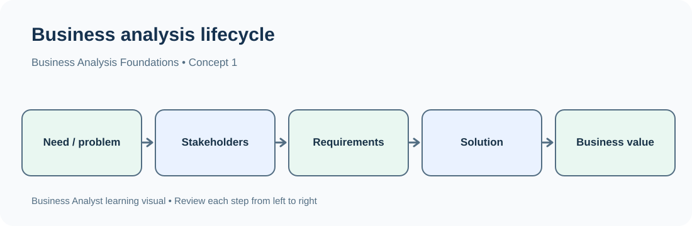
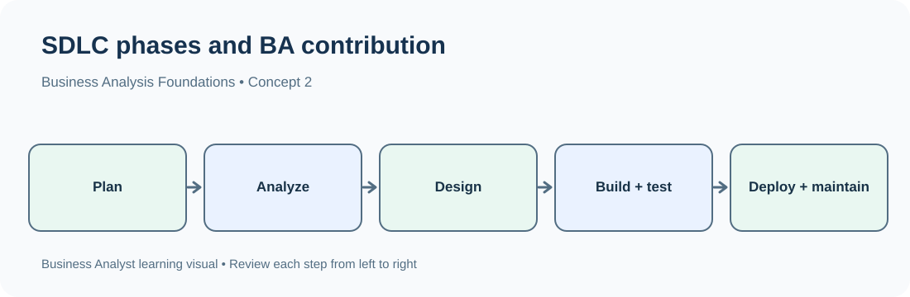

# Day 1 — Business Analysis Foundations

## Module 1: Business Analysis Foundations

**Approved syllabus topic:** Business analysis, Business Analyst responsibilities, SDLC and project lifecycle  
**Learning level:** Beginner to advanced foundation  
**Suggested study time:** 2–3 hours  
**Prerequisites:** No prior Business Analyst or software-development knowledge is required.

---

# 1. Learning Objectives

By the end of this lesson, you should be able to:

- Explain what business analysis means and why organizations need it.
- Define the role of a Business Analyst (BA).
- Describe the responsibilities of a BA during a software or business-change initiative.
- Distinguish a Business Analyst from a Project Manager, Product Owner, Developer, Tester and Data Analyst.
- Explain the Software Development Life Cycle (SDLC).
- Identify the main SDLC phases and the BA's contribution to each phase.
- Explain the difference between a project lifecycle and an SDLC.
- Recognize common software-development approaches, including Waterfall and Agile, at a foundational level.

# 2. What Is Business Analysis?

Business analysis is the work of understanding a business need or problem and helping an organization identify a suitable change or solution.

A Business Analyst studies how the business currently works, understands what stakeholders need, clarifies requirements, and communicates those requirements to the people who design, build, test or deliver the solution.

### Simple example

Imagine an online shopping company receives many complaints because customers cannot easily track their orders.

The company knows that something needs to improve, but it may not yet know exactly what should change.

A Business Analyst may:

1. Speak with customers, customer-support staff and managers.
2. Understand how order tracking currently works.
3. Identify where customers experience difficulty.
4. Document what users need from an improved tracking service.
5. Discuss possible solutions with the technical team.
6. Help clarify requirements during development.
7. Support the team in checking whether the delivered solution meets the agreed needs.

The BA does not simply tell developers to “make tracking better.” The BA helps turn that broad need into clear, understandable and testable requirements.

### Business analysis in one flow

```text
Business Need or Problem
          |
          v
Understand the Current Situation
          |
          v
Identify Stakeholders and Their Needs
          |
          v
Analyze and Clarify Requirements
          |
          v
Evaluate Possible Solutions
          |
          v
Support Delivery and Validation
          |
          v
Check Whether the Business Need Is Addressed
```

### Important terms

| Term | Meaning | Example |
|---|---|---|
| Business need | A change or result the organization needs | Customers need a simpler way to track orders |
| Business problem | A difficulty or opportunity affecting the organization | Customers frequently contact support for order updates |
| Stakeholder | A person or group affected by, interested in or involved in a change | Customers, support agents, operations manager |
| Requirement | A documented need or condition the solution must satisfy | Customers must be able to view the latest order status |
| Solution | A product, service, process or change that addresses a need | An order-tracking page |
| Business value | A useful result delivered to the organization or its customers | Fewer tracking-related support calls |

**Remember:** Business analysis is not limited to software. It can also be used to improve business processes, services, policies, operations and organizational decisions.

# 3. Why Do Organizations Need Business Analysts?

Organizations often know that a problem exists but do not have a complete understanding of its causes, effects or the change required.

Without proper analysis, teams may build something that works technically but does not solve the actual business need.

### Example: A banking application

A bank receives feedback that customers find its account-opening process difficult.

Different groups may describe the issue differently:

- Customers: “The application process takes too long.”
- Branch employees: “Customers frequently submit incomplete forms.”
- Operations team: “Manual verification creates delays.”
- Management: “We need to improve customer onboarding.”

These statements describe different perspectives on the same broad business situation.

The BA helps understand these perspectives and establish what the organization actually needs.

### What can happen without business analysis?

| Situation | Possible consequence |
|---|---|
| Requirements are unclear | Developers build the wrong functionality |
| Stakeholders are not consulted | Important user needs are missed |
| Scope is not understood | Additional work appears unexpectedly |
| Requirements keep changing without analysis | Delays and cost increases |
| Acceptance conditions are missing | The team disagrees about whether work is complete |
| Business processes are not understood | A new system reproduces existing problems |
| Communication is poor | Business and technical teams misunderstand each other |

### Value provided by business analysis

- **Clarity:** Converts unclear requests into understandable requirements.
- **Alignment:** Helps stakeholders agree on the business need and expected result.
- **Reduced rework:** Identifies misunderstandings earlier.
- **Better decisions:** Helps compare possible solutions and their consequences.
- **Process improvement:** Identifies unnecessary steps, delays and duplication.
- **Validation:** Helps check whether the delivered solution addresses the original need.

# 4. Who Is a Business Analyst?

A Business Analyst is a professional who connects business stakeholders with the people responsible for delivering a change or solution.

The BA understands business needs and communicates them in a form that relevant teams can use.

### Simple understanding

```text
BUSINESS SIDE                         DELIVERY SIDE

Business users                       Developers
Managers             Business        Testers
Customers     <----> Analyst <---->  Designers
Operations teams                     Technical teams
```

The BA helps both sides understand the same problem and work toward an agreed outcome.

A BA is not necessarily the manager of the delivery team and is not necessarily the person who writes the software code.

## 4.1 Main responsibilities of a Business Analyst

### 1. Understand business needs

The BA identifies why a change is being requested.

Example:

A retail company asks for a new return-management feature.

The BA investigates:

- What difficulty are customers facing?
- How are returns handled today?
- Which teams are involved?
- What should improve after the change?

### 2. Identify stakeholders

The BA identifies people and groups who may:

- Request the change.
- Use the solution.
- Approve the requirements.
- Build or test the solution.
- Be affected by the change.

Example: Customers, customer-support agents, warehouse staff, finance team and management.

### 3. Gather requirements

Requirements are gathered through methods such as:

- Interviews.
- Workshops.
- Questionnaires.
- Observation.
- Reviewing existing documents and systems.

Example:

A support manager explains that agents need to see the customer's order history while handling a complaint.

### 4. Analyze requirements

The BA checks whether requirements are clear, consistent, realistic, relevant and sufficiently detailed.

Unclear requirement:

> The application should be fast.

Clearer requirement:

> The order-history page should display the customer's most recent 10 orders within 3 seconds under the agreed normal operating conditions.

The exact performance target should be confirmed with the relevant stakeholders and technical team. It should not be invented by the BA.

### 5. Document requirements

The BA records requirements so stakeholders and delivery teams can review and use them.

Common documentation includes:

| Document | Purpose |
|---|---|
| Business Requirements Document (BRD) | Records business needs, objectives and high-level requirements |
| Functional requirements | Describe what the solution must do |
| Non-functional requirements | Describe quality attributes and operating constraints |
| User stories | Express a need from a user's perspective, commonly in Agile teams |
| Use cases | Describe interactions between an actor and a system to achieve a goal |
| Process flow | Shows the sequence of activities in a process |
| Requirements Traceability Matrix (RTM) | Links requirements to design, development and testing evidence |

These documents are not all mandatory for every project. The team chooses documentation appropriate to the project, organization and delivery approach.

### 6. Communicate with stakeholders

The BA explains requirements, asks questions, records decisions and resolves misunderstandings.

Example:

A manager requests a feature that allows customers to cancel orders.

The BA clarifies:

- Can every order be cancelled?
- Is cancellation allowed after dispatch?
- Does cancellation require approval?
- How should refunds be handled?
- Should the customer receive a notification?

### 7. Support the development team

The BA clarifies the expected behavior when developers or designers have questions.

Example:

A developer asks what should happen if a customer tries to cancel an already delivered order.

The BA checks the agreed business rules and obtains clarification from the appropriate stakeholder if the rule has not been defined.

### 8. Support testing and validation

The BA helps confirm that the solution satisfies the agreed requirements.

Example:

Requirement: A customer can view the current status of an order.

The BA may help define expected behavior for statuses such as:

- Order placed.
- Confirmed.
- Packed.
- Shipped.
- Out for delivery.
- Delivered.
- Cancelled.

The BA may participate in User Acceptance Testing (UAT), where business representatives check whether the solution supports their needs.

### 9. Manage requirement changes

Business needs can change during a project.

The BA helps understand:

- What is changing?
- Why is it changing?
- Which existing requirements are affected?
- What is the impact on cost, schedule, scope and other requirements?
- Who needs to review or approve the change?

A change should be assessed and communicated rather than silently added to the work.

## 4.2 A Business Analyst's responsibilities across a project

| Project stage | Typical BA contribution |
|---|---|
| Initial understanding | Understand the business need and expected value |
| Discovery | Identify stakeholders and investigate the current situation |
| Requirements | Elicit, analyze, document and validate requirements |
| Solution design | Clarify requirements and discuss solution options |
| Development | Answer requirement questions and manage clarifications |
| Testing | Help define acceptance conditions and support UAT |
| Delivery | Confirm that agreed requirements have been addressed |
| After implementation | Help evaluate whether the intended business outcome is being achieved |

# 5. Skills Required for a Business Analyst

A BA needs a combination of communication, analytical, business and technical-understanding skills.

| Skill | What it means | Practical example |
|---|---|---|
| Communication | Explain information clearly and listen carefully | Interviewing a department manager |
| Analytical thinking | Break a broad issue into smaller questions | Investigating why order delays increased |
| Problem-solving | Compare possible ways to address an issue | Evaluating options for reducing manual work |
| Documentation | Record requirements accurately | Writing functional requirements |
| Stakeholder management | Work with people who have different needs | Handling conflicting customer and operations requirements |
| Business understanding | Understand how an organization creates value | Understanding a bank's loan approval process |
| Process understanding | Recognize activities, decisions and handoffs | Mapping an employee onboarding process |
| Basic technical knowledge | Understand how software systems and teams work | Discussing an API requirement with developers |
| Attention to detail | Notice missing or contradictory information | Identifying inconsistent cancellation rules |
| Presentation | Communicate findings and recommendations | Presenting process improvements to management |

### Does a Business Analyst need coding?

Not every BA role requires programming.

However, technical knowledge can be useful, especially in IT Business Analyst or Business Systems Analyst roles.

| Knowledge area | Why it helps |
|---|---|
| Excel | Analyze and organize business data |
| SQL | Retrieve information from databases |
| APIs | Understand communication between systems |
| JSON | Understand a common data-exchange format |
| Databases | Understand how business information is stored |
| SDLC | Understand how software is developed and delivered |
| Agile and Scrum | Understand how delivery teams organize work |
| Jira | Understand and track requirements and delivery work |

The depth required depends on the job. A business-process BA may need less technical knowledge than a technical or systems BA.

# 6. Types of Business Analyst Roles

The title Business Analyst can describe different kinds of work.

| Role | Main focus | Example |
|---|---|---|
| Business Analyst | Business needs, requirements and solutions | Improving a customer-service process |
| IT Business Analyst | Requirements for IT systems | Defining requirements for a banking application |
| Business Systems Analyst | Interaction between business processes and information systems | Understanding how an order system connects to inventory |
| Functional Analyst | Functional behavior of a particular system or application | Defining how a loan-approval module should behave |
| Data/Business Analyst | Business questions answered using data | Analyzing monthly sales performance |
| Process Analyst | Business processes and operational improvement | Reducing delays in invoice processing |

**Important:** Job titles and responsibilities vary between organizations. Always read the actual job description rather than assuming every company uses these titles in exactly the same way.

# 7. Business Analyst vs Other Roles

A BA works with several other roles, but their responsibilities are different.

## 7.1 Business Analyst vs Project Manager

| Business Analyst | Project Manager |
|---|---|
| Focuses on business needs and requirements | Focuses on managing project delivery |
| Understands what the business needs | Coordinates how the project is delivered |
| Analyzes processes and requirements | Manages schedule, resources and delivery risks |
| Clarifies expected solution behavior | Tracks project progress and dependencies |
| Helps validate business requirements | Oversees project execution and coordination |

**Example:** For a new banking application, the BA clarifies the account-opening requirements. The Project Manager coordinates the timeline, resources, risks and overall delivery.

## 7.2 Business Analyst vs Product Owner

| Business Analyst | Product Owner |
|---|---|
| Analyzes needs and requirements | Maximizes product value |
| Helps clarify stakeholder needs | Makes product backlog decisions |
| Documents and validates requirements | Orders and prioritizes the product backlog |
| Supports communication and analysis | Represents product priorities to the Scrum Team |

In some organizations, a BA may perform some Product Owner activities. The responsibilities depend on the team's structure.

## 7.3 Business Analyst vs Developer

| Business Analyst | Developer |
|---|---|
| Defines and clarifies requirements | Implements software functionality |
| Understands business rules | Writes and maintains code |
| Explains expected system behavior | Builds the technical solution |
| Discusses requirements with stakeholders | Discusses implementation with the delivery team |

## 7.4 Business Analyst vs Tester / QA Engineer

| Business Analyst | Tester / QA Engineer |
|---|---|
| Clarifies what the solution should do | Checks whether the solution behaves correctly |
| Defines or supports acceptance criteria | Designs and executes tests |
| Explains business rules | Identifies and reports defects |
| Helps validate business suitability | Verifies software quality against expected behavior |

Both may work together during UAT and requirement validation.

## 7.5 Business Analyst vs Data Analyst

| Business Analyst | Data Analyst |
|---|---|
| Focuses on business needs, requirements and change | Focuses on analyzing data to answer questions |
| May analyze processes and systems | Commonly analyzes datasets and trends |
| Uses interviews, workshops and documentation | Uses SQL, spreadsheets, statistics and visualization tools |
| May use data as one source of evidence | Uses data analysis as a central part of the role |

There can be overlap. Some Business Analyst positions require substantial data analysis, while others focus more on requirements and processes.

# 8. What Is SDLC?

SDLC stands for **Software Development Life Cycle**.

It is a structured way of planning, creating, testing, delivering and maintaining software.

A software application is not normally created by writing code randomly. Teams work through activities that help them understand what to build, build it, check it and support it after release.

### Example

A bank wants to develop a mobile application feature that lets customers download account statements.

The team must:

1. Understand what customers and the bank need.
2. Define the expected feature behavior.
3. Design how the feature will work.
4. Develop the feature.
5. Test it.
6. Release it to users.
7. Maintain and improve it.

These activities form part of the SDLC.

## 8.1 Main phases of SDLC

A commonly used SDLC view has the following phases:

```text
1. Planning
     |
     v
2. Requirements Analysis
     |
     v
3. Design
     |
     v
4. Development
     |
     v
5. Testing
     |
     v
6. Deployment
     |
     v
7. Maintenance
```

Different organizations and methodologies may combine, rename or repeat phases. This is a general learning model, not a rule that every team must follow identically.

## 8.2 Phase 1 — Planning

**Purpose:** Understand the need for the software initiative and decide whether and how to proceed.

Typical activities:

- Understand the business opportunity or problem.
- Identify high-level objectives.
- Identify major stakeholders.
- Consider feasibility, risks, time and cost.
- Establish an initial scope.

Example:

A bank wants to allow customers to download statements through its mobile application.

Initial planning questions:

- Why is the feature needed?
- Who will use it?
- What business outcome is expected?
- Which systems may be affected?
- Is the change technically and operationally feasible?

**BA contribution:** Help clarify the business need, identify stakeholders, capture high-level requirements and support feasibility discussions.

## 8.3 Phase 2 — Requirements Analysis

**Purpose:** Understand and document what stakeholders need from the solution.

Typical activities:

- Conduct stakeholder interviews.
- Review existing processes and documents.
- Identify functional and non-functional requirements.
- Analyze business rules.
- Resolve ambiguity and conflicts.
- Validate requirements with stakeholders.

Example requirements for statement download:

- A logged-in customer can select an account.
- A customer can select an available statement period.
- The system provides the statement in an agreed format.
- Only authorized customers can access their own statements.

**BA contribution:** This is a major area of BA work. The BA elicits, analyzes, documents, prioritizes and validates requirements.

## 8.4 Phase 3 — Design

**Purpose:** Decide how the proposed solution should be structured and how users or systems will interact with it.

Design may include:

- User-interface design.
- System architecture.
- Database design.
- Process design.
- API and integration design.
- Security and access design.

Example:

For statement download, designers may prepare a screen showing:

1. Account selection.
2. Statement period selection.
3. Download action.
4. Download status or error message.

The technical team decides how the application will retrieve and generate the statement.

**BA contribution:** Clarify business rules, review designs against requirements, explain user needs and identify missing behavior. The BA does not necessarily create the technical architecture.

## 8.5 Phase 4 — Development

**Purpose:** Build the software according to the agreed requirements and design.

Typical activities:

- Frontend development.
- Backend development.
- Database implementation.
- API integration.
- Code review.
- Developer-level testing.

Example:

Developers implement the statement-selection screen and the service that retrieves the statement.

**BA contribution:**

- Answer questions about requirements.
- Clarify business rules.
- Explain expected behavior.
- Review requirement-related decisions.
- Communicate approved changes to relevant stakeholders.

The BA is not normally responsible for writing all application code.

## 8.6 Phase 5 — Testing

**Purpose:** Check whether the software works as expected and identify defects.

Common testing levels and types include:

| Testing type | Basic meaning | Example |
|---|---|---|
| Unit testing | Checks a small piece of code | Testing a date-validation function |
| Integration testing | Checks whether components work together | Checking whether the app can retrieve statement data from a service |
| System testing | Checks the complete system | Testing the statement-download feature in the application |
| User Acceptance Testing (UAT) | Checks whether the solution meets business needs | A bank representative verifies that customers can download the correct statement |

**BA contribution:**

- Clarify expected business behavior.
- Help define acceptance criteria.
- Review test scenarios for business coverage.
- Support UAT.
- Help determine whether a reported issue is a defect or an unclear requirement.
- Confirm that business requirements have been addressed.

## 8.7 Phase 6 — Deployment

**Purpose:** Make the software available in the target environment or to intended users.

Typical activities:

- Prepare the release.
- Configure production environments.
- Migrate data if required.
- Perform deployment checks.
- Communicate release information.
- Monitor the initial release.

Example:

The bank releases statement download to customers through a mobile application update.

**BA contribution:**

- Help confirm that required business conditions are met.
- Support release-related stakeholder communication.
- Help prepare user or operational information.
- Clarify any business questions that arise during rollout.

## 8.8 Phase 7 — Maintenance

**Purpose:** Keep the software useful and reliable after release.

Typical activities:

- Fix defects.
- Monitor performance.
- Address user feedback.
- Apply security and compatibility updates.
- Improve existing features.
- Analyze new business needs.

Example:

Customers report that they cannot download statements for older accounts. The team investigates the issue and may define a change to support those accounts.

**BA contribution:**

- Understand feedback and new needs.
- Analyze the impact of proposed changes.
- Clarify updated requirements.
- Help prioritize improvements.
- Support validation of fixes and enhancements.

## 8.9 SDLC summary table

| Phase | Main question | Main outcome | BA's contribution |
|---|---|---|---|
| Planning | Why are we doing this? | Initial direction and scope | Clarify business need |
| Requirements Analysis | What is needed? | Analyzed requirements | Elicit and document requirements |
| Design | How should the solution work? | Solution design | Clarify and review business needs |
| Development | Can we build it? | Working software components | Resolve requirement questions |
| Testing | Does it work as expected? | Test results and defect information | Support business validation and UAT |
| Deployment | Can users access it? | Released solution | Support readiness and communication |
| Maintenance | Does it continue to meet needs? | Supported and improved software | Analyze feedback and changes |

# 9. Types of SDLC Methodologies

SDLC describes the activities involved in software delivery. A methodology or delivery approach describes how a team organizes and performs those activities.

Two foundational approaches are Waterfall and Agile.

## 9.1 Waterfall model

Waterfall is a sequential approach in which work generally moves through defined phases.

```text
Requirements
     |
     v
Design
     |
     v
Development
     |
     v
Testing
     |
     v
Deployment
     |
     v
Maintenance
```

A phase is generally completed and reviewed before the next phase proceeds.

### Example

A company is replacing a well-understood internal reporting system. The requirements are relatively stable and the organization wants formal documentation and stage approvals.

A sequential approach may be suitable, depending on the project's circumstances.

### Characteristics

- Phases are planned in sequence.
- Requirements and design are often documented in detail early.
- Formal reviews and approvals may occur between phases.
- Changes later in the process can be more expensive or disruptive.
- The final solution may not be available to users until later in the project.

### BA responsibilities in Waterfall

- Gather and document requirements in detail.
- Confirm requirements with stakeholders.
- Maintain requirement documentation.
- Support formal reviews and approvals.
- Clarify requirements during design, development and testing.
- Help verify that the delivered solution matches the approved requirements.

## 9.2 Agile approach

Agile is an approach to delivering value through iterative work, frequent feedback and adaptation.

Instead of waiting until every feature is completed, a team delivers work in smaller increments and learns from feedback.

```text
Product Backlog
      |
      v
Plan a Small Set of Work
      |
      v
Design and Develop
      |
      v
Test
      |
      v
Review with Stakeholders
      |
      v
Feedback and Adaptation
      |
      +------> Next Iteration
```

### Example

An e-commerce company wants to improve its checkout experience.

Rather than waiting to release every planned improvement together, the team may deliver changes in increments:

- First increment: clearer delivery-address selection.
- Second increment: improved payment error messages.
- Third increment: better order confirmation.

The exact sequence is decided by the team and product priorities.

### Characteristics

- Work is delivered in smaller increments.
- Stakeholder feedback is collected regularly.
- Requirements can evolve as the team learns.
- Teams collaborate frequently.
- Progress is reviewed throughout delivery.

### BA responsibilities in Agile

- Help understand and clarify user needs.
- Write or refine user stories where the team uses them.
- Define or clarify acceptance criteria.
- Participate in backlog refinement and planning as appropriate.
- Answer questions during development.
- Gather feedback and help clarify changing needs.
- Support acceptance and validation.

**Important:** Agile does not mean “no planning” or “no documentation.” It means planning and documentation are adapted to support iterative delivery and useful communication.

## 9.3 Waterfall vs Agile

| Comparison | Waterfall | Agile |
|---|---|---|
| Work organization | Generally sequential phases | Iterative and incremental work |
| Requirements | Often defined in greater detail early | Can evolve through feedback |
| Delivery | Often delivered after major phases | Working increments delivered regularly |
| Feedback | Commonly concentrated at formal reviews and milestones | Collected frequently |
| Change | Can be more difficult later in the process | Adaptation is built into the approach |
| Planning | More upfront planning is common | Planning is repeated as work progresses |
| Documentation | Often extensive and phase-based | Documentation is created as useful for the work |
| Best fit | May suit stable, well-understood requirements | May suit changing needs and frequent feedback |

Neither approach is automatically best for every project. The choice depends on requirements, risks, regulations, stakeholders, technology and delivery constraints.

# 10. What Is a Project Lifecycle?

A project lifecycle is the set of stages a project passes through from its beginning to its completion.

It describes how the project is initiated, planned, carried out, monitored and closed.

A common project lifecycle view is:

```text
1. Initiation
      |
      v
2. Planning
      |
      v
3. Execution
      |
      v
4. Monitoring and Controlling
      |
      v
5. Closure
```

These stages describe project management and project progression. They are not identical to the technical phases of the SDLC.

## 10.1 Initiation

**Purpose:** Establish why the project should exist and whether it should proceed.

Typical activities:

- Identify the business need.
- Define high-level objectives.
- Identify key stakeholders.
- Establish initial scope.
- Assess whether the initiative is worth investigating.
- Obtain authorization to proceed, where required.

Example:

A retail organization proposes a customer self-service portal because customers frequently contact support for basic account information.

The organization investigates the need and decides whether to initiate the project.

**BA contribution:** Help explain the business need, identify stakeholders and capture high-level requirements.

## 10.2 Planning

**Purpose:** Decide how the project will be organized and delivered.

Typical activities:

- Define scope and deliverables.
- Estimate time and cost.
- Identify resources.
- Plan activities and milestones.
- Identify risks and dependencies.
- Decide how progress will be monitored.

**BA contribution:** Help clarify requirements, scope, assumptions, dependencies and requirement-related risks.

## 10.3 Execution

**Purpose:** Perform the planned work and create the project's deliverables.

Typical activities:

- Coordinate team activities.
- Design and develop the solution.
- Communicate with stakeholders.
- Produce project deliverables.
- Manage day-to-day work.

**BA contribution:** Clarify requirements, communicate with stakeholders, support solution discussions and help keep the work aligned with business needs.

## 10.4 Monitoring and Controlling

**Purpose:** Compare actual progress with the plan and respond when differences or problems occur.

Typical activities:

- Track progress.
- Monitor scope, schedule and cost.
- Identify risks and issues.
- Review quality.
- Evaluate change requests.
- Communicate project status.

**BA contribution:** Analyze the impact of requirement changes, clarify scope, maintain requirement information and support business decisions.

## 10.5 Closure

**Purpose:** Formally complete the project or project phase.

Typical activities:

- Confirm deliverables.
- Obtain required acceptance.
- Complete handover.
- Record lessons learned.
- Close outstanding project activities.
- Release project resources.

**BA contribution:** Help confirm that agreed business requirements have been addressed, support acceptance and contribute to lessons learned.

# 11. Project Lifecycle vs SDLC

This is an important distinction.

| Project Lifecycle | SDLC |
|---|---|
| Describes the stages of managing and completing a project | Describes the stages of developing and maintaining software |
| Focuses on project objectives, planning, execution and closure | Focuses on software requirements, design, development, testing and maintenance |
| Can apply to software and non-software projects | Specifically concerns software systems |
| Includes project coordination, resources, schedule and closure | Includes technical and product-delivery activities |
| Common stages include initiation, planning, execution, monitoring and closure | Common phases include planning, requirements, design, development, testing, deployment and maintenance |

### Example: Developing a banking application

**Project lifecycle view:**

- Initiation: Decide to develop the application.
- Planning: Estimate cost, schedule, resources and risks.
- Execution: Coordinate the work to deliver the application.
- Monitoring and controlling: Track progress, issues and changes.
- Closure: Complete the project and hand over the deliverables.

**SDLC view:**

- Requirements: Define what the application must do.
- Design: Decide how the application will work.
- Development: Build the application.
- Testing: Check its behavior.
- Deployment: Release it.
- Maintenance: Support and improve it.

The two views are related and operate together. A software project is managed through a project lifecycle while its software is developed through SDLC activities.

# 12. How the Business Analyst Works with the Project Team

A BA rarely works alone. The BA collaborates with business and technical roles.

| Team member | Main responsibility | How the BA works with them |
|---|---|---|
| Business Sponsor | Supports and authorizes the business initiative | Understands objectives and expected value |
| Stakeholder / Business User | Explains business needs and uses the solution | Gathers and validates requirements |
| Project Manager | Coordinates project delivery | Communicates scope, requirements and changes |
| Product Owner | Makes product-value and backlog-priority decisions in Scrum | Clarifies needs and supports backlog understanding |
| UX/UI Designer | Designs user experiences and interfaces | Explains user needs and reviews designs |
| Developer | Builds software | Clarifies expected functionality and business rules |
| Tester / QA Engineer | Checks software quality | Clarifies requirements and expected results |
| Technical Lead / Architect | Guides technical design and architecture | Discusses constraints and solution feasibility |

### Example: Online food-ordering application

Suppose a company wants customers to track food orders.

- The business sponsor explains why the feature matters.
- Customers and restaurant staff explain their needs.
- The BA documents the expected order-tracking behavior.
- The Product Owner or relevant decision-maker prioritizes the work.
- The designer creates the screen experience.
- Developers implement the feature.
- Testers check the behavior.
- Business users validate whether the feature meets their needs.

The BA helps maintain a shared understanding across these participants.

# 13. End-to-End Industry Scenario

## Scenario: Improving a hospital appointment-booking process

A hospital receives many calls from patients who want to book, reschedule or cancel appointments.

Management is considering an online appointment-booking system.

### Step 1: Understand the business need

The BA asks:

- What difficulties do patients experience?
- How are appointments currently booked?
- Which hospital departments are involved?
- What problems do reception staff face?
- What does management want to improve?

### Step 2: Identify stakeholders

| Stakeholder | Interest or responsibility |
|---|---|
| Patients | Book, reschedule and cancel appointments |
| Reception staff | Manage appointment requests |
| Doctors | View appointment schedules |
| Hospital management | Improve service and operations |
| IT team | Develop and support the system |

### Step 3: Understand the current process

A simplified current process might be:

```text
Patient Calls Hospital
        |
        v
Reception Checks Availability
        |
        v
Is a Slot Available?
      /   \
    Yes    No
     |      |
     v      v
Book Slot  Suggest Another Slot
     |
     v
Inform Patient
```

### Step 4: Identify high-level requirements

Possible requirements to investigate:

- Patients should be able to view available appointment slots.
- Patients should be able to request an appointment.
- Reception staff should be able to manage appointments.
- The system should prevent conflicting bookings.
- Patients should receive booking confirmation.

These are initial examples. The BA must confirm detailed business rules, permissions, notification behavior and exceptions with stakeholders.

### Step 5: Work through the SDLC

| SDLC phase | Example activity |
|---|---|
| Planning | Confirm the need and initial feasibility |
| Requirements | Understand booking rules and user needs |
| Design | Design appointment screens and system behavior |
| Development | Build the booking functionality |
| Testing | Check booking, cancellation and conflict scenarios |
| Deployment | Release the system |
| Maintenance | Fix issues and support improvements |

### Step 6: Work through the project lifecycle

| Project stage | Example activity |
|---|---|
| Initiation | Approve investigation of the appointment system |
| Planning | Plan resources, scope, schedule and risks |
| Execution | Coordinate analysis, design, development and delivery |
| Monitoring and controlling | Track progress, issues and changes |
| Closure | Confirm completion and hand over the solution |

### Key learning

The BA helps the organization move from a broad request—“We need online appointments”—to an understood business need and clear requirements that a delivery team can act on.

# 14. Common Misunderstandings

| Misunderstanding | Correct understanding |
|---|---|
| A BA only writes documents | A BA also investigates needs, communicates, analyzes and supports validation |
| A BA must be a programmer | Programming is not mandatory for every BA role |
| A BA decides everything | Decisions and approvals are shared among stakeholders and accountable roles |
| A BA and Project Manager are the same | Their primary responsibilities are different |
| Agile means there is no documentation | Agile teams create useful documentation appropriate to their work |
| SDLC and project lifecycle are the same | SDLC focuses on software delivery; project lifecycle focuses on managing the project |
| Requirements are always fixed at the beginning | Requirements may be clarified or changed as the team learns |
| Testing is only the tester's responsibility | Testing is a team activity; the BA supports business validation and requirement clarification |
| The BA always creates the solution design | The BA contributes business understanding; technical and UX design responsibilities may belong to other specialists |

# 15. Important Terminology — Day 1 Revision

| Term | Full form / meaning |
|---|---|
| BA | Business Analyst |
| SDLC | Software Development Life Cycle |
| Agile | An approach emphasizing iterative delivery, collaboration and adaptation |
| Waterfall | A sequential development approach |
| Stakeholder | A person or group affected by or involved in a change |
| Requirement | A need or condition that a solution must satisfy |
| BRD | Business Requirements Document |
| FR | Functional Requirement |
| NFR | Non-Functional Requirement |
| UAT | User Acceptance Testing |
| QA | Quality Assurance |
| RTM | Requirements Traceability Matrix |
| UI | User Interface |
| UX | User Experience |
| Scope | The boundaries of the work or solution |
| Deliverable | A specific output produced by a project |
| Feasibility | Whether an initiative is practical and achievable under its constraints |
| Deployment | Releasing software into an environment where it can be used |
| Maintenance | Supporting and improving software after release |

---

# 16. Interview Questions and Answers

## Q1. What is business analysis?

**Answer:**

Business analysis is the process of understanding business needs, identifying problems or opportunities, analyzing requirements and helping an organization determine suitable solutions.

A Business Analyst communicates with stakeholders, documents requirements and supports the delivery team to ensure that the solution addresses the business need.

**Example:** If an e-commerce company has a high number of abandoned carts, a BA investigates the checkout process, gathers stakeholder requirements and helps define improvements.

**Follow-up question:** Is business analysis limited to software projects?

**Answer:** No. It can also be used for business-process improvement, operational changes, service improvement and organizational decisions.

## Q2. Who is a Business Analyst?

**Answer:**

A Business Analyst is a professional who connects business stakeholders with solution-delivery teams.

The BA understands business needs, gathers and analyzes requirements, documents expected behavior and supports validation of the solution.

**Example:** In a banking project, the BA understands customer and bank requirements for an account-opening feature and communicates them to the development and testing teams.

**Follow-up question:** Does a BA need coding skills?

**Answer:** Not necessarily. Coding is not required for every BA position, although technical knowledge such as SQL, APIs and databases can be valuable in IT-focused roles.

## Q3. What are the main responsibilities of a Business Analyst?

**Answer:**

The main responsibilities include:

1. Understanding business needs.
2. Identifying stakeholders.
3. Gathering requirements.
4. Analyzing and prioritizing requirements.
5. Documenting requirements.
6. Communicating with stakeholders and technical teams.
7. Supporting solution discussions.
8. Supporting testing and UAT.
9. Analyzing requirement changes.

**Follow-up question:** Which responsibility is especially important?

**Answer:** All are connected, but understanding the actual business need is fundamental. If the need is misunderstood, even correctly implemented requirements may produce the wrong outcome.

## Q4. What is SDLC?

**Answer:**

SDLC stands for Software Development Life Cycle. It is a structured approach to planning, designing, developing, testing, deploying and maintaining software.

Common phases are:

1. Planning.
2. Requirements analysis.
3. Design.
4. Development.
5. Testing.
6. Deployment.
7. Maintenance.

**Example:** When a bank develops a mobile banking feature, the team first understands the requirements, designs the feature, develops it, tests it, releases it and maintains it.

**Follow-up question:** Does every organization follow exactly the same SDLC phases?

**Answer:** No. The phases and their names can differ depending on the organization, project and development methodology.

## Q5. What is the role of a BA in SDLC?

**Answer:**

The BA contributes throughout the software lifecycle.

- During planning, the BA helps understand the business need.
- During requirements analysis, the BA gathers and documents requirements.
- During design, the BA clarifies business rules and reviews the solution against requirements.
- During development, the BA answers requirement-related questions.
- During testing, the BA supports acceptance criteria and UAT.
- During deployment, the BA supports business readiness and communication.
- During maintenance, the BA analyzes feedback and new requirements.

**Follow-up question:** Is the BA responsible for developing the software?

**Answer:** Usually not. Developers implement the software. The BA focuses on business needs, requirements and communication.

## Q6. What is the difference between a Business Analyst and a Project Manager?

**Answer:**

A Business Analyst primarily focuses on understanding business needs, requirements and suitable solutions.

A Project Manager primarily focuses on coordinating project delivery, including schedule, resources, risks, dependencies and progress.

**Example:** For a new customer portal, the BA clarifies what customers should be able to do. The Project Manager coordinates the work required to deliver the portal.

**Follow-up question:** Can one person perform both roles?

**Answer:** In some organizations, responsibilities can overlap, especially in smaller teams. However, the roles have different primary focuses.

## Q7. What is the difference between Waterfall and Agile?

**Answer:**

Waterfall generally organizes work into sequential phases. Agile organizes work into smaller iterations or increments and uses frequent feedback to adapt.

| Waterfall | Agile |
|---|---|
| Sequential phases | Iterative and incremental delivery |
| More upfront definition is common | Requirements can evolve |
| Feedback often occurs at milestones | Feedback is collected regularly |
| Changes may be harder later | Adaptation is part of the approach |

**Follow-up question:** Which approach is better?

**Answer:** Neither is always better. The choice depends on requirement stability, project risks, regulations, stakeholder availability and delivery needs.

## Q8. What is a project lifecycle?

**Answer:**

A project lifecycle is the sequence of stages used to manage a project from initiation to closure.

A common model includes:

1. Initiation.
2. Planning.
3. Execution.
4. Monitoring and controlling.
5. Closure.

**Example:** For a hospital appointment system, initiation establishes the need, planning defines how the work will be managed, execution delivers the work, monitoring tracks progress and closure completes the project.

**Follow-up question:** Is a project lifecycle the same as SDLC?

**Answer:** No. A project lifecycle focuses on managing the project, while SDLC focuses on developing and maintaining software.

## Q9. Explain the difference between a Business Analyst and a Data Analyst.

**Answer:**

A Business Analyst primarily understands business needs, processes and requirements. A Data Analyst primarily works with data to identify patterns, answer questions and support decisions.

A BA may use data as part of requirement analysis, and a Data Analyst may work closely with business stakeholders. Their responsibilities can overlap depending on the organization.

**Follow-up question:** Can a Business Analyst use SQL?

**Answer:** Yes. SQL can help a BA retrieve and inspect business data, validate assumptions and answer requirement-related questions.

## Q10. What happens if requirements are not clear?

**Answer:**

Unclear requirements can cause:

- Different interpretations among stakeholders.
- Incorrect implementation.
- Rework and delays.
- Disagreements during testing.
- Increased project cost.
- A solution that does not meet business needs.

A BA helps prevent these problems by asking clarifying questions, documenting requirements, confirming business rules and validating the requirements with stakeholders.

**Follow-up question:** How do you check whether a requirement is clear?

**Answer:** Check whether it is understandable, specific, consistent, feasible, relevant and testable. Confirm that stakeholders agree on its meaning.

## Q11. Why is stakeholder communication important for a BA?

**Answer:**

Different stakeholders have different responsibilities, expectations and perspectives. Communication helps the BA understand those perspectives, resolve misunderstandings and obtain agreement on requirements.

**Example:** Customers may want flexible appointment booking, while hospital staff need rules that prevent conflicting appointments. The BA helps clarify and document the needs and constraints.

**Follow-up question:** What would you do if two stakeholders disagree?

**Answer:** Understand the reason behind each position, document the conflicting needs, identify business impact and constraints, and facilitate a discussion with the appropriate decision-makers. The BA should not invent a decision on behalf of accountable stakeholders.

## Q12. What is User Acceptance Testing?

**Answer:**

User Acceptance Testing, or UAT, is a validation activity in which business users or their representatives check whether a solution meets agreed business needs and acceptance conditions.

**Example:** Hospital staff verify that the appointment system allows them to view bookings, manage cancellations and avoid conflicting appointments according to the agreed rules.

**Follow-up question:** Is UAT the same as unit testing?

**Answer:** No. Unit testing checks individual pieces of code, while UAT checks whether the solution is acceptable for its intended business use.

## Q13. What is the difference between a functional and a non-functional requirement?

**Answer:**

A functional requirement describes what the system must do.

A non-functional requirement describes a quality attribute or constraint, such as performance, security, availability or usability.

**Examples:**

- Functional: A customer can download an account statement.
- Non-functional: The statement-download service must meet an agreed response-time target under specified conditions.

**Follow-up question:** Can a system have functional requirements without non-functional requirements?

**Answer:** A system may have documented functional requirements while non-functional requirements are missing, but that creates a risk. Quality attributes and constraints should also be considered.

## Q14. What is business value?

**Answer:**

Business value is the benefit or useful outcome that a change provides to an organization, its customers or other stakeholders.

Examples include:

- Reduced processing time.
- Better customer experience.
- Fewer manual errors.
- Improved operational efficiency.
- Increased revenue.
- Better compliance.

**Follow-up question:** Does delivering software automatically mean business value has been achieved?

**Answer:** No. The software must address the intended business need. The organization should evaluate whether the expected outcome actually occurred.

## Q15. How does a BA contribute to project success?

**Answer:**

A BA contributes by ensuring that the business need is understood, stakeholders are involved, requirements are clear, changes are communicated and the solution is validated against expected business outcomes.

This reduces misunderstanding and helps the team deliver a solution that is useful to the business.

**Follow-up question:** Can a BA guarantee project success?

**Answer:** No. Project success depends on many factors, including leadership, resources, technical delivery, stakeholder decisions, risks and execution. The BA contributes to success but does not control every factor.

---

# 17. Final Revision Sheet

| Topic | Remember |
|---|---|
| Business analysis | Understand business needs and help identify suitable changes or solutions |
| Business Analyst | Connects business stakeholders and solution-delivery teams |
| Main BA work | Elicit, analyze, document, communicate and validate requirements |
| Stakeholders | People or groups involved in or affected by a change |
| SDLC | Software Development Life Cycle |
| SDLC phases | Planning, requirements, design, development, testing, deployment and maintenance |
| Waterfall | Generally sequential development approach |
| Agile | Iterative approach with frequent feedback and adaptation |
| Project lifecycle | Initiation, planning, execution, monitoring and controlling, closure |
| BA vs Project Manager | Requirements and business needs vs project delivery coordination |
| BA vs Developer | Requirements and business understanding vs software implementation |
| BA vs Tester | Requirement clarification and business validation vs testing and defect identification |
| UAT | Business validation of whether the solution meets agreed needs |
| Business value | Useful outcome produced by a change |

## The most important flow to remember

```text
Business Need
     |
     v
Business Analysis
     |
     v
Stakeholder Understanding
     |
     v
Requirements
     |
     v
Solution Design
     |
     v
Development
     |
     v
Testing and UAT
     |
     v
Deployment
     |
     v
Maintenance and Improvement
     |
     v
Evaluate Business Value
```

**Day 1 key takeaway:** A Business Analyst helps ensure that a team does not simply build a system because someone requested it. The team first understands the business need, identifies the right requirements and works toward a solution that provides useful business value.


## Visual learning aids




