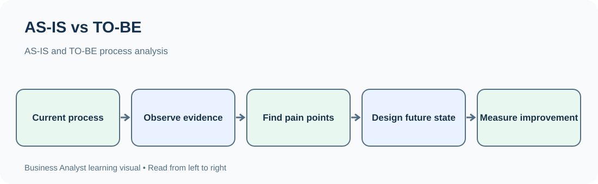
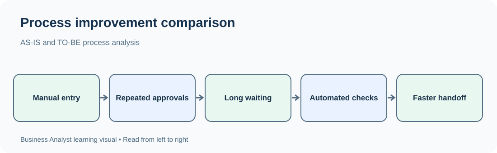

# Day 16 --- AS-IS and TO-BE Process Analysis

**Phase 3: Process Modeling and Documentation**\
**Approved syllabus topic:** AS-IS and TO-BE process analysis\
**Learning focus:** Understand and document how a business process works
today, design how it should work in the future, compare both states, and
explain the proposed change using evidence and business reasoning.

------------------------------------------------------------------------

## 1. Learning objectives

By the end of this lesson, you should be able to:

-   Explain the meaning and purpose of AS-IS and TO-BE process models.
-   Distinguish the current state from the proposed future state.
-   Discover and document the actual current process without assuming
    how it works.
-   Identify process participants, activities, decisions, handoffs,
    inputs, outputs and exceptions.
-   Analyze process performance using time, cost, quality, volume and
    customer experience.
-   Identify pain points, workarounds, duplication, delays and control
    weaknesses.
-   Design a realistic TO-BE process that addresses verified problems.
-   Compare AS-IS and TO-BE processes systematically.
-   Explain process changes, impacts, assumptions, dependencies and
    risks.
-   Validate the proposed process with stakeholders.

## 2. What are AS-IS and TO-BE processes?

### AS-IS process

The **AS-IS process** describes how work is performed today.

It documents the current reality, including: - Activities people
actually perform. - The order in which work happens. - Roles and
departments involved. - Systems, forms and documents used. - Decisions
and business rules. - Handoffs between people or teams. - Delays,
queues, rework and exceptions. - Informal workarounds that may not
appear in official procedures.

The AS-IS model must represent what happens in practice, not merely what
a policy document says should happen.

**Example:** A student applies for admission by filling out an online
form. An admissions officer downloads the form, checks the documents
manually, emails the student if something is missing, updates a
spreadsheet and sends an approval request to a manager.

That sequence is the AS-IS process if it accurately reflects today's
operations.

### TO-BE process

The **TO-BE process** describes the desired future way of working after
an improvement or change.

It may introduce: - Automation. - Clearer responsibilities. - Fewer
handoffs. - Standardized steps. - Better validation. - Self-service
capabilities. - Improved notifications. - Stronger controls. - Better
reporting and monitoring.

**Example:** The student submits an application through a portal. The
portal checks mandatory fields and document formats immediately. The
admissions team reviews a single application queue, requests missing
documents through the portal and records decisions in one system.

That is a TO-BE process only after stakeholders agree that it is a
feasible and desirable future design.

### Simple comparison

  -----------------------------------------------------------------------
  Aspect                  AS-IS                   TO-BE
  ----------------------- ----------------------- -----------------------
  Meaning                 Current process         Desired future process

  Main question           How does work happen    How should work happen?
                          now?                    

  Evidence                Observation,            Business objectives,
                          interviews, records,    validated pain points,
                          system data and         requirements and design
                          documents               decisions

  Focus                   Understand reality      Improve the process

  Includes                Existing steps,         Proposed steps,
                          controls, delays and    controls, roles and
                          workarounds             technology

  Main risk               Recording an idealized  Designing an
                          process instead of      unrealistic solution
                          actual practice         

  Output                  Current-state process   Future-state process
                          model and findings      model and improvement
                                                  rationale
  -----------------------------------------------------------------------

**Remember:** AS-IS is not automatically bad, and TO-BE is not
automatically good. The current process may contain important controls.
The future process must preserve necessary controls while improving the
experience and outcomes.

## 3. Why does a Business Analyst create both models?

A BA should understand the current process before recommending changes.

If a BA jumps directly to a future design, the team may: - Solve the
wrong problem. - Miss an important business rule. - Remove a necessary
control. - Automate an inefficient process without fixing it. - Create
new work for another department. - Ignore a system limitation or
stakeholder dependency. - Underestimate the cost or effort of change.

AS-IS and TO-BE models create a common basis for discussion.

### Business value

1.  **Shared understanding:** stakeholders can agree on how the current
    process operates.
2.  **Problem visibility:** delays, repeated work and unclear ownership
    become visible.
3.  **Evidence-based improvement:** the future design can target
    verified problems.
4.  **Requirement discovery:** each proposed process change may create
    functional and non-functional requirements.
5.  **Impact analysis:** teams can identify changes to roles, systems,
    data and controls.
6.  **Change communication:** employees can understand what will be
    different.
7.  **Measurement:** current performance can be compared with future
    targets.

## 4. Key terms used in process analysis

  -----------------------------------------------------------------------
  Term                    Meaning                 Example
  ----------------------- ----------------------- -----------------------
  Current state           Existing way of working Staff review
                                                  applications manually

  Future state            Intended way of working Portal performs initial
                                                  completeness checks

  Process step            One action in a         Verify identity
                          workflow                document

  Handoff                 Transfer of work or     Admissions sends a case
                          responsibility          to Finance

  Bottleneck              Point that limits       One manager approves
                          process flow            every request

  Queue                   Work waiting to be      120 applications
                          processed               awaiting review

  Rework                  Work repeated to        Applicant resubmits an
                          correct an issue        unreadable document

  Workaround              Informal method used to Staff maintain a
                          get work done           separate spreadsheet

  Cycle time              Total elapsed time for  Application received to
                          a process instance      decision

  Processing time         Time actively spent     20 minutes reviewing a
                          performing work         form

  Waiting time            Time work spends        2 days awaiting manager
                          waiting                 approval

  Throughput              Number of items         300 applications per
                          completed in a period   week

  SLA                     Agreed service-level    Respond to a request
                          target                  within 2 business days

  Control                 Activity that reduces   Verify identity before
                          risk or ensures         approval
                          compliance              

  Automation              Technology performs a   System sends a reminder
                          task or part of a task  automatically

  Process owner           Person accountable for  Head of Admissions
                          process performance     
  -----------------------------------------------------------------------

### Cycle time, processing time and waiting time

Suppose an application takes:

-   15 minutes for initial review.
-   1 day waiting for clarification.
-   20 minutes for document recheck.
-   2 days waiting for manager approval.
-   10 minutes to record the final decision.

Active processing time is 45 minutes. Waiting time is approximately 3
days. Total cycle time is the elapsed time from the defined start to the
defined end, including processing and waiting.

Do not report only active processing time when the business problem is
that customers wait several days.

## 5. Discovering the real AS-IS process

The BA should gather evidence from multiple sources.

### 5.1 Interviews

Ask people who perform, manage or receive the process output.

Useful questions: - What triggers this process? - What do you do
first? - What information do you need? - Which system or document do you
use? - Who receives the work next? - What happens when information is
missing? - Which steps take the longest? - What workarounds do you
use? - How do you know the process is complete?

Do not ask only, "What is the official process?" Ask, "Can you walk me
through the last real case you handled?"

### 5.2 Observation

Watch the work being performed where appropriate and permitted.

Observe: - Actual sequence of activities. - System navigation and
repeated data entry. - Waiting and interruptions. - Manual checks. -
Handoffs. - Exceptions and workarounds.

Record what you observe without judging employees. A workaround may
exist because the official system does not support a real operational
need.

### 5.3 Document analysis

Review relevant: - Standard operating procedures (SOPs). - Forms and
templates. - Policy documents. - Approval matrices. - Service-level
agreements. - Reports and spreadsheets. - Existing process diagrams. -
Training material.

Documents show the documented or intended process. Validate whether the
steps still match actual practice.

### 5.4 System and data analysis

Where authorized, inspect: - Transaction timestamps. - Status
histories. - Queue sizes. - Rejection reasons. - Repeated submissions. -
Processing volumes. - Error logs and audit records.

Use data to test statements such as "approval always takes a week."
Confirm definitions, time periods and data quality before drawing
conclusions.

### 5.5 Workshops

Bring relevant stakeholders together to: - Walk through the current
process. - Resolve conflicting descriptions. - Identify missing steps
and exceptions. - Confirm responsibilities. - Agree on pain points that
need investigation.

### 5.6 Triangulation

**Triangulation** means comparing multiple evidence sources.

Example: - The SOP says applications are reviewed within one day. -
Staff interviews say the queue often waits three days. - Timestamp data
shows a median wait of 2.8 days.

The sources reveal a difference between the documented target and actual
performance. The BA should investigate the difference rather than
choosing one source without explanation.

## 6. How to document an AS-IS process

Use a consistent structure so another person can understand and review
the model.

### Step 1: Define the process

Record: - Process name. - Business purpose. - Trigger. - Start point. -
End point. - Process owner. - Included and excluded activities.

Example:

  Field          Example
  -------------- -----------------------------------------------
  Process name   Student admission application
  Purpose        Review applications and communicate decisions
  Trigger        Student submits an application
  Start          Application received
  End            Admission decision communicated
  Owner          Admissions Manager
  Scope          Submission through decision notification
  Excluded       Fee collection after admission

### Step 2: Identify participants and responsibilities

List roles, teams, external parties and systems.

  Participant          Current responsibility
  -------------------- -------------------------------------------
  Student              Completes form and uploads documents
  Admissions Officer   Reviews application and checks documents
  Admissions Manager   Approves or rejects eligible applications
  Finance              Confirms fee status when required
  Email system         Sends manual or automated communications
  Spreadsheet          Tracks application status

A system can support an activity without being a human participant.
Choose modeling conventions that make responsibility clear.

### Step 3: List activities in order

Use verb + object labels.

1.  Complete application.
2.  Upload documents.
3.  Receive application.
4.  Download application details.
5.  Verify documents.
6.  Request missing information if needed.
7.  Recheck submitted documents.
8.  Prepare approval recommendation.
9.  Review recommendation.
10. Record decision.
11. Notify student.

### Step 4: Add decisions and alternate paths

Examples: - Are mandatory fields complete? - Are documents readable? -
Is the applicant eligible? - Is the application approved?

Include rejection, resubmission, cancellation and timeout paths when
they occur in the real process.

### Step 5: Record handoffs and systems

For each handoff, record: - Sender. - Receiver. - Information
transferred. - Transfer method. - Expected response time. - What happens
if the receiver does not respond.

### Step 6: Capture pain points separately

Do not clutter the process model with long explanations. Use a
pain-point register linked to the relevant process step.

### Step 7: Validate the AS-IS model

Walk through the model with people who perform the work and the process
owner. Ask whether it reflects normal cases and important exceptions.
Record disagreements and unresolved questions.

## 7. Identifying pain points in the AS-IS process

A pain point is a problem or source of friction experienced by
customers, employees or the organization.

### Common categories

  -----------------------------------------------------------------------
  Category                Typical sign            Example
  ----------------------- ----------------------- -----------------------
  Delay                   Work waits too long     Approval queue builds
                                                  up

  Duplication             Same work happens more  Customer enters address
                          than once               in two forms

  Manual effort           Repetitive human        Staff copy data between
                          activity                spreadsheets

  Error                   Incorrect or incomplete Staff select the wrong
                          result                  application status

  Rework                  Work must be repeated   Documents are
                                                  repeatedly requested

  Handoff issue           Responsibility is       Two teams assume the
                          unclear                 other owns the case

  Visibility issue        Status is hard to track Customer calls to ask
                                                  for updates

  Control weakness        Risk is not checked     Approval occurs without
                          consistently            required evidence

  Capacity issue          Demand exceeds          One reviewer handles
                          available resources     all applications

  Customer friction       Process is difficult to Customer cannot see
                          use                     missing documents
  -----------------------------------------------------------------------

### Pain-point register

A pain-point register makes findings actionable.

  ----------------------------------------------------------------------------------
  ID          Process     Observed      Evidence      Impact          Follow-up
              step        problem                                     
  ----------- ----------- ------------- ------------- --------------- --------------
  PP-01       Document    Missing       Review sample Extra waiting   Confirm
              review      documents     and staff     and rework      frequency
                          found late    interviews                    

  PP-02       Status      Separate      Observation   Duplicate       Review system
              tracking    spreadsheet                 updates and     capability
                          used                        inconsistent    
                                                      status          

  PP-03       Manager     Requests wait Timestamp     Longer cycle    Analyze
              approval    in one queue  report        time            approval
                                                                      capacity

  PP-04       Customer    Updates sent  Staff         Inconsistent    Confirm
              updates     manually      interview     communication   notification
                                                                      needs
  ----------------------------------------------------------------------------------

Distinguish a verified finding from a hypothesis. For example, "the
approval queue is the main cause of delay" should not be stated as fact
until evidence supports it.

## 8. Designing the TO-BE process

A TO-BE process should address business needs while remaining feasible,
safe and measurable.

### Step 1: Start with objectives

Examples: - Reduce average application cycle time. - Reduce incomplete
submissions. - Improve application status visibility. - Reduce duplicate
data entry. - Maintain required approval controls.

Objectives should be measurable where possible.

### Step 2: Use validated pain points

Link each proposed change to a problem or business need.

  -----------------------------------------------------------------------
  AS-IS pain point                    Possible TO-BE improvement
  ----------------------------------- -----------------------------------
  Missing documents discovered late   Validate required uploads at
                                      submission

  Staff maintain separate status      Use one shared application status
  spreadsheet                         record

  Customers repeatedly ask for        Provide status tracking and
  updates                             notifications

  Approval requests are difficult to  Use a centralized approval queue
  prioritize                          

  Duplicate data entry                Reuse validated application data
  -----------------------------------------------------------------------

Do not automate a step simply because it is manual. First understand why
the step exists and whether it is still required.

### Step 3: Design the future sequence

Example: 1. Student completes online application. 2. Portal validates
mandatory fields. 3. Portal checks document presence and file format. 4.
Student corrects missing information before submission. 5. Application
enters a centralized review queue. 6. Admissions Officer verifies
eligibility and evidence. 7. If clarification is needed, portal requests
it and records the response. 8. Eligible application goes to the
authorized approver. 9. Decision is recorded in the application system.
10. Student receives an automatic status notification.

### Step 4: Define roles and ownership

Clarify: - Who performs each activity? - Who owns the process? - Who
approves exceptions? - Which activities are automated? - Who monitors
failed notifications or overdue cases?

Automation does not remove the need for ownership and exception
handling.

### Step 5: Preserve necessary controls

For every current control, ask: - What risk does it address? - Is the
control legally, contractually or operationally required? - Can it be
made more efficient? - What evidence must be retained? - Who is
accountable?

A future process should not remove a control without an approved
risk-based decision.

### Step 6: Define exception handling

Examples: - Unsupported file format. - Duplicate application. - Identity
mismatch. - System unavailable. - Approval overdue. - Applicant
withdraws. - Notification delivery fails.

A TO-BE diagram that only describes the happy path is incomplete when
exceptions materially affect operations.

### Step 7: Define measurable targets

Set targets with stakeholders and use a reliable baseline.

  Measure                                          AS-IS baseline   Proposed target
  --------------------------------------------- ----------------- -----------------
  Median application cycle time                   5 business days   3 business days
  Incomplete submissions                                      22%                8%
  Manual status updates per application                         3                 1
  Applications with status visible to student                 20%               95%

These numbers are illustrative. A real BA must use measured baseline
data and obtain agreement on targets.

### Step 8: Validate feasibility

Check: - Technology capability. - Data quality and migration needs. -
Security and privacy. - Staff capacity and training. - Budget and
delivery timeline. - Policy and regulatory requirements. - Dependencies
on external systems. - Operational support and exception ownership.

## 9. AS-IS vs TO-BE comparison

A comparison table makes the proposed change understandable.

  -----------------------------------------------------------------------
  Area              AS-IS             TO-BE             Expected benefit
  ----------------- ----------------- ----------------- -----------------
  Application       Form checked      Mandatory fields  Fewer incomplete
  submission        after receipt     checked before    applications
                                      submission        

  Document          Manual review     Initial automated Earlier error
  validation        after submission  file checks       detection

  Status tracking   Separate          Central           Better visibility
                    spreadsheet       application       
                                      record            

  Clarification     Email exchange    Portal-based      Better tracking
                                      request and       
                                      response          

  Approval          Email or manual   Central approval  Clearer ownership
                    queue             queue             

  Notification      Staff sends       System sends      More consistent
                    update manually   configured        communication
                                      notification      
  -----------------------------------------------------------------------

### What a good comparison should explain

-   What changes?
-   Why is the change needed?
-   Who is affected?
-   Which systems or data are involved?
-   What benefit is expected?
-   What new risks or dependencies are introduced?
-   How will success be measured?

## 10. Process improvement options

A BA can consider several improvement approaches. Select based on
evidence and constraints.

### Eliminate

Remove steps that do not add value and are not required controls.

Example: Remove a duplicate manual entry after confirming the same data
is already captured reliably.

### Simplify

Reduce complexity while retaining the necessary outcome.

Example: Replace a five-field internal handoff form with a smaller
standardized set of required fields.

### Standardize

Make similar work follow a consistent method.

Example: Use one document checklist across all admission officers.

### Automate

Use technology for repeatable work where rules are clear.

Example: Automatically notify a student when an application status
changes.

### Reorder

Move an activity earlier or later to prevent avoidable rework.

Example: Check mandatory document presence before an application enters
the detailed review queue.

### Combine

Bring related steps together when doing so reduces handoffs without
weakening control.

Example: Review identity and address evidence in one structured
verification activity.

### Add a control

Introduce a check where a verified risk requires it.

Example: Require an authorized second approval for high-value refunds.

**Important:** automation is one improvement option, not the default
answer to every process problem.

## 11. Impact analysis --- what changes when TO-BE is introduced?

A future process can affect more than the sequence of tasks.

  -----------------------------------------------------------------------
  Impact area                         Questions to ask
  ----------------------------------- -----------------------------------
  People                              Which roles gain, lose or change
                                      responsibilities?

  Process                             Which activities, decisions and
                                      handoffs change?

  Technology                          Which systems, integrations or
                                      configurations are required?

  Data                                What data is created, reused,
                                      updated or retained?

  Policy                              Do approval rules or operating
                                      procedures change?

  Controls                            Are existing checks preserved or
                                      redesigned?

  Customer                            Does the customer experience or
                                      required action change?

  Reporting                           Are new measures or dashboards
                                      needed?

  Training                            What must users learn before
                                      go-live?

  Support                             Who handles failures and
                                      exceptions?
  -----------------------------------------------------------------------

### Example impact record

  -----------------------------------------------------------------------
  Change            Affected group    Impact            Preparation
  ----------------- ----------------- ----------------- -----------------
  Centralized       Admissions        New work queue    Training and
  review queue      Officers          and status        access setup
                                      workflow          

  Portal document   Students          Must upload       Clear guidance
  validation                          supported file    and error
                                      formats           messages

  Automated         Admissions and IT New notification  Template approval
  notifications     Support           rules and failure and monitoring
                                      monitoring        

  Digital approval  Managers          Approval through  Role access and
                                      system rather     training
                                      than email        
  -----------------------------------------------------------------------

## 12. Risks and assumptions in future-state design

### Common TO-BE risks

-   Automation rejects valid cases because rules are incomplete.
-   Users continue maintaining unofficial spreadsheets.
-   Notifications fail without an alert or fallback.
-   Staff do not understand the new workflow.
-   Data is incomplete or inconsistent during migration.
-   The proposed system cannot integrate with an external service.
-   A faster process weakens a necessary control.
-   The future process depends on an unrealistic response time.

### Assumptions

An assumption is something treated as true for planning but not yet
confirmed.

Examples: - Students have access to the internet and a supported
device. - The existing student database can provide required records. -
Managers will review applications through the new queue. - The
notification service is available.

Record each assumption with an owner and a plan to validate it.

### Dependencies

A dependency is something the process change relies on.

Examples: - Identity verification service. - Payment gateway. - Student
master data. - Manager availability. - Security approval. - Training
completion.

### Risk register example

  -----------------------------------------------------------------------
  Risk              Likelihood        Impact            Mitigation
  ----------------- ----------------- ----------------- -----------------
  Invalid documents Medium            High              Retain human
  pass automated                                        verification for
  checks                                                required evidence

  Users keep using  Medium            Medium            Communicate
  old spreadsheet                                       cutover and
                                                        retire duplicate
                                                        tracking

  Notification      Medium            Medium            Retry, log
  service fails                                         failure and
                                                        provide manual
                                                        fallback

  Staff are not     Medium            High              Role-based
  trained                                               training and
                                                        readiness checks
  -----------------------------------------------------------------------

## 13. How to measure whether the TO-BE process works

Define measures before implementation so the team can compare
performance fairly.

### Useful process measures

-   **Cycle time:** elapsed time from process start to completion.
-   **Processing time:** active work time.
-   **Waiting time:** time spent waiting.
-   **Throughput:** completed cases per time period.
-   **First-time-right rate:** percentage completed without correction
    or rework.
-   **Error rate:** percentage of cases with a defined error.
-   **Rework rate:** percentage requiring repeated work.
-   **SLA attainment:** percentage completed within the agreed service
    target.
-   **Customer satisfaction:** measured through an agreed survey or
    feedback method.
-   **Backlog:** number of open cases awaiting work.

### Define metrics carefully

For every KPI, specify: - Name and business meaning. - Calculation
method. - Start and end events. - Data source. - Reporting period. -
Exclusions. - Owner. - Baseline. - Target.

Example:

**Application cycle time** - Start: timestamp when a valid application
is submitted. - End: timestamp when the admission decision is
communicated. - Calculation: end timestamp minus start timestamp. -
Report: median business days per month. - Exclusions: withdrawn
applications, if agreed and clearly reported.

Do not compare two periods if the metric definition or case population
changed without explaining the difference.

## 14. Worked example --- current and future admission process

### Business context

A college receives a large number of student applications. Applicants
complain that they do not know the status of their applications.
Admissions staff report repeated document requests and manual tracking.

These are initial stakeholder observations. The BA must validate their
frequency and impact using interviews, sample cases and available
process data.

### AS-IS process

1.  Student downloads or opens the application form.
2.  Student completes details and submits documents.
3.  Admissions Officer receives the application.
4.  Officer downloads the submitted information.
5.  Officer checks documents manually.
6.  If something is missing, officer emails the student.
7.  Student replies with corrected documents.
8.  Officer rechecks the application.
9.  Officer updates a spreadsheet.
10. Officer sends the case to the Manager.
11. Manager approves or rejects.
12. Officer updates the spreadsheet and emails the student.

### Observed or investigated pain points

  -----------------------------------------------------------------------
  ID                      Possible pain point     Evidence to collect
  ----------------------- ----------------------- -----------------------
  P1                      Missing documents       Sample application
                          discovered after        review
                          submission              

  P2                      Status is difficult for Applicant interviews
                          students to see         and support enquiries

  P3                      Spreadsheet requires    Staff observation and
                          manual updates          spreadsheet review

  P4                      Approval queue may      Timestamp and queue
                          create waiting time     analysis
  -----------------------------------------------------------------------

Do not treat a possible pain point as a confirmed root cause until
evidence supports it.

### TO-BE process

1.  Student opens the application portal.
2.  Student completes required fields.
3.  Portal validates mandatory fields and supported document formats.
4.  Student corrects errors before submission.
5.  Portal creates an application record and reference number.
6.  Admissions Officer reviews the application in a centralized queue.
7.  If clarification is required, the officer creates a request in the
    portal.
8.  Student uploads the missing information.
9.  The system records the updated submission and returns it to the
    review queue.
10. Officer completes the review and sends the case for approval.
11. Manager records the decision in the system.
12. Portal updates the status and notifies the student.
13. Process ends with an approved or rejected outcome.

### Comparison and benefits

  -----------------------------------------------------------------------
  Area              Current state     Future state      Intended result
  ----------------- ----------------- ----------------- -----------------
  Completeness      Issues found      Initial           Reduce avoidable
                    during manual     validation at     incomplete
                    review            submission        submissions

  Tracking          Spreadsheet       Central           One source of
                                      application       status
                                      record            information

  Clarification     Email thread      Portal request    Better audit
                                      and response      trail

  Approval          Manual handoff    System approval   Clearer ownership
                                      queue             and tracking

  Notification      Manual email      Configured system More consistent
                                      notification      communication
  -----------------------------------------------------------------------

### Requirements that may emerge

-   The portal shall validate mandatory application fields before
    submission.
-   The portal shall accept only configured document formats and size
    limits.
-   The system shall generate a unique application reference.
-   Admissions Officers shall be able to view and filter assigned
    applications.
-   Authorized users shall be able to request additional documents.
-   Students shall be able to view the current application status.
-   The system shall record decision history and timestamps.
-   The system shall notify students when the decision is recorded.

These are example requirements. A BA should confirm details,
permissions, business rules and acceptance criteria with stakeholders.

### Validation questions

-   Are all application types covered by the same process?
-   Are there exceptions for international or special-category
    applicants?
-   Which documents require human verification?
-   Who can change an application after submission?
-   Can a manager delegate approval?
-   What happens if the portal or notification service is unavailable?
-   How long must application records be retained?
-   What is the approved cycle-time target?

## 15. Common mistakes in AS-IS and TO-BE analysis

  -----------------------------------------------------------------------
  Mistake                 Why it is harmful       Better approach
  ----------------------- ----------------------- -----------------------
  Drawing the ideal       Hides real operational  Verify current practice
  process as AS-IS        problems                with evidence

  Relying on one          May reflect one         Triangulate interviews,
  interview               person's experience     observation and data

  Designing TO-BE before  Can solve the wrong     Establish current state
  understanding AS-IS     problem                 first

  Automating every manual May automate waste or   Evaluate purpose and
  task                    remove useful judgment  risk before automation

  Ignoring exceptions     Future process fails on Model important
                          real cases              alternate and failure
                                                  paths

  Removing controls       Can increase business   Understand the purpose
  without analysis        or compliance risk      of each control

  Setting unsupported     Creates unrealistic     Establish a measured
  targets                 expectations            baseline

  Ignoring employee       Causes adoption and     Include role and change
  impact                  training problems       impact analysis

  Failing to define       Makes comparisons       Use consistent start
  process boundaries      unreliable              and end points

  Mixing facts and        Reduces confidence in   Label evidence,
  assumptions             findings                assumptions and open
                                                  questions

  Using vague pain points Makes improvement       State process step,
                          difficult to measure    impact and evidence

  Failing to validate     Design may be           Review with process
  TO-BE                   infeasible or           owners, users and
                          unacceptable            technical teams
  -----------------------------------------------------------------------

## 16. BA deliverables associated with process analysis

Typical outputs include:

  -----------------------------------------------------------------------
  Deliverable                         Purpose
  ----------------------------------- -----------------------------------
  AS-IS process model                 Describes current workflow

  Process discovery notes             Records evidence and stakeholder
                                      explanations

  Pain-point register                 Captures observed problems and
                                      impacts

  Process performance baseline        Records current measures

  TO-BE process model                 Describes proposed future workflow

  AS-IS vs TO-BE comparison           Explains what changes and why

  Impact analysis                     Identifies affected roles, systems,
                                      data and controls

  Assumption and dependency log       Records items requiring
                                      confirmation

  Risk register                       Tracks risks introduced or affected
                                      by the change

  Requirement updates                 Converts approved process changes
                                      into requirements

  Validation record                   Captures stakeholder feedback and
                                      approval
  -----------------------------------------------------------------------

## 17. Interview questions and answers

### Q1. What is an AS-IS process?

**Answer:** An AS-IS process describes how work is currently performed.
It includes actual activities, roles, decisions, systems, handoffs,
exceptions and workarounds. A BA documents it using evidence from
interviews, observation, documents and process data.

### Q2. What is a TO-BE process?

**Answer:** A TO-BE process describes the desired future way of working.
It is designed to address validated business needs and process problems
while considering feasibility, controls, technology, people and
measurable objectives.

### Q3. Why should a BA create an AS-IS model before a TO-BE model?

**Answer:** The AS-IS model establishes the current reality. Without it,
the BA may misunderstand the problem, miss business rules or design a
future process that does not address the actual causes of delay or
error.

### Q4. How do you gather information for an AS-IS process?

**Answer:** I use stakeholder interviews, observation, document
analysis, workshops and authorized system data. I compare the sources to
identify differences between documented procedures and actual practice.

### Q5. What is a pain point?

**Answer:** A pain point is a problem or source of friction in a
process, such as delay, rework, duplicate data entry, unclear ownership
or poor customer visibility. I record the process step, evidence, impact
and follow-up needed.

### Q6. How do you identify whether a process needs improvement?

**Answer:** I review business objectives and process measures such as
cycle time, waiting time, error rate, rework, throughput and customer
feedback. I also investigate stakeholder concerns and validate the
underlying causes before recommending changes.

### Q7. What is the difference between processing time and waiting time?

**Answer:** Processing time is the time spent actively performing work.
Waiting time is the time a case spends waiting for an action, decision
or resource. Both contribute to total cycle time.

### Q8. Should every manual activity be automated in the TO-BE process?

**Answer:** No. I first understand why the activity exists, whether it
adds value and whether it is a required control. Automation is
appropriate when the work is suitable, rules are clear and the risks and
exceptions can be managed.

### Q9. How do you compare AS-IS and TO-BE?

**Answer:** I compare activities, roles, handoffs, systems, decisions,
controls, data and performance measures. For each proposed change, I
explain the reason, affected stakeholders, expected benefit, risks and
success measure.

### Q10. How do you ensure the TO-BE process is realistic?

**Answer:** I validate it with process owners, end users, technical
teams and relevant control or compliance stakeholders. I check
technology, capacity, cost, dependencies, training, exceptions and
operational support.

### Q11. What is a process baseline?

**Answer:** A process baseline is a measured picture of current
performance using agreed metric definitions and a defined period. It
provides the reference point for evaluating whether the future process
improves results.

### Q12. What is the difference between a pain point and a root cause?

**Answer:** A pain point describes an observed problem, such as long
approval waiting time. A root cause explains why it occurs, such as a
single approver handling all requests without backup. Root-cause
analysis is covered in more detail in the next lesson.

### Q13. How would you handle disagreement about the current process?

**Answer:** I would ask stakeholders to walk through specific recent
cases, compare their descriptions with documents and system evidence,
and identify whether different teams follow different variations. I
would document unresolved differences and ask the process owner to
confirm the agreed model.

### Q14. What happens after the TO-BE process is approved?

**Answer:** The BA helps translate the approved process into
requirements, user stories, business rules, data and integration needs,
acceptance criteria and change impacts. The team can then plan
implementation and validation.

### Q15. How do you prevent a TO-BE design from weakening controls?

**Answer:** I identify the purpose and risk addressed by each current
control, consult the relevant owner and design an equivalent or improved
control where needed. Any removal or change must be explicitly assessed
and approved.

## 18. Daily knowledge check

Choose the best answer. Review the explanation after each question.

### Question 1

What does an AS-IS process represent?

A. The ideal future process\
B. The process currently performed\
C. A list of project risks\
D. The system architecture

**Correct answer: B.** AS-IS describes current practice, including real
activities, handoffs, exceptions and workarounds.

### Question 2

Which evidence combination is most useful for validating the current
process?

A. One stakeholder's opinion only\
B. An old process diagram only\
C. Interviews, observation, documents and system data\
D. A proposed TO-BE diagram

**Correct answer: C.** Comparing multiple sources helps identify
differences between documented and actual practice.

### Question 3

A process takes 30 minutes of active work but spends 2 days waiting for
approval. Which measure helps explain the overall customer delay?

A. Processing time only\
B. Waiting time and cycle time\
C. Number of employees only\
D. Number of process symbols

**Correct answer: B.** Waiting time and total cycle time expose delays
that active processing time alone misses.

### Question 4

What should a BA do before recommending automation?

A. Automate every manual step\
B. Remove all approval controls\
C. Understand the purpose, evidence, rules and risks of the activity\
D. Select a software product immediately

**Correct answer: C.** The BA must understand the work and its controls
before proposing a technology change.

### Question 5

Which statement best describes a useful AS-IS vs TO-BE comparison?

A. It lists only the new software features\
B. It explains process changes, reasons, impacts and expected benefits\
C. It hides exceptions to keep the diagram simple\
D. It assumes every proposed improvement will succeed

**Correct answer: B.** A meaningful comparison explains what changes and
why, who is affected, and how success will be evaluated.

## 19. Quick revision sheet

-   **AS-IS:** how work happens today.
-   **TO-BE:** how work should happen in the agreed future state.
-   Document reality before designing improvement.
-   Use interviews, observation, documents, workshops and system data.
-   Triangulate evidence instead of relying on a single source.
-   A pain point is an observed problem; a root cause explains why it
    occurs.
-   Processing time is active work time.
-   Waiting time is time spent waiting.
-   Cycle time is total elapsed time across defined process boundaries.
-   A good TO-BE model addresses validated problems and preserves
    necessary controls.
-   Compare activities, roles, handoffs, systems, data, controls and
    outcomes.
-   Define a baseline before setting or evaluating targets.
-   Validate the future state with business, operational and technical
    stakeholders.

### Five questions to ask during any AS-IS analysis

1.  What starts the process and what ends it?
2.  Who performs each activity?
3.  What information and systems are used?
4.  Where do work, time or quality problems occur?
5.  What evidence confirms the current process?

### Five questions to ask during any TO-BE design

1.  Which business objective should improve?
2.  Which verified pain point does the change address?
3.  What activities, roles, systems and controls will change?
4.  What exceptions, risks and dependencies must be handled?
5.  How will the organization measure success?

## 20. Day 16 completion checklist

-   [ ] I can define AS-IS and TO-BE processes.
-   [ ] I can explain why the current process must be understood before
    future-state design.
-   [ ] I can identify process boundaries, roles, activities, decisions
    and handoffs.
-   [ ] I can use interviews, observation, documents, workshops and
    system data for process discovery.
-   [ ] I can explain triangulation.
-   [ ] I can identify common process pain points.
-   [ ] I can distinguish a pain point from a root cause.
-   [ ] I can explain processing time, waiting time and cycle time.
-   [ ] I can document a current-state process accurately.
-   [ ] I can propose future-state improvements linked to validated
    problems.
-   [ ] I can compare AS-IS and TO-BE processes.
-   [ ] I can identify impacts on people, processes, systems, data and
    controls.
-   [ ] I can record assumptions, dependencies and risks.
-   [ ] I can define baseline measures and future targets.
-   [ ] I can validate process models with stakeholders.
-   [ ] I can answer the interview questions in my own words.
-   [ ] I can answer all five daily quiz questions and explain why each
    answer is correct.

------------------------------------------------------------------------

**Day 16 complete --- AS-IS and TO-BE Process Analysis.**

**Next syllabus topic --- Day 17: Gap Analysis, Root-Cause Analysis and
the 5 Whys.**

## Visual learning aids

