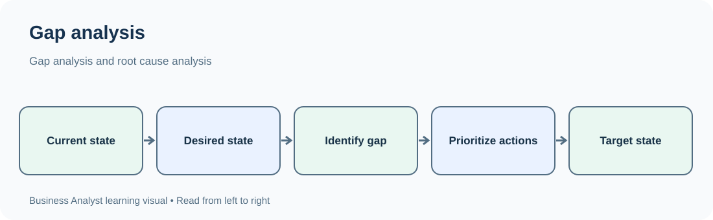
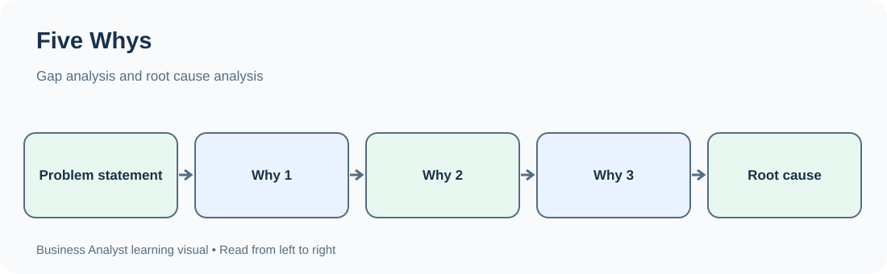

# TechPhile.ai --- Business Analyst Career Pathway

# Day 17: Gap Analysis, Root-Cause Analysis and the 5 Whys

**Phase:** 3 --- Business Process Analysis and Improvement\
**Estimated learning time:** 2--3 hours\
**Difficulty:** Beginner to Advanced\
**Prerequisites:** Day 13 --- Business Process Modeling and Process
Discovery; Day 14 --- Flowcharts; Day 15 --- BPMN; Day 16 --- AS-IS and
TO-BE Process Analysis\
**Learning focus:** Compare the current and desired states, identify
measurable gaps, investigate why problems occur, and distinguish
evidence-based root causes from assumptions.

------------------------------------------------------------------------

## 1. Learning Objectives

By the end of this lesson, you should be able to:

-   Explain gap analysis and when a Business Analyst uses it.
-   Distinguish the current state, desired state, gap, cause and
    solution.
-   Compare AS-IS and TO-BE processes systematically.
-   Identify gaps in process, people, technology, data, policy, controls
    and performance.
-   Prioritize gaps using business impact, urgency, risk and effort.
-   Explain root-cause analysis (RCA) and why treating symptoms is not
    enough.
-   Apply the 5 Whys technique without forcing an answer or stopping too
    early.
-   Use a fishbone (Ishikawa) diagram to organize possible causes.
-   Distinguish a symptom, contributing factor, root cause and
    corrective action.
-   Validate causes using evidence and stakeholder input.
-   Convert verified findings into improvement requirements and
    measurable outcomes.
-   Explain gap analysis and root-cause analysis clearly in an
    interview.

------------------------------------------------------------------------

# 2. Why These Techniques Matter in Real Business

Imagine an online shopping company reports:

> "Too many customers abandon their orders during checkout. We need a
> new checkout page."

A weak analysis might immediately recommend redesigning the page.

A Business Analyst should first investigate:

-   What is the current checkout completion rate?
-   What completion rate does the business expect?
-   At which checkout step do customers leave?
-   Does the issue affect all customers or a particular payment method?
-   Are customers confused, or are payment requests failing?
-   Is the page slow?
-   Are stock, delivery or address validations failing?
-   What evidence is available from analytics, support tickets and
    system logs?

Two different questions are involved:

1.  **Gap analysis:** What is different between the current performance
    and the desired performance?
2.  **Root-cause analysis:** Why is the current performance below the
    desired level?

For example:

-   Current checkout completion: 62%.
-   Target checkout completion: 80%.
-   Performance gap: 18 percentage points.
-   Investigation finds that many UPI transactions fail after the
    payment provider returns a timeout.
-   Further investigation finds that the application retries requests
    incorrectly and sometimes displays an unclear failure message.

The business should not assume that a visual redesign will solve a
payment reliability problem.

**Main idea:** Gap analysis tells you what is missing or different.
Root-cause analysis helps explain why the gap exists. Neither should be
replaced by an untested solution idea.

------------------------------------------------------------------------

# 3. Essential Terms

  -----------------------------------------------------------------------
  Term                    Simple meaning          Example
  ----------------------- ----------------------- -----------------------
  Current state / AS-IS   How things work or      62% checkout completion
                          perform now             

  Desired state / TO-BE   The agreed future       80% checkout completion
                          condition               

  Gap                     Difference between      18 percentage points
                          current and desired     
                          state                   

  Gap analysis            Structured comparison   Compare process,
                          of current and desired  performance and
                          states                  capability

  Symptom                 Visible sign of a       Customers abandon
                          problem                 checkout

  Problem                 An undesirable          Checkout completion is
                          condition affecting an  below target
                          outcome                 

  Cause                   A factor that           Payment requests time
                          contributes to a        out
                          problem                 

  Root cause              An underlying cause     Retry logic does not
                          whose removal or        handle provider
                          control can prevent     timeouts correctly
                          recurrence              

  Contributing factor     A condition that makes  Peak-hour traffic
                          the problem more likely increases timeout
                          or severe               frequency

  Corrective action       Action intended to      Correct retry and
                          remove or control an    timeout handling
                          identified cause        

  Preventive action       Action intended to      Add automated timeout
                          reduce the chance of a  and retry tests
                          similar problem         
                          elsewhere               

  Evidence                Information that        Gateway logs,
                          supports or challenges  timestamps, transaction
                          a claim                 records

  Baseline                Measured starting point Current completion rate
                                                  of 62%

  Target                  Desired measurable      Reach 80% within an
                          result                  agreed period

  Impact                  Effect on customers,    Lost orders and
                          operations or business  increased support calls
                          results                 
  -----------------------------------------------------------------------

## 3.1 Symptom, problem, cause and solution are different

Consider this example:

-   **Symptom:** Customers call support because they cannot reset
    passwords.
-   **Problem:** The password-reset process has a high failure rate.
-   **Possible cause:** Reset emails are delayed or sent to an outdated
    address.
-   **Verified root cause:** The email service queue is not processing
    messages reliably during peak traffic.
-   **Solution:** Improve queue processing and monitoring, then test the
    full reset flow.

Do not label a proposed solution as a root cause.

  -----------------------------------------------------------------------
  Statement                           What it represents
  ----------------------------------- -----------------------------------
  "Users are calling support."        Symptom

  "Password resets fail too often."   Problem

  "The email may be delayed."         Hypothesis / possible cause

  "Queue processing pauses when the   Verified cause, if evidence
  worker reaches its configured       supports it
  limit."                             

  "Increase worker capacity and add   Potential corrective action
  queue monitoring."                  
  -----------------------------------------------------------------------

------------------------------------------------------------------------

# 4. Gap Analysis --- Fundamentals

## 4.1 What is gap analysis?

Gap analysis is a structured method of comparing an organization's
current condition with its desired condition to identify what must
change to achieve a business objective.

It can compare:

-   Performance: current result versus target.
-   Process: current activities versus required activities.
-   Capability: what the organization can do versus what it needs to do.
-   Technology: current system capability versus required capability.
-   Data: available data versus required data.
-   People: current skills or capacity versus required skills or
    capacity.
-   Controls: existing checks versus required controls.
-   Policy: current rules versus required rules.

## 4.2 The basic gap analysis flow

``` text
Define business objective
          |
          v
Understand current state (AS-IS)
          |
          v
Define desired state (TO-BE)
          |
          v
Compare current and desired states
          |
          v
Identify and describe gaps
          |
          v
Investigate causes and impacts
          |
          v
Prioritize gaps
          |
          v
Recommend actions and requirements
          |
          v
Measure whether the gap has reduced
```

## 4.3 What makes a good gap statement?

A useful gap statement contains:

1.  **Area:** Which process, capability or measure is affected?
2.  **Current condition:** What happens today?
3.  **Desired condition:** What should happen?
4.  **Difference:** What exactly is missing?
5.  **Impact:** Why does the difference matter?
6.  **Evidence:** How do we know?

Weak statement:

> "The admission process is inefficient."

Better statement:

> "The current student admission process takes an average of 7 working
> days from application submission to verification completion, while the
> agreed target is 3 working days. The 4-day gap is associated with
> manual document checks and repeated requests for missing information,
> resulting in delayed admission decisions."

The improved statement is specific, measurable and open to
investigation. It does not prematurely claim that one factor is the only
root cause.

------------------------------------------------------------------------

# 5. Defining the Current State and Desired State

A gap cannot be measured accurately if either side is unclear.

## 5.1 Current state (AS-IS)

The current state describes what actually happens now.

Use evidence such as:

-   Interviews with process participants.
-   Direct observation.
-   Existing process documents.
-   System reports and event logs.
-   Customer complaints and support tickets.
-   Transaction records.
-   Operational metrics.
-   Audit findings.

Record the date range, population and measurement method. For example,
"average processing time" is incomplete unless you know which process
instances were included and how the time was calculated.

## 5.2 Desired state (TO-BE)

The desired state describes an agreed future condition.

It should be connected to:

-   Business objectives.
-   Stakeholder needs.
-   Customer expectations.
-   Regulatory or policy requirements.
-   Operational capacity.
-   Technology feasibility.
-   Risk and control requirements.

Example:

  -----------------------------------------------------------------------
  Measure                         Current state             Desired state
  ------------------- ------------------------- -------------------------
  Admission                      7 working days            3 working days
  verification time                             

  Applications                              28%                 Below 10%
  requiring rework                              

  Applicants                                40%                       95%
  receiving status                              
  updates                                       

  Missing-document    Often after manual review     At initial submission
  identification                                
  -----------------------------------------------------------------------

Targets should be approved by the appropriate stakeholders. A BA should
not invent a target simply because it sounds ambitious.

## 5.3 Do not confuse a target with a solution

-   Target: Reduce verification time from 7 days to 3 days.
-   Possible solution: Introduce automated document completeness checks.
-   Another possible solution: Change the review queue and assign work
    by application type.

A target defines the result. A solution describes a possible way to
achieve it.

------------------------------------------------------------------------

# 6. Types of Gaps

A Business Analyst should examine more than just the visible process
steps.

## 6.1 Performance gap

A difference between current and expected results.

Example: - Current first-response time: 18 hours. - Target: 4 hours. -
Gap: 14 hours.

## 6.2 Process gap

A required activity, handoff, decision or control is missing or
ineffective.

Example: - Current process has no formal review before a refund is
approved. - Desired process requires approval based on refund amount.

## 6.3 Capability gap

The organization lacks a skill, resource or operational ability.

Example: - The support team cannot investigate payment failures because
it has no access to transaction-status information.

## 6.4 Technology gap

Existing systems do not support a required capability.

Example: - The current application cannot send automatic status
notifications.

## 6.5 Data gap

Required information is missing, inaccurate, inconsistent or unavailable
at the right time.

Example: - Customer records contain inconsistent phone-number formats,
making reliable matching difficult.

## 6.6 People and skill gap

Employees need training, clearer responsibilities or additional
capacity.

Example: - Staff members use different methods to classify complaints
because no common training or guidance exists.

## 6.7 Policy and compliance gap

Current rules or practices do not meet an agreed policy or regulatory
requirement.

Example: - The organization retains customer documents longer than its
approved retention policy permits.

## 6.8 Control gap

A control that should prevent, detect or correct an error is missing or
weak.

Example: - A payment can be refunded twice because the system does not
check whether a refund has already been processed.

## 6.9 Gap categories table

  -----------------------------------------------------------------------
  Gap category            Question to ask         Example evidence
  ----------------------- ----------------------- -----------------------
  Performance             Are results meeting the KPI report
                          target?                 

  Process                 Are the required steps  Process map
                          and decisions present?  

  People                  Do teams have the       Training and workload
                          required skills and     records
                          capacity?               

  Technology              Can the system support  System assessment
                          the required work?      

  Data                    Is the necessary        Data-quality report
                          information complete    
                          and reliable?           

  Policy                  Are current practices   Policy documents
                          aligned with approved   
                          rules?                  

  Controls                Are errors prevented or Audit results and
                          detected?               control records
  -----------------------------------------------------------------------

A single business issue can contain multiple gap types. For example,
delayed refunds may involve a process gap, a system gap, a data gap and
a control gap.

------------------------------------------------------------------------

# 7. How to Conduct Gap Analysis --- Step by Step

## Step 1: Confirm the business objective

Ask:

-   What business result should improve?
-   Who owns the objective?
-   Why is the change needed?
-   How will success be measured?
-   Is there an agreed target and deadline?

Example objective:

> Reduce the average time from application submission to admission
> decision from 7 working days to 3 working days within the next two
> admission cycles.

## Step 2: Define the analysis boundary

Clarify:

-   Which process is included?
-   Where does it start and end?
-   Which locations, products or customer groups are included?
-   What period will be examined?
-   What is explicitly outside the analysis?

Without boundaries, teams may compare unrelated activities or datasets.

## Step 3: Collect current-state evidence

Use interviews, workshops, observation, documents and system data.

Record: - What happens. - Who performs it. - Which system or document is
used. - How long it takes. - Where work waits. - How often errors or
rework occur. - What exceptions happen.

## Step 4: Define the desired state

Work with stakeholders to agree on:

-   Required process behavior.
-   Required capabilities.
-   Performance measures and targets.
-   Controls and compliance needs.
-   Customer and employee experience.
-   Constraints and dependencies.

## Step 5: Compare the two states

Compare one dimension at a time.

  -----------------------------------------------------------------------
  Dimension         Current state     Desired state     Identified gap
  ----------------- ----------------- ----------------- -----------------
  Document checking Manual review     Completeness      Early validation
                    after submission  check at          missing
                                      submission        

  Status updates    Applicant calls   Automatic status  Notification
                    for updates       notifications     capability
                                                        missing

  Work assignment   Shared email      Assigned queue    Accountability
                    inbox             with ownership    and tracking
                                                        missing

  Processing time   7 working days    3 working days    4-day performance
                                                        gap

  Rework            28% of            Below 10%         Quality gap
                    applications                        
  -----------------------------------------------------------------------

## Step 6: Describe and validate each gap

A gap record should be clear enough that another person can understand
it without guessing.

Ask stakeholders: - Is the current state accurate? - Is the desired
state realistic and approved? - Is the difference described correctly? -
Is the evidence reliable? - Are any affected groups or exceptions
missing?

## Step 7: Investigate causes

Do not assume every gap has one cause. Use root-cause techniques such as
5 Whys, fishbone analysis, process analysis and data analysis.

## Step 8: Prioritize gaps

Consider: - Business impact. - Customer impact. - Financial impact. -
Compliance or operational risk. - Urgency. - Number of people or
transactions affected. - Dependencies. - Implementation effort and
feasibility.

## Step 9: Recommend actions

Possible actions include: - Process redesign. - Role clarification. -
Staff training. - Data cleansing. - System enhancement. - Automation. -
Policy clarification. - Additional controls. - Monitoring and reporting.

Recommendations must address verified gaps and causes.

## Step 10: Define success measures

Set a baseline, target, owner, measurement method and review period.

Example:

  -------------------------------------------------------------------------
  KPI                         Baseline               Target Measurement
  --------------- -------------------- -------------------- ---------------
  Average                       7 days               3 days Timestamp
  verification                                              difference
  time                                                      

  Rework rate                      28%            Below 10% Reworked
                                                            applications /
                                                            total
                                                            applications

  Status inquiry             500/month      Below 200/month Support call
  calls                                                     category report
  -------------------------------------------------------------------------

------------------------------------------------------------------------

# 8. Gap Analysis Tools and Documents

## 8.1 Gap analysis matrix

A gap analysis matrix records the current state, desired state, gap,
impact and action.

  ------------------------------------------------------------------------------------------
  ID         Area            Current    Desired state  Gap            Impact      Priority
                             state                                                
  ---------- --------------- ---------- -------------- -------------- ----------- ----------
  G-01       Verification    7 days     3 days         4-day delay    Late        High
                                                                      decisions   

  G-02       Notifications   Manual     Automatic      No             More        Medium
                             updates    updates        notification   inquiry     
                                                       capability     calls       

  G-03       Document checks Late       Early          Missing early  Rework      High
                             manual     completeness   validation                 
                             review     check                                     
  ------------------------------------------------------------------------------------------

## 8.2 Capability assessment

Use a capability assessment when the issue concerns what the
organization can reliably do.

Example maturity scale:

  -----------------------------------------------------------------------
  Level                   Meaning                 Example
  ----------------------- ----------------------- -----------------------
  1 --- Initial           Work is informal and    Staff use personal
                          inconsistent            spreadsheets

  2 --- Repeatable        Basic steps exist but   Some teams use a shared
                          vary by team            checklist

  3 --- Defined           Standard process is     All teams follow an
                          documented              approved workflow

  4 --- Managed           Performance is measured Team dashboards monitor
                          and controlled          processing time

  5 --- Optimized         Continuous improvement  Trends trigger regular
                          is established          process improvements
  -----------------------------------------------------------------------

This scale is an illustrative model, not a universal mandatory standard.
Define what each level means before assessing a real organization.

## 8.3 Gap register

A gap register may include:

-   Gap ID.
-   Business objective.
-   Process or capability area.
-   Current state.
-   Desired state.
-   Gap description.
-   Evidence source.
-   Business impact.
-   Possible causes.
-   Priority.
-   Owner.
-   Proposed action.
-   Status.
-   Related requirements and risks.

## 8.4 Traceability

Connect each gap to: - Business objective. - Evidence. - Root-cause
findings. - Improvement recommendation. - Requirement. - Acceptance
criteria. - KPI or outcome.

This prevents recommendations from becoming disconnected from the
original business problem.

------------------------------------------------------------------------

# 9. Prioritizing Identified Gaps

Not every gap can be addressed immediately.

## 9.1 Prioritization factors

Evaluate each gap using:

1.  **Business impact:** Does it affect revenue, cost, productivity or
    strategic goals?
2.  **Customer impact:** Does it create delays, confusion or poor
    service?
3.  **Risk:** Could it cause financial, operational, security or
    compliance harm?
4.  **Urgency:** Is there a deadline or time-sensitive dependency?
5.  **Frequency:** How often does it occur?
6.  **Scale:** How many transactions, employees or customers are
    affected?
7.  **Effort:** How difficult or expensive is it to address?
8.  **Dependency:** Must another gap be resolved first?

## 9.2 Simple priority categories

  -----------------------------------------------------------------------
  Priority                Typical meaning         Example
  ----------------------- ----------------------- -----------------------
  Critical                Severe business,        Duplicate refunds
                          customer, safety or     causing major financial
                          compliance impact       exposure
                          requiring urgent action 

  High                    Significant recurring   Verification delays
                          impact or major         affecting most
                          objective at risk       applicants

  Medium                  Noticeable impact but   Applicants make
                          manageable through      frequent status
                          current operations      inquiries

  Low                     Limited impact or minor A report requires
                          improvement opportunity manual formatting
  -----------------------------------------------------------------------

The priority must be agreed with stakeholders. A BA facilitates
analysis; the BA does not automatically own the business decision.

## 9.3 Impact-versus-effort matrix

  -----------------------------------------------------------------------
                          Low effort              High effort
  ----------------------- ----------------------- -----------------------
  High impact             Quick wins --- often    Major initiatives ---
                          prioritized             plan carefully

  Low impact              Fill-in improvements    Defer or reconsider
  -----------------------------------------------------------------------

Use the matrix as a discussion aid, not as a substitute for compliance,
risk or dependency analysis.

## 9.4 Example

  ------------------------------------------------------------------------
  Gap                Impact            Effort            Suggested
                                                         treatment
  ------------------ ----------------- ----------------- -----------------
  Missing-document   High              Low               Quick win
  warning                                                

  Replace entire     High              High              Evaluate and plan
  admission platform                                     

  Reformat internal  Low               Low               Schedule if
  report                                                 capacity allows

  Add a complex      Low               High              Reconsider
  feature with                                           
  little measurable                                      
  benefit                                                
  ------------------------------------------------------------------------

------------------------------------------------------------------------

# 10. Root-Cause Analysis (RCA)

## 10.1 What is root-cause analysis?

Root-cause analysis is a structured investigation used to identify the
underlying reasons a problem occurs so that corrective action can
address those reasons rather than only the visible symptoms.

RCA is useful when: - A problem repeats. - A process misses its
target. - Defects or errors occur frequently. - Customers experience
recurring failures. - Operational costs increase unexpectedly. - A
control fails. - A business improvement does not produce the expected
result.

## 10.2 Why symptom treatment is not enough

Example: A support team receives 300 password-reset complaints each
week.

Temporary response: - Ask more support agents to manually reset
passwords.

Potential problem: - The same failure continues. - Support workload
remains high. - Customers continue to experience delays. - Operating
cost increases.

A root-cause investigation may find that reset emails are not reliably
processed. Addressing the underlying delivery issue can reduce both
customer complaints and support workload.

## 10.3 RCA vocabulary

  -----------------------------------------------------------------------
  Term                    Meaning                 Example
  ----------------------- ----------------------- -----------------------
  Problem statement       Clear description of    12% of payment attempts
                          the undesirable         fail
                          condition               

  Symptom                 Observable sign         Customers see payment
                                                  errors

  Hypothesis              Possible explanation    Provider timeout may be
                          requiring validation    responsible

  Cause                   Factor that contributes Requests exceed
                          to the problem          provider response time

  Root cause              Underlying cause        Timeout handling and
                          supported by evidence   retry configuration are
                                                  incorrect

  Contributing factor     Makes the problem worse Traffic peaks at
                                                  certain times

  Corrective action       Addresses the           Correct timeout and
                          identified cause        retry behavior

  Preventive action       Reduces recurrence      Add monitoring and
                          elsewhere               regression tests
  -----------------------------------------------------------------------

## 10.4 Root cause does not always mean one single cause

Complex problems often have several interacting causes.

For example, delayed order delivery might involve: - Incorrect inventory
data. - Late warehouse picking. - Courier capacity constraints. -
Incomplete delivery addresses. - Poor exception escalation.

Avoid forcing a complicated situation into one simple explanation.

------------------------------------------------------------------------

# 11. The 5 Whys Technique

## 11.1 What is the 5 Whys technique?

The 5 Whys is a simple root-cause analysis technique. You start with a
clearly stated problem and repeatedly ask "Why?" to move from the
visible symptom toward underlying causes.

The name suggests five rounds, but five is not a strict rule: - You may
reach a verified cause in fewer than five questions. - You may need more
than five questions. - You may discover multiple cause paths. - Stop
when the explanation is specific, evidence-supported and actionable.

## 11.2 How to perform the 5 Whys

1.  Write a specific problem statement.
2.  Ask why the problem occurred.
3.  Record the answer as a possible cause.
4.  Ask why that cause occurred.
5.  Continue until the cause can be investigated and addressed.
6.  Check each answer against evidence.
7.  Identify contributing factors and alternate explanations.
8.  Define corrective and preventive actions.
9.  Assign owners and measures.
10. Check whether the problem actually reduces after the change.

## 11.3 Worked example: Admission verification delay

**Problem statement:** Student admission verification takes an average
of 7 working days, while the target is 3 working days.

  -----------------------------------------------------------------------
  Why level               Question                Finding to investigate
  ----------------------- ----------------------- -----------------------
  Why 1                   Why does verification   Applications wait in a
                          take 7 days?            review queue.

  Why 2                   Why do applications     Reviewers receive
                          wait in the queue?      applications in batches
                                                  and have limited
                                                  visibility of pending
                                                  work.

  Why 3                   Why is work processed   The process assigns
                          in batches?             applications through a
                                                  shared inbox rather
                                                  than a tracked queue.

  Why 4                   Why is there no tracked The current workflow
                          queue?                  has no defined
                                                  ownership and
                                                  assignment capability.

  Why 5                   Why was ownership not   The process design
                          defined?                focused on collecting
                                                  documents but did not
                                                  define workload
                                                  assignment and
                                                  monitoring.
  -----------------------------------------------------------------------

**Potential root-cause finding:** The process lacks defined ownership
and work-queue management. This must be validated against actual
workflow records and interviews before being treated as a confirmed root
cause.

**Potential actions:** - Define application ownership. - Introduce a
tracked review queue. - Establish aging alerts for pending
applications. - Define escalation rules. - Monitor average verification
time and queue age.

**Important:** Do not automatically assume that every answer in a 5 Whys
chain is proven. Each answer is a hypothesis until evidence supports it.

## 11.4 Another example: Customer receives duplicate notifications

Problem: \> Some customers receive the same order confirmation
notification multiple times.

  Why     Possible answer
  ------- --------------------------------------------------------
  Why 1   Why do customers receive duplicates?
  Why 2   Why is the same event processed more than once?
  Why 3   Why does a repeated event create another notification?
  Why 4   Why is duplicate detection missing?
  Why 5   Why was this not included in the design?

Potential corrective actions: - Define duplicate-event handling. - Add
idempotency controls. - Record processed event identifiers. - Test retry
and duplicate-delivery scenarios. - Monitor duplicate notification
rates.

The actual cause must be verified using event logs, message identifiers,
service behavior and design records.

------------------------------------------------------------------------

# 12. How to Use 5 Whys Correctly

## 12.1 Good practices

-   Start with a specific, measurable problem.
-   Use neutral questions.
-   Ask the people who perform the work.
-   Separate facts from assumptions.
-   Check records, logs and process evidence.
-   Allow multiple branches when different causes are possible.
-   Focus on process and system conditions, not blame.
-   Stop when the cause is actionable and supported by evidence.
-   Confirm that the proposed action addresses the cause.
-   Measure the result after implementation.

## 12.2 Common mistakes

  -----------------------------------------------------------------------
  Mistake                 Why it is a problem     Better approach
  ----------------------- ----------------------- -----------------------
  Starting with a vague   The investigation can   Define the affected
  complaint               go in many directions   process, time period
                                                  and measure

  Assuming there must be  The number of questions Continue until the
  exactly five answers    is not the objective    cause is sufficiently
                                                  understood

  Blaming an employee     It may hide unclear     Investigate the
                          procedures, workload or conditions that shaped
                          system design           the behavior

  Treating guesses as     Actions may solve the   Validate each answer
  facts                   wrong problem           with evidence

  Forcing one cause       Several factors may     Create multiple cause
                          contribute              branches

  Jumping to a solution   The real cause may      Finish the
                          remain                  investigation before
                                                  selecting an action

  Ignoring exceptions     The analysis may miss   Examine normal and
                          the cases where the     exceptional cases
                          problem occurs          

  Not checking the result The team cannot know    Define a post-change
                          whether the cause was   KPI and review period
                          addressed               
  -----------------------------------------------------------------------

## 12.3 Avoid the blame trap

Weak conclusion:

> "The employee made mistakes, so the employee is the root cause."

Better investigation questions: - Was the procedure clear? - Was the
employee trained? - Was the workload reasonable? - Did the system show
the correct information? - Were there conflicting instructions? - Was
there a validation control? - Did the process make the correct action
easy to perform?

Human error may be part of the explanation, but the BA should examine
the conditions that allowed the error and whether process or system
improvements can prevent recurrence.

------------------------------------------------------------------------

# 13. Fishbone Diagram (Ishikawa / Cause-and-Effect Diagram)

## 13.1 What is a fishbone diagram?

A fishbone diagram is a visual technique for organizing possible causes
of a problem into categories.

It is useful when: - A problem has many possible explanations. - A
cross-functional team needs to brainstorm causes. - You want to avoid
focusing on only the first explanation. - You need a structured view
before validating causes.

It is also called: - Ishikawa diagram. - Cause-and-effect diagram.

## 13.2 Common cause categories

A common manufacturing-oriented grouping is the 6 Ms:

  -----------------------------------------------------------------------
  Category                What to examine         Service/business
                                                  example
  ----------------------- ----------------------- -----------------------
  Manpower / People       Skills, staffing,       Not enough trained
                          workload, communication reviewers

  Methods                 Procedures, rules,      No standard review
                          workflow                sequence

  Machines / Technology   Systems, tools,         Application is slow
                          equipment               

  Materials / Inputs      Documents, supplies,    Incomplete customer
                          source information      documents

  Measurement             KPIs, monitoring, data  Queue age is not
                          quality                 measured

  Environment             External or workplace   Peak-season application
                          conditions              volume
  -----------------------------------------------------------------------

For service and digital businesses, teams may use adapted categories:

-   People.
-   Process.
-   Technology.
-   Data.
-   Policy.
-   Environment.

Choose categories that fit the problem. Do not force every issue into
all six categories.

## 13.3 Example: Why are customer support tickets taking too long to resolve?

  -----------------------------------------------------------------------
  Category                            Possible causes to investigate
  ----------------------------------- -----------------------------------
  People                              New agents need training; staffing
                                      is insufficient

  Process                             Tickets are reassigned repeatedly;
                                      escalation rules are unclear

  Technology                          Support tool is slow; customer
                                      history is unavailable

  Data                                Customer details are incomplete or
                                      duplicated

  Policy                              Approval is required for too many
                                      low-risk cases

  Environment                         Ticket volume spikes during product
                                      releases
  -----------------------------------------------------------------------

These are possible causes, not verified findings.

## 13.4 Text-based fishbone structure

``` text
People -----------\
Process -----------\
Technology --------\
Data --------------- > Long ticket resolution time
Policy -------------/
Environment -------/
```

## 13.5 How to create a fishbone diagram

1.  Write the problem at the right side (the fish head).
2.  Draw the main horizontal line.
3.  Add suitable cause categories as branches.
4.  Brainstorm possible causes with relevant stakeholders.
5.  Break broad causes into more specific sub-causes.
6.  Identify which causes can be checked.
7.  Collect evidence for the most important candidates.
8.  Confirm or reject each candidate.
9.  Record verified causes and recommended actions.

## 13.6 Fishbone versus 5 Whys

  -----------------------------------------------------------------------
  Aspect                  5 Whys                  Fishbone
  ----------------------- ----------------------- -----------------------
  Main purpose            Explore why a problem   Organize many possible
                          occurs                  causes

  Structure               A chain or branching    Categories with cause
                          sequence of questions   branches

  Best use                A relatively focused    A complex problem with
                          problem                 several possible cause
                                                  areas

  Strength                Simple and easy to      Broad view across
                          facilitate              functions

  Limitation              Can follow one path too Can produce many
                          narrowly                unverified ideas

  Evidence needed?        Yes                     Yes
  -----------------------------------------------------------------------

The techniques can be combined: use a fishbone to generate cause
possibilities, then use 5 Whys to investigate selected branches.

------------------------------------------------------------------------

# 14. Other Root-Cause Analysis Methods --- Awareness

## 14.1 Pareto analysis

Pareto analysis helps identify which categories contribute most to a
problem.

A common form uses the 80/20 principle as a heuristic: a relatively
small number of categories may account for a large share of the impact.
Do not assume the exact 80/20 relationship will always occur.

Example:

  Complaint category     Number of complaints
  -------------------- ----------------------
  Payment failure                         420
  Delivery delay                          250
  Refund delay                            180
  Login issue                              90
  Other                                    60
  **Total**                         **1,000**

The team can investigate the largest categories first, while still
considering severity and risk.

## 14.2 Process analysis

Study the workflow to locate: - Waiting time. - Rework. - Duplicate
activities. - Unnecessary approvals. - Handoffs. - Bottlenecks. -
Missing controls. - Exception paths.

A process map from earlier lessons is often useful evidence during RCA.

## 14.3 Data analysis

Analyze: - Frequency of incidents. - Error rates. - Trends over time. -
Differences between teams, locations or channels. - Failure rates by
transaction type. - Time between process steps. - Relationship between
workload and performance.

A correlation or pattern does not automatically prove causation.
Investigate the mechanism and alternative explanations.

## 14.4 Fault tree analysis --- introductory awareness

Fault tree analysis starts with an undesirable top-level event and
breaks it into contributing events using logical relationships such as
AND and OR.

Example top event: "Order is not delivered on time."

Possible branches: - Warehouse dispatch is late OR - Courier delivery is
late OR - Address is invalid.

This method is useful for more technical or risk-oriented
investigations. A BA may work with engineering, operations or risk
specialists to interpret it.

------------------------------------------------------------------------

# 15. Evidence-Based Root-Cause Validation

A plausible explanation is not automatically a root cause.

## 15.1 Sources of evidence

-   System logs.
-   Transaction records.
-   Process timestamps.
-   Customer complaints.
-   Defect records.
-   Audit reports.
-   Staff interviews.
-   Direct observation.
-   Policy documents.
-   System configuration.
-   Operational dashboards.
-   Sample case reviews.

## 15.2 Validation questions

For each suspected cause, ask:

1.  What evidence supports this explanation?
2.  What evidence could disprove it?
3.  Does the issue occur when this condition is absent?
4.  Does the problem occur more often when this condition is present?
5.  Are there other explanations?
6.  Does the cause explain the timing and pattern of the issue?
7.  Can the cause be reproduced or observed?
8.  Would addressing it reasonably reduce the problem?
9.  Are there unintended consequences of the proposed action?

## 15.3 Hypothesis and evidence register

  -----------------------------------------------------------------------
  ID                Suspected cause   Evidence needed   Status
  ----------------- ----------------- ----------------- -----------------
  C-01              Review queue has  Queue records and To validate
                    no ownership      staff interviews  

  C-02              Documents are     Application       Supported /
                    incomplete at     sample and        pending
                    submission        rejection reasons 

  C-03              Email             Email service     To validate
                    notifications are timestamps and    
                    delayed           logs              
  -----------------------------------------------------------------------

Use clear statuses such as: - Proposed. - Under investigation. -
Supported by evidence. - Rejected. - Confirmed for the defined scope.

Avoid writing "confirmed" when evidence is weak or limited to one
person's opinion.

------------------------------------------------------------------------

# 16. From Root Causes to Business Improvements

RCA is useful only when findings lead to appropriate decisions.

## 16.1 Cause-to-action mapping

  -----------------------------------------------------------------------
  Verified cause          Potential action        How to measure
  ----------------------- ----------------------- -----------------------
  No ownership for        Assign a named owner or Percentage of
  pending applications    queue                   unassigned applications

  Missing documents       Add early completeness  Rework rate
  discovered late         validation              

  Payment timeout         Improve timeout and     Payment failure rate
  handling is incorrect   retry behavior          

  Duplicate events create Add idempotency         Duplicate notification
  duplicate messages      handling                rate

  No monitoring of queue  Add queue-age alerts    Number of overdue cases
  aging                                           
  -----------------------------------------------------------------------

## 16.2 Corrective versus preventive actions

  -----------------------------------------------------------------------
  Corrective action                   Preventive action
  ----------------------------------- -----------------------------------
  Fixes or controls the identified    Reduces the chance of similar
  cause                               problems elsewhere

  Addresses the current problem       Improves standards, monitoring,
  mechanism                           testing or controls

  Example: correct the payment retry  Example: add integration tests for
  logic                               retry and duplicate events
  -----------------------------------------------------------------------

Both may be required.

## 16.3 Convert findings into requirements

A BA should translate agreed improvements into clear requirements.

Example cause: \> Applications remain unassigned because the current
workflow does not allocate ownership.

Potential requirements: - The system shall assign each submitted
application to an authorized review queue. - The system shall display
the current owner and assignment timestamp. - The system shall notify
the queue manager when an application exceeds the agreed waiting
threshold. - Authorized users shall be able to reassign an application
with an audit record.

Example acceptance criterion:

**Given** an application has been submitted successfully\
**When** the system completes the assignment step\
**Then** the application shall appear in the designated review queue
with an assigned owner and timestamp.

The exact assignment rules and threshold must be agreed with
stakeholders.

## 16.4 Link requirements to outcomes

  -----------------------------------------------------------------------
  Finding                 Requirement / action    Outcome measure
  ----------------------- ----------------------- -----------------------
  Work has no clear owner Assignment and queue    Unassigned application
                          tracking                count

  Late discovery of       Early validation        Rework rate
  missing documents                               

  Applicants do not know  Status notifications    Status inquiry calls
  status                                          

  Review delays are       Aging dashboard and     Average queue age
  invisible               alerts                  
  -----------------------------------------------------------------------

------------------------------------------------------------------------

# 17. Worked Industry Scenario --- Student Admission Process

## 17.1 Business situation

A university receives online admission applications. Applicants complain
that admission decisions take too long and that they do not know whether
documents have been received.

The operations manager asks for an improved admission portal.

The BA does not immediately recommend building a new portal. The BA
investigates the current and desired states.

## 17.2 Business objective

Reduce average verification time from 7 working days to 3 working days
and reduce application rework from 28% to below 10% over the next two
admission cycles.

Targets are illustrative and would need approval in a real engagement.

## 17.3 Current-state findings

-   Applicants upload documents through an online form.
-   Staff download documents and check them manually.
-   Applications are tracked in a shared spreadsheet.
-   Staff assign work informally.
-   Missing documents are often discovered after review begins.
-   Applicants call support for status updates.
-   Managers cannot easily see queue age or reviewer workload.

## 17.4 Desired-state description

-   Applicants receive clear confirmation after submission.
-   Required document completeness is checked early.
-   Applications are assigned to a tracked queue.
-   Reviewers can see pending and overdue work.
-   Applicants receive status notifications.
-   Managers can monitor verification time and rework.

## 17.5 Gap analysis matrix

  -----------------------------------------------------------------------
  Area              Current state     Desired state     Gap
  ----------------- ----------------- ----------------- -----------------
  Document          Manual and late   Early             Early validation
  validation                          completeness      missing
                                      check             

  Assignment        Informal          Tracked ownership Assignment
                                                        control missing

  Status updates    Applicant calls   Automatic updates Notification
                                                        capability
                                                        missing

  Monitoring        Spreadsheet       Queue dashboard   Operational
                                                        visibility
                                                        missing

  Verification time 7 days            3 days            4-day performance
                                                        gap

  Rework            28%               Below 10%         Quality gap
  -----------------------------------------------------------------------

## 17.6 Root-cause investigation

Problem statement: \> Average verification time is 7 working days, which
is 4 days above the agreed target.

Potential 5 Whys path:

1.  Why does verification take 7 days?\
    Applications wait before a reviewer begins work.

2.  Why do they wait?\
    Staff do not have a clear view of which applications are pending and
    who owns them.

3.  Why is there no clear view?\
    Applications are tracked in a shared spreadsheet and email inbox.

4.  Why is the spreadsheet insufficient?\
    It does not automatically assign work, track aging or trigger
    escalation.

5.  Why were these capabilities not defined?\
    The original process requirements focused on application submission
    and document storage, not end-to-end review management.

Possible root-cause finding: \> The process and supporting system lack
defined assignment, queue visibility and aging controls.

Validation required: - Review application timestamps. - Compare waiting
time across reviewers and periods. - Interview staff. - Inspect
spreadsheet and email workflow. - Check whether delays occur even when
reviewers have capacity.

## 17.7 Improvement recommendations

1.  Define assignment and ownership rules.
2.  Create a tracked review queue.
3.  Add document completeness checks.
4.  Introduce applicant status notifications.
5.  Add queue aging and escalation.
6.  Track verification time, rework and inquiry volume.
7.  Review performance after rollout.

## 17.8 Success measures

  KPI                                           Baseline           Target
  ------------------------------------- ---------------- ----------------
  Average verification time               7 working days   3 working days
  Rework rate                                        28%        Below 10%
  Applicants receiving status updates                40%              95%
  Monthly status inquiry calls                       500        Below 200

The BA should ensure that KPI definitions, data sources, owners and
reporting periods are agreed before implementation.

------------------------------------------------------------------------

# 18. BA Responsibilities During Gap and Root-Cause Analysis

A Business Analyst typically:

-   Clarifies the business objective and scope.
-   Collects and organizes current-state evidence.
-   Helps stakeholders define the desired state.
-   Compares current and desired conditions.
-   Documents gaps in a structured register.
-   Facilitates workshops and cause-analysis discussions.
-   Separates facts, hypotheses and opinions.
-   Uses 5 Whys, fishbone and other suitable techniques.
-   Checks causes against process and data evidence.
-   Identifies impacts, dependencies and risks.
-   Helps prioritize gaps with stakeholders.
-   Converts approved findings into requirements.
-   Connects requirements to acceptance criteria and KPIs.
-   Communicates findings clearly to business and technical teams.
-   Supports validation after improvements are implemented.

**The BA does not need to decide every solution alone.** The BA helps
the right stakeholders make evidence-based decisions.

------------------------------------------------------------------------

# 19. Common Mistakes to Avoid

1.  **Starting with a solution:** "We need a new application" is not a
    complete problem analysis.
2.  **Unclear current state:** A statement such as "the process is slow"
    is not measurable.
3.  **Unapproved target:** A target must be agreed with the business
    owner.
4.  **Mixing gap and cause:** "No automated system" may describe a gap,
    not necessarily the root cause.
5.  **Assuming one cause:** Complex problems can have multiple causes.
6.  **Blaming people:** Investigate process design, training, workload
    and system conditions.
7.  **Treating opinions as evidence:** Confirm claims using records,
    observation or multiple sources.
8.  **Ignoring business impact:** Not all gaps deserve the same
    priority.
9.  **Ignoring dependencies:** Some improvements cannot be implemented
    independently.
10. **No owner:** Every agreed action should have a responsible owner.
11. **No measurement:** Without a baseline and target, improvement
    cannot be evaluated.
12. **No follow-up:** Verify whether the problem has reduced after
    implementation.

------------------------------------------------------------------------

# 20. Interview Preparation --- Questions and Answers

## Q1. What is gap analysis?

**Answer:** Gap analysis is a structured comparison of the current state
and desired state to identify differences that must be addressed to
achieve a business objective.

**Example:** If the current admission verification time is 7 days and
the target is 3 days, the performance gap is 4 days.

**Follow-up:** What information do you need before calculating a gap?\
**Answer:** A clearly defined current measure, an agreed target, the
same scope and a reliable measurement method.

## Q2. What is the difference between gap analysis and root-cause analysis?

**Answer:** Gap analysis identifies what is different between the
current and desired states. Root-cause analysis investigates why the
problem or gap exists.

**Example:** Gap analysis identifies that payment failures are 12%
against a target of 2%. RCA investigates why those failures occur.

**Follow-up:** Can gap analysis be completed without RCA?\
**Answer:** A gap can be identified without RCA, but understanding
causes is important before selecting effective corrective actions.

## Q3. What is a root cause?

**Answer:** A root cause is an underlying reason for a problem that is
supported by evidence and, when addressed or controlled, can help
prevent the problem from recurring.

**Follow-up:** Does every problem have only one root cause?\
**Answer:** No. Complex problems may have several contributing or
interacting causes.

## Q4. Explain the 5 Whys technique.

**Answer:** The 5 Whys technique starts with a specific problem and
repeatedly asks why it occurred to move from a symptom toward underlying
causes. Each answer should be checked against evidence. Five is a guide,
not a fixed limit.

**Follow-up:** What is a major limitation?\
**Answer:** It can follow one cause path too narrowly or produce
unsupported conclusions if the answers are not validated.

## Q5. What is a fishbone diagram?

**Answer:** A fishbone diagram, also called an Ishikawa or
cause-and-effect diagram, organizes possible causes of a problem into
categories such as people, process, technology, data, policy and
environment.

**Follow-up:** When would you use it instead of 5 Whys?\
**Answer:** When a problem has many possible causes across teams or
functions. The fishbone organizes possibilities, and 5 Whys can
investigate selected branches.

## Q6. How do you identify the current state?

**Answer:** I would use interviews, observation, process documents,
system records, reports and operational data. I would define the scope
and period, then validate the findings with process participants.

**Follow-up:** Why use multiple sources?\
**Answer:** Multiple sources help identify inconsistencies and reduce
reliance on one person's interpretation.

## Q7. How do you prioritize gaps?

**Answer:** I would consider business impact, customer impact, financial
effect, risk, urgency, frequency, scale, effort and dependencies. I
would facilitate prioritization with stakeholders and document the
rationale.

**Follow-up:** Should a low-effort gap always be addressed first?\
**Answer:** No. A high-risk or compliance-related gap may need priority
even if it requires significant effort.

## Q8. How do you make sure a root cause is correct?

**Answer:** I would identify supporting and contradictory evidence,
examine process records and system data, interview relevant people,
consider alternative explanations and check whether the cause explains
the observed pattern.

**Follow-up:** Is an interview statement enough to confirm a root
cause?\
**Answer:** Usually not by itself. It is useful evidence, but should be
compared with other sources where possible.

## Q9. What is the difference between a corrective action and a preventive action?

**Answer:** A corrective action addresses the identified cause of an
existing problem. A preventive action reduces the chance of a similar
problem occurring elsewhere or in the future.

**Example:** Correct a faulty retry rule; then add automated tests and
monitoring for retry behavior.

## Q10. What would you do if stakeholders disagree about the root cause?

**Answer:** I would document the different explanations, identify what
evidence would support or disprove each one, collect that evidence and
facilitate a review. I would avoid presenting an unverified opinion as a
confirmed cause.

**Follow-up:** What if evidence is incomplete?\
**Answer:** Record the uncertainty, identify the additional
investigation needed and make the decision risk visible.

## Q11. How do you connect gap analysis to requirements?

**Answer:** I map each validated gap to its business objective,
evidence, cause, proposed improvement and requirement. I then define
acceptance criteria and measures that show whether the requirement has
addressed the gap.

**Follow-up:** Why is traceability important?\
**Answer:** It shows why a requirement exists and helps prevent
unrelated features from entering the solution.

## Q12. What KPIs can measure process improvement?

**Answer:** Depending on the process, KPIs may include cycle time,
processing time, waiting time, error rate, rework rate, first-time-right
rate, customer satisfaction, cost per transaction and backlog age.

**Follow-up:** Why is a baseline needed?\
**Answer:** It provides the starting point for comparing performance
after the change.

## Q13. What if the 5 Whys points to an employee mistake?

**Answer:** I would investigate why the mistake was possible: unclear
instructions, training gaps, workload, system design, missing validation
or inadequate controls. The objective is to improve the process, not
simply assign blame.

**Follow-up:** Can training be a valid corrective action?\
**Answer:** Yes, if evidence shows a genuine skill or knowledge gap.
Training should not be used as a default response to every error.

## Q14. Can a business have multiple gaps for one objective?

**Answer:** Yes. For example, reducing order delivery time may require
improvements in inventory accuracy, warehouse processing, courier
coordination and customer address validation.

**Follow-up:** How do you manage them?\
**Answer:** Record them separately, map dependencies and prioritize
based on impact, risk and feasibility.

## Q15. What happens after root-cause analysis?

**Answer:** Validate findings, agree corrective and preventive actions,
define requirements where needed, assign owners, implement changes and
measure whether the problem has reduced.

**Follow-up:** What if the KPI does not improve?\
**Answer:** Review the implementation, measurement quality and original
cause assumptions. The team may need further investigation or a
different intervention.

------------------------------------------------------------------------

# 21. Daily Knowledge Check --- 5 MCQs

Choose one correct answer for each question. Review the explanation
after attempting all five.

## Question 1

A company processes applications in 6 days, but the agreed target is 2
days. What does the 4-day difference represent?

A. Root cause\
B. Performance gap\
C. Corrective action\
D. Business rule

**Correct answer: B --- Performance gap.**

**Explanation:** The current and desired performance differ by 4 days.
The reason for the delay still needs investigation.

## Question 2

Which statement is the best example of a root-cause analysis question?

A. Which new application should we buy?\
B. Who should be blamed for the delay?\
C. Why do applications remain unassigned for several days?\
D. Can we reduce the number of meetings?

**Correct answer: C.**

**Explanation:** It investigates why the problem occurs. The other
options jump to a solution, blame or an unrelated action.

## Question 3

What is the primary purpose of a fishbone diagram?

A. To approve project scope\
B. To organize possible causes into categories\
C. To calculate project cost\
D. To write acceptance criteria

**Correct answer: B.**

**Explanation:** A fishbone diagram helps a team explore possible causes
across relevant categories. Those causes still need evidence-based
validation.

## Question 4

During 5 Whys, the team reaches a possible cause after three questions.
What should it do?

A. Stop automatically because three is enough\
B. Continue asking random questions until exactly five\
C. Validate the cause and continue only if further investigation is
needed\
D. Immediately implement the first solution suggested

**Correct answer: C.**

**Explanation:** Five is not a strict limit. The goal is a sufficiently
specific, actionable and evidence-supported explanation.

## Question 5

A team believes staff training will reduce data-entry errors. What
should the BA do first?

A. Schedule training immediately\
B. Confirm whether a skill or knowledge gap is actually contributing to
the errors\
C. Replace the entire system\
D. Remove all data validation rules

**Correct answer: B.**

**Explanation:** Training may be appropriate, but the BA should validate
the suspected cause. Errors may instead be caused by confusing screens,
poor data quality, unclear rules or missing controls.

------------------------------------------------------------------------

# 22. Quick Revision Sheet

  -----------------------------------------------------------------------
  Concept                             Remember
  ----------------------------------- -----------------------------------
  Gap analysis                        Compare current state with desired
                                      state

  Gap                                 The difference that needs to be
                                      addressed

  Root-cause analysis                 Investigate why the problem occurs

  Symptom                             Visible sign of a problem

  Root cause                          Underlying, evidence-supported
                                      reason

  5 Whys                              Repeatedly ask why; five is a
                                      guide, not a rule

  Fishbone                            Organize possible causes into
                                      categories

  Pareto analysis                     Identify categories contributing a
                                      large share of impact

  Corrective action                   Address the identified cause

  Preventive action                   Reduce recurrence or similar future
                                      problems

  Baseline                            Starting measurement

  Target                              Agreed desired measurement

  Gap register                        Structured list of identified gaps

  Evidence                            Information supporting or
                                      challenging a finding
  -----------------------------------------------------------------------

## The complete mental model

``` text
Business objective
       |
       v
Current state (AS-IS)
       |
       v
Desired state (TO-BE)
       |
       v
Gap analysis: What is different?
       |
       v
Root-cause analysis: Why does it happen?
       |
       v
Evidence validation
       |
       v
Prioritized improvement actions
       |
       v
Requirements and implementation
       |
       v
KPI measurement: Did the gap reduce?
```

## Five questions to ask during gap analysis

1.  What is happening now?
2.  What should happen instead?
3.  What evidence supports both descriptions?
4.  What is the impact of the difference?
5.  Which gaps should be addressed first, and why?

## Five questions to ask during root-cause analysis

1.  What exactly is the problem?
2.  When and where does it occur?
3.  What conditions contribute to it?
4.  What evidence supports the suspected causes?
5.  What action would address the verified cause?

------------------------------------------------------------------------


## Visual learning aids





# 23. Day 17 Completion Checklist

-   [ ] I can define gap analysis and explain why it is used.
-   [ ] I can distinguish current state, desired state and gap.
-   [ ] I can write a clear, measurable gap statement.
-   [ ] I can identify performance, process, capability, technology,
    data, people, policy and control gaps.
-   [ ] I can conduct gap analysis step by step.
-   [ ] I can document gaps in a gap analysis matrix or register.
-   [ ] I can prioritize gaps using impact, urgency, risk and effort.
-   [ ] I can explain root-cause analysis.
-   [ ] I can distinguish symptoms, problems, hypotheses, causes and
    root causes.
-   [ ] I can apply the 5 Whys technique.
-   [ ] I understand why five is not a strict number.
-   [ ] I can explain the fishbone diagram and its categories.
-   [ ] I can compare 5 Whys and fishbone analysis.
-   [ ] I understand Pareto analysis and process/data analysis at an
    introductory level.
-   [ ] I can validate suspected causes using evidence.
-   [ ] I can distinguish corrective and preventive actions.
-   [ ] I can connect verified causes to requirements and KPIs.
-   [ ] I can explain the admission-process scenario.
-   [ ] I can answer the interview questions in my own words.
-   [ ] I can answer all five quiz questions and explain why each answer
    is correct.

------------------------------------------------------------------------

**Day 17 complete --- Gap Analysis, Root-Cause Analysis and the 5
Whys.**

**Next syllabus topic --- Day 18: Process Improvement, Lean Principles
and Waste Reduction.**
