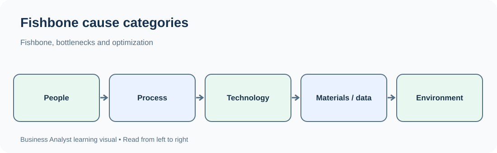
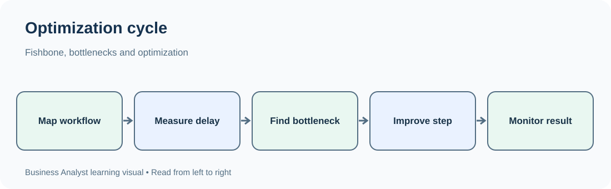

# TechPhile.ai --- Business Analyst Career Pathway

# Day 18: Fishbone Diagrams, Bottlenecks and Process Optimization

**Phase:** 3 --- Process Modeling and Documentation\
**Estimated learning time:** 2--3 hours\
**Difficulty:** Beginner to Advanced\
**Prerequisites:** Day 13 --- Business Process Modeling and Process
Discovery; Day 14 --- Flowcharts; Day 15 --- BPMN; Day 16 --- AS-IS and
TO-BE Process Analysis; Day 17 --- Gap Analysis, Root-Cause Analysis and
the 5 Whys\
**Learning focus:** Identify and investigate process bottlenecks, use
fishbone diagrams to organize possible causes, and evaluate practical
ways to optimize business processes.

------------------------------------------------------------------------

## 1. Learning Objectives

By the end of this lesson, you should be able to:

-   Explain what a process bottleneck is and how it affects business
    performance.
-   Recognize bottlenecks using process observation, operational data
    and stakeholder feedback.
-   Distinguish a bottleneck from a symptom, delay, constraint and root
    cause.
-   Understand throughput, capacity, utilization, queue length, waiting
    time and cycle time.
-   Use a fishbone diagram to organize possible causes of a process
    problem.
-   Select suitable cause categories for service, operational and
    technology processes.
-   Investigate bottlenecks without assuming the first visible delay is
    the true cause.
-   Apply practical process optimization techniques.
-   Compare process improvement options using impact, effort, risk and
    feasibility.
-   Understand Lean principles and the seven common forms of process
    waste.
-   Recognize how automation can improve a process and when automation
    may make things worse.
-   Define baseline measures, improvement targets and monitoring
    methods.
-   Explain process bottleneck investigation and optimization in an
    interview.

------------------------------------------------------------------------

# 2. Why This Topic Matters in Real Business

Imagine an online shopping company receives 2,000 orders every day. The
company has enough inventory and delivery partners, but many orders are
dispatched late.

The operations manager says:

> "The warehouse team is slow. We should hire more employees."

Should the Business Analyst immediately recommend hiring?

No. The BA should investigate the complete order-fulfilment process:

-   How many orders enter the process each hour?
-   How many orders can each stage process?
-   At which stage does the queue grow?
-   How long do orders wait before picking begins?
-   Are items difficult to locate?
-   Are orders held for payment or address checks?
-   Are staff waiting for updated inventory information?
-   Does the delay occur during every shift or only at peak times?

The visible delay may occur in the warehouse, but its cause may be
inaccurate inventory data, late payment confirmation, poor work
allocation or an approval rule.

The BA needs to identify where work is constrained, understand why the
constraint exists and recommend improvements that address the real
issue.

**Main idea:** A process bottleneck limits the flow of the entire
process. Improving a stage that is not constraining the flow may produce
little or no overall benefit.

------------------------------------------------------------------------

# 3. Essential Terms

  -----------------------------------------------------------------------
  Term                    Simple meaning          Example
  ----------------------- ----------------------- -----------------------
  Process                 Connected activities    Order fulfilment
                          that produce a business 
                          result                  

  Bottleneck              A stage that limits the One review team can
                          flow or capacity of the approve only 100 cases
                          process                 per day

  Constraint              A limitation affecting  Limited staff, machine
                          what a process can      capacity or system
                          achieve                 throughput

  Throughput              Number of completed     500 orders completed
                          items per unit of time  per day

  Capacity                Maximum output a stage  120 applications per
                          can produce under       day
                          defined conditions      

  Utilization             Share of available      A team uses 90% of its
                          capacity being used     available working time

  Queue                   Work waiting to be      300 applications
                          processed               awaiting review

  Queue length            Number of items waiting 300 pending cases

  Waiting time            Time an item spends     An application waits 2
                          waiting                 days for review

  Processing time         Active time spent       A reviewer spends 20
                          performing work         minutes checking
                                                  documents

  Cycle time              Elapsed time from a     5 working days from
                          defined start to end    submission to decision
                          point                   

  Lead time               Time from a customer's  4 days from order
                          request or order to     placement to delivery
                          delivery of the result  

  Rework                  Work repeated because   An application is
                          something was           returned for missing
                          incomplete or incorrect information

  Waste                   Activity or resource    Re-entering the same
                          use that does not       customer details
                          create required         
                          customer or business    
                          value                   

  Process optimization    Improving process       Reducing unnecessary
                          performance while       handoffs
                          preserving required     
                          outcomes and controls   

  Root cause              Underlying reason a     No defined queue
                          problem occurs          ownership

  Improvement measure     Metric used to evaluate Average waiting time
                          a change                
  -----------------------------------------------------------------------

Terminology can vary across organizations. Always define the start and
end points of a measure before comparing it.

------------------------------------------------------------------------

# 4. What Is a Process Bottleneck?

## 4.1 Definition

A **process bottleneck** is a stage, resource, rule or condition that
restricts the flow of work through a process.

It limits the output of the overall process even when other stages have
spare capacity.

Think of a road with four lanes that narrows to one lane. Vehicles may
move quickly before the narrow section, but the narrow section restricts
how many vehicles can pass through.

The same idea applies to business processes.

## 4.2 Simple business example

A loan application passes through four stages:

  Stage                     Capacity per day
  ----------------------- ------------------
  Application intake        300 applications
  Document verification     120 applications
  Credit assessment         180 applications
  Final approval            150 applications

The document verification stage has the lowest capacity: 120
applications per day.

If all stages depend on this sequence and the figures are comparable,
document verification is the likely bottleneck.

Even if intake can accept 300 applications per day, the process cannot
complete 300 applications per day when verification can handle only 120.

**Important:** The lowest stated capacity is a useful clue, but actual
bottleneck identification also requires checking work arrival patterns,
staffing schedules, product mix, rework, downtime and dependencies.

## 4.3 How bottlenecks affect a process

A bottleneck can cause:

-   Long queues.
-   Increased waiting time.
-   Delayed completion.
-   Missed service-level targets.
-   Higher operating costs.
-   Employee frustration.
-   Customer complaints.
-   More work-in-progress.
-   Increased risk of errors and rework.
-   Reduced overall throughput.

## 4.4 Bottleneck versus ordinary delay

Not every delay is a bottleneck.

  -----------------------------------------------------------------------
  Situation               Bottleneck?             Why
  ----------------------- ----------------------- -----------------------
  One employee takes a    Not necessarily         It may be an isolated
  long lunch break once                           delay

  A review stage          Likely                  It restricts flow and
  consistently processes                          creates a queue
  less work than arrives                          

  A system is unavailable Not necessarily         A temporary incident
  for 10 minutes once                             may not be a persistent
                                                  capacity constraint

  A required approval     Likely                  The approval stage may
  queue grows every week                          be restricting
                                                  throughput

  A process has a long    It depends              The delay may be a
  wait because work is                            policy or scheduling
  intentionally scheduled                         choice rather than a
  monthly                                         capacity bottleneck
  -----------------------------------------------------------------------

A BA should investigate patterns over time instead of relying on one
incident.

------------------------------------------------------------------------

# 5. Understanding Process Flow and Capacity

## 5.1 Throughput

Throughput measures how many items a process or stage completes during a
defined period.

Formula:

``` text
Throughput = Completed items / Time period
```

Example:

A team completes 450 applications in 5 working days.

``` text
Throughput = 450 / 5
           = 90 applications per working day
```

Always state the unit: - Orders per hour. - Applications per day. -
Claims per week. - Customers served per month.

Do not compare throughput values if the time periods or populations
differ.

## 5.2 Capacity

Capacity is the amount of work a stage can handle under specified
operating conditions.

Example:

A reviewer can complete 15 applications per day. A team of 6 reviewers
has a theoretical daily capacity of:

``` text
15 × 6 = 90 applications per day
```

Actual capacity may be lower because of: - Meetings. - Leave. - Complex
cases. - System downtime. - Rework. - Training. - Administrative work. -
Uneven allocation.

A theoretical maximum is not the same as sustainable operational
capacity.

## 5.3 Utilization

Utilization compares the amount of available capacity being used with
the total available capacity.

``` text
Utilization (%) =
(Used capacity / Available capacity) × 100
```

Example:

A team has 40 available staff-hours in a day and spends 32 hours
processing assigned work.

``` text
Utilization = (32 / 40) × 100
            = 80%
```

High utilization does not automatically mean good performance. If a
stage operates close to full capacity all the time, small changes in
arrival volume or processing time can create large queues.

## 5.4 Queue length

Queue length is the number of items waiting for processing.

Example:

-   50 applications are waiting at 9 AM.
-   80 new applications arrive during the day.
-   The team completes 60 applications.

Ignoring cancellations and other movements:

``` text
Ending queue = Starting queue + Arrivals - Completions

Ending queue = 50 + 80 - 60
             = 70 applications
```

The queue grew by 20 applications.

If arrivals continue to exceed completions, the backlog will continue
growing.

## 5.5 Waiting time, processing time and cycle time

  -----------------------------------------------------------------------
  Measure                 Meaning                 Example
  ----------------------- ----------------------- -----------------------
  Processing time         Time actively spent     30 minutes checking an
                          doing the work          application

  Waiting time            Time the item waits     2 days before a
                          between activities      reviewer picks it up

  Cycle time              Total elapsed time      4 working days from
                          across a defined        receipt to decision
                          process boundary        
  -----------------------------------------------------------------------

A process can have short processing time but long cycle time.

Example:

-   Document review: 30 minutes.
-   Waiting for assignment: 1 day.
-   Waiting for missing information: 2 days.
-   Final review: 30 minutes.

The active work is only 1 hour, but the elapsed time is several days.

**BA insight:** Reducing waiting time may produce a greater improvement
than trying to make employees perform each activity faster.

------------------------------------------------------------------------

# 6. How to Identify a Bottleneck

Use multiple sources of evidence. Do not decide based only on which team
receives the most complaints.

## 6.1 Examine queues

Look for: - Work accumulating before a particular stage. - A backlog
that grows over time. - Cases waiting much longer at one stage than
others. - Work being repeatedly reassigned. - Oldest items remaining
unresolved.

Example:

  Stage                     Items waiting
  ----------------------- ---------------
  Intake                               10
  Document verification               240
  Credit assessment                    35
  Final approval                       20

The verification stage deserves investigation because the queue is much
larger. However, the BA should also check how much work enters each
stage and whether the queue includes cases waiting for customers.

## 6.2 Compare arrival rate and completion rate

  Stage            Average arrivals/day   Average completions/day
  -------------- ---------------------- -------------------------
  Intake                            200                       200
  Verification                      200                       150
  Assessment                        150                       155
  Approval                          150                       145

Verification receives more work than it completes. Its queue is likely
to grow.

A stage where completions are consistently below arrivals is a strong
bottleneck candidate.

## 6.3 Measure stage-level time

Record: - Time work enters a stage. - Time processing starts. - Time
processing ends. - Time work leaves the stage. - Time spent waiting for
missing information. - Time spent waiting for approval.

Example:

  Activity               Active processing   Waiting
  -------------------- ------------------- ---------
  Initial validation            10 minutes   2 hours
  Document review               25 minutes    2 days
  Manager approval               5 minutes     1 day
  Final notification             5 minutes    1 hour

Document review and manager approval account for much of the waiting
time. Further investigation is needed to identify why.

## 6.4 Observe work directly

A BA may observe: - Employees waiting for system responses. - Work being
moved between inboxes. - Repeated data entry. - Manual searches for
information. - Repeated approval requests. - Staff interruptions. - Work
being returned for correction.

Observation helps identify what documents and system reports may not
show.

## 6.5 Interview process participants

Useful questions: - Which activity usually takes the longest? - Where
does work wait? - What causes work to be returned? - Which approvals are
difficult to obtain? - What information is often missing? - Which
systems slow down the process? - What workarounds do employees use? -
Are delays different during peak periods?

Do not ask only managers. Front-line employees often understand
operational details that are not visible in management reports.

## 6.6 Use system and operational data

Possible evidence: - Workflow timestamps. - Queue reports. - Ticket
histories. - Application logs. - Transaction records. - Staffing
schedules. - Error and rework reports. - Service-level reports.

Check data quality before drawing conclusions: - Are timestamps recorded
consistently? - Are cancelled cases included? - Are reopened cases
counted twice? - Are all teams using the same definitions? - Are
weekends and holidays handled consistently?

------------------------------------------------------------------------

# 7. Bottleneck Investigation --- Step-by-Step

## Step 1: Define the process and boundary

State: - Process start. - Process end. - Included activities. - Excluded
activities. - Customer or business group. - Time period being studied.

Example:

> Analyze the process from successful loan application submission to
> final credit decision for retail loan applications received during
> October.

## Step 2: Define the business problem

Weak:

> "Loan processing is slow."

Better:

> "The average time from complete application submission to credit
> decision is 6 working days, compared with the agreed target of 3
> working days."

## Step 3: Map the AS-IS process

Identify: - Activities. - Roles. - Systems. - Handoffs. - Decisions. -
Queues. - Exceptions. - Rework loops.

Use a flowchart or BPMN model from the previous lessons.

## Step 4: Collect baseline data

Measure: - Arrival rate. - Completion rate. - Queue length. - Processing
time. - Waiting time. - Cycle time. - Rework rate. - Utilization. -
Error rate.

## Step 5: Locate the constraint

Look for the stage where: - Work accumulates. - Completion capacity is
low relative to arrivals. - Waiting time is high. - Downstream stages
are starved of work. - The process repeatedly misses its target.

## Step 6: Investigate possible causes

Use: - 5 Whys. - Fishbone diagram. - Interviews. - Observation. -
Process and data analysis. - Pareto analysis where useful.

## Step 7: Validate the cause

Check evidence and alternative explanations. A large queue may be caused
by: - Low processing capacity. - A sudden arrival spike. - Missing
information. - A policy hold. - A system outage. - Work being assigned
in batches. - Rework or duplicate cases.

## Step 8: Identify improvement options

Consider: - Removing unnecessary steps. - Simplifying decisions. -
Standardizing work. - Improving assignment rules. - Reducing rework. -
Adding capacity. - Changing approval thresholds. - Improving system
performance. - Automating repetitive work. - Improving information
availability.

## Step 9: Assess impact and risk

Evaluate: - Customer experience. - Business value. - Compliance. -
Operational risk. - Cost. - Employee impact. - Technical feasibility. -
Dependencies. - Training and support needs.

## Step 10: Define measures and monitor

Set: - Baseline. - Target. - Data source. - Measurement owner. - Review
period. - Guardrail measures to ensure quality does not decline.

------------------------------------------------------------------------

# 8. Fishbone Diagrams for Bottleneck Investigation

## 8.1 What is a fishbone diagram?

A fishbone diagram is a cause-and-effect tool used to organize possible
causes of a defined problem into meaningful categories.

It is also called: - Ishikawa diagram. - Cause-and-effect diagram.

The problem is placed at the head of the diagram. Main cause categories
form the major branches, and specific possible causes are added as
smaller branches.

A fishbone diagram helps a team explore possible explanations. It does
not prove that those explanations are true.

## 8.2 Common categories

The traditional manufacturing-oriented 6 Ms are:

  -----------------------------------------------------------------------
  Category                What it examines        Business example
  ----------------------- ----------------------- -----------------------
  Manpower / People       Skills, staffing,       Too few trained
                          workload and            reviewers
                          communication           

  Methods                 Procedures, workflow    Every team follows a
                          and rules               different review
                                                  sequence

  Machines / Technology   Systems, tools and      Application freezes
                          equipment               during review

  Materials / Inputs      Documents and           Applications arrive
                          information used        with missing documents

  Measurement             Metrics, monitoring and Queue age is not
                          data quality            tracked

  Mother Nature /         External and workplace  Seasonal demand creates
  Environment             conditions              volume spikes
  -----------------------------------------------------------------------

For service and digital organizations, teams often adapt the categories:

-   People.
-   Process.
-   Technology.
-   Data.
-   Policy.
-   Environment.

Choose categories that make sense for the process. There is no
requirement to use every category.

## 8.3 Example: Why are loan applications taking too long?

**Problem at the fish head:** Loan decision cycle time exceeds the
target.

  -----------------------------------------------------------------------
  Category                            Possible causes to investigate
  ----------------------------------- -----------------------------------
  People                              Insufficient trained reviewers;
                                      uneven workload

  Process                             Repeated handoffs; unnecessary
                                      approval steps

  Technology                          Slow application; missing
                                      integration with credit bureau

  Data                                Incomplete applicant information;
                                      inconsistent records

  Policy                              All applications require the same
                                      approval level

  Environment                         High application volume during
                                      seasonal campaigns

  Measurement                         No queue-age monitoring; unclear
                                      stage-level timestamps
  -----------------------------------------------------------------------

These are hypotheses, not confirmed causes.

## 8.4 Text-based fishbone diagram

``` text
People ------------------\
Process ------------------\
Technology ---------------\
Data ---------------------- > Long loan decision cycle time
Policy -------------------/
Environment --------------/
Measurement -------------/
```

## 8.5 How to create a fishbone diagram

1.  Define the problem precisely.
2.  Place the problem at the right side of the page.
3.  Draw a central horizontal line.
4.  Add relevant cause categories as branches.
5.  Invite people from different roles to suggest possible causes.
6.  Add specific causes under the relevant branches.
7.  Break broad causes into smaller, testable explanations.
8.  Mark which causes have evidence and which are only hypotheses.
9.  Select important causes for further investigation.
10. Validate the causes before recommending actions.

## 8.6 Good and weak cause statements

  -----------------------------------------------------------------------
  Weak statement                      Better, testable statement
  ----------------------------------- -----------------------------------
  Staff are lazy                      The review queue has no assignment
                                      owner and work remains unclaimed

  The system is bad                   The application takes more than 10
                                      seconds to load the customer record
                                      during peak hours

  Communication is poor               The operations team does not
                                      receive an alert when a case is
                                      returned for missing information

  Customers are careless              22% of submitted applications have
                                      at least one required document
                                      missing

  Management is slow                  Approval requests remain pending
                                      for an average of 2 working days
  -----------------------------------------------------------------------

The better statements describe observable conditions that can be
investigated.

## 8.7 Combining fishbone with 5 Whys

Use fishbone to identify broad possibilities. Then use 5 Whys to
investigate a selected branch.

Example:

-   Fishbone category: Process.
-   Possible cause: Applications are assigned in batches.
-   Why 1: Why are applications assigned in batches? Because the shared
    inbox is reviewed only twice daily.
-   Why 2: Why is the inbox reviewed twice daily? Because no queue
    assignment feature exists.
-   Why 3: Why is there no assignment feature? Because ownership and
    work allocation were not included in the original process
    requirements.

Each answer must be validated.

------------------------------------------------------------------------

# 9. Process Optimization --- Fundamentals

## 9.1 What is process optimization?

Process optimization is the systematic improvement of a business process
so it achieves its intended outcome with less delay, effort, cost, error
or waste, while maintaining required quality, controls and customer
value.

Optimization does not always mean making a process faster.

It may also mean: - Reducing errors. - Improving consistency. -
Increasing transparency. - Improving customer experience. - Reducing
risk. - Improving compliance. - Making work easier for employees. -
Improving the ability to handle changing demand.

## 9.2 Optimization objectives

  Objective                     Example measure
  ----------------------------- --------------------------------------------------
  Improve speed                 Cycle time
  Increase output               Throughput
  Reduce waiting                Average queue waiting time
  Improve quality               Error rate
  Reduce rework                 Rework percentage
  Improve customer experience   Customer satisfaction
  Reduce cost                   Cost per transaction
  Improve reliability           Percentage completed within SLA
  Improve control               Number of unauthorized or duplicate transactions

## 9.3 The optimization mindset

Before changing a process, ask:

1.  Does this activity create value?
2.  Is it required by policy, risk or regulation?
3.  Can it be removed without harming the outcome?
4.  Can it be simplified?
5.  Can two activities be combined?
6.  Can work be performed earlier?
7.  Can a handoff be avoided?
8.  Can the information be captured once and reused?
9.  Can a repetitive step be automated safely?
10. How will the team know the change worked?

------------------------------------------------------------------------

# 10. Practical Process Optimization Techniques

## 10.1 Eliminate unnecessary steps

Remove activities that do not add value and are not required for
compliance, risk management or control.

Example: - Current: Customer enters the same address on three screens. -
Improvement: Capture the address once and reuse it where appropriate.

Do not remove a control simply because it takes time. Confirm why it
exists and assess the risk first.

## 10.2 Simplify complex activities

Reduce unnecessary complexity.

Example: - Current: Staff use a 12-page checklist for a simple
application. - Improvement: Use a shorter role-specific checklist while
retaining mandatory checks.

## 10.3 Standardize work

Create a consistent method for common tasks.

Example: - Current: Each support agent classifies complaints
differently. - Improvement: Define common complaint categories and
classification guidance.

Standardization improves consistency but should allow legitimate
exceptions.

## 10.4 Combine activities

Combine steps when they can be completed together without creating risk.

Example: - Current: Staff verify identity in one screen and then open
another system to verify the same details. - Improvement: Display the
necessary verified information in one workflow, subject to access and
security controls.

## 10.5 Reorder activities

Perform tasks earlier when doing so prevents downstream rework.

Example: - Current: Staff discover missing documents after a full
application review. - Improvement: Check document completeness
immediately after submission.

## 10.6 Reduce handoffs

Every handoff may create waiting, communication effort and ownership
confusion.

Example: - Current: A customer request moves between three teams for
routine approval. - Improvement: Define clear decision authority and
allow an authorized team to complete the routine case.

## 10.7 Improve work allocation

Distribute work based on skills, capacity, urgency and business rules.

Example: - Current: All cases enter one shared inbox. - Improvement:
Route specialist cases to qualified reviewers and display queue
ownership.

## 10.8 Reduce rework

Identify why work is returned or corrected.

Example: - Current: Applications are repeatedly returned because
required fields are missing. - Improvement: Add clear field guidance and
validation at the point of entry.

## 10.9 Improve information visibility

Make the right information available to the people who need it.

Example: - Current: Agents cannot see whether a refund is pending or
completed. - Improvement: Provide a reliable transaction-status view
with appropriate access controls.

## 10.10 Automate suitable repetitive tasks

Automation may be useful for: - Data validation. - Status
notifications. - Routing. - Duplicate checks. - Report generation. -
Routine calculations. - Reminders and alerts.

Automation should follow process understanding and simplification.
Automating an unnecessary or poorly designed process can make waste
happen faster.

------------------------------------------------------------------------

# 11. Lean Principles and Waste Reduction

## 11.1 What is Lean?

Lean is an approach to improving how work is delivered by focusing on
customer value and reducing activities that consume resources without
creating required value.

Lean encourages teams to: - Understand what the customer values. -
Examine the complete flow of work. - Reduce unnecessary activity. -
Improve flow. - Respond to actual demand. - Continuously improve.

Lean is not simply "make employees work faster" or "cut costs at any
price." Quality, safety, compliance and customer value must be
protected.

## 11.2 Value from the customer's perspective

An activity is value-adding when it contributes to the outcome the
customer needs and is performed correctly the first time.

Example: In an online order process: - Picking the correct product is
value-adding. - Packing the order safely is value-adding. - Re-entering
the same address because systems are disconnected is generally
non-value-adding.

Some activities do not directly create customer value but are necessary
because of legal, security or business controls. These should be
distinguished from avoidable waste.

## 11.3 The seven wastes --- TIMWOOD

A common Lean memory aid is **TIMWOOD**.

  -----------------------------------------------------------------------
  Waste                   Meaning                 Business example
  ----------------------- ----------------------- -----------------------
  T --- Transportation    Unnecessary movement of Physical files moved
                          items or information    between departments

  I --- Inventory         Excess work or stock    Hundreds of unprocessed
                          waiting                 applications

  M --- Motion            Unnecessary movement by Staff repeatedly search
                          people                  different folders for
                                                  the same document

  W --- Waiting           People, systems or work Application waits for
                          waiting                 approval

  O --- Overproduction    Producing more or       Generating reports
                          earlier than needed     nobody uses

  O --- Overprocessing    Doing more work than    Entering the same
                          required                customer data in
                                                  multiple systems

  D --- Defects           Errors that cause       Incorrect invoices
                          correction or rework    requiring reissue
  -----------------------------------------------------------------------

Some Lean models also explicitly discuss underused talent or skills as
an additional waste.

## 11.4 Examples of waste in service organizations

### Transportation

-   Physical documents move between offices.
-   Information is transferred manually between disconnected systems.

### Inventory

-   Large backlog of unresolved support tickets.
-   Applications waiting for review.

### Motion

-   Employees search through multiple folders.
-   Agents switch between many screens to answer one question.

### Waiting

-   Customer waits for an approval.
-   Staff wait for a system response.

### Overproduction

-   Teams prepare duplicate reports.
-   Unrequested documents are generated.

### Overprocessing

-   Multiple teams perform the same verification.
-   Customer details are repeatedly entered.

### Defects

-   Incorrect data entry.
-   Wrong product shipped.
-   Incomplete application returned for correction.

## 11.5 How to identify waste

Ask: - Does this activity change the product, service or information in
a way the customer needs? - Is the activity required by law, policy,
security or risk control? - Is the same information entered more than
once? - Does work wait between activities? - Is work produced before
anyone needs it? - Does an error cause repeated work? - Could the
activity be simplified without creating new risk?

------------------------------------------------------------------------

# 12. Bottleneck Management and the Theory of Constraints

## 12.1 What is the Theory of Constraints?

The Theory of Constraints (TOC) is an approach that focuses improvement
on the constraint that most limits the performance of the overall
system.

The key idea is:

> Improving a non-bottleneck stage does not necessarily improve the
> output of the whole process.

## 12.2 Five focusing steps

1.  **Identify the constraint:** Find the stage or condition limiting
    overall throughput.
2.  **Exploit the constraint:** Use its existing capacity effectively;
    reduce avoidable interruptions and rework.
3.  **Subordinate other activities:** Align upstream and downstream work
    with the constraint's actual capacity.
4.  **Elevate the constraint:** Increase capacity through staffing,
    technology, process changes or other investment.
5.  **Repeat:** Once the constraint moves, identify the next one.

## 12.3 Example

A claims process has these capacities:

  Stage                  Capacity per day
  -------------------- ------------------
  Claim intake                        300
  Document review                     100
  Assessment                          160
  Payment processing                  220

Document review is the likely constraint.

### Step 1 --- Identify

The document review stage completes only 100 claims per day.

### Step 2 --- Exploit

-   Reduce avoidable interruptions.
-   Ensure reviewers have complete files.
-   Prioritize work using approved rules.
-   Reduce time spent searching for documents.

### Step 3 --- Subordinate

Do not send 300 incomplete claims into the review queue if the review
team can handle only 100. Align intake and downstream planning with the
review capacity.

### Step 4 --- Elevate

If justified, train additional reviewers, introduce document extraction
or add a suitable system capability.

### Step 5 --- Repeat

After review capacity increases, assessment may become the next
constraint. Re-measure the entire process.

**Important:** Do not use the example as a reason to stop accepting
valid customer requests. Demand management must follow approved business
and customer policies.

------------------------------------------------------------------------

# 13. Balancing Flow, Quality and Capacity

A process should not be optimized for speed alone.

## 13.1 Speed versus quality

Example: A team reduces application review time by skipping a
verification step.

Possible result: - Faster processing. - More incorrect approvals. -
Higher fraud risk. - More later corrections.

The change may improve one KPI while damaging the overall business
outcome.

Use balanced measures:

  Speed measure             Quality / control measure
  ------------------------- --------------------------------
  Average processing time   Error rate
  Cycle time                Rework rate
  Throughput                First-time-right rate
  Queue age                 Complaint rate
  SLA achievement           Audit or compliance exceptions

## 13.2 Avoid excessive utilization

If a team is scheduled at 100% utilization, there may be no capacity
for: - Unexpected work. - Complex cases. - Breaks. - Training. - System
issues. - Urgent exceptions.

A practical operating plan usually needs some capacity for variation.
The appropriate buffer depends on the type of work, demand variability
and service expectations.

## 13.3 Work-in-progress (WIP)

Work-in-progress is work that has started but is not yet completed.

Too much WIP can: - Increase waiting. - Hide priorities. - Increase
context switching. - Make ownership unclear. - Delay completion.

A team may improve flow by limiting how much work is started at once and
finishing existing work before accepting more.

WIP limits are explored further in the Agile and Kanban section of the
pathway.

------------------------------------------------------------------------

# 14. Process Optimization Tools

## 14.1 Process map / flowchart

Use a flowchart to: - Visualize activity sequence. - Identify
unnecessary steps. - Locate decision points. - Show rework loops. - Find
handoffs.

## 14.2 BPMN

Use BPMN when the process needs clear representation of: - Events. -
Tasks. - Gateways. - Participants. - Message flows. - Exceptions.

## 14.3 Fishbone diagram

Use it to organize possible causes of a bottleneck or performance
problem.

## 14.4 5 Whys

Use it to investigate a selected cause path.

## 14.5 Pareto chart

Use it to identify which issue categories contribute most to total
volume or impact.

Example: If 70% of all rework comes from three missing-document
categories, those categories may deserve early attention.

## 14.6 Value stream mapping --- introductory view

Value stream mapping visualizes the flow of information and work
required to deliver a product or service.

It helps identify: - Value-adding activities. - Non-value-adding
activities. - Waiting time. - Processing time. - Inventory or work
queues. - Information flow. - Improvement opportunities.

Example: Map the full journey from customer order to delivery, not just
the warehouse picking activity.

## 14.7 Tool comparison

  -----------------------------------------------------------------------
  Tool                    Main purpose            Use when
  ----------------------- ----------------------- -----------------------
  Flowchart               Show sequence and       You need to understand
                          decisions               process steps

  BPMN                    Model detailed business Multiple roles, events
                          workflows               and message flows
                                                  matter

  Fishbone                Organize possible       Many possible causes
                          causes                  exist

  5 Whys                  Explore why a cause     Investigating a focused
                          occurs                  problem

  Pareto chart            Rank issue categories   You need to focus on
                          by frequency or impact  major contributors

  Value stream map        See end-to-end flow and You need to improve the
                          waste                   complete value stream

  KPI dashboard           Monitor process         You need ongoing
                          performance             visibility
  -----------------------------------------------------------------------

------------------------------------------------------------------------

# 15. Evaluating and Selecting Improvements

Do not select an improvement merely because it is popular or easy to
implement.

## 15.1 Evaluation factors

Consider: - Expected business benefit. - Customer impact. - Reduction in
cycle time or waiting. - Reduction in errors and rework. -
Implementation cost. - Technical feasibility. - Operational
feasibility. - Compliance and security impact. - Training
requirements. - Dependencies. - Time to deliver. - Ongoing maintenance.

## 15.2 Impact-versus-effort matrix

                Low effort           High effort
  ------------- -------------------- ---------------------
  High impact   Quick wins           Major initiatives
  Low impact    Small improvements   Defer or reconsider

This is a prioritization aid, not an automatic decision rule. High-risk
or mandatory controls may need attention even if implementation effort
is high.

## 15.3 Example

  -----------------------------------------------------------------------
  Improvement       Expected impact   Effort            Consideration
  ----------------- ----------------- ----------------- -----------------
  Add early         High              Low--Medium       Reduces avoidable
  document                                              rework
  completeness                                          
  checks                                                

  Introduce a       Medium--High      Medium            Improves
  review queue                                          visibility
  dashboard                                             

  Replace the       Potentially high  Very high         Needs business
  entire                                                case and
  application                                           migration
  platform                                              planning

  Add automatic     Medium            Medium            Requires accurate
  status                                                status data
  notifications                                         

  Remove mandatory  Potentially       Low               Do not remove
  identity          harmful                             required controls
  verification                                          
  -----------------------------------------------------------------------

## 15.4 Pilot before broad rollout

Where appropriate: 1. Select a limited team, location or process
segment. 2. Define baseline measures. 3. Implement the improvement. 4.
Monitor speed, quality and customer impact. 5. Collect employee
feedback. 6. Compare results with the baseline. 7. Adjust before wider
rollout.

A pilot helps reveal unintended consequences before a large-scale
change.

------------------------------------------------------------------------

# 16. Measuring Process Optimization

## 16.1 Define a baseline

A baseline is the starting measurement before an improvement.

Example: - Average cycle time: 6 days. - Rework rate: 25%. - Throughput:
100 applications per day. - Customer satisfaction: 3.4/5.

## 16.2 Define targets

Targets should be: - Relevant to the business objective. - Measurable. -
Realistic. - Time-bound. - Approved by the appropriate owner.

Example: - Reduce average cycle time from 6 days to 3 days within 90
days. - Reduce rework from 25% to below 10%. - Maintain or improve
first-time-right rate.

## 16.3 Useful process KPIs

  KPI                     What it tells you
  ----------------------- -----------------------------------------------------
  Throughput              How much work is completed in a period
  Cycle time              How long a process instance takes
  Processing time         How long active work takes
  Waiting time            How long work waits
  Queue length            How much work is pending
  Queue age               How long the oldest or each pending item has waited
  Utilization             How much available capacity is being used
  Rework rate             How often work must be corrected or repeated
  First-time-right rate   Share completed correctly without rework
  SLA achievement         Share completed within agreed service time
  Cost per transaction    Average cost of processing an item
  Customer satisfaction   Customer perception of the service

## 16.4 Calculate improvement

Suppose average processing cycle time falls from 8 days to 5 days.

``` text
Time reduction = Old time - New time
               = 8 - 5
               = 3 days

Percentage reduction =
((Old time - New time) / Old time) × 100

= (3 / 8) × 100
= 37.5%
```

The cycle time reduced by 37.5%.

Be precise about the measure: this is a reduction in average cycle time,
not necessarily a 37.5% increase in throughput.

## 16.5 Guardrail measures

A guardrail is a measure that helps ensure an improvement does not
create unacceptable side effects.

Example:

  -----------------------------------------------------------------------
  Primary goal                        Guardrail
  ----------------------------------- -----------------------------------
  Reduce processing time              Error rate must not increase

  Increase throughput                 Customer satisfaction must not
                                      decline

  Reduce staffing cost                SLA and compliance performance must
                                      be maintained

  Automate document review            False rejection rate must remain
                                      acceptable
  -----------------------------------------------------------------------

------------------------------------------------------------------------

# 17. Worked Industry Scenario --- E-Commerce Order Fulfilment

## 17.1 Business situation

An e-commerce company receives 1,500 orders per day. Customers complain
that some orders are dispatched late.

The operations manager believes warehouse picking is the problem and
requests more warehouse staff.

The BA investigates the complete order fulfilment process.

## 17.2 Process boundary

Start: Customer completes a valid order.

End: Order is handed over to the delivery partner.

Included stages: 1. Order confirmation. 2. Payment confirmation. 3.
Inventory allocation. 4. Picking. 5. Packing. 6. Dispatch handover.

## 17.3 Initial process data

  Stage                    Average arrivals/day   Average completions/day
  ---------------------- ---------------------- -------------------------
  Order confirmation                      1,500                     1,500
  Payment confirmation                    1,500                     1,470
  Inventory allocation                    1,470                     1,450
  Picking                                 1,450                     1,100
  Packing                                 1,100                     1,150
  Dispatch handover                       1,100                     1,080

Picking is a strong bottleneck candidate because it receives more orders
than it completes. The queue may accumulate before picking.

However, the BA should validate the data and investigate whether orders
have different complexity, whether inventory is available and whether
work is being held for other reasons.

## 17.4 Fishbone analysis

Problem: \> Orders are not being dispatched within the agreed target.

  -----------------------------------------------------------------------
  Category                            Possible causes
  ----------------------------------- -----------------------------------
  People                              New pickers need training; staffing
                                      is uneven across shifts

  Process                             Pick lists are released in large
                                      batches; priority rules are unclear

  Technology                          Warehouse system responds slowly

  Data                                Inventory locations are inaccurate

  Measurement                         Picking time and queue age are not
                                      tracked by zone

  Environment                         Peak-hour volume is higher than
                                      normal
  -----------------------------------------------------------------------

## 17.5 Further investigation

The BA reviews: - Order timestamps. - Pick-list release times. -
Inventory accuracy reports. - Warehouse staff interviews. - Observation
across shifts. - System response times. - Rework and missing-item
records.

The evidence indicates that a significant number of orders are delayed
because inventory locations are inaccurate. Pickers spend time searching
for items and sometimes return to correct the pick.

This is a verified finding only if the records and observations support
it. Other contributing factors may remain.

## 17.6 Improvement options

1.  Improve inventory-location accuracy.
2.  Introduce cycle counts for high-volume items.
3.  Improve pick-list sequencing.
4.  Route work based on warehouse zones.
5.  Monitor unpicked order age.
6.  Define escalation for items not found.
7.  Train staff on the updated picking workflow.

## 17.7 Before-and-after measures

Illustrative targets:

  KPI                                         Baseline             Target
  --------------------------------- ------------------ ------------------
  Picking throughput                  1,100 orders/day   1,400 orders/day
  Average picking time                      45 minutes         30 minutes
  Inventory-location accuracy                      92%                99%
  Orders dispatched within target                  72%                95%
  Missing-item rework                               8%           Below 2%

These targets require business approval and a defined measurement
method.

## 17.8 BA conclusion

The BA should not conclude that hiring more staff is the only solution.
The analysis indicates that inventory accuracy and picking workflow may
be important contributors to the bottleneck.

The BA documents: - The measured bottleneck. - Supporting evidence. -
Verified and unverified causes. - Improvement alternatives. - Risks and
dependencies. - Requirements. - Baseline and target KPIs.

The business owner and delivery team then decide which changes to
implement.

------------------------------------------------------------------------

# 18. Another Scenario --- Customer Support Ticket Resolution

A software company receives 800 support tickets per day.

The average resolution time has increased from 10 hours to 18 hours.

Potential bottleneck indicators: - Tickets wait for specialist
assignment. - The same ticket is transferred between teams. - Agents
request information already held elsewhere. - Specialist teams have high
utilization. - Some ticket categories require manual approval.

Possible fishbone causes:

  Category      Possible causes
  ------------- -----------------------------------------------------
  People        Too few specialists for a specific product area
  Process       Escalation rules are unclear
  Technology    Customer history is not visible in the support tool
  Data          Ticket category is inaccurate
  Policy        Routine cases require unnecessary approval
  Measurement   Team-level queue age is not reported

Possible improvement options: - Improve ticket categorization. - Define
ownership and escalation rules. - Provide relevant customer history. -
Create a knowledge base for recurring questions. - Route specialist
tickets correctly. - Monitor backlog age and resolution time.

Do not automate ticket routing until categories and routing rules are
reliable. Poor classification can send tickets to the wrong team faster.

------------------------------------------------------------------------

# 19. Risks and Considerations During Optimization

## 19.1 Removing necessary controls

A process may be slow because of an approval or verification step.
Before removing it, determine whether it protects against fraud,
financial loss, privacy violations or regulatory breaches.

## 19.2 Moving the bottleneck

Improving one stage may cause another stage to become the new
constraint.

After each major improvement, measure the complete process again.

## 19.3 Optimizing a local stage instead of the full process

A team may improve its own speed while creating more work for another
team.

Example: - Intake accepts applications faster. - Verification receives a
larger backlog. - End-to-end cycle time becomes worse.

Optimize the overall value stream, not only one department's metric.

## 19.4 Automating poor processes

Automation may: - Repeat incorrect data. - Scale a flawed decision
rule. - Create more exceptions. - Make errors harder to detect.

Understand, simplify and validate the process before automating.

## 19.5 Ignoring employee feedback

A process may look efficient on paper but be difficult to follow in real
operations.

Involve people who perform the work and validate the TO-BE process with
them.

## 19.6 Changing KPIs without preserving definitions

If the start/end points or calculation method change, an apparent
improvement may be caused by a measurement change rather than a real
process improvement.

Keep KPI definitions stable or clearly document changes.

------------------------------------------------------------------------

# 20. BA Responsibilities in Process Bottleneck Investigation

A Business Analyst typically:

-   Clarifies the business problem and process boundary.
-   Identifies stakeholders and process owners.
-   Documents the AS-IS process.
-   Collects process and performance data.
-   Identifies queues, delays, handoffs and rework.
-   Compares arrival rates, completion rates and capacity.
-   Facilitates fishbone and 5 Whys discussions.
-   Separates hypotheses from evidence-supported causes.
-   Identifies waste and optimization opportunities.
-   Evaluates impact, effort, feasibility and risk.
-   Helps define the TO-BE process.
-   Documents requirements and business rules.
-   Defines acceptance criteria and KPIs.
-   Supports pilot evaluation and stakeholder validation.
-   Monitors whether the improvement achieves the expected outcome.

**Remember:** The BA facilitates understanding and decision-making.
Process owners, business leaders and technical specialists contribute
their expertise and approve changes within their responsibilities.

------------------------------------------------------------------------

# 21. Common Mistakes to Avoid

  -----------------------------------------------------------------------
  Mistake                 Why it is a problem     Better approach
  ----------------------- ----------------------- -----------------------
  Assuming the            Ignores workload,       Measure stage capacity
  slowest-looking         systems and process     and flow
  employee is the         design                  
  bottleneck                                      

  Improving every stage   Makes cause and effect  Focus on the constraint
  at once                 difficult to understand and evaluate changes

  Measuring only          Misses waiting and      Measure end-to-end
  processing time         queue delays            cycle time

  Hiring more staff       May not address the     Investigate causes and
  immediately             real constraint         capacity first

  Using a fishbone as     It contains possible    Validate each important
  proof                   causes, not confirmed   cause
                          facts                   

  Automating before       Can scale waste and     Improve the process
  simplifying             errors                  first

  Removing approvals      May weaken controls     Assess why each control
  without risk review                             exists

  Optimizing one team's   Can make another stage  Measure end-to-end
  KPI                     worse                   performance

  Ignoring demand         Average values can hide Compare by time,
  variation               peak-period problems    channel and case type

  Failing to monitor      The bottleneck may move Define ongoing KPIs and
  after rollout           or return               ownership
  -----------------------------------------------------------------------

------------------------------------------------------------------------

# 22. Interview Preparation --- Questions and Answers

## Q1. What is a process bottleneck?

**Answer:** A process bottleneck is a stage or constraint that limits
the flow or output of the overall process. It often causes queues,
waiting time and delayed completion.

**Example:** If a process receives 200 applications per day but document
review completes only 120, document review may be the bottleneck.

**Follow-up:** How would you confirm it?\
**Answer:** Compare arrivals, completions, capacity, queue growth and
stage-level waiting time over a suitable period.

## Q2. What is the difference between capacity and throughput?

**Answer:** Capacity is how much work a stage can handle under defined
conditions. Throughput is how much work it actually completes during a
period.

**Example:** A team may have capacity for 150 applications per day but
complete only 120.

**Follow-up:** Why might actual throughput be lower than capacity?\
**Answer:** Rework, downtime, missing information, staffing variation,
complex cases and interruptions.

## Q3. How do you identify a bottleneck in a business process?

**Answer:** I would map the process, define the process boundary,
collect stage-level timestamps and operational data, compare arrival and
completion rates, examine queue lengths and waiting time, and validate
findings with process participants.

**Follow-up:** Is the stage with the largest queue always the
bottleneck?\
**Answer:** Not automatically. The queue may be large because of a
demand spike, policy hold or data issue. Further analysis is needed.

## Q4. What is a fishbone diagram?

**Answer:** A fishbone diagram is a cause-and-effect tool used to
organize possible causes of a problem into categories such as people,
process, technology, data, policy and environment.

**Follow-up:** Does it prove root causes?\
**Answer:** No. It organizes hypotheses. Causes must be validated with
evidence.

## Q5. What is the difference between fishbone analysis and 5 Whys?

**Answer:** Fishbone analysis explores and organizes many possible
causes. The 5 Whys investigates a selected cause path by repeatedly
asking why.

**Follow-up:** Can you combine them?\
**Answer:** Yes. Use fishbone to generate possible causes and 5 Whys to
investigate selected branches.

## Q6. What is process optimization?

**Answer:** Process optimization is the systematic improvement of a
process to deliver its intended outcome with less delay, effort, cost,
error or waste while maintaining quality and required controls.

**Follow-up:** Does optimization always mean automation?\
**Answer:** No. It may involve removing unnecessary steps, simplifying
rules, reducing handoffs, improving work allocation or standardizing
activities.

## Q7. Explain the seven wastes in Lean.

**Answer:** TIMWOOD represents Transportation, Inventory, Motion,
Waiting, Overproduction, Overprocessing and Defects.

**Follow-up:** Give an example of overprocessing.\
**Answer:** Entering the same customer information into multiple systems
when it could be captured once and reused safely.

## Q8. What is the Theory of Constraints?

**Answer:** It is an approach that focuses improvement on the constraint
that limits the performance of the overall system. Its five focusing
steps are identify, exploit, subordinate, elevate and repeat.

**Follow-up:** What happens after the constraint is improved?\
**Answer:** Another stage may become the new bottleneck, so the process
must be measured again.

## Q9. Why is reducing waiting time important?

**Answer:** Waiting can account for a large part of end-to-end cycle
time even when active processing takes little time. Reducing unnecessary
waiting can improve customer experience and throughput without requiring
employees to work faster.

**Follow-up:** How would you measure it?\
**Answer:** Compare timestamps for when work enters a queue and when
processing begins.

## Q10. What is the difference between processing time and cycle time?

**Answer:** Processing time is the active time spent doing the work.
Cycle time is the total elapsed time across a defined process boundary,
including waiting between activities.

**Follow-up:** Can processing time be low while cycle time is high?\
**Answer:** Yes. Work may be completed quickly once started but spend
days waiting in queues.

## Q11. Why can high utilization create delays?

**Answer:** When a resource operates close to full capacity, it has
little room to absorb demand variation, urgent work or unexpected
interruptions. Queues can grow quickly.

**Follow-up:** Should every resource operate at 100% utilization?\
**Answer:** No. Appropriate capacity buffers depend on demand
variability and service expectations.

## Q12. What is work-in-progress?

**Answer:** Work-in-progress is work that has started but has not yet
been completed. Excessive WIP can increase waiting, context switching
and lead time.

**Follow-up:** How can a team control WIP?\
**Answer:** Use clear priorities, work limits, ownership and a focus on
completing existing work before starting too much new work.

## Q13. How do you decide which process improvement to implement?

**Answer:** I would compare expected business and customer impact,
effort, cost, feasibility, risk, dependencies and compliance
requirements. I would facilitate stakeholder prioritization and document
the decision.

**Follow-up:** What if a quick win creates a compliance risk?\
**Answer:** It should not proceed until the risk is assessed and
acceptable controls are defined.

## Q14. How do you know whether process optimization worked?

**Answer:** Compare post-change results with an agreed baseline using
defined KPIs such as cycle time, throughput, waiting time, rework and
customer satisfaction. Check guardrail measures to ensure quality and
controls have not deteriorated.

**Follow-up:** What if speed improves but errors increase?\
**Answer:** The change has created a trade-off that must be
investigated. The team may need to adjust the process rather than
declare success based on speed alone.

## Q15. What is value stream mapping?

**Answer:** Value stream mapping is a visual method for examining the
end-to-end flow of work and information needed to deliver a product or
service. It helps identify processing, waiting, work queues and waste.

**Follow-up:** How is it different from a basic flowchart?\
**Answer:** A flowchart mainly shows steps and decisions. A value stream
map also emphasizes flow, timing, queues and value-adding versus
non-value-adding activity.

------------------------------------------------------------------------

# 23. Daily Knowledge Check --- 5 MCQs

Choose one correct answer for each question. Attempt all five before
checking the explanations.

## Question 1

A process receives 180 cases per day. One stage completes only 120 cases
per day, and its queue grows continuously. What is the most likely
explanation?

A. The stage has excess capacity\
B. The stage may be a bottleneck\
C. The process has no inputs\
D. The process has no business objective

**Correct answer: B --- The stage may be a bottleneck.**

**Explanation:** Arrivals exceed completions, so work accumulates.
Confirm using comparable data and investigate other conditions.

## Question 2

Which measure represents the number of completed applications per
working day?

A. Utilization\
B. Queue length\
C. Throughput\
D. Processing time

**Correct answer: C --- Throughput.**

**Explanation:** Throughput measures completed output per unit of time.

## Question 3

A team uses a fishbone diagram and lists "slow system response" as a
possible cause. What should happen next?

A. Treat it as confirmed\
B. Immediately replace the system\
C. Collect system performance evidence to validate the possibility\
D. Remove the measurement KPI

**Correct answer: C.**

**Explanation:** A fishbone diagram organizes possible causes. System
logs and response-time measurements can help validate the hypothesis.

## Question 4

Which option is an example of Lean waste called overprocessing?

A. A customer waits for a refund\
B. Staff enter the same customer details into three systems\
C. A warehouse has insufficient stock\
D. A team completes more orders than expected

**Correct answer: B.**

**Explanation:** Repeating the same data-entry activity is unnecessary
processing when the information could be reused safely.

## Question 5

A company increases the capacity of its document-review stage. What
should the BA do next?

A. Assume the entire process is now optimized\
B. Stop measuring performance\
C. Reassess the complete process to see whether another stage has become
the bottleneck\
D. Increase every team's utilization to 100%

**Correct answer: C.**

**Explanation:** Once a constraint is improved, another stage may limit
overall throughput. Re-measure the process and identify the next
constraint.

------------------------------------------------------------------------

# 24. Quick Revision Sheet

  -----------------------------------------------------------------------
  Concept                             Remember
  ----------------------------------- -----------------------------------
  Bottleneck                          Stage or constraint limiting
                                      process flow

  Capacity                            Maximum work a stage can handle
                                      under defined conditions

  Throughput                          Completed work per unit of time

  Utilization                         Share of available capacity being
                                      used

  Queue                               Work waiting for processing

  WIP                                 Work started but not yet completed

  Processing time                     Active work time

  Waiting time                        Time spent waiting

  Cycle time                          Total elapsed time across a defined
                                      process

  Fishbone                            Organizes possible causes into
                                      categories

  5 Whys                              Investigates a cause path by
                                      repeatedly asking why

  Lean                                Focuses on customer value and waste
                                      reduction

  TIMWOOD                             Seven common forms of waste

  Theory of Constraints               Focus improvement on the system's
                                      constraint

  Value stream map                    Shows end-to-end work and
                                      information flow

  Guardrail KPI                       Protects quality or control while
                                      improving another measure
  -----------------------------------------------------------------------

## The complete bottleneck investigation flow

``` text
Define business problem
          |
          v
Set process boundaries
          |
          v
Map the AS-IS process
          |
          v
Collect baseline data
          |
          v
Measure queues, capacity and throughput
          |
          v
Identify bottleneck candidates
          |
          v
Use fishbone / 5 Whys to investigate
          |
          v
Validate causes with evidence
          |
          v
Identify and prioritize improvements
          |
          v
Define TO-BE process and requirements
          |
          v
Pilot / implement changes
          |
          v
Measure results and guardrails
          |
          v
Identify the next constraint
```

## Five questions for bottleneck investigation

1.  Where does work accumulate?
2.  Does the stage complete less work than it receives?
3.  How much time is spent waiting versus processing?
4.  What evidence explains the constraint?
5.  What improvement would increase end-to-end flow without harming
    quality?

## Five questions for process optimization

1.  Does each activity create value or satisfy a necessary control?
2.  Can unnecessary work or handoffs be removed?
3.  Can errors and rework be prevented earlier?
4.  Can the bottleneck be managed or its capacity improved?
5.  Which KPIs and guardrails will prove the change worked?

------------------------------------------------------------------------


## Visual learning aids





# 25. Day 18 Completion Checklist

-   [ ] I can define a process bottleneck.
-   [ ] I can distinguish a bottleneck from an isolated delay.
-   [ ] I can explain capacity, throughput, utilization and queue
    length.
-   [ ] I can distinguish processing time, waiting time, cycle time and
    lead time.
-   [ ] I can calculate throughput and utilization from simple data.
-   [ ] I can identify a likely bottleneck by comparing arrivals and
    completions.
-   [ ] I can use process observation and interviews to investigate
    delays.
-   [ ] I can explain how a fishbone diagram is structured.
-   [ ] I can select suitable cause categories for a business process.
-   [ ] I understand that fishbone causes are hypotheses until
    validated.
-   [ ] I can combine fishbone analysis with the 5 Whys.
-   [ ] I can explain process optimization.
-   [ ] I can describe practical optimization techniques.
-   [ ] I can explain the seven Lean wastes using TIMWOOD.
-   [ ] I can explain the five focusing steps of the Theory of
    Constraints.
-   [ ] I can identify how too much WIP and excessive utilization affect
    flow.
-   [ ] I can explain why automation should follow process
    understanding.
-   [ ] I can evaluate improvement options using impact, effort and
    risk.
-   [ ] I can define baselines, targets, KPIs and guardrail measures.
-   [ ] I can explain the e-commerce order-fulfilment scenario.
-   [ ] I can answer the interview questions in my own words.
-   [ ] I can answer all five quiz questions and explain why each answer
    is correct.

------------------------------------------------------------------------

**Day 18 complete --- Fishbone Diagrams, Bottlenecks and Process
Optimization.**

**Next syllabus topic --- Day 19: Functional Specifications, Business
Rules and Documentation Standards.**
