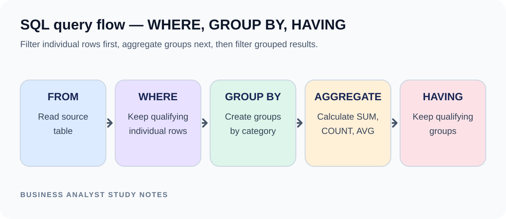
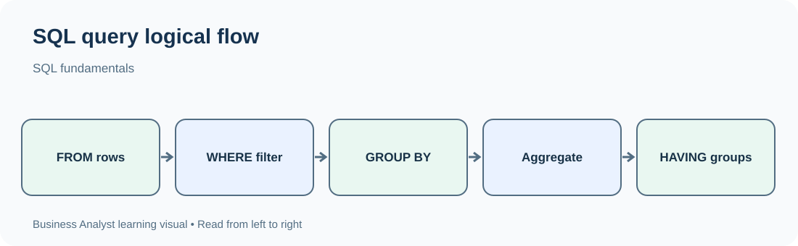

# TechPhile.ai — Business Analyst Career Pathway

# Day 23: SQL Fundamentals for Business Analysts

**Phase:** 4 — Data Analysis for Business Decisions  
**Estimated learning time:** 2–3 hours  
**Difficulty:** Beginner to Intermediate  
**Prerequisites:** Day 19 requirements documentation; basic computer and spreadsheet familiarity.

## Learning objectives
1. Explain tables, rows, columns, primary keys and foreign keys.
2. Retrieve selected columns using SELECT.
3. filter records using WHERE and combine conditions.
4. Sort and limit query results.
5. Aggregate data using COUNT, SUM, AVG, MIN and MAX.
6. Group results and filter groups with HAVING.

## 1. Why SQL matters
A BA may need to answer “How many orders were delivered last month?” or “Which product category has the highest revenue?” Data may live in a relational database rather than an Excel file. SQL lets you ask precise questions of that data.

Scenario: An online retailer stores customers, orders and order items in tables. You need to retrieve operational summaries for a manager.

## 2. Database vocabulary
| Term | Meaning | Example |
|---|---|---|
| Database | Organized collection of data | Retail database |
| Table | Data arranged in rows and columns | orders |
| Row/record | One instance | One order |
| Column/field | Attribute | order_date |
| Primary key | Unique row identifier | order_id |
| Foreign key | Reference to another table | customer_id |
| NULL | Missing/unknown value | delivered_at is NULL |
| Query | Request to retrieve/modify data | SELECT query |
| Schema | Structure/definition of database objects | tables and columns |

Example tables:
- customers(customer_id, customer_name, city)
- orders(order_id, customer_id, order_date, status, total_amount)

## 3. Tool setup and first query
Use an approved SQL learning environment provided by your course, workplace or a local database such as PostgreSQL. If using a browser SQL sandbox, do not upload confidential business data. Tool interfaces differ, so the exact buttons may vary.

Create or select a database, open the SQL editor, paste a query and run it. Inspect the result grid and any error message. Save queries with meaningful names.

First query:
```sql
SELECT order_id, status, total_amount
FROM orders;
```
Meaning:
- SELECT chooses columns.
- FROM identifies the source table.
Expected output: one row per record in orders, showing only those three columns.

## 4. SELECT, aliases and DISTINCT
```sql
SELECT customer_id, order_date
FROM orders;
```
Alias:
```sql
SELECT total_amount AS order_value
FROM orders;
```
Unique values:
```sql
SELECT DISTINCT status
FROM orders;
```
Avoid SELECT * in a report query when only a few columns are needed; selecting necessary fields is clearer and reduces unnecessary data exposure.

## 5. WHERE filters rows
```sql
SELECT order_id, total_amount
FROM orders
WHERE status = 'Delivered';
```
Common operators:
- =, <>, >, >=, <, <=
- AND, OR, NOT
- IN ('Delivered','Pending')
- BETWEEN lower AND upper (inclusive)
- LIKE 'A%' (starts with A)
- IS NULL / IS NOT NULL

Examples:
```sql
SELECT *
FROM orders
WHERE total_amount >= 500
  AND status = 'Delivered';

SELECT *
FROM orders
WHERE status IN ('Delivered', 'Pending');

SELECT *
FROM orders
WHERE order_date BETWEEN DATE '2026-09-01' AND DATE '2026-09-30';
```
Date literal syntax varies slightly by database. Use date types, not fragile text comparisons.

NULL is not equal to an empty string. Use IS NULL, not = NULL.

## 6. ORDER BY and LIMIT
```sql
SELECT order_id, total_amount
FROM orders
ORDER BY total_amount DESC
LIMIT 5;
```
DESC means descending; ASC means ascending. LIMIT syntax varies (SQL Server uses TOP or OFFSET/FETCH). State your database when using dialect-specific syntax.

## 7. Aggregate functions
| Function | Purpose |
|---|---|
| COUNT(*) | Count rows |
| COUNT(column) | Count non-NULL values in a column |
| SUM(column) | Sum numeric values |
| AVG(column) | Average non-NULL numeric values |
| MIN(column) / MAX(column) | Lowest/highest value |

Example:
```sql
SELECT COUNT(*) AS order_count,
       SUM(total_amount) AS total_sales,
       AVG(total_amount) AS average_order_value,
       MIN(total_amount) AS smallest_order,
       MAX(total_amount) AS largest_order
FROM orders;
```
COUNT(*) counts rows even when some columns are NULL. COUNT(column) skips NULL in that column.

## 8. GROUP BY and HAVING




GROUP BY creates one output row per group:
```sql
SELECT status, COUNT(*) AS order_count
FROM orders
GROUP BY status;
```
Revenue by status:
```sql
SELECT status, SUM(total_amount) AS sales
FROM orders
GROUP BY status;
```
HAVING filters groups after aggregation:
```sql
SELECT customer_id, COUNT(*) AS order_count
FROM orders
GROUP BY customer_id
HAVING COUNT(*) >= 2;
```
WHERE filters individual source rows before grouping. HAVING filters grouped results.

## 9. Query processing mental model
A useful simplified logical order is:
FROM → WHERE → GROUP BY → HAVING → SELECT → ORDER BY → LIMIT.
This helps explain why an aggregate such as COUNT(*) generally belongs in HAVING rather than WHERE.

## 10. Complete worked example
Sample orders:
| order_id | status | total_amount |
|---|---|---:|
| 1 | Delivered | 500 |
| 2 | Pending | 300 |
| 3 | Delivered | 700 |
| 4 | Late | 200 |

Query:
```sql
SELECT status, COUNT(*) AS orders, SUM(total_amount) AS value
FROM orders
GROUP BY status
ORDER BY value DESC;
```
Expected:
- Delivered: 2 orders, value 1200.
- Pending: 1 order, value 300.
- Late: 1 order, value 200.

## 11. Common mistakes
| Error | Fix |
|---|---|
| Missing quotes around text | Use single quotes for string literals |
| WHERE COUNT(*) > 1 | Use HAVING COUNT(*) > 1 |
| Selecting ungrouped column | Group it or aggregate it |
| status = NULL | Use status IS NULL |
| Wrong total | Check duplicate grain and filters |
| Ambiguous column | Qualify with table alias |
| Date filter excludes final day | Use an appropriate half-open date range for timestamps |

For timestamp columns, a robust monthly filter is often `>= start_date AND < next_month_start`, avoiding missing records later on the final day.

## 12. Interview revision
- SELECT chooses columns; FROM chooses table; WHERE filters rows.
- GROUP BY creates groups; aggregate functions calculate group values.
- HAVING filters groups; ORDER BY sorts results.
- COUNT(*) counts rows; COUNT(column) ignores NULL values.
- Primary keys identify rows; foreign keys connect tables.

### Interview questions
**Q1. Difference between WHERE and HAVING?**  
WHERE filters rows before grouping. HAVING filters grouped results after GROUP BY. Example: WHERE status = 'Delivered' selects delivered rows; HAVING COUNT(*) > 5 selects groups with more than five rows.

**Q2. Difference between COUNT(*) and COUNT(column)?**  
COUNT(*) counts every row. COUNT(column) counts only rows where that column is not NULL. This distinction matters when measuring completeness.

**Q3. How would you find monthly sales by status?**  
Filter the relevant date range, group by month and status, and use SUM(total_amount). I would confirm the date field and time zone and compare the total to a trusted source.

## 13. Mini-project — Business Data Query Lab
**Time:** 45–75 minutes.

Workspace:
```text
Day_23_Business_Data_Query_Lab/
├── README.md
├── schema.sql
├── inputs/
│   └── sample_data.sql
├── queries.sql
├── expected_results.md
└── checker_checklist.md
```

Create this schema:
```sql
CREATE TABLE orders (
  order_id INT PRIMARY KEY,
  customer_id INT NOT NULL,
  order_date DATE NOT NULL,
  status VARCHAR(20) NOT NULL,
  total_amount DECIMAL(10,2) NOT NULL
);
```
Insert sample records:
```sql
INSERT INTO orders VALUES
(1,101,'2026-09-01','Delivered',500),
(2,102,'2026-09-02','Pending',300),
(3,101,'2026-09-03','Delivered',700),
(4,103,'2026-09-04','Late',200),
(5,104,'2026-09-05','Delivered',900),
(6,102,'2026-09-06','Pending',400);
```

Write and save queries for:
1. All orders, showing only ID, date and status.
2. Delivered orders.
3. Orders with total_amount >= 500.
4. Unique order statuses.
5. Total number of orders and total sales.
6. Order count and sales by status.
7. Customers with at least two orders.
8. Top three orders by amount.

Expected checks:
- Total orders = 6.
- Total sales = 3,000.
- Delivered = 3 orders, sales = 2,100.
- Pending = 2 orders, sales = 700.
- Late = 1 order, sales = 200.
- Customer 101 and 102 each have 2 orders.

Checker:
- [ ] Queries execute without syntax errors.
- [ ] Only necessary columns are selected.
- [ ] Text and date filters are correct.
- [ ] NULL logic is correct where used.
- [ ] Aggregates match expected totals.
- [ ] GROUP BY includes selected non-aggregated fields.
- [ ] HAVING is used for aggregate filters.
- [ ] Query purpose is explained in a comment.

Hints: Run each query separately. If totals do not match, check inserted rows and duplicate records. Use COUNT(*) to verify row count before interpreting sums.

Extension: Add a date-grouped monthly report and explain how you would handle timestamp boundaries.

## 14. Knowledge check
1. Which clause filters rows before grouping? A) HAVING B) WHERE C) ORDER BY D) LIMIT. **Answer: B**.
2. Which counts all rows? A) COUNT(*) B) COUNT(nullable_column) C) SUM D) AVG. **Answer: A**.
3. How do you test for missing values? A) = NULL B) IS NULL C) LIKE NULL D) IN NULL. **Answer: B**.
4. Which clause filters aggregate groups? A) WHERE B) FROM C) HAVING D) DISTINCT. **Answer: C**.
5. Which clause sorts output? A) GROUP BY B) ORDER BY C) WHERE D) JOIN. **Answer: B**.

## 15. Assessment and bridge
Complete Day 23 when you can independently write SELECT, WHERE, ORDER BY, aggregate and GROUP BY queries, explain WHERE versus HAVING, and reproduce the expected project totals.

**Bridge to Day 24:** Business questions often need data from more than one table. Next, connect tables with joins and answer practical customer-operations questions.


---

## Visual references to add manually

### 1. WHERE, GROUP BY and HAVING execution concept
- **Filename:** `day_23_concept_01_sql_where_groupby_having.png`
- **Insert under heading:** `## 8. GROUP BY and HAVING`
- **What it should show:** Rows filtered by WHERE, then grouped for aggregation, then groups filtered by HAVING.
- **Search phrase:** `SQL WHERE GROUP BY HAVING order of operations visual diagram`
- **Reference:** [PipeCode — GROUP BY vs WHERE vs HAVING visual](https://pipecode.ai/blogs/spur-data-engineering-interview-questions-full-de-prep-guide)

*Image note: check that the visual correctly explains WHERE as row filtering before aggregation and HAVING as group filtering after aggregation. Check reuse terms before copying.*


### Additional concept visual


