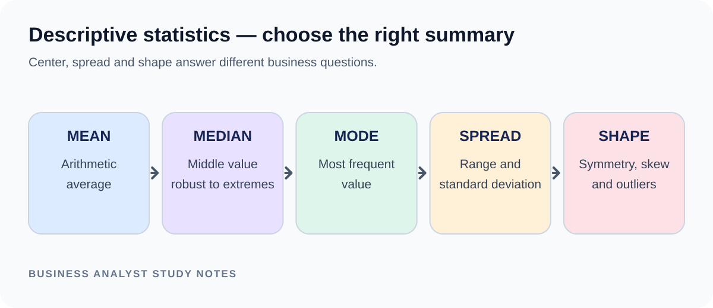
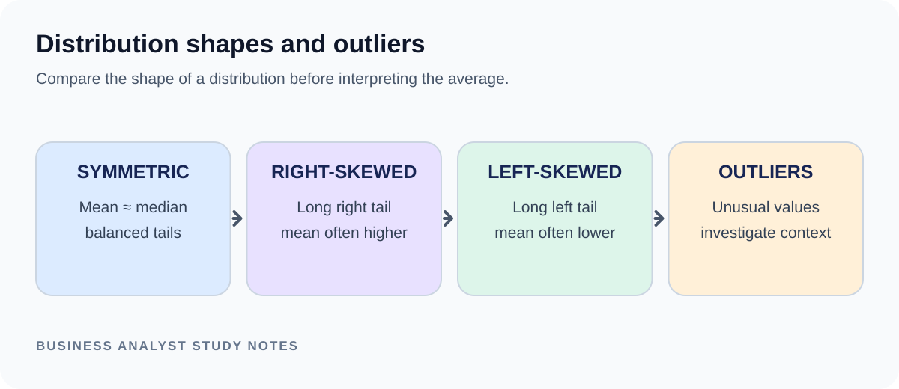

# TechPhile.ai — Business Analyst Career Pathway

# Day 25: Statistics for Business Decisions — Averages, Variation and Distributions

**Phase:** 4 — Data Analysis for Business Decisions  
**Estimated learning time:** 2–3 hours  
**Difficulty:** Beginner to Intermediate  
**Prerequisites:** Day 19 requirements documentation; basic computer and spreadsheet familiarity.

## Learning objectives
1. Calculate and interpret mean, median and mode.
2. Explain range, variance and standard deviation conceptually.
3. Read a frequency distribution and identify skew/outliers.
4. Choose a suitable summary for a business question.
5. Distinguish correlation from causation and sample from population.
6. Communicate statistical findings with limitations.

## 1. Why this matters
A manager reports that average delivery time is 2 days. Does that mean most deliveries take 2 days? Perhaps many take 1 day while a few take 10 days. An average alone can hide variation. A BA uses statistics to describe typical performance, consistency and unusual cases.

Scenario: A support manager wants to compare resolution times across teams. You need to report both typical time and spread.

## 2. Core terms
| Term | Meaning | Example |
|---|---|---|
| Population | Entire group of interest | All support cases this year |
| Sample | Subset observed | 200 selected cases |
| Variable | Characteristic measured | Resolution time |
| Observation | One recorded value | 4.2 hours |
| Distribution | Pattern of values | Many short cases, few long cases |
| Outlier | Unusually distant value | A 72-hour case among 2–6-hour cases |
| Mean | Sum divided by count | Arithmetic average |
| Median | Middle value after sorting | 50th percentile |
| Mode | Most frequent value/category | Most common issue type |
| Range | Maximum minus minimum | 12 − 2 = 10 |
| Variance | Average squared deviation (with sample/population versions) | Measures spread |
| Standard deviation | Square root of variance | Spread in original units |
| Percentile | Value at/below which a percentage falls | 90th percentile |
| Skew | Asymmetry of a distribution | Long tail to the right |

## 3. Mean, median and mode
Data: 2, 3, 3, 4, 18 hours.
- Mean = (2 + 3 + 3 + 4 + 18) / 5 = 6 hours.
- Median = 3 hours (middle sorted value).
- Mode = 3 hours (most frequent).
The long 18-hour case pulls the mean upward. Median better represents the typical case in this skewed example, while the mean still matters for total workload/capacity calculations.

When to use:
- Mean: useful for totals and relatively balanced distributions.
- Median: useful when data is skewed or has extreme values.
- Mode: useful for most common category/value.

## 4. Variation: range and standard deviation
Two teams may both average 5 hours:
- Team A: 4, 5, 5, 5, 6.
- Team B: 1, 2, 5, 8, 9.
Both have mean 5, but Team B is less consistent.

Range = maximum − minimum. It is easy to understand but uses only two values and is sensitive to extremes.

Variance describes squared deviations from the mean. Standard deviation is the square root of variance and is expressed in the same units as the original variable. Larger standard deviation means values are more spread out around the mean.

Population variance divides squared deviations by N. Sample variance divides by n−1 to estimate population variability from a sample. In spreadsheet software, functions commonly distinguish STDEV.P and STDEV.S.

## 5. Distribution and outliers






A frequency table groups observations:
| Resolution time | Case count |
|---|---:|
| 0–2 hours | 12 |
| 2–4 hours | 18 |
| 4–6 hours | 8 |
| 6–8 hours | 2 |

A histogram displays frequencies across numeric intervals. A bar chart compares categories; a histogram shows a numeric distribution where adjacent bins represent ranges.

Common shapes:
- Symmetric: both sides are roughly balanced.
- Right-skewed: long tail toward larger values; often seen in wait times or income.
- Left-skewed: long tail toward smaller values.
- Multimodal: more than one peak, potentially indicating different populations/processes.

An outlier is a signal to investigate, not an automatic instruction to delete. It may be a data error or a genuine unusual case.

## 6. Percentiles and practical interpretation
The 90th percentile of resolution time is the value at or below which 90% of cases fall (subject to the software's percentile convention). It helps describe the slower end of customer experience.

Example: Median = 3 hours, 90th percentile = 11 hours. This suggests the typical case is resolved in about 3 hours, but the slowest portion takes substantially longer. Confirm the reporting population and calculation method before comparing teams.

## 7. Correlation is not causation
If support volume and resolution time rise together, they are correlated in the observed data. This alone does not prove higher volume caused longer resolution. Other factors may influence both: staffing, case complexity, seasonality or system outages.

For a responsible BA statement:
- Describe the observed relationship.
- Avoid causal language unless the study design supports it.
- Suggest further analysis or a controlled test.

## 8. Follow-along calculations
Data: 2, 3, 3, 4, 18.
1. Sort values: already sorted.
2. Count = 5.
3. Sum = 30.
4. Mean = 30 / 5 = 6.
5. Median = third value = 3.
6. Mode = 3.
7. Range = 18 − 2 = 16.

Expected interpretation: The mean is higher than the median because one large observation creates a right tail. Investigate the 18-hour case; do not delete it without evidence.

## 9. Spreadsheet practice
In Excel, if values are in A2:A6:
- Mean: `=AVERAGE(A2:A6)`
- Median: `=MEDIAN(A2:A6)`
- Mode: `=MODE.SNGL(A2:A6)`
- Minimum: `=MIN(A2:A6)`
- Maximum: `=MAX(A2:A6)`
- Range: `=MAX(A2:A6)-MIN(A2:A6)`
- Sample standard deviation: `=STDEV.S(A2:A6)`
- Population standard deviation: `=STDEV.P(A2:A6)`

Choose STDEV.S when your observations are a sample used to infer a larger population; choose STDEV.P when the dataset is the full population of interest. Be explicit about which one you use.

## 10. Common mistakes
| Mistake | Fix |
|---|---|
| Reporting only mean | Add median and spread |
| Deleting outliers automatically | Investigate source and context |
| Comparing different populations | Align definitions and time periods |
| Treating correlation as cause | State limitations and test hypotheses |
| Confusing sample and population | State what records are included |
| Ignoring units | Report hours, days, %, currency etc. |
| Comparing standard deviations across very different scales | Consider context and relative variability |

## 11. Interview revision
- Mean is sensitive to extreme values; median is more robust.
- Mode is the most frequent value/category.
- Range is max minus min.
- Standard deviation measures spread around the mean in original units.
- A distribution shows how values are spread.
- Correlation does not prove causation.
- A statistic must be interpreted in context with population, time period and units.

### Interview questions
**Q1. When would you use median instead of mean?**  
When the distribution is skewed or contains extreme values. For example, a few very long support cases can increase the mean resolution time, while the median better describes the middle case. I would still report spread or percentiles to show the tail.

**Q2. Two teams have the same average resolution time. Are they performing equally?**  
Not necessarily. One team may have consistent times while another has large variation. I would compare median, standard deviation, percentiles, case mix and service-level outcomes before concluding.

**Q3. Does correlation prove causation?**  
No. Two variables may move together because of a third factor or coincidence. I would describe the relationship and investigate confounders or use a suitable experiment before making a causal claim.

## 12. Mini-project — Business Performance Analysis
**Time:** 45–75 minutes.

Workspace:
```text
Day_25_Business_Performance_Analysis/
├── README.md
├── inputs/
│   └── resolution_times.csv
├── analysis.xlsx
├── findings.md
└── checker_checklist.md
```

Starter data:
```csv
Case_ID,Team,Resolution_Hours
C01,Alpha,2
C02,Alpha,3
C03,Alpha,3
C04,Alpha,4
C05,Alpha,18
C06,Beta,1
C07,Beta,2
C08,Beta,5
C09,Beta,8
C10,Beta,9
```

Tasks:
1. Import the data and verify 10 observations.
2. Calculate mean, median, mode and range overall.
3. Calculate mean, median and standard deviation by team.
4. Create a frequency table and histogram.
5. Identify potential outliers and explain whether they are errors or genuine cases (if unknown, mark pending investigation).
6. Write three findings and two recommended follow-up questions.
7. State the limitations of this small illustrative dataset.

Expected checks:
- Overall count = 10.
- Overall sum = 55 hours.
- Overall mean = 5.5 hours.
- Sorted values: 1, 2, 2, 3, 3, 4, 5, 8, 9, 18.
- Overall median = (3 + 4) / 2 = 3.5 hours.
- Minimum = 1; maximum = 18; range = 17.
- Alpha mean = 6; Beta mean = 5.

Checker:
- [ ] Units are stated as hours.
- [ ] All 10 records are included.
- [ ] Mean and median calculations are correct.
- [ ] Team comparisons use the same definitions.
- [ ] Standard deviation method (sample/population) is stated.
- [ ] Histogram uses numeric bins.
- [ ] Potential outlier is investigated, not automatically removed.
- [ ] Findings distinguish observation from explanation.
- [ ] Sample limitations are included.

Hints: Sort before finding the median. With an even number of observations, average the two middle values. Do not claim Alpha is worse solely because of this tiny sample; inspect case mix and additional periods.

Extension: Compare the 90th percentile across teams and explain why a tail metric may reveal service risk not visible in the mean.

## 13. Knowledge check
1. Which measure is least affected by one extreme value? A) Mean B) Median C) Range D) Maximum. **Answer: B**.
2. What is the range of 2, 4, 9? A) 5 B) 7 C) 9 D) 15. **Answer: B**.
3. Standard deviation describes: A) Spread around the mean B) Most frequent value C) Total rows D) Data type. **Answer: A**.
4. A right-skewed distribution has: A) A long tail toward larger values B) No values C) Equal values only D) A long tail toward smaller values. **Answer: A**.
5. Correlation proves causation? A) Always B) Only for large datasets C) No D) Only for averages. **Answer: C**.

## 14. Assessment and bridge
Complete Day 25 when you can calculate and interpret central tendency and spread, explain skew/outliers, and produce a report that states its assumptions and limitations.

**Bridge to Day 26:** After describing current performance, the next step in the pathway is to examine trends over time and distinguish short-term fluctuations from meaningful changes.


---

## Visual references to add manually

### 1. Descriptive statistics and distribution shapes
- **Filename:** `day_25_concept_01_descriptive_statistics_distributions.png`
- **Insert under heading:** `## 5. Distribution and outliers`
- **What it should show:** Mean/median/mode, symmetric versus right-skewed and left-skewed distributions, outliers, histogram and box plot concepts.
- **Search phrase:** `descriptive statistics mean median mode standard deviation skewed distributions histogram infographic`
- **Reference:** [LivePhysics — descriptive statistics infographic](https://livephysics.com/infographics/statistics-descriptive-statistics/)

*Image note: use a legible educational diagram and verify its explanation of skew and outliers. Check reuse terms before copying.*
