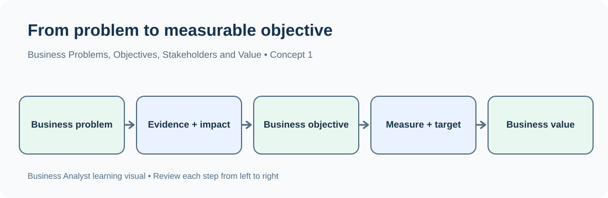
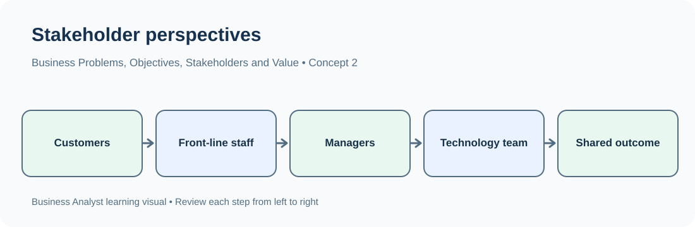

# TechPhile.ai --- Business Analyst Career Pathway

# Day 2: Business Problems, Business Objectives, Stakeholders and Value Creation

**Phase:** 1 --- Business Analysis Foundations\
**Estimated learning time:** 2--3 hours\
**Difficulty:** Beginner to Intermediate\
**Prerequisites:** Day 1 --- Business analysis, BA responsibilities,
SDLC and project lifecycle\
**Learning focus:** Understand a business problem, ask the right
questions, define a business objective, identify stakeholders and
explain the value a solution should create.

------------------------------------------------------------------------

## 1. Learning Objectives

By the end of Day 2, you should be able to:

-   Explain what a business problem is and distinguish a symptom from a
    possible cause.
-   Break a broad business problem into smaller areas using analytical
    thinking.
-   Convert a vague problem into clear business and analytical
    questions.
-   Distinguish a business problem, business need, business objective
    and measurable outcome.
-   Identify stakeholders, understand their interests and recognize that
    different stakeholders may have different expectations.
-   Explain business value and connect a proposed improvement to
    measurable benefits.
-   Describe how a Business Analyst connects the problem, stakeholders,
    objectives and expected value.

------------------------------------------------------------------------

# 2. Why This Topic Matters in a Real Business

Imagine that you join an online shopping company as a Junior Business
Analyst.

The sales manager tells you:

> "Our sales are decreasing. We need a new application. Please ask the
> development team to build it."

Should you immediately tell developers to build an application?

**No.** You do not yet know:

-   Which sales are decreasing?
-   When did the decline begin?
-   Is it happening in every region or only some regions?
-   Is the issue related to products, prices, orders, customers or the
    checkout process?
-   What does the business actually want to improve?
-   Who will be affected by the change?
-   How will the company know whether the solution worked?

A Business Analyst first understands the business situation. The BA then
clarifies the problem, speaks with relevant stakeholders, defines the
desired outcome and helps the team understand the value of solving it.

**Main idea:** Do not jump from a complaint directly to a solution.
Understand the problem first.

------------------------------------------------------------------------

# 3. Words You Need

  -----------------------------------------------------------------------
  Term                    Simple meaning          Example
  ----------------------- ----------------------- -----------------------
  Business                An organization or      An online shopping
                          activity that provides  company
                          products or services    

  Business problem        A situation that        Online sales have
                          prevents a business     decreased
                          from achieving its      
                          desired result          

  Symptom                 A visible sign that     Fewer orders are being
                          something may be wrong  completed

  Root cause              The underlying reason a Payment failures may be
                          problem is happening    preventing orders

  Business need           The improvement or      Customers need a
                          capability the business reliable checkout
                          requires                process

  Business objective      What the business wants Increase completed
                          to achieve              orders

  Stakeholder             A person or group       Customers, sales
                          affected by, interested manager and support
                          in or responsible for a team
                          business change         

  Business value          The benefit created by  More completed orders
                          solving a business need and fewer support
                                                  complaints

  Measurable outcome      A result that can be    Increase monthly
                          checked using a number  completed orders from
                          or clear condition      8,000 to 9,000

  KPI                     A measure used to track Monthly completed
                          progress toward an      orders
                          important objective     

  Evidence                Information used to     Order records showing a
                          support a conclusion    decline in completed
                                                  purchases

  Assumption              Something treated as    The decline may be
                          true until it is        related to the checkout
                          checked                 process

  Constraint              A limitation that must  The change must be
                          be considered           delivered within the
                                                  approved budget
  -----------------------------------------------------------------------

**Important distinction:** An assumption is not a confirmed fact. A BA
should record assumptions and validate them where possible.

------------------------------------------------------------------------

# 4. What Is a Business Problem?

A **business problem** is a situation in which an organization is
experiencing a difficulty, gap or missed opportunity that needs to be
understood or improved.

A business problem describes what is happening. It does not
automatically tell us why it is happening.

### Example

A company reports:

"Our monthly sales are decreasing."

This is a business problem because the company is not achieving the
sales performance it expects.

However, the statement does not explain the cause.

Possible areas to investigate include:

-   Fewer customers visiting the website.
-   Fewer customers adding products to their carts.
-   More customers leaving before payment.
-   Products being unavailable.
-   Delivery delays affecting repeat purchases.
-   Changes in prices or customer preferences.

These are investigation areas, not confirmed causes.

## 4.1 Common Business Problems

  -----------------------------------------------------------------------
  Business area           Example business        What the business may
                          problem                 want to understand
  ----------------------- ----------------------- -----------------------
  Sales                   Monthly sales are       Which products, regions
                          decreasing              or customer groups are
                                                  affected?

  Marketing               Campaigns are not       Which campaigns are
                          generating enough       generating useful
                          customers               responses?

  Customer service        Customer complaints are Which complaint types
                          increasing              are increasing?

  Human Resources (HR)    Employee attrition is   Which departments or
                          increasing              employee groups are
                                                  affected?

  Finance                 Operating expenses are  Which expense
                          increasing              categories are rising?

  E-commerce              Customers abandon       At which stage do
                          shopping carts          customers leave?

  Banking                 Loan defaults are       Which loan categories
                          increasing              show higher default
                                                  levels?

  Healthcare              Patients wait too long  Where are delays
                          for appointments        occurring in the
                                                  appointment process?

  Logistics               Deliveries are          Which delivery stages
                          frequently late         or locations experience
                                                  delays?
  -----------------------------------------------------------------------

## 4.2 A Business Problem Is Not the Same as a Solution

Consider these statements:

  -----------------------------------------------------------------------
  Statement                           What it represents
  ----------------------------------- -----------------------------------
  Customers are waiting too long for  Possible business problem
  support                             

  Build a chatbot                     Proposed solution

  Reduce customer waiting time        Desired objective

  Reduce average waiting time from 15 Measurable outcome
  minutes to 8 minutes                
  -----------------------------------------------------------------------

A company may request a specific solution before fully understanding the
problem.

The BA should clarify the business need instead of assuming that the
requested solution is automatically the right one.

### Remember

-   Problem = What is happening?
-   Solution = What might we do?
-   Objective = What do we want to achieve?
-   Outcome = How will we know that we achieved it?

------------------------------------------------------------------------

# 5. How Does a Business Analyst Understand a Business Problem?

A BA should not immediately start writing requirements or recommending
software.

First, the BA understands the situation and gathers enough information
to describe it clearly.

### Example conversation

**Manager:** "Our sales are decreasing. Please analyze the situation."

A weak response would be:

"Okay, I will prepare a sales report."

A better response would be to clarify:

-   Which sales are decreasing: online, in-store or both?
-   Compared with which period?
-   Since when has the decline been observed?
-   Is the decline happening in all regions?
-   Are all products affected?
-   Has the number of orders changed, or has the average order value
    changed?
-   What business result does management want to improve?

## 5.1 Business Problem Understanding Flow

``` text
Business Complaint or Observation
              |
              v
     Understand the Situation
              |
              v
       Clarify the Problem
              |
              v
      Identify Stakeholders
              |
              v
       Ask Relevant Questions
              |
              v
     Identify Evidence Needed
              |
              v
      Define Desired Objective
              |
              v
     Evaluate Possible Actions
```

The flow is iterative. New information from stakeholders or data may
require the BA to clarify the problem again.

## 5.2 Information to Clarify

  -----------------------------------------------------------------------
  Area                    Questions to ask        Why it matters
  ----------------------- ----------------------- -----------------------
  Context                 What is happening?      Establishes the
                                                  situation

  Time                    When did it start?      Helps identify when the
                                                  change occurred

  Scope                   Which products, teams   Defines where to
                          or locations are        investigate
                          affected?               

  Size                    How large is the        Helps understand its
                          problem?                impact

  Comparison              What was the earlier or Shows the gap
                          expected performance?   

  Evidence                Which reports or        Separates facts from
                          records support the     opinions
                          observation?            

  Impact                  How does this affect    Explains why the
                          the business or         problem matters
                          customers?              

  Desired result          What should improve?    Helps define the
                                                  objective

  Constraints             What limits must be     Prevents unrealistic
                          considered?             recommendations
  -----------------------------------------------------------------------

------------------------------------------------------------------------

# 6. What Is Analytical Thinking?

**Analytical thinking** means breaking a broad problem into smaller
parts, examining each part logically and using evidence rather than
assumptions.

It helps a BA or Data Analyst understand where a problem is occurring
and what should be investigated next.

### Example: Sales are decreasing

Instead of immediately saying "Customers do not like our products",
divide the problem into areas:

``` text
                    SALES DECREASING
                           |
       +-------------------+-------------------+
       |                   |                   |
       v                   v                   v
    Customers           Products             Orders
       |                   |                   |
       v                   v                   v
 New customers?       Which products?     Fewer orders?
 Returning users?     Stock availability?  Lower order value?
       |
       +-------------------+-------------------+
                           |
                           v
                     Other Areas
                           |
                +----------+----------+
                |          |          |
                v          v          v
              Region     Pricing    Time period
```

The diagram gives possible areas to investigate. It does not prove that
any one area caused the decline.

## 6.1 Break a Problem into Dimensions

A **dimension** is a way of looking at or grouping information.

For a sales problem, useful dimensions may include:

  Dimension        Example breakdown
  ---------------- ------------------------------------------
  Time             Day, week, month, quarter
  Region           Hyderabad, Bengaluru, Chennai
  Product          Laptop, mobile, accessories
  Customer type    New customer, returning customer
  Sales channel    Website, mobile app, physical store
  Payment method   Card, UPI, net banking, cash on delivery

Looking at the same business measure through different dimensions can
reveal patterns.

For example, total sales may be decreasing overall, but the decline may
be concentrated in one region or one product category.

## 6.2 Finding vs Assumption vs Root Cause

These three terms should not be mixed.

  -----------------------------------------------------------------------
  Type                    Meaning                 Example
  ----------------------- ----------------------- -----------------------
  Observation             Something noticed in    Completed orders
                          the available           decreased in March
                          information             

  Assumption              An unverified           Customers may be
                          explanation             unhappy with delivery

  Finding                 A result supported by   The order records show
                          analysis                a larger decline in one
                                                  region

  Root cause              The underlying reason   A verified
                          supported by sufficient delivery-capacity issue
                          investigation           is causing late
                                                  deliveries and
                                                  cancellations
  -----------------------------------------------------------------------

A finding may help identify a possible root cause, but it is not
automatically the root cause.

## 6.3 A Simple Analytical Approach

1.  State the problem clearly.
2.  Identify the business area affected.
3.  Break the problem into dimensions.
4.  Ask questions about each dimension.
5.  Identify the information needed to answer those questions.
6.  Examine the evidence.
7.  Report findings with their limitations.
8.  Recommend an action only when the evidence supports it.

------------------------------------------------------------------------

# 7. What Is a Business Question?

A **business question** is a question that helps an organization
understand performance, investigate a problem or make a decision.

Business questions turn a broad complaint into something specific that
can be investigated.

### Example

**Business problem:** Sales are decreasing.

Useful business questions:

1.  Which region experienced the largest sales decline?
2.  Which product category experienced a decline?
3.  When did the decline begin?
4.  Did the number of orders decrease?
5.  Did the average order value decrease?
6.  Are new customers or returning customers contributing to the
    decline?

These questions guide the analysis.

## 7.1 Business Problem vs Business Question

  -----------------------------------------------------------------------
  Business problem                    Business question
  ----------------------------------- -----------------------------------
  Sales are decreasing                Which region experienced the
                                      largest decline?

  Customer complaints are increasing  Which complaint category increased
                                      the most?

  Employee attrition is high          Which department has the highest
                                      attrition rate?

  Marketing performance is poor       Which campaign generated the most
                                      conversions?

  Deliveries are late                 Which delivery stage contributes
                                      most to delays?
  -----------------------------------------------------------------------

**Simple understanding:**

-   Problem = What is happening?
-   Question = What do we need to find out?

## 7.2 Types of Business Questions

### A. Performance Questions

These help understand current or past performance.

Examples:

-   What were total sales last month?
-   Which product generated the highest revenue?
-   How many support requests were resolved this week?
-   What was the average delivery time?

### B. Comparison Questions

These compare categories, groups or time periods.

Examples:

-   Which region generated more sales?
-   Were sales higher in January or February?
-   Which product had fewer customer complaints?
-   Did the new process take less time than the old process?

### C. Investigation Questions

These help investigate a problem or an unexpected result.

Examples:

-   Why did sales decrease?
-   Why are customer complaints increasing?
-   Why are customers leaving during checkout?
-   Why are deliveries taking longer?

An investigation question does not mean the cause is already known. The
purpose is to find evidence.

### D. Improvement Questions

These help identify opportunities to improve business performance.

Examples:

-   How can we increase customer retention?
-   How can we reduce the time required to resolve complaints?
-   Which checkout step should be investigated first?
-   How can the company improve delivery performance?

### Quick Revision

  Question type   Purpose
  --------------- -----------------------------------
  Performance     Understand results
  Comparison      Compare groups or periods
  Investigation   Understand possible reasons
  Improvement     Identify opportunities for action

## 7.3 What Makes a Good Business Question?

A good business question should be:

-   **Clear:** The reader should understand exactly what is being asked.
-   **Relevant:** It should relate to the business problem.
-   **Specific:** Avoid broad wording such as "How is the business
    doing?"
-   **Answerable:** The required information should exist or be
    obtainable.
-   **Useful:** The answer should help someone understand or make a
    decision.

### Weak vs Better Questions

  -----------------------------------------------------------------------
  Weak question                       Better question
  ----------------------------------- -----------------------------------
  Why are sales bad?                  Which product categories had the
                                      largest revenue decline compared
                                      with the previous month?

  Are customers unhappy?              How many complaints were received
                                      this month, and which categories
                                      were most common?

  Is marketing working?               Which campaign produced the highest
                                      conversion rate during the
                                      reporting period?

  Are deliveries slow?                What percentage of orders were
                                      delivered after the promised date?
  -----------------------------------------------------------------------

------------------------------------------------------------------------

# 8. What Is a Business Objective?

A **business objective** describes what an organization wants to
achieve.

It gives direction to the work being done to address a business problem
or opportunity.

### Example 1

-   Business problem: Monthly sales are decreasing.
-   Business objective: Increase monthly sales revenue.

### Example 2

-   Business problem: Customer complaints are increasing.
-   Business objective: Reduce customer complaints.

### Example 3

-   Business problem: Employees are leaving the organization.
-   Business objective: Improve employee retention.

## 8.1 Business Problem vs Business Objective

  -----------------------------------------------------------------------
  Business problem                    Business objective
  ----------------------------------- -----------------------------------
  Sales are decreasing                Increase sales

  Customer complaints are increasing  Reduce customer complaints

  Employee attrition is high          Improve employee retention

  Marketing costs are high            Improve marketing efficiency

  Deliveries are frequently late      Improve on-time delivery
                                      performance
  -----------------------------------------------------------------------

**Remember:** A problem describes the current situation. An objective
describes the desired improvement.

## 8.2 Business Objective vs Business Need

These terms are related, but they are not identical.

  -----------------------------------------------------------------------
  Term                    Meaning                 Example
  ----------------------- ----------------------- -----------------------
  Business problem        The difficulty or gap   Customers abandon the
                                                  checkout process

  Business need           The capability or       Customers need a
                          improvement required    reliable and convenient
                                                  checkout experience

  Business objective      The result the company  Increase completed
                          wants                   purchases

  Possible solution       An option that may      Improve the checkout
                          address the need        flow
  -----------------------------------------------------------------------

A BA should understand the need before treating a proposed solution as
final.

## 8.3 Characteristics of a Useful Objective

A useful objective should be:

-   Clear and understandable.
-   Connected to a real business problem or opportunity.
-   Focused on a result rather than a specific tool.
-   Realistic within the business context.
-   Measurable where possible.
-   Understood by the relevant stakeholders.

### Weak vs Better Objectives

  -----------------------------------------------------------------------
  Weak objective                      Better objective
  ----------------------------------- -----------------------------------
  Make the website better             Improve the website checkout
                                      completion rate

  Improve customer service            Reduce the average time required to
                                      resolve customer complaints

  Increase business                   Increase monthly sales revenue

  Fix delivery                        Improve the percentage of orders
                                      delivered on time
  -----------------------------------------------------------------------

------------------------------------------------------------------------

# 9. What Is a Measurable Outcome?

A **measurable outcome** is a result that can be checked using numbers
or clearly defined criteria.

An objective gives direction. A measurable outcome makes the expected
result specific enough to evaluate.

### Example

**Business objective:** Increase sales.

**Measurable outcome:** Increase monthly sales revenue from ₹10 lakh to
₹12 lakh within six months.

Now the company can compare actual performance with the target.

## 9.1 More Examples

  -----------------------------------------------------------------------
  Business objective                  Example measurable outcome
  ----------------------------------- -----------------------------------
  Increase sales                      Monthly revenue increases by 20%

  Improve customer retention          Retention rate increases from 80%
                                      to 90%

  Reduce complaints                   Monthly complaints decrease from
                                      500 to 300

  Improve marketing                   Campaign conversion rate increases
                                      from 3% to 5%

  Improve delivery                    On-time delivery rate increases
                                      from 85% to 95%
  -----------------------------------------------------------------------

These figures are illustrative examples, not industry benchmarks.

## 9.2 Why Measurable Outcomes Matter

Without a measurable outcome:

-   Teams may interpret "improve" differently.
-   Stakeholders may disagree about whether the work succeeded.
-   It becomes difficult to compare before and after performance.
-   Management may not know whether the change created value.

## 9.3 A Simple Outcome Structure

A useful way to write an outcome is:

``` text
Increase / Reduce / Improve
          +
What will change?
          +
Current value (if known)
          +
Target value
          +
Time period
```

Example:

"Reduce average customer complaint resolution time from 48 hours to 24
hours within three months."

If the current value is unknown, do not invent it. First establish a
baseline using reliable information.

------------------------------------------------------------------------

# 10. What Is a KPI?

**KPI** stands for **Key Performance Indicator**.

A KPI is a measurable value used to evaluate progress toward an
important business objective.

A KPI helps a business monitor whether it is moving toward its intended
result.

### Example

-   Business objective: Increase sales.
-   Possible KPI: Monthly sales revenue.

Another example:

-   Business objective: Improve customer retention.
-   Possible KPI: Customer retention rate.

## 10.1 Business Objective and KPI

  Business objective           Possible KPI
  ---------------------------- -------------------------
  Increase sales               Monthly sales revenue
  Increase profitability       Profit margin
  Improve customer retention   Customer retention rate
  Reduce complaints            Monthly complaint count
  Improve marketing            Conversion rate
  Improve delivery             On-time delivery rate

## 10.2 Metric vs KPI

A **metric** is a measurement used to track something.

A **KPI** is a metric considered especially important for evaluating
progress toward a key objective.

For example, an e-commerce company may track:

-   Website page views.
-   Number of products viewed.
-   Number of items added to carts.
-   Completed orders.
-   Monthly revenue.

If the company's main objective is to increase completed purchases,
completed orders or checkout conversion rate may be selected as KPIs.

Not every metric is automatically a KPI.

**Note:** KPI planning, dimensions and measures are covered in detail on
Day 20. Day 2 introduces the connection between objectives and KPIs
only.

------------------------------------------------------------------------

# 11. Who Is a Stakeholder?

A **stakeholder** is a person, group or organization that is affected by
a business change, has an interest in it or can influence it.

Stakeholders may:

-   Request a change.
-   Use the solution.
-   Approve the work.
-   Provide information.
-   Build or test the solution.
-   Pay for the work.
-   Be affected by the final result.

### Example: Online Shopping Application

Suppose an online shopping company wants to improve its checkout
process.

Possible stakeholders include:

  Stakeholder                Why they are involved
  -------------------------- ----------------------------------------------
  Customers                  Use the checkout process
  Sales manager              Wants more completed purchases
  Customer support team      Handles customer questions and complaints
  Finance team               Monitors payments, refunds and revenue
  Product manager            Helps decide product priorities
  Business Analyst           Understands needs and documents requirements
  Developers                 Build the approved solution
  Testers / QA team          Check whether the solution works as expected
  Senior management          May approve budget and business direction
  Payment service provider   Supports payment processing

The exact stakeholders depend on the organization and the scope of the
change.

## 11.1 Internal and External Stakeholders

### Internal Stakeholders

People or groups within the organization.

Examples:

-   Business manager.
-   Sales team.
-   Finance team.
-   Customer support team.
-   Developers.
-   Testers.
-   Senior management.

### External Stakeholders

People or organizations outside the organization who are affected by or
involved in the change.

Examples:

-   Customers.
-   Suppliers.
-   Business partners.
-   Payment providers.
-   Delivery partners.
-   Regulators, where relevant.

  Internal stakeholder    External stakeholder
  ----------------------- ----------------------
  Sales manager           Customer
  Finance department      Payment provider
  Customer support team   Delivery partner
  Development team        Supplier

## 11.2 Stakeholder vs User

A **user** directly uses a product, service or system.

A **stakeholder** has an interest in, is affected by or can influence
the change.

A user can be a stakeholder, but not every stakeholder is a user.

Example:

-   A customer uses the shopping application: user and stakeholder.
-   A finance director approves the project budget but does not use the
    application: stakeholder, not necessarily a user.
-   A developer builds the application: project stakeholder, but not
    necessarily an end user.

## 11.3 Why Stakeholders Matter to a Business Analyst

Stakeholders help the BA understand different parts of the business.

For example:

-   Customers explain their experience.
-   Managers explain business goals.
-   Finance explains financial rules and constraints.
-   Support teams explain common complaints.
-   Developers explain technical considerations.
-   Testers help confirm whether requirements can be verified.

If the BA speaks to only one person, important requirements or
constraints may be missed.

## 11.4 Stakeholders May Have Different Expectations

Consider the checkout improvement example:

  Stakeholder         Possible expectation
  ------------------- -------------------------------------------------------
  Customer            Checkout should be simple and quick
  Sales manager       More customers should complete purchases
  Finance team        Payments and refunds should be recorded correctly
  Customer support    Fewer payment-related complaints
  Developer           Requirements should be clear and technically feasible
  Tester              Expected behavior should be testable
  Senior management   The change should justify its cost

These expectations may conflict.

For example, customers may want more payment options, while the finance
team may need additional checks before approving a new payment method.

The BA helps clarify the needs, document the differences and support
discussion among stakeholders.

------------------------------------------------------------------------

# 12. What Is Business Value?

**Business value** is the benefit an organization receives from an
activity, change or solution.

Value is not limited to earning more money. It can also include saving
time, reducing risk, improving customer experience or making work more
reliable.

## 12.1 Common Types of Business Value

  -----------------------------------------------------------------------
  Value type              Meaning                 Example
  ----------------------- ----------------------- -----------------------
  Financial value         Improves revenue,       More completed
                          profit or cost          purchases increase
                                                  revenue

  Cost reduction          Reduces spending        Fewer manual processing
                                                  hours

  Time saving             Makes work faster       Customer requests are
                                                  resolved sooner

  Customer value          Improves customer       Easier checkout process
                          experience              

  Operational value       Improves how work is    Fewer order-processing
                          performed               errors

  Quality value           Improves accuracy or    Fewer incorrect
                          consistency             invoices

  Risk reduction          Reduces the chance or   Better checks reduce
                          impact of a problem     incorrect payments

  Compliance value        Helps meet applicable   Required records are
                          rules or policies       maintained
  -----------------------------------------------------------------------

## 12.2 Business Value Example

Suppose a company receives 1,000 customer support requests every month.

The current process requires an average of 20 minutes to handle each
request.

The company wants to improve the process so that common requests can be
handled in 12 minutes.

Potential time saved per request:

20 minutes - 12 minutes = 8 minutes

Total time saved per month:

1,000 × 8 minutes = 8,000 minutes

8,000 minutes ÷ 60 = approximately 133.3 hours

**Interpretation:** If the new process achieves the expected result, it
could save approximately 133 hours of handling time per month.

This is a potential operational benefit. It is not automatically a cash
saving. The company must decide how the saved time will be used.

## 12.3 Value Is Not the Same as Delivering a Feature

Consider a company that builds a new customer support dashboard.

  Item             Example
  ---------------- -----------------------------------------------------
  Output           A customer support dashboard is delivered
  Capability       Support agents can view request status in one place
  Outcome          Agents resolve requests faster
  Business value   Less handling time and improved customer experience

Building a feature is an output. The value depends on whether it helps
create a useful outcome.

------------------------------------------------------------------------

# 13. Connecting the Problem, Stakeholders, Objective and Value

A Business Analyst connects four important questions:

1.  **Problem:** What is happening?
2.  **Stakeholders:** Who is affected or involved?
3.  **Objective:** What result should improve?
4.  **Value:** Why is the improvement useful?

### Example: Customer Complaints

**Business problem:** Customer complaints are increasing.

**Stakeholders:** - Customers. - Customer support manager. - Support
agents. - Product team. - Senior management.

**Business objective:** Reduce customer complaints and improve the
support experience.

**Measurable outcome:** Reduce monthly complaints from 500 to 300 within
six months.

**Possible KPI:** Monthly complaint count.

**Expected value:** - Fewer customer issues. - Less pressure on the
support team. - Improved customer experience. - Better understanding of
recurring product or service issues.

### Connected Flow

``` text
                 BUSINESS PROBLEM
              Customer complaints rise
                         |
                         v
                    STAKEHOLDERS
          Customers, support team, managers
                         |
                         v
                 BUSINESS QUESTIONS
       Which complaint types are increasing?
          When and where do they occur?
                         |
                         v
                 BUSINESS OBJECTIVE
              Reduce customer complaints
                         |
                         v
                MEASURABLE OUTCOME
              500 complaints -> 300
                         |
                         v
                       KPI
              Monthly complaint count
                         |
                         v
                  EXPECTED VALUE
        Better customer experience and less
              support-team workload
```

This is a simplified thinking flow. In a real project, the BA may
revisit earlier steps as new information becomes available.

------------------------------------------------------------------------

# 14. Complete Industry Example --- E-Commerce Checkout

## Business Scenario

An online shopping company notices that many customers add products to
their shopping carts but do not complete their purchases.

The business wants to understand the situation and improve completed
purchases.

### Step 1: Identify the Business Problem

Customers are abandoning shopping carts.

This describes the observed situation. It does not yet explain why
customers leave.

### Step 2: Identify Stakeholders

  Stakeholder        Interest or responsibility
  ------------------ -------------------------------------------------
  Customers          Want a convenient and reliable purchase process
  Sales manager      Wants more completed purchases
  Product manager    Prioritizes checkout improvements
  Finance team       Needs accurate payment and refund handling
  Customer support   Receives payment and checkout complaints
  Developers         Implement approved changes
  QA testers         Verify checkout behavior
  Management         Reviews business impact and cost

### Step 3: Ask Business Questions

-   How many customers add products to their carts?
-   How many customers complete purchases?
-   At which checkout step do customers leave?
-   Does cart abandonment differ by device?
-   Does it differ by payment method?
-   Are payment failures being recorded?
-   Has the abandonment rate changed over time?

### Step 4: Define the Business Objective

Reduce cart abandonment and increase completed purchases.

### Step 5: Define a Measurable Outcome

Illustrative target:

Reduce the cart abandonment rate from 70% to 50% within six months.

The company should first confirm the current rate and agree on how it
will be calculated.

### Step 6: Select a KPI

Possible KPI:

Cart abandonment rate.

A commonly used calculation is:

Cart abandonment rate = (Carts created but not converted into purchases
÷ Total carts created) × 100

Example:

-   Total carts created = 1,000
-   Carts not converted into purchases = 700

Cart abandonment rate = (700 ÷ 1,000) × 100 = 70%

The calculation depends on how the company defines and records a cart.
The definition should be agreed before comparing results.

### Step 7: Examine the Evidence

Suppose the analysis shows:

  Checkout stage               Number of customers reaching the stage
  -------------------------- ----------------------------------------
  Added product to cart                                         1,000
  Started checkout                                                800
  Entered delivery details                                        650
  Reached payment                                                 500
  Completed purchase                                              300

The table shows that 1,000 carts were created and 300 purchases were
completed.

It also shows where the number of customers decreases. It does not, by
itself, prove why customers leave.

### Step 8: Report a Finding Carefully

A careful finding would be:

"Of the 500 customers who reached the payment stage, 300 completed the
purchase. Further investigation is required to understand why the
remaining customers did not complete payment."

Avoid stating:

"Payment failure is definitely the reason."

That conclusion would require additional evidence, such as payment error
records, customer feedback or technical logs.

### Step 9: Explain the Expected Business Value

If the company reduces cart abandonment:

-   More customers may complete purchases.
-   Sales revenue may increase.
-   Fewer customers may need help with checkout issues.
-   The company may improve the customer purchase experience.

The actual value should be measured after the change is implemented.

------------------------------------------------------------------------

# 15. Converting Vague Business Problems into Clear Questions

This is an important skill for a fresher Business Analyst.

A stakeholder may explain a problem using broad statements. The BA must
convert them into specific questions that can be investigated.

## Example 1: "Our customers are unhappy."

Better questions:

-   How many complaints are received each month?
-   Which complaint categories are most common?
-   Which products or services receive the most complaints?
-   How long does it take to resolve complaints?
-   Are complaints increasing in a particular region?
-   What feedback do customers provide?

## Example 2: "Our marketing is not working."

Better questions:

-   How many people were reached by each campaign?
-   How many people clicked the campaign?
-   How many people completed a purchase?
-   Which campaign generated the most conversions?
-   What was the cost per conversion?
-   How do campaign results compare with the previous period?

## Example 3: "Our employees are leaving."

Better questions:

-   What is the employee attrition rate?
-   Which department has the highest attrition?
-   What is the average employee tenure?
-   Does attrition differ by experience level?
-   What reasons are recorded for employee departures?
-   During which period did attrition increase?

## Example 4: "Our delivery process is poor."

Better questions:

-   What percentage of orders are delivered on time?
-   Which regions experience the most delays?
-   Which delivery stage takes the longest?
-   How many orders are cancelled because of delays?
-   Are delays more common for particular delivery partners?

**Important:** Questions should be relevant to the problem and
answerable using available or obtainable information.

------------------------------------------------------------------------

# 16. Common Mistakes and How to Avoid Them

  -----------------------------------------------------------------------
  Mistake                 Why it is a problem     Better approach
  ----------------------- ----------------------- -----------------------
  Jumping directly to a   The requested solution  Understand the problem
  solution                may not address the     first
                          real need               

  Treating an assumption  Can lead to incorrect   Label assumptions and
  as a fact               conclusions             validate them

  Writing a vague problem Different people may    Include the affected
  statement               interpret it            area, situation and
                          differently             impact where known

  Confusing a problem     The current situation   Write them separately
  with an objective       and desired result      
                          become mixed            

  Setting an objective    Success becomes         Define a measurable
  without a measure       difficult to evaluate   outcome

  Calling every metric a  Important measures      Select measures linked
  KPI                     become unclear          to key objectives

  Ignoring stakeholders   Important needs and     Identify affected and
                          constraints may be      influential groups
                          missed                  

  Listening only to       Users and operational   Consider all relevant
  management              teams may have          stakeholder
                          different information   perspectives

  Assuming a finding      A pattern may have more Investigate before
  proves the cause        than one explanation    claiming a root cause

  Promising value without Expected benefits may   State expected value
  evidence                not occur               and measure actual
                                                  results
  -----------------------------------------------------------------------

------------------------------------------------------------------------

# 17. Interview Preparation --- Day 2

## Q1. What is a business problem?

**Answer:**

A business problem is a situation in which an organization faces a
difficulty, gap or missed opportunity that needs to be understood or
improved.

For example, if an online shopping company experiences a decrease in
completed purchases, that is a business problem.

A Business Analyst clarifies the situation, identifies affected
stakeholders, asks relevant questions and helps define the desired
outcome.

**Follow-up question:** Does a business problem always explain its root
cause?

**Answer:** No. It describes what is happening. The cause must be
investigated using evidence.

## Q2. How do you approach a business problem as a Business Analyst?

**Answer:**

I would first understand the business context and clarify the problem
with relevant stakeholders. Then I would identify who is affected, ask
specific questions, determine what information is needed and understand
the impact. After reviewing the available evidence, I would help define
a clear business objective and measurable outcome.

**Example:** If sales are decreasing, I would investigate the affected
products, regions, customer groups and time periods before recommending
a solution.

**Follow-up question:** Why should you avoid recommending a solution
immediately?

**Answer:** Because the requested solution may not address the actual
business need. Understanding the problem first reduces the risk of
building the wrong solution.

## Q3. What is the difference between a business problem and a business objective?

**Answer:**

A business problem describes the current difficulty, while a business
objective describes the result the organization wants to achieve.

  Business problem                     Business objective
  ------------------------------------ ----------------------------
  Customer complaints are increasing   Reduce customer complaints
  Sales are decreasing                 Increase sales
  Deliveries are late                  Improve on-time delivery

**Follow-up question:** How would you check whether the objective was
achieved?

**Answer:** Define a measurable outcome and track an appropriate KPI.

## Q4. Who are stakeholders?

**Answer:**

Stakeholders are people, groups or organizations that are affected by a
business change, have an interest in it or can influence it.

For an e-commerce checkout improvement, stakeholders may include
customers, sales managers, finance teams, customer support, developers,
testers and senior management.

**Follow-up question:** Is every stakeholder a user?

**Answer:** No. A user directly uses the solution. A stakeholder may be
involved or affected without using it.

## Q5. What is business value?

**Answer:**

Business value is the benefit an organization receives from a change or
solution. It may include increased revenue, reduced costs, time savings,
better customer experience, improved quality or reduced risk.

**Example:** If a support-process improvement reduces the time needed to
handle customer requests, it may create operational value and improve
customer experience.

**Follow-up question:** Is delivering a software feature the same as
creating business value?

**Answer:** No. Delivering a feature is an output. Business value
depends on whether that feature produces a useful outcome.

## Q6. What is analytical thinking?

**Answer:**

Analytical thinking means breaking a broad problem into smaller parts,
examining each part logically and using evidence instead of assumptions.

For example, if sales decrease, I would examine sales by product,
region, customer type, time period and sales channel.

**Follow-up question:** Does finding a pattern prove the root cause?

**Answer:** No. A pattern is a finding that may guide further
investigation. More evidence may be required to establish the cause.

## Q7. What is the difference between a metric and a KPI?

**Answer:**

A metric is a measurement used to track something. A KPI is a metric
selected as especially important for measuring progress toward a key
business objective.

For example, a company may track website views, cart additions and
completed purchases. If its main objective is to increase completed
purchases, completed orders may be selected as a KPI.

**Follow-up question:** Can a metric become a KPI?

**Answer:** Yes. A metric can be selected as a KPI when it is important
for evaluating progress toward a business objective.

## Q8. How do you handle stakeholders who have different expectations?

**Answer:**

I would understand each stakeholder's concern, clarify the business
objective, document the different expectations and identify conflicts or
constraints. I would facilitate discussion so that the relevant people
can agree on priorities and decisions. I would then document the agreed
requirements and decisions clearly.

**Follow-up question:** Should a BA decide every conflict independently?

**Answer:** No. The BA supports analysis and communication. Decisions
should be made by the appropriate stakeholders or decision-makers.

------------------------------------------------------------------------

# 18. Day 2 Quick Revision Sheet

  -----------------------------------------------------------------------
  Concept                             Remember this
  ----------------------------------- -----------------------------------
  Business problem                    Describes what is happening

  Symptom                             Visible sign of a possible problem

  Root cause                          Underlying reason established
                                      through investigation

  Business question                   Helps understand or investigate the
                                      problem

  Analytical thinking                 Breaks a broad problem into smaller
                                      parts

  Business need                       Describes the improvement or
                                      capability required

  Business objective                  Describes what the organization
                                      wants to achieve

  Measurable outcome                  Defines how the desired result can
                                      be checked

  KPI                                 Tracks progress toward an important
                                      objective

  Stakeholder                         Person or group affected by,
                                      interested in or able to influence
                                      a change

  User                                Person who directly uses a product
                                      or system

  Business value                      Benefit created by an outcome
  -----------------------------------------------------------------------

## Important Differences

  -----------------------------------------------------------------------
  Do not confuse                      Difference
  ----------------------------------- -----------------------------------
  Problem vs solution                 Problem is the situation; solution
                                      is a possible response

  Problem vs objective                Problem is current; objective is
                                      desired

  Objective vs outcome                Objective gives direction; outcome
                                      makes the result measurable

  Metric vs KPI                       KPI is a metric selected as
                                      important for a key objective

  User vs stakeholder                 A user uses the solution; a
                                      stakeholder may or may not use it

  Finding vs root cause               A finding is an observed result; a
                                      root cause explains why the problem
                                      occurs
  -----------------------------------------------------------------------

## Complete Day 2 Thinking Flow

``` text
Understand the Business Situation
              |
              v
       Define the Problem
              |
              v
      Identify Stakeholders
              |
              v
        Ask Questions
              |
              v
       Examine Evidence
              |
              v
      Define Business Need
              |
              v
     Set Business Objective
              |
              v
     Define Measurable Outcome
              |
              v
          Select KPI
              |
              v
       Evaluate Business Value
```

------------------------------------------------------------------------

# 19. Day 2 Interview Answer Framework

When an interviewer gives you a business problem, organize your response
in this order:

1.  **Clarify:** Ask what exactly is happening.
2.  **Scope:** Identify the affected products, teams, customers, regions
    or time periods.
3.  **Stakeholders:** Identify who is affected and who can provide
    information or make decisions.
4.  **Questions:** Convert the broad problem into specific questions.
5.  **Evidence:** Identify the information needed and distinguish facts
    from assumptions.
6.  **Objective:** State what the business wants to improve.
7.  **Outcome:** Define how success can be measured.
8.  **Value:** Explain why the improvement matters to the business.

This structure helps you answer scenario-based interview questions
without jumping directly to a solution.

------------------------------------------------------------------------


## Visual learning aids





# 20. Day 2 Completion Checklist

Use this checklist to confirm that you understand the lesson.

-   [ ] I can explain a business problem in simple words.
-   [ ] I can distinguish a problem, symptom, assumption and root cause.
-   [ ] I can break a broad problem into smaller investigation areas.
-   [ ] I can write clear business questions.
-   [ ] I can distinguish performance, comparison, investigation and
    improvement questions.
-   [ ] I can distinguish a business problem, business need and business
    objective.
-   [ ] I can write a measurable outcome.
-   [ ] I can explain what a KPI is and how it relates to an objective.
-   [ ] I can identify internal and external stakeholders.
-   [ ] I can explain the difference between a user and a stakeholder.
-   [ ] I can describe financial, operational, customer and risk-related
    business value.
-   [ ] I can explain how a BA connects a problem, stakeholders,
    objectives and value.

------------------------------------------------------------------------

**End of Day 2 --- Business Problems, Business Objectives, Stakeholders
and Value Creation**

**Next syllabus topic --- Day 3:** Business domains, processes,
products, services and organizational structures.
