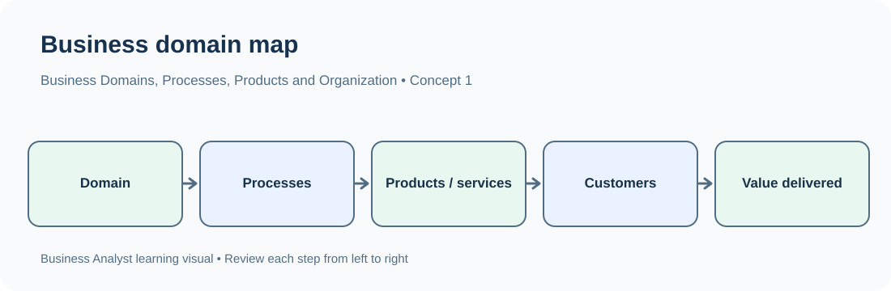
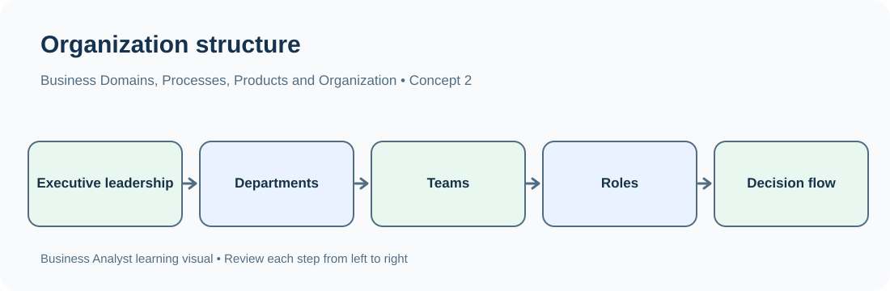

# TechPhile.ai --- Business Analyst Career Pathway

# Day 3: Business Domains, Processes, Products, Services and Organizational Structures

**Phase:** 1 --- Business Analysis Foundations\
**Approved syllabus topic:** Business domains, processes, products,
services and organizational structures\
**Estimated learning time:** 2--3 hours\
**Learning level:** Beginner to Intermediate\
**Prerequisites:** Day 1 --- Business analysis and project lifecycle;
Day 2 --- Business problems, objectives, stakeholders and value creation

------------------------------------------------------------------------

## 1. Learning Objectives

By the end of Day 3, you should be able to:

-   Explain what a business domain is and identify common business
    domains.
-   Understand how a business domain differs from a department, process,
    product and service.
-   Explain what a business process is and identify its inputs,
    activities, decisions, outputs and participants.
-   Distinguish core, support and management processes.
-   Explain the difference between a product and a service using
    business examples.
-   Understand how products, services and processes work together to
    deliver value.
-   Describe common organizational structures: functional, divisional,
    matrix and flat.
-   Explain why a Business Analyst must understand the domain, process,
    product/service and organizational structure before analyzing
    requirements.

------------------------------------------------------------------------

# 2. Why Does a Business Analyst Need to Understand a Business?

Imagine you join a bank as a Junior Business Analyst.

The bank asks you to help improve its loan application system.

Before discussing screens, fields or software requirements, you should
understand:

-   What type of business is a bank?
-   What does the bank provide to customers?
-   What is a loan?
-   How does a loan application move from submission to approval?
-   Which teams are involved?
-   Who checks customer documents?
-   Who approves or rejects the loan?
-   Which department owns each activity?
-   What happens when information is missing?

If you do not understand the business context, you may document
requirements that do not match the real process.

**Main idea:** A BA must understand the business in which a change is
happening, not just the software being developed.

------------------------------------------------------------------------

# 3. What Is a Business Domain?

A **business domain** is a particular area or field in which an
organization operates and performs business activities.

It describes the industry or business area that the organization belongs
to.

### Simple examples

  Organization                               Business domain
  ------------------------------------------ --------------------------------
  A bank                                     Banking and financial services
  An online shopping company                 E-commerce and retail
  A hospital                                 Healthcare
  An insurance company                       Insurance
  A school or university                     Education
  An airline                                 Aviation and travel
  A company delivering parcels               Logistics
  A company selling software subscriptions   Software / technology

### Easy way to understand

-   A bank belongs to the **banking domain**.
-   A hospital belongs to the **healthcare domain**.
-   An online shopping company belongs to the **e-commerce domain**.

The domain gives the BA the business context.

## 3.1 Why Is Domain Knowledge Important?

**Domain knowledge** means understanding the important terms,
activities, rules and practices of a particular business area.

For example, a BA working in banking should become familiar with terms
such as:

-   Account.
-   Deposit.
-   Withdrawal.
-   Loan.
-   Interest.
-   EMI (Equated Monthly Instalment).
-   Credit score.
-   KYC (Know Your Customer).
-   Loan approval.
-   Repayment.

A BA working in healthcare may need to understand:

-   Patient.
-   Appointment.
-   Doctor.
-   Consultation.
-   Medical record.
-   Prescription.
-   Billing.
-   Insurance claim.

Domain knowledge helps a BA:

-   Understand what stakeholders are discussing.
-   Ask relevant questions.
-   Recognize important business rules.
-   Understand how a process works.
-   Avoid misunderstanding industry-specific terms.
-   Communicate more effectively with business and technical teams.

**Important:** A BA does not need to know every detail of an industry
before starting. The BA learns the relevant domain concepts needed for
the assigned business problem.

## 3.2 Common Business Domains

  -----------------------------------------------------------------------
  Business domain         What the organization   Example business
                          generally does          activity
  ----------------------- ----------------------- -----------------------
  Banking                 Provides financial      Opening accounts and
                          services                processing loans

  Insurance               Provides protection     Processing insurance
                          against specified       claims
                          financial risks         

  Healthcare              Provides medical care   Scheduling patient
                          and related services    appointments

  E-commerce              Sells products through  Processing online
                          digital channels        orders

  Retail                  Sells products to       Managing store
                          customers               inventory and sales

  Education               Provides learning and   Student admission and
                          educational services    course registration

  Telecom                 Provides communication  Activating mobile
                          services                connections

  Logistics               Moves and delivers      Assigning parcels to
                          goods                   delivery routes

  Travel and hospitality  Provides travel,        Booking hotel rooms
                          accommodation and       
                          related services        

  Manufacturing           Produces physical goods Planning production and
                                                  quality checks

  Human Resources         Manages                 Recruiting and
                          employee-related        onboarding employees
                          activities              

  Software / IT           Builds or provides      Managing software
                          technology products and subscriptions
                          services                
  -----------------------------------------------------------------------

## 3.3 Business Domain vs Department

These terms are related but different.

A **business domain** describes the field in which the organization
operates.

A **department** is an internal organizational unit responsible for a
particular function or area of work.

Example: A bank operates in the banking domain. Inside the bank, there
may be departments such as:

-   Sales.
-   Customer service.
-   Finance.
-   Risk management.
-   Loan operations.
-   Information Technology (IT).
-   Human Resources (HR).

  Business domain   Department
  ----------------- --------------------
  Banking           Loan operations
  Healthcare        Billing department
  E-commerce        Customer support
  Manufacturing     Quality control
  Education         Admissions office

**Remember:** The domain describes the business area; the department
describes how work is divided inside an organization.

------------------------------------------------------------------------

# 4. What Is a Business Process?

A **business process** is a connected set of activities performed by
people, systems or teams to achieve a specific business result.

A process usually starts with an event or request, follows a sequence of
activities and produces an output.

### Simple example: Ordering food online

When a customer orders food:

1.  The customer selects food.
2.  The customer places an order.
3.  The restaurant receives the order.
4.  The restaurant prepares the food.
5.  A delivery partner collects the order.
6.  The food is delivered to the customer.
7.  The order is marked as completed.

These connected activities form a business process.

### Business Process Flow

``` text
Customer Selects Food
          |
          v
     Places Order
          |
          v
 Restaurant Receives Order
          |
          v
 Restaurant Prepares Food
          |
          v
 Delivery Partner Collects
          |
          v
     Food Delivered
          |
          v
      Order Completed
```

## 4.1 Why Do Businesses Need Processes?

Processes help organizations perform work in an organized and repeatable
way.

Without a clear process:

-   Employees may not know what to do next.
-   Important activities may be missed.
-   The same work may be repeated.
-   Requests may be delayed.
-   Different employees may follow different methods.
-   It becomes difficult to measure performance.

A defined process helps clarify who does what, in which order and what
result is expected.

## 4.2 Main Elements of a Business Process

A process can be understood using these elements:

  -----------------------------------------------------------------------
  Element                 Meaning                 Example: Loan
                                                  application
  ----------------------- ----------------------- -----------------------
  Trigger                 Event that starts the   Customer submits a loan
                          process                 application

  Input                   Information or items    Application form and
                          needed to perform the   identity documents
                          process                 

  Activity / Task         Work performed during   Verify customer
                          the process             documents

  Decision                A point where the       Are the documents
                          process chooses between complete?
                          paths                   

  Participant / Role      Person, team or system  Loan officer
                          performing an activity  

  Output                  Result produced by the  Approved, rejected or
                          process                 pending application

  Rule                    Condition that guides   Required documents must
                          an activity or decision be present

  Handoff                 Transfer of work from   Loan officer sends the
                          one person or team to   application to the
                          another                 credit team
  -----------------------------------------------------------------------

A process does not always have only one input or one output. The table
shows common elements.

## 4.3 Process Example --- Bank Loan Application

**Business situation:** A customer wants to apply for a personal loan.

  ------------------------------------------------------------------------
                   Step Activity         Responsible role Result
                                         / team           
  --------------------- ---------------- ---------------- ----------------
                      1 Customer submits Customer         Application
                        application                       received

                      2 Check required   Loan operations  Documents
                        documents                         checked

                      3 Verify customer  Verification     Verification
                        information      team             result

                      4 Evaluate credit  Credit team      Eligibility
                        eligibility                       result

                      5 Make approval    Authorized       Approved or
                        decision         approver         rejected

                      6 Inform customer  Customer service Decision
                                         / system         communicated

                      7 Complete         Loan operations  Loan amount
                        disbursement                      processed
                        steps, if                         
                        approved                          
  ------------------------------------------------------------------------

This example is simplified. Actual loan processes vary by bank, product,
regulation and approval policy.

## 4.4 Process, Activity and Task --- What Is the Difference?

These terms describe different levels of work.

  -----------------------------------------------------------------------
  Term                    Meaning                 Example
  ----------------------- ----------------------- -----------------------
  Process                 A complete sequence     Loan application
                          that achieves a         processing
                          business result         

  Activity                A major part of the     Verify customer
                          process                 information

  Task                    A specific piece of     Check the customer's
                          work within an activity identity document
  -----------------------------------------------------------------------

### Hierarchy

``` text
Business Process
      |
      v
   Activity
      |
      v
     Task
```

**Example:**

-   Process: Employee onboarding.
-   Activity: Collect employee information.
-   Task: Verify the employee's submitted address proof.

## 4.5 Process Trigger and Process Output

A **trigger** starts a process. An **output** is what the process
produces.

  -----------------------------------------------------------------------
  Business process        Trigger                 Example output
  ----------------------- ----------------------- -----------------------
  Order processing        Customer places an      Confirmed or cancelled
                          order                   order

  Employee onboarding     Candidate accepts an    Employee onboarding
                          offer                   completed

  Loan processing         Loan application        Loan decision
                          submitted               

  Patient appointment     Patient requests an     Confirmed appointment
  booking                 appointment             

  Insurance claim         Customer submits a      Approved, rejected or
  processing              claim                   pending claim
  -----------------------------------------------------------------------

A trigger is not the same as an input. For example, submitting a loan
application may trigger the process, while the application details and
supporting documents are inputs used during the process.

------------------------------------------------------------------------

# 5. Types of Business Processes

Organizations perform different types of processes. A useful
introductory classification is:

1.  Core processes.
2.  Support processes.
3.  Management processes.

## 5.1 Core Processes

A **core process** directly contributes to delivering the organization's
main product or service to its customers.

Examples:

  Organization            Core process
  ----------------------- ---------------------------------------------------------
  Bank                    Account opening, loan processing and payment processing
  E-commerce company      Order processing and product delivery
  Hospital                Patient registration, consultation and treatment
  Manufacturing company   Production and product quality checks
  Insurance company       Policy issuance and claim processing

Core processes are closely connected to the organization's main business
purpose.

## 5.2 Support Processes

A **support process** helps the organization operate, but it does not
usually represent the main product or service delivered to customers.

Examples:

-   Employee recruitment.
-   Payroll processing.
-   IT support.
-   Office administration.
-   Equipment maintenance.
-   Internal purchasing.

For example, a bank's HR team recruits employees. Recruitment supports
the bank's operations, but it is not the bank's main service to
customers.

## 5.3 Management Processes

A **management process** helps plan, monitor, control and improve the
organization.

Examples:

-   Business planning.
-   Budget approval.
-   Performance reviews.
-   Risk management.
-   Policy approval.
-   Strategic planning.

## 5.4 Core vs Support vs Management

  -----------------------------------------------------------------------
  Process type            Main purpose            Example in a bank
  ----------------------- ----------------------- -----------------------
  Core                    Deliver the main        Processing a customer
                          business service        loan

  Support                 Help the organization   Recruiting bank
                          operate                 employees

  Management              Direct and control the  Reviewing business
                          organization            performance
  -----------------------------------------------------------------------

**Remember:**

-   Core = Delivers the main business value.
-   Support = Helps the organization function.
-   Management = Plans and controls the organization.

A process may be classified differently depending on the organization's
business model and context. Focus on the purpose of the process.

------------------------------------------------------------------------

# 6. What Is a Product?

A **product** is something an organization creates or offers to meet a
customer need.

A product may be physical or digital.

### Physical product examples

-   Mobile phone.
-   Laptop.
-   Car.
-   Furniture.
-   Packaged food.
-   Clothing.

### Digital product examples

-   Mobile banking application.
-   Accounting software.
-   Online learning platform.
-   Subscription-based software.
-   Digital payment application.

## 6.1 Product Examples Across Domains

  Business domain   Example product
  ----------------- ----------------------------------------
  Banking           Savings account or credit card product
  Insurance         Health insurance policy
  E-commerce        A mobile phone listed for sale
  Software / IT     Project management software
  Education         Online learning course
  Manufacturing     Automobile

Some industries use the word "product" for a financial or contractual
offering, even though it is not a physical object.

## 6.2 Product Characteristics

A product may have:

-   A name.
-   Features.
-   A price or subscription plan.
-   A target customer group.
-   Usage conditions.
-   Quality expectations.
-   A lifecycle that includes introduction, updates and retirement.

Example: A project management software product may offer task tracking,
team collaboration, reporting and subscription plans.

------------------------------------------------------------------------

# 7. What Is a Service?

A **service** is an activity or benefit an organization provides to a
customer.

Unlike a physical product, a service is generally an action or
experience delivered to meet a need.

### Service examples

-   Banking services.
-   Medical consultation.
-   Food delivery.
-   Hotel accommodation.
-   Internet connectivity.
-   Technical support.
-   Insurance claim handling.
-   Transportation.

## 7.1 Service Examples Across Domains

  Business domain   Example service
  ----------------- ------------------------------------
  Banking           Money transfer
  Healthcare        Doctor consultation
  Insurance         Claim processing
  E-commerce        Home delivery
  Education         Student counselling
  Telecom           Internet connectivity
  Logistics         Parcel delivery
  IT                Cloud hosting or technical support

## 7.2 Product vs Service

  -----------------------------------------------------------------------
  Product                             Service
  ----------------------------------- -----------------------------------
  An item or offering provided to     An activity or benefit provided to
  meet a need                         meet a need

  Can be physical or digital          Usually involves an activity or
                                      experience

  Example: Laptop                     Example: Laptop repair

  Example: Mobile banking application Example: Bank customer support

  Example: Health insurance policy    Example: Insurance claim assistance
  -----------------------------------------------------------------------

A digital product can provide a service-like experience. A company may
also sell a product together with related services.

**Important:** Product and service are not always completely separate.
Many organizations provide both.

------------------------------------------------------------------------

# 8. How Products, Services and Processes Work Together

A product or service does not reach a customer by itself. Business
processes help create, deliver and support it.

### Example: Online Shopping Company

**Product:** A mobile phone sold through the website.

**Services:** - Online shopping experience. - Payment processing. - Home
delivery. - Return and refund support.

**Processes:** - Product listing. - Inventory management. - Order
processing. - Payment confirmation. - Packing and dispatch. -
Delivery. - Returns and refunds.

### Connected View

``` text
             BUSINESS DOMAIN
                  |
                  v
              E-COMMERCE
                  |
          +-------+-------+
          |               |
          v               v
       PRODUCT          SERVICE
      Mobile phone     Home delivery
          |               |
          +-------+-------+
                  |
                  v
          BUSINESS PROCESSES
                  |
      +-----------+-----------+
      |           |           |
      v           v           v
    Order      Payment     Delivery
  Processing  Processing  Processing
      |           |           |
      +-----------+-----------+
                  |
                  v
          CUSTOMER RECEIVES
          PRODUCT AND SERVICE
```

### Why This Matters to a BA

Suppose customers complain that their orders arrive late.

A BA should understand:

-   Which product or service is affected?
-   Which business process is responsible for delivery?
-   Which teams participate in that process?
-   Where does work move from one team to another?
-   What information is needed at each step?
-   What result does the customer expect?

The issue may involve inventory, packing, dispatch, delivery partners or
communication. The BA should investigate rather than assume the cause.

------------------------------------------------------------------------

# 9. What Is an Organization?

An **organization** is a group of people who work together using
resources, responsibilities and processes to achieve shared objectives.

Examples include:

-   A bank.
-   A hospital.
-   A software company.
-   A university.
-   A manufacturing company.
-   A government department.

Organizations divide work so that responsibilities are clear and
activities can be coordinated.

This brings us to organizational structure.

------------------------------------------------------------------------

# 10. What Is an Organizational Structure?

An **organizational structure** describes how roles, teams, departments,
responsibilities and reporting relationships are arranged within an
organization.

It helps answer:

-   Who is responsible for a particular activity?
-   Which team does an employee belong to?
-   Who does an employee report to?
-   Which manager makes or approves decisions?
-   How do departments coordinate their work?

### Simple example

A company may have:

-   Human Resources.
-   Finance.
-   Sales.
-   Marketing.
-   Operations.
-   Information Technology.

Each department has responsibilities and may have its own manager.

## 10.1 Why Organizational Structure Matters to a BA

A BA needs to understand the structure because it affects:

-   Who should be consulted.
-   Who owns a business process.
-   Who provides information.
-   Who approves a requirement or decision.
-   How work moves between departments.
-   Where communication or handoff problems may occur.

For example, in a loan application process, the sales team may collect
the application, the verification team may check documents and the
credit team may evaluate eligibility.

The BA should understand how these teams coordinate.

------------------------------------------------------------------------

# 11. Common Types of Organizational Structures

The main introductory structures covered here are:

1.  Functional structure.
2.  Divisional structure.
3.  Matrix structure.
4.  Flat structure.

## 11.1 Functional Organizational Structure

In a **functional structure**, employees are grouped according to their
area of expertise or business function.

Common departments include:

-   Finance.
-   Human Resources.
-   Marketing.
-   Sales.
-   Operations.
-   IT.

### Simple diagram

``` text
                 CEO
                  |
     +------------+------------+
     |            |            |
     v            v            v
  Finance        HR           Sales
     |
     |       Other functions may report
     |       separately to the CEO
     |
```

A more complete example:

``` text
                  CEO
                   |
    +--------------+--------------+
    |              |              |
    v              v              v
 Finance           HR             IT
                                   |
                            Development Team
```

### Example

A bank has separate Finance, HR, IT, Sales and Loan Operations
departments.

Employees usually report through their functional manager.

### Advantages

-   Clear functional responsibilities.
-   Employees can develop specialist knowledge.
-   Similar work is grouped together.
-   Functional managers can guide employees in their area.

### Challenges

-   Departments may work in silos.
-   Cross-department decisions may take time.
-   Teams may focus on their own goals rather than the complete customer
    process.

**Silo:** A situation where departments work separately and do not
coordinate or share information effectively.

### BA example

A BA investigating loan delays may need information from Sales, Loan
Operations, Verification and IT. In a functional structure, the BA may
need to coordinate with several separate department managers.

## 11.2 Divisional Organizational Structure

In a **divisional structure**, the organization is divided into groups
based on a product, service, customer group or geographic region.

Each division may have its own functions or resources.

### Example: Divisions by product

``` text
                  CEO
                   |
        +----------+----------+
        |                     |
        v                     v
   Personal Banking      Business Banking
        |                     |
   +----+----+            +---+----+
   |         |            |        |
   v         v            v        v
  Sales     Ops          Sales    Ops
```

### Example: Divisions by geography

A company may have:

-   North Region.
-   South Region.
-   East Region.
-   West Region.

### Advantages

-   Each division can focus on its product, customer group or region.
-   Decisions may be closer to the relevant market.
-   Performance can be reviewed by division.
-   Divisions can respond to different customer needs.

### Challenges

-   Similar functions may be duplicated across divisions.
-   Divisions may compete for resources.
-   Processes may differ between divisions.
-   Coordination across divisions may be difficult.

### BA example

An e-commerce company has separate divisions for electronics and
fashion. The BA may find that each division uses a different returns
process. The BA should understand whether the difference is intentional
or creates unnecessary complexity.

## 11.3 Matrix Organizational Structure

In a **matrix structure**, employees may work with both a functional
manager and a project or product manager.

This means responsibility and reporting can cross functional and project
lines.

### Simple diagram

``` text
                 CEO
                  |
        +---------+---------+
        |                   |
        v                   v
   Functional Teams     Project Teams
        |                   |
        v                   v
   Developers  --------> Project A
   Testers     --------> Project B
   Analysts    --------> Project C
```

An employee may belong to the IT department while also working on a
specific project.

### Example

A developer belongs to the IT function but is assigned to the customer
onboarding project.

The developer may coordinate with:

-   IT / Development Manager for technical and functional matters.
-   Project Manager for project priorities and delivery work.

### Advantages

-   People from different functions can work together.
-   Specialist skills can be shared across projects.
-   Cross-functional collaboration is supported.
-   Resources can be assigned to multiple business initiatives.

### Challenges

-   Employees may receive competing priorities.
-   Reporting relationships can become confusing.
-   Coordination requires clear communication.
-   Conflicts may occur between functional and project managers.

### BA example

A BA may report to a Business Analysis Manager but work day to day with
a Project Manager, Product Owner, developers and testers.

## 11.4 Flat Organizational Structure

A **flat structure** has fewer management levels between employees and
senior leadership.

It generally has a wider span of responsibility for each manager and
fewer layers of hierarchy.

### Simple diagram

``` text
              Founder / CEO
                    |
       +------------+------------+
       |            |            |
       v            v            v
    Employee     Employee     Employee
       |            |            |
       +------ Team collaboration
```

This is a simplified representation. Actual flat organizations can still
have team leads and managers.

### Advantages

-   Fewer management layers.
-   Communication may be faster.
-   Employees may have more direct access to decision-makers.
-   Decision-making can be less hierarchical.

### Challenges

-   Managers may handle many direct reports.
-   Roles can become less clearly defined.
-   Employees may have to take on wider responsibilities.
-   Coordination becomes difficult as the organization grows.

### BA example

In a small software startup, a BA may communicate directly with the
founder, developers and customer support team instead of going through
several management levels.

------------------------------------------------------------------------

# 12. Comparing Organizational Structures

  -------------------------------------------------------------------------
  Structure         How work is       Main advantage     Common challenge
                    grouped                              
  ----------------- ----------------- ------------------ ------------------
  Functional        By department or  Clear              Department silos
                    expertise         specialization     

  Divisional        By product,       Focus on a         Duplication across
                    service, customer specific market or divisions
                    or region         offering           

  Matrix            By function and   Cross-functional   Competing
                    project/product   collaboration      priorities

  Flat              With fewer        Direct             Wide management
                    management layers communication      responsibilities
  -------------------------------------------------------------------------

### Quick way to remember

-   **Functional:** Grouped by function.
-   **Divisional:** Grouped by product, customer or region.
-   **Matrix:** Functional teams also work across projects.
-   **Flat:** Fewer levels of management.

**Important:** Real organizations may combine structures. For example, a
large company may have geographic divisions, and each division may
contain functional departments.

------------------------------------------------------------------------

# 13. How Organizational Structure Affects Business Processes

A business process may cross multiple departments.

Consider an online order:

  Process activity             Department / team
  ---------------------------- ------------------------------
  Receive customer order       Sales / E-commerce
  Check product availability   Inventory / Operations
  Confirm payment              Finance / Payment Operations
  Pack product                 Warehouse
  Dispatch product             Logistics
  Handle customer complaint    Customer Support

If departments do not communicate properly, the order may be delayed.

### Example: A Handoff Problem

The warehouse has packed an order, but the logistics team has not
received the dispatch information.

Possible impact:

-   The parcel remains in the warehouse.
-   Delivery is delayed.
-   The customer contacts support.
-   The company may need to investigate the handoff.

A BA should identify:

-   Which team completes the first activity?
-   Which team receives the work?
-   What information must be transferred?
-   How is the transfer confirmed?
-   What happens if the receiving team does not receive the information?

This is why understanding organizational structure is important during
process analysis.

------------------------------------------------------------------------

# 14. How a BA Studies a Business Domain

When assigned to a new domain, a BA can use a structured approach to
understand it.

## Step 1: Understand the Organization

Find out:

-   What does the organization do?
-   Which industry does it operate in?
-   Who are its customers?
-   What products or services does it offer?

## Step 2: Understand the Business Vocabulary

Learn the terms used by stakeholders.

Example in insurance:

-   Policy.
-   Premium.
-   Insured person.
-   Claim.
-   Claim settlement.
-   Renewal.
-   Coverage.

Do not assume that a term has the same meaning in every industry. Ask
stakeholders to clarify domain-specific definitions.

## Step 3: Understand the Main Processes

Identify how the organization performs its important activities.

Example in insurance:

-   Customer registration.
-   Policy purchase.
-   Premium payment.
-   Claim submission.
-   Claim review.
-   Claim settlement.

## Step 4: Identify Departments and Roles

Understand which teams perform each activity.

Example:

-   Sales team.
-   Underwriting team.
-   Claims team.
-   Finance team.
-   Customer support.
-   IT team.

## Step 5: Understand Products and Services

Identify what the organization provides and what customers expect.

Example:

-   Product: Health insurance policy.
-   Service: Claim support and claim processing.

## Step 6: Understand the Business Problem

Connect the domain, process, product/service and people to the issue
being investigated.

Example:

"Customers are waiting too long for claim decisions."

The BA should understand the claim process, the teams involved, the
information required and the customer's expected result.

------------------------------------------------------------------------

# 15. Complete Industry Example --- Healthcare Appointment Booking

This example connects all Day 3 topics.

## Business Scenario

A hospital wants to improve its patient appointment booking process.

Patients report difficulty finding available appointments and sometimes
wait too long for confirmation.

## Step 1: Identify the Business Domain

**Domain:** Healthcare.

The hospital provides medical services to patients.

## Step 2: Identify Products and Services

The hospital may provide:

-   Doctor consultations.
-   Diagnostic tests.
-   Emergency care.
-   Inpatient treatment.
-   Pharmacy services.

For this scenario, the relevant service is doctor consultation and
appointment booking.

## Step 3: Identify the Business Process

**Process:** Patient appointment booking.

``` text
Patient Requests Appointment
              |
              v
       Select Department
              |
              v
        Select Doctor
              |
              v
      Check Availability
              |
              v
       Choose Time Slot
              |
              v
      Confirm Appointment
              |
              v
       Send Confirmation
```

This is a simplified flow. Real hospitals may include additional steps
such as patient registration, payment, referral checks or appointment
approval.

## Step 4: Identify Process Elements

  -----------------------------------------------------------------------
  Element                             Example
  ----------------------------------- -----------------------------------
  Trigger                             Patient requests an appointment

  Input                               Patient details, department and
                                      preferred date

  Activities                          Search doctor availability and
                                      select a time slot

  Decision                            Is the requested slot available?

  Participants                        Patient, receptionist and
                                      appointment system

  Output                              Confirmed appointment or
                                      alternative slot

  Rule                                A slot cannot be assigned if it is
                                      already booked

  Handoff                             Receptionist or system sends the
                                      appointment details to the relevant
                                      department
  -----------------------------------------------------------------------

## Step 5: Identify Organizational Structure

The hospital may have:

-   Administration.
-   Reception.
-   Medical departments.
-   Nursing.
-   Billing.
-   IT.
-   Patient support.

The appointment process may involve Reception, the Medical Department
and IT.

## Step 6: Understand the Business Problem

Patients experience difficulty finding and confirming appointments.

The BA should investigate:

-   Which departments have the longest waiting times?
-   Are appointment slots unavailable or is the booking process unclear?
-   How are appointments currently recorded?
-   Who updates doctor availability?
-   How are cancellations handled?
-   How are patients informed about confirmation?

## Step 7: Connect the Concepts

  -----------------------------------------------------------------------
  Day 3 concept                       Healthcare example
  ----------------------------------- -----------------------------------
  Business domain                     Healthcare

  Organization                        Hospital

  Product / service                   Doctor consultation service

  Business process                    Appointment booking

  Trigger                             Patient requests an appointment

  Input                               Patient and appointment details

  Activity                            Check doctor availability

  Decision                            Is a slot available?

  Output                              Confirmed appointment

  Departments                         Reception, Medical Department and
                                      IT

  Organizational structure            The hospital's arrangement of
                                      departments and reporting
                                      relationships
  -----------------------------------------------------------------------

**Key learning:** A BA understands the business domain first, then the
product or service, the process used to deliver it and the
organizational teams involved.

------------------------------------------------------------------------

# 16. Common Mistakes and How to Avoid Them

  -----------------------------------------------------------------------
  Common mistake          Why it is incorrect     Better understanding
  ----------------------- ----------------------- -----------------------
  Treating a business     A domain describes the  Banking is a domain;
  domain as a department  industry or business    Loan Operations is a
                          area                    department

  Thinking a process is   A process usually       Loan processing
  one task                contains connected      contains document
                          activities              checks, verification
                                                  and approval

  Confusing activity with An activity is only one Document verification
  process                 part of a process       is an activity within
                                                  loan processing

  Confusing a trigger     A trigger starts the    Application submission
  with an input           process; inputs are     triggers loan
                          information or items    processing; documents
                          used in it              are inputs

  Thinking every product  Products can also be    Software and insurance
  is physical             digital or financial    policies can be
                          offerings               products

  Thinking a service is   Services can be         Medical consultation
  always software-based   physical-world          and parcel delivery are
                          activities              services

  Assuming every          Processes may cross     Order processing may
  department owns a       several departments     involve Sales,
  complete process                                Inventory, Finance and
                                                  Logistics

  Thinking all            Structures vary by size A startup may be flat;
  organizations use one   and operating model     a large company may be
  structure                                       divisional or matrix

  Ignoring handoffs       Work can become delayed Identify what
                          when responsibility     information passes from
                          moves between teams     one team to another

  Assuming the            Formal reporting lines  Study the actual
  organization chart      do not always show      process and speak with
  explains every process  day-to-day workflow     the people performing
                                                  it
  -----------------------------------------------------------------------

------------------------------------------------------------------------

# 17. Important Terms --- Day 3

  -----------------------------------------------------------------------
  Term                    Simple meaning          Example
  ----------------------- ----------------------- -----------------------
  Business domain         Industry or business    Healthcare
                          area                    

  Domain knowledge        Understanding the terms Knowing what a medical
                          and practices of a      appointment is
                          business area           

  Organization            People working together A hospital
                          to achieve shared       
                          objectives              

  Department              Internal group          Billing department
                          responsible for a       
                          function                

  Business process        Connected activities    Appointment booking
                          that achieve a business 
                          result                  

  Trigger                 Event that starts a     Patient requests an
                          process                 appointment

  Input                   Information or items    Patient details
                          used by a process       

  Activity                Major piece of work in  Check doctor
                          a process               availability

  Task                    Specific unit of work   Verify patient ID

  Decision                Point where the process Is a slot available?
                          chooses a path          

  Output                  Result produced by a    Confirmed appointment
                          process                 

  Handoff                 Transfer of work        Reception sends details
                          between people or teams to the department

  Core process            Directly delivers the   Loan processing
                          main business offering  

  Support process         Helps the organization  Employee recruitment
                          operate                 

  Management process      Plans, monitors or      Budget review
                          controls the            
                          organization            

  Product                 Offering provided to    Laptop or software
                          meet a customer need    

  Service                 Activity or benefit     Doctor consultation
                          provided to a customer  

  Organizational          Arrangement of roles,   Functional structure
  structure               teams and reporting     
                          relationships           

  Functional structure    Employees grouped by    Finance, HR and IT
                          expertise or function   

  Divisional structure    Organization grouped by North and South
                          product, customer or    divisions
                          region                  

  Matrix structure        Employees work across   Developer assigned to
                          functions and projects  Project A

  Flat structure          Organization has fewer  Small startup with
                          management levels       direct communication
  -----------------------------------------------------------------------

------------------------------------------------------------------------

# 18. Interview Preparation --- Day 3

## Q1. What is a business domain?

**Answer:**

A business domain is the industry or business area in which an
organization operates.

For example, a bank belongs to the banking domain, a hospital belongs to
the healthcare domain and an online shopping company belongs to the
e-commerce domain.

A Business Analyst needs domain knowledge to understand business
terminology, processes, rules and stakeholder expectations.

**Follow-up:** What is the difference between a business domain and a
department?

**Answer:** A business domain describes the industry or business area,
while a department is an internal group within an organization. Banking
is a domain; Loan Operations is a department.

## Q2. What is a business process?

**Answer:**

A business process is a connected sequence of activities performed by
people or systems to achieve a specific business result.

For example, an order-processing process may include receiving an order,
checking inventory, confirming payment, packing the product and
arranging delivery.

**Follow-up:** What are the common elements of a business process?

**Answer:** Trigger, inputs, activities, decisions, participants, rules,
outputs and handoffs.

## Q3. What is the difference between a process, activity and task?

**Answer:**

A process is the complete sequence of work, an activity is a major part
of that process, and a task is a specific piece of work within an
activity.

For example:

-   Process: Employee onboarding.
-   Activity: Collect employee information.
-   Task: Verify the employee's address proof.

**Follow-up:** Can a process contain multiple activities?

**Answer:** Yes. A business process normally contains multiple connected
activities.

## Q4. What is the difference between a product and a service?

**Answer:**

A product is an offering provided to meet a customer need. It may be
physical or digital. A service is an activity or benefit provided to a
customer.

For example, a laptop is a product, while laptop repair is a service. A
hospital provides healthcare services such as doctor consultations.

**Follow-up:** Can an organization provide both products and services?

**Answer:** Yes. A company may sell a product and also provide delivery,
installation, maintenance or customer support.

## Q5. What are core, support and management processes?

**Answer:**

-   Core processes directly deliver the organization's main product or
    service.
-   Support processes help the organization operate.
-   Management processes plan, monitor and control the organization.

For example, loan processing is a core process in a bank, recruitment is
a support process and business performance review is a management
process.

**Follow-up:** Is recruitment a core process in every organization?

**Answer:** It is generally a support process because it supports the
organization's operations. Process classification should always be
understood in the context of the organization's main purpose.

## Q6. What is an organizational structure?

**Answer:**

An organizational structure describes how employees, roles, departments,
responsibilities and reporting relationships are arranged in an
organization.

It helps people understand who is responsible for work, who makes
decisions and how teams coordinate.

**Follow-up:** Why should a Business Analyst understand organizational
structure?

**Answer:** It helps the BA identify process owners, relevant
stakeholders, approval responsibilities and handoffs between teams.

## Q7. Explain the functional organizational structure.

**Answer:**

In a functional structure, employees are grouped according to their area
of expertise or business function, such as Finance, HR, Sales,
Operations and IT.

Its advantage is clear specialization and responsibility. A common
challenge is that departments may work in silos and cross-department
coordination may take time.

**Follow-up:** What is a silo?

**Answer:** A silo is a situation where departments work separately and
do not coordinate or share information effectively.

## Q8. What is the difference between functional and divisional structures?

**Answer:**

A functional structure groups employees by expertise or department. A
divisional structure groups the organization by product, service,
customer group or geographic region.

For example, Finance, HR and IT are functional departments. North Region
and South Region may be divisions.

**Follow-up:** Can each division have its own departments?

**Answer:** Yes. A division may have its own Sales, Operations or other
functional teams.

## Q9. What is a matrix organizational structure?

**Answer:**

A matrix structure combines functional teams with project or product
assignments. An employee may report to a functional manager and also
work under a project manager for a particular initiative.

For example, a developer may belong to the IT department but work on a
customer onboarding project.

**Follow-up:** What is one challenge of a matrix structure?

**Answer:** Employees may receive competing priorities from functional
and project managers.

## Q10. How would you understand a new business domain as a BA?

**Answer:**

I would first understand what the organization does, who its customers
are and what products or services it provides. Then I would learn the
important business terms, understand the main processes, identify the
departments and roles involved, and study the business problem assigned
to me.

I would clarify unfamiliar terms with relevant stakeholders instead of
making assumptions.

**Follow-up:** Do you need to become an industry expert before starting
BA work?

**Answer:** No. I need enough relevant domain knowledge to understand
the assigned business problem, ask useful questions and communicate
accurately. I can deepen my knowledge as the work progresses.

------------------------------------------------------------------------

# 19. Day 3 Quick Revision Sheet

  -----------------------------------------------------------------------
  Topic                               Remember
  ----------------------------------- -----------------------------------
  Business domain                     Industry or area in which an
                                      organization operates

  Domain knowledge                    Understanding the terms, activities
                                      and rules of that business area

  Business process                    Connected activities that achieve a
                                      business result

  Trigger                             Event that starts the process

  Input                               Information or items used by the
                                      process

  Activity                            Major piece of work

  Task                                Specific unit of work

  Decision                            Point where a process chooses a
                                      path

  Output                              Result produced by the process

  Handoff                             Transfer of work between people or
                                      teams

  Core process                        Delivers the main business offering

  Support process                     Helps the organization operate

  Management process                  Plans and controls the organization

  Product                             Physical or digital offering

  Service                             Activity or benefit provided to a
                                      customer

  Organizational structure            Arrangement of roles, departments
                                      and reporting lines

  Functional                          Grouped by expertise or function

  Divisional                          Grouped by product, customer or
                                      region

  Matrix                              Functional teams also work across
                                      projects

  Flat                                Fewer management levels
  -----------------------------------------------------------------------

## Important Differences

  -----------------------------------------------------------------------
  Do not confuse                      Difference
  ----------------------------------- -----------------------------------
  Domain vs department                Industry/business area vs internal
                                      organizational unit

  Process vs activity                 Complete sequence vs major part of
                                      the sequence

  Activity vs task                    Major piece of work vs specific
                                      unit of work

  Trigger vs input                    Event that starts the process vs
                                      information/items used by it

  Product vs service                  Offering vs activity or benefit

  Core vs support process             Main customer/business delivery vs
                                      process that supports operations

  Functional vs divisional structure  Grouped by expertise vs grouped by
                                      product, customer or region

  Functional vs matrix structure      Department-based reporting vs
                                      department and project
                                      relationships
  -----------------------------------------------------------------------

## Complete Day 3 Understanding Flow

``` text
             BUSINESS DOMAIN
                    |
                    v
              ORGANIZATION
                    |
          +---------+---------+
          |                   |
          v                   v
       PRODUCTS             SERVICES
          |                   |
          +---------+---------+
                    |
                    v
             BUSINESS PROCESSES
                    |
                    v
       ACTIVITIES, TASKS AND DECISIONS
                    |
                    v
          DEPARTMENTS AND PEOPLE
                    |
                    v
          ORGANIZATIONAL STRUCTURE
                    |
                    v
          CUSTOMER / BUSINESS VALUE
```

------------------------------------------------------------------------


## Visual learning aids





# 20. Day 3 Completion Checklist

-   [ ] I can explain what a business domain is.
-   [ ] I can identify common business domains using real organizations.
-   [ ] I can distinguish a business domain from a department.
-   [ ] I can explain what domain knowledge means.
-   [ ] I can define a business process.
-   [ ] I can identify triggers, inputs, activities, decisions,
    participants, outputs and handoffs.
-   [ ] I can distinguish a process, activity and task.
-   [ ] I can explain core, support and management processes.
-   [ ] I can distinguish products from services.
-   [ ] I can explain how processes help deliver products and services.
-   [ ] I can define organizational structure.
-   [ ] I can explain functional, divisional, matrix and flat
    structures.
-   [ ] I can explain how organizational structure affects process
    ownership and coordination.
-   [ ] I can connect a business domain, product/service, process and
    organizational structure in an industry example.

------------------------------------------------------------------------

**End of Day 3 --- Business Domains, Processes, Products, Services and
Organizational Structures**

**Next syllabus topic --- Day 4:** Stakeholder identification,
stakeholder mapping, influence and interest.
