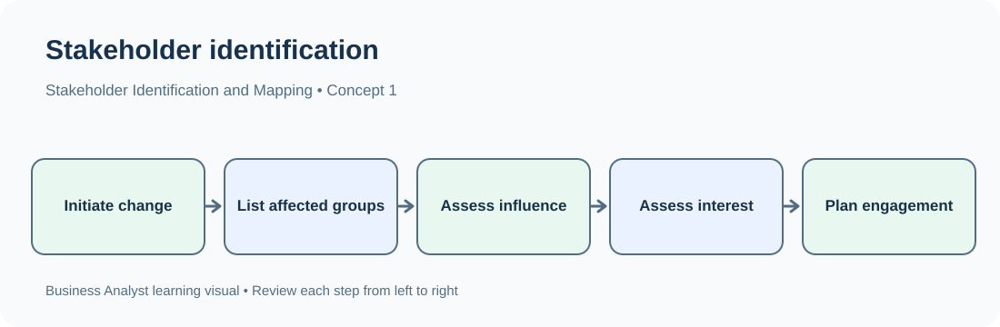
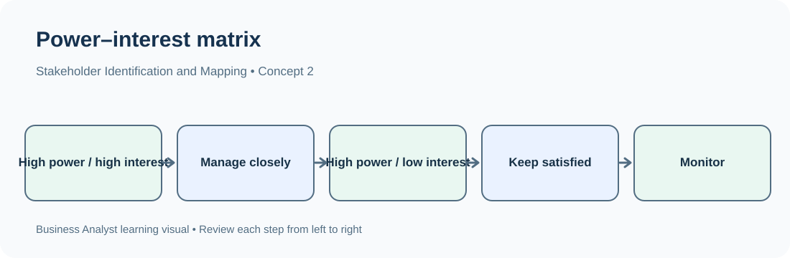

# TechPhile.ai — Business Analyst Career Pathway

# Day 4: Stakeholder Identification, Stakeholder Mapping, Influence and Interest

**Phase:** 1 — Business Analysis Foundations  
**Approved syllabus topic:** Stakeholder identification, stakeholder mapping, influence and interest  
**Estimated learning time:** 2–3 hours  
**Difficulty:** Beginner to Intermediate  
**Prerequisites:**  
- Day 1 — Business analysis, BA responsibilities and project lifecycle  
- Day 2 — Business problems, objectives, stakeholders and value creation  
- Day 3 — Business domains, processes, products, services and organizational structures  

---

# 1. Learning Objectives

By the end of this lesson, you should be able to:

- Define a stakeholder and explain why stakeholder identification is important.
- Identify stakeholders systematically for a business change or project.
- Distinguish internal, external, primary, secondary, direct and indirect stakeholders.
- Understand stakeholder roles, responsibilities, needs and expectations.
- Explain stakeholder analysis and the information a BA records.
- Define stakeholder mapping and create a stakeholder map.
- Explain influence, interest, power and impact in practical terms.
- Use the Power–Interest Matrix to classify stakeholders.
- Select suitable engagement and communication approaches for different stakeholder groups.
- Recognize stakeholder conflicts and understand the BA's role in handling them.

---

# 2. Why Stakeholder Analysis Matters

Imagine an e-commerce company wants to improve its order-return process.

The sales manager says:

> "Customers are unhappy with returns. We need to make the return process easier."

A Business Analyst should not discuss the solution only with the sales manager. The return process may involve:

- Customers who request returns.
- Customer-support agents who receive return requests.
- Warehouse employees who inspect returned products.
- Delivery partners who collect products.
- Finance employees who process refunds.
- Operations managers who monitor the process.
- Developers who maintain the return-management system.
- Testers who verify the new functionality.
- Senior management who approve budget or policy changes.

Each group sees a different part of the process.

For example:

- Customers want a simple return process.
- Finance wants accurate refund calculations.
- Warehouse staff need correct product and condition details.
- Customer support wants fewer repeated customer queries.
- Management wants lower return-processing costs.

If the BA identifies only customers and the sales manager, important operational and financial requirements may be missed.

**Main idea:** Stakeholder analysis helps a BA understand who is involved, who is affected, who can influence a change and whose needs must be considered.

## 2.1 What can happen when stakeholders are missed?

| Situation | Possible consequence |
|---|---|
| End users are not identified | The solution may not fit how people actually work |
| Finance is not consulted | Refund, payment or budget rules may be missed |
| Operations teams are ignored | The proposed process may be impractical |
| Approvers are not identified | Decisions and sign-offs may be delayed |
| External partners are missed | Integration or handoff requirements may be overlooked |
| Stakeholder expectations are not understood | Conflicts may appear late in the project |
| Communication is inconsistent | Different groups may work with different information |

---

# 3. Words You Need

| Term | Simple meaning | Example |
|---|---|---|
| Stakeholder | A person, group or organization affected by, interested in or able to influence a change | Customer, finance manager or delivery partner |
| Stakeholder identification | Finding all relevant people and groups connected to a change | Listing everyone involved in an order-return process |
| Stakeholder analysis | Understanding each stakeholder's role, needs, expectations, influence and concerns | Recording that finance approves refund rules |
| Stakeholder mapping | Organizing stakeholders visually or in a structured view | Placing stakeholders in a Power–Interest Matrix |
| Influence | The ability to affect decisions or outcomes | A senior manager can approve project funding |
| Interest | How much a stakeholder cares about or is concerned with the change | Customer-support agents may be highly interested in a new support workflow |
| Power | The formal or practical authority a stakeholder has over decisions | A compliance head may have authority to reject a process that violates policy |
| Impact | How strongly the change affects a stakeholder | A new return process directly changes warehouse employees' work |
| Engagement | The way the BA or project team involves and communicates with stakeholders | Holding a workshop with customer-support representatives |
| Expectation | What a stakeholder believes should happen | Customers expect a refund after an eligible return |
| Concern | A risk, difficulty or issue a stakeholder is worried about | Finance is concerned about incorrect refunds |
| Decision-maker | A person authorized to make a particular decision | Business sponsor approving the budget |
| Subject-matter expert (SME) | A person with detailed knowledge of a business area or process | A warehouse supervisor who understands product inspection |
| Sponsor | A senior person who supports the initiative and may provide authority, funding or direction | Operations director sponsoring a process-improvement initiative |
| End user | A person who directly uses the system, product or process | A customer using the return portal |
| Dependency | A person, team, system or activity that another part of the work relies on | Refund processing depends on payment-system confirmation |

**Important:** A stakeholder is not necessarily a user. A finance director may approve refund policies without using the customer-facing return portal.

---

# 4. What Is a Stakeholder?

A **stakeholder** is a person, group or organization that:

- Is affected by a business change.
- Has an interest in the change.
- Can influence the change or its outcome.
- Provides information, resources, approval or services needed for the change.

Stakeholders may be inside or outside the organization.

## 4.1 Simple example: Online shopping return process

| Stakeholder | Why they are involved |
|---|---|
| Customer | Requests a return and receives the refund |
| Customer-support agent | Handles return questions and requests |
| Warehouse team | Receives and inspects returned products |
| Finance team | Checks and processes refunds |
| Delivery partner | Collects or transports returned products |
| Operations manager | Owns or monitors operational performance |
| Sales manager | Monitors sales and customer experience |
| Product manager | Helps decide product priorities |
| Business Analyst | Identifies needs and documents requirements |
| Developer | Implements system changes |
| Tester / QA engineer | Checks whether the solution behaves as expected |
| Senior management | May approve funding, policy or major decisions |

The exact stakeholders depend on the business, process, organization and scope of the change.

---

# 5. Types of Stakeholders

Stakeholders can be classified in different ways. These classifications help the BA avoid overlooking important groups.

## 5.1 Internal Stakeholders

**Internal stakeholders** are people or groups within the organization.

Examples:

- Senior management.
- Department managers.
- Sales employees.
- Finance employees.
- Customer-support employees.
- Operations teams.
- Human Resources (HR).
- IT and development teams.
- Testers and quality-assurance teams.

### Example

A bank is improving its loan application process.

Internal stakeholders may include:

| Internal stakeholder | Possible involvement |
|---|---|
| Branch manager | Explains branch-level issues and business expectations |
| Loan operations team | Processes applications and documents |
| Credit-risk team | Evaluates credit eligibility |
| Finance team | Explains financial controls and records |
| IT team | Supports the loan application system |
| Compliance team | Checks applicable policies and regulatory requirements |
| Senior management | Approves major business decisions |

## 5.2 External Stakeholders

**External stakeholders** are people or organizations outside the organization who are affected by, interested in or involved in the change.

Examples:

- Customers.
- Suppliers.
- Vendors.
- Delivery partners.
- Payment providers.
- Business partners.
- Regulators, where relevant.
- Outsourced service providers.

### Example

For an online payment improvement:

| External stakeholder | Possible involvement |
|---|---|
| Customer | Makes a payment |
| Payment gateway provider | Processes payment requests |
| Bank | Authorizes or declines a payment |
| Card network | Supports card-payment processing |
| Regulatory authority | May define relevant compliance obligations |

## 5.3 Internal vs External Stakeholders

| Internal | External |
|---|---|
| Belongs to the organization | Outside the organization |
| Usually works within its departments or teams | May be a customer, partner, supplier or regulator |
| Example: Finance manager | Example: Payment provider |
| Example: Developer | Example: Delivery partner |

**Remember:** The classification depends on the organization being analyzed. A vendor's employee is external to the client organization, even though that person may work closely with its project team.

## 5.4 Primary and Secondary Stakeholders

### Primary stakeholders

Primary stakeholders are directly involved in, directly affected by or closely connected to the change.

Examples for a customer-return process:

- Customers requesting returns.
- Customer-support agents processing requests.
- Warehouse employees inspecting returned items.
- Finance employees processing refunds.

### Secondary stakeholders

Secondary stakeholders are affected more indirectly or provide supporting oversight, advice or resources.

Examples may include:

- Senior leadership.
- Legal advisers.
- HR, if staff responsibilities or training change.
- Other departments that receive reports about return performance.

| Primary stakeholder | Secondary stakeholder |
|---|---|
| Directly involved or affected | More indirectly involved or affected |
| Often uses or operates the changed process | May provide oversight, support or advice |
| Example: Warehouse employee | Example: HR manager |

**Important:** Primary and secondary are not permanent labels. A stakeholder's classification can change when the scope changes.

## 5.5 Direct and Indirect Stakeholders

| Type | Meaning | Example |
|---|---|---|
| Direct stakeholder | Experiences or participates in the change directly | A customer using a new checkout screen |
| Indirect stakeholder | Experiences a consequence of the change without directly using the solution | A management team receiving new performance reports |

A stakeholder can be both primary and external, or secondary and internal. These categories describe different aspects and should not be treated as one fixed classification.

## 5.6 Stakeholder vs User vs Customer

| Term | Meaning | Example |
|---|---|---|
| Stakeholder | Has an interest in, is affected by or can influence the change | Finance director |
| User | Directly uses the product, service or system | Customer using a return portal |
| Customer | Purchases or receives the organization's product or service | Person who bought a laptop |

A customer is often a stakeholder and user, but not always. An internal employee may be a user without being a customer. A sponsor may be a stakeholder without using the system.

---

# 6. Stakeholder Identification

**Stakeholder identification** is the process of finding all people, teams and organizations that are relevant to a business change.

It is usually one of the first activities in stakeholder analysis.

## 6.1 Why identify stakeholders systematically?

A BA needs to know:

- Who requested the change?
- Who experiences the current problem?
- Who performs the current process?
- Who owns the process?
- Who approves decisions?
- Who provides specialist knowledge?
- Who builds or tests the solution?
- Who provides external services?
- Who may be affected by the final result?

## 6.2 Step-by-step stakeholder identification

```text
1. Understand the business problem
              |
              v
2. Define the process or change being examined
              |
              v
3. Identify people who perform the process
              |
              v
4. Identify people who receive the output
              |
              v
5. Identify process owners and decision-makers
              |
              v
6. Identify supporting teams and subject experts
              |
              v
7. Identify external organizations and partners
              |
              v
8. Check for missing or indirectly affected groups
              |
              v
9. Record and validate the stakeholder list
```

This is an iterative process. New stakeholders may be discovered when the BA learns more about the process.

## 6.3 Questions a BA should ask

| Area | Questions |
|---|---|
| Business ownership | Which department owns this business process? |
| Problem | Who experiences the problem most often? |
| Process | Who performs each activity? |
| Users | Who will use the changed system or process? |
| Decisions | Who can approve or reject the proposed change? |
| Expertise | Who understands the detailed business rules? |
| Operations | Who will operate or support the solution after release? |
| Technology | Which IT teams or vendors are involved? |
| External parties | Are customers, suppliers, banks or service providers involved? |
| Compliance | Does a compliance, legal or regulatory group need to be consulted? |
| Impact | Whose daily work, responsibilities or outcomes may change? |

## 6.4 Stakeholder identification using a process

Suppose a hospital wants to improve patient appointment booking.

First understand the process:

```text
Patient requests appointment
              |
              v
Reception checks availability
              |
              v
Doctor's schedule is confirmed
              |
              v
Appointment is booked
              |
              v
Patient receives confirmation
              |
              v
Patient attends appointment
```

Now identify the people and groups connected to each step.

| Process activity | Possible stakeholder |
|---|---|
| Request appointment | Patient |
| Check availability | Receptionist |
| Confirm doctor's schedule | Doctor or clinic coordinator |
| Book appointment | Receptionist or booking system owner |
| Send confirmation | IT team or notification service provider |
| Attend appointment | Patient and doctor |
| Monitor appointment performance | Hospital operations manager |

This process-based method helps identify stakeholders who may not be obvious from the original request.

## 6.5 Stakeholder identification checklist

Before finalizing the list, check whether you have considered:

- [ ] The person who requested the change.
- [ ] People who experience the problem.
- [ ] People who perform the current process.
- [ ] Process owners and department managers.
- [ ] End users of the proposed solution.
- [ ] Decision-makers and approvers.
- [ ] Subject-matter experts.
- [ ] Finance, operations and support teams, where relevant.
- [ ] IT, developers and testers, where relevant.
- [ ] External customers, suppliers and service providers.
- [ ] Compliance or legal stakeholders, where relevant.
- [ ] People indirectly affected by the change.

---

# 7. Stakeholder Roles, Responsibilities and Expectations

Identifying a stakeholder is not enough. The BA must understand what that stakeholder contributes and what they need from the change.

## 7.1 Common stakeholder roles

| Role | Typical responsibility | Example |
|---|---|---|
| Sponsor | Supports the initiative and provides direction or authority | Operations director |
| Business owner | Owns the business area or process | Head of loan operations |
| Decision-maker | Makes a specific decision within their authority | Finance approver |
| Subject-matter expert (SME) | Explains detailed business activities and rules | Senior loan-processing officer |
| End user | Uses the solution or performs the changed process | Loan officer |
| Customer | Receives the organization's product or service | Loan applicant |
| Project Manager | Coordinates project delivery, schedule and resources | Project manager |
| Business Analyst | Understands needs, analyzes requirements and facilitates communication | BA assigned to the initiative |
| Developer | Implements the technical solution | Software engineer |
| Tester / QA | Checks the solution against expected behavior | QA analyst |
| Vendor / partner | Provides an external product or service | Identity-verification provider |

A person may hold more than one role. For example, a department manager may also be the process owner and decision-maker for a particular business rule.

## 7.2 Stakeholder needs vs expectations

These terms are related but not identical.

- **Need:** Something necessary for the stakeholder to perform work or achieve an outcome.
- **Expectation:** What the stakeholder believes the solution or project should provide.

Example: In a loan application system:

| Stakeholder | Need | Possible expectation |
|---|---|---|
| Loan applicant | Submit an application and track its status | Clear instructions and timely updates |
| Loan officer | Review complete applicant information | One screen showing relevant application details |
| Credit team | Assess credit eligibility | Accurate and accessible credit information |
| Compliance team | Ensure required checks are followed | Required checks cannot be bypassed |
| Management | Monitor business performance | Reports on application volume and processing time |
| IT support | Maintain the system | Clear error information and support procedures |

A BA should confirm needs and expectations rather than assume them.

## 7.3 Stakeholder interest and concern

A stakeholder's interest describes how much the change matters to them. Their concern describes a specific issue they are worried about.

| Stakeholder | Interest | Possible concern |
|---|---|---|
| Customer | High | Return request may be rejected incorrectly |
| Finance team | High | Refund amount may be inaccurate |
| Warehouse team | High | Returned products may arrive without correct details |
| Senior management | Medium or high | The change may exceed the approved budget |
| Other departments | Low or medium | The change may affect their reports |

Interest can be high even when a stakeholder has little decision-making power.

---

# 8. What Is Stakeholder Analysis?

**Stakeholder analysis** is the activity of examining stakeholders to understand their roles, needs, interests, influence, impact, concerns and involvement in a change.

It helps the BA decide:

- Whose requirements must be understood?
- Who should be consulted?
- Who can make or approve decisions?
- Who may support or resist the change?
- Who needs frequent communication?
- Who needs to be informed about progress?
- Which stakeholder conflicts need attention?

## 8.1 Information to record during stakeholder analysis

| Information | What to record | Example |
|---|---|---|
| Name or group | Stakeholder's name, role or team | Finance department |
| Organization | Internal or external | Internal |
| Role | How they are connected to the change | Refund processing |
| Responsibility | What they do or decide | Validate refund records |
| Needs | What they require | Accurate refund details |
| Expectations | What they expect from the solution | Correct refund status |
| Interest | How much the change matters to them | High |
| Influence | Ability to affect decisions or outcomes | Medium |
| Impact | How strongly the change affects them | High |
| Concerns | Problems or risks they anticipate | Incorrect refund calculation |
| Engagement approach | How they should be involved | Review refund rules and attend validation sessions |

This information may be recorded in a stakeholder register.

## 8.2 Stakeholder Register

A **stakeholder register** is a structured record of identified stakeholders and relevant information about them.

Example:

| Stakeholder | Type | Role | Interest | Influence | Main concern |
|---|---|---|---|---|---|
| Operations director | Internal | Sponsor / decision-maker | High | High | Process cost and performance |
| Customer-support team | Internal | Process users | High | Medium | More complicated support work |
| Finance team | Internal | Refund control | High | High | Incorrect refund amounts |
| Customers | External | End users | High | Medium | Slow or unclear refunds |
| Delivery partner | External | Return collection | Medium | Medium | Incorrect collection details |
| IT team | Internal | Technical delivery | Medium | Medium | Unclear integration requirements |

**Note:** The influence and interest levels above are illustrative. A BA should determine them from the actual organization, decision rights and project context.

---

# 9. What Is Stakeholder Mapping?

**Stakeholder mapping** is the process of organizing stakeholders visually according to selected characteristics, such as their influence, interest or impact.

It helps the BA and project team understand stakeholder relationships and decide how to engage with different groups.

A stakeholder map is not simply a list of names. It shows how stakeholders relate to the change.

## 9.1 Why use stakeholder mapping?

- Quickly identify stakeholders who need close involvement.
- Recognize powerful decision-makers.
- Identify highly interested users.
- Avoid spending the same amount of communication effort on every stakeholder.
- Identify groups that may need additional explanation or support.
- Make stakeholder discussions more structured.

## 9.2 Common stakeholder mapping approaches

| Mapping approach | What it compares | When it is useful |
|---|---|---|
| Power–Interest Matrix | Power and interest | Deciding engagement and communication effort |
| Influence–Impact Matrix | Influence and impact | Understanding who can shape the change and who will experience it |
| Stakeholder Onion Diagram | Stakeholders by closeness to the solution or organization | Showing groups around a system or business change |
| Stakeholder Relationship Map | Relationships and dependencies among stakeholders | Understanding communication paths and dependencies |

This lesson focuses mainly on influence, interest and the Power–Interest Matrix.

---

# 10. Understanding Influence, Power, Interest and Impact

These words are connected, but they do not mean the same thing.

## 10.1 Influence

**Influence** is a stakeholder's ability to affect decisions, actions or outcomes.

A stakeholder may influence a change through:

- Expertise.
- Organizational authority.
- Control over resources.
- Control over an important process.
- Ability to support or delay a decision.
- Relationships with other stakeholders.

Example:

A senior operations manager may influence whether a new return process is accepted because the operations team must use it.

## 10.2 Power

**Power** is the authority or ability a stakeholder has to make decisions, approve resources or control important outcomes.

Examples:

- A sponsor may approve project funding.
- A compliance head may reject a process that does not satisfy required controls.
- A department head may approve a change to departmental procedures.

Power is often formal, while influence can also come from expertise, experience or relationships.

## 10.3 Interest

**Interest** describes how much a stakeholder cares about the change or how closely the outcome relates to their responsibilities.

Examples:

- Customers may have high interest in a faster refund process.
- Finance may have high interest because refund accuracy affects its work.
- A department unrelated to returns may have low interest.

Interest is not the same as power. A customer may have high interest but limited authority over the company's internal project decisions.

## 10.4 Impact

**Impact** describes how strongly the change affects a stakeholder.

Examples:

- Warehouse employees may experience high impact if their daily return-inspection process changes.
- Senior management may experience lower day-to-day operational impact but still have high influence over approval.
- Customers may experience high impact if the return experience changes significantly.

## 10.5 Compare the terms

| Term | Main question | Example |
|---|---|---|
| Power | Can this stakeholder formally make or control a decision? | Can the sponsor approve funding? |
| Influence | Can this stakeholder affect what happens? | Can an experienced SME shape the solution? |
| Interest | How much does this stakeholder care about the change? | Does the new process matter to the support team? |
| Impact | How strongly will the change affect this stakeholder? | Will warehouse employees' daily tasks change? |

**Important:** Do not automatically assign high power to someone just because they are highly interested. Similarly, a stakeholder may be strongly affected but have little influence over project decisions.

---

# 11. Power–Interest Matrix

The **Power–Interest Matrix** is a stakeholder mapping technique that groups stakeholders according to two dimensions:

- **Power:** How much authority or influence they have over the change.
- **Interest:** How much they care about the change or its outcome.

It creates four categories.

## 11.1 The four quadrants

```text
                         HIGH POWER
                              |
          KEEP SATISFIED      |      MANAGE CLOSELY
                              |
          Lower interest      |      High interest
                              |
LOW INTEREST -----------------+---------------- HIGH INTEREST
                              |
          MONITOR             |      KEEP INFORMED
                              |
          Lower interest      |      High interest
                              |
                         LOW POWER
```

Another way to read the matrix:

|  | Low interest | High interest |
|---|---|---|
| **High power** | Keep satisfied | Manage closely |
| **Low power** | Monitor | Keep informed |

## 11.2 Quadrant 1 — Manage Closely

<badge color="success">High power + High interest</badge>

These stakeholders have the ability to influence important decisions and care strongly about the outcome.

**Engagement approach:**
- Involve them in important discussions.
- Confirm priorities and expectations.
- Provide regular progress updates.
- Seek decisions or approvals when needed.
- Discuss risks and major changes early.

**Example:**
An operations director who sponsors the return-process improvement and is closely concerned about its results.

## 11.3 Quadrant 2 — Keep Satisfied

<badge color="info">High power + Low interest</badge>

These stakeholders can influence the change but may not need detailed day-to-day updates.

**Engagement approach:**
- Provide concise and relevant updates.
- Explain major decisions and risks.
- Escalate issues that require their authority.
- Avoid overwhelming them with unnecessary details.
- Confirm whether their level of interest changes.

**Example:**
A senior executive who can approve a major budget but is not involved in daily return operations.

## 11.4 Quadrant 3 — Keep Informed

<badge color="warning">Low power + High interest</badge>

These stakeholders care strongly about the change but may have limited authority over project decisions.

**Engagement approach:**
- Share regular updates in accessible language.
- Ask for feedback about their experience.
- Explain process changes and expected behavior.
- Give them opportunities to raise concerns.
- Make sure their needs are represented.

**Example:**
Customer-support agents who will use the revised return workflow every day but cannot approve the project budget.

## 11.5 Quadrant 4 — Monitor

<badge color="secondary">Low power + Low interest</badge>

These stakeholders have limited influence and limited interest in the specific change.

**Engagement approach:**
- Monitor for changes in their involvement.
- Provide basic updates when relevant.
- Avoid unnecessary meetings.
- Reassess their position if the scope changes.

**Example:**
An employee from a department whose work is not directly affected by the return-process change.

**Important:** "Monitor" does not mean ignore. A stakeholder's interest, power or impact can change as the project develops.

---

# 12. Worked Example: Map Stakeholders for an E-commerce Return Process

## 12.1 Business situation

An e-commerce company wants to improve its return and refund process.

The current process involves customers, customer support, warehouse operations, finance and delivery partners.

The business wants to make returns easier to manage and improve the visibility of refund status.

The BA identifies these stakeholders:

| Stakeholder | Power | Interest | Reason |
|---|---|---|---|
| Operations director | High | High | Sponsors the process improvement and owns operational outcomes |
| Finance manager | High | High | Owns important refund controls and financial accuracy |
| Senior executive | High | Low | Can approve major funding but is not involved in daily operations |
| Customer-support agents | Low | High | Use the process and handle customer questions |
| Warehouse employees | Low | High | Perform return inspections and handoffs |
| Customers | Low | High | Directly experience the return and refund process |
| Delivery partner | Medium | Medium | Performs return collection and depends on correct instructions |
| Unrelated department employee | Low | Low | Has little connection to the change |

These classifications are examples, not universal rules. The BA must validate actual authority, interest and impact with the organization.

## 12.2 Place stakeholders in the matrix

| Quadrant | Stakeholders in this example | Engagement |
|---|---|---|
| Manage closely | Operations director, finance manager | Detailed discussions, decisions, regular reviews |
| Keep satisfied | Senior executive | Concise updates and escalation of major decisions |
| Keep informed | Customer-support agents, warehouse employees, customers | Feedback, process updates and clear instructions |
| Monitor | Unrelated department employee | Basic updates if relevant |
| Review separately | Delivery partner | Confirm operational dependency and agree communication based on actual influence and interest |

The delivery partner is shown separately because its example ratings are medium. A simple four-quadrant matrix may need a documented judgment for stakeholders whose ratings fall between high and low.

## 12.3 What should the BA do next?

1. Validate the stakeholder list with the process owner.
2. Confirm who owns refund policy and approval decisions.
3. Speak with support and warehouse representatives about current problems.
4. Understand the delivery partner's responsibilities and dependencies.
5. Record stakeholder needs, concerns and decisions.
6. Agree how each group will receive updates or participate.
7. Revisit the map when scope, roles or stakeholder priorities change.

---

# 13. Influence–Impact Matrix

The Power–Interest Matrix is not the only way to map stakeholders.

An **Influence–Impact Matrix** compares:

- **Influence:** How much a stakeholder can affect the change.
- **Impact:** How strongly the change affects that stakeholder.

This is useful when the BA wants to understand both decision-making ability and the consequences experienced by different groups.

## 13.1 Four general categories

| Influence | Impact | What it may mean | Typical response |
|---|---|---|---|
| High | High | Can shape the change and is strongly affected | Engage closely |
| High | Low | Can shape the change but experiences limited direct impact | Consult on important decisions |
| Low | High | Has limited authority but experiences major change | Provide support, communication and feedback channels |
| Low | Low | Limited influence and limited direct impact | Monitor |

## 13.2 Example: New employee attendance system

| Stakeholder | Influence | Impact | Reason |
|---|---|---|---|
| HR director | High | High | Owns attendance policy and approves process changes |
| IT manager | High | Medium | Influences technical implementation |
| Employees | Low | High | Must use the new attendance system |
| Payroll team | Medium | High | Uses attendance information for salary processing |
| External building-security vendor | Low | Medium | May support access-device integration |

The matrix helps distinguish people who approve a change from people who experience the greatest operational impact.

---

# 14. Stakeholder Onion Diagram

A **Stakeholder Onion Diagram** is a visual way to show stakeholder groups around the system or business change.

The system or solution is placed at the center. Groups are placed in surrounding layers based on their relationship to it.

A simplified view:

```text
+------------------------------------------------------+
|                 Wider environment                    |
|  Regulators, external partners, industry bodies      |
|                                                      |
|   +----------------------------------------------+   |
|   |              Organization                    |   |
|   |  Senior management, departments, IT, finance |   |
|   |                                              |   |
|   |    +------------------------------------+    |   |
|   |    |          Direct users              |    |   |
|   |    |  Customers, support agents         |    |   |
|   |    |                                    |    |   |
|   |    |       +--------------------+       |    |   |
|   |    |       |  System / change   |       |    |   |
|   |    |       +--------------------+       |    |   |
|   |    +------------------------------------+    |   |
|   +----------------------------------------------+   |
+------------------------------------------------------+
```

**How to read it:**

- The center represents the system or change being analyzed.
- The nearest layer contains people who interact directly with it.
- Wider layers contain organizational groups and external parties connected to the change.

The exact layers depend on the modeling approach and context. The diagram is a way to organize relationships, not a universal fixed classification.

## 14.1 When is it useful?

- When a system has many user groups.
- When the BA needs to show the wider environment around a solution.
- When external parties and organizational groups both matter.
- When a simple stakeholder list does not show relationships clearly.

---

# 15. Stakeholder Engagement

**Stakeholder engagement** means involving stakeholders appropriately throughout the change.

Mapping tells the BA where stakeholders may sit. Engagement describes what the BA or project team does with that information.

## 15.1 Engagement is not the same for everyone

| Stakeholder group | Suitable engagement examples |
|---|---|
| High power, high interest | Decision meetings, workshops, detailed reviews |
| High power, low interest | Concise status reports, milestone updates, escalation when required |
| Low power, high interest | User interviews, demonstrations, feedback sessions, clear updates |
| Low power, low interest | Occasional relevant updates and monitoring |

The communication method should fit the stakeholder's role, needs and availability.

## 15.2 Common engagement methods

| Method | What it is | When useful |
|---|---|---|
| Interview | A one-to-one or small-group discussion to understand a stakeholder's knowledge and needs | Understanding a manager's expectations or an SME's process knowledge |
| Workshop | A structured group discussion to explore or agree on an issue | Resolving different process expectations |
| Meeting | A planned discussion with an agenda and outcome | Reviewing decisions and progress |
| Email or written update | A written message with information or requests | Sharing status, decisions or documents |
| Demonstration | Showing a process, screen or solution behavior | Gathering feedback from users |
| Observation | Watching how people perform their work | Understanding actual operational activities |
| Survey or questionnaire | Collecting responses from multiple people | Gathering feedback from a large user group |

## 15.3 Example communication plan

| Stakeholder | Information needed | Method | Possible frequency |
|---|---|---|---|
| Operations director | Progress, risks and decisions | Review meeting | At agreed milestones |
| Finance manager | Refund rules and financial impact | Workshop / review | When rules are discussed or changed |
| Customer-support team | Workflow changes and user feedback | Workshop / demonstration | During analysis and validation |
| Warehouse team | Return inspection and handoff changes | Interview / process walkthrough | During process analysis |
| Customers | Return instructions and service changes | In-app notice / help content | When changes affect customers |
| Delivery partner | Collection requirements and operational changes | Partner meeting / written specification | At relevant integration milestones |

Frequency should be agreed with the stakeholders and project team. Do not assume every stakeholder needs a daily meeting.

---

# 16. Stakeholder Conflicts and Competing Expectations

Stakeholders may want different things because they have different responsibilities, priorities and constraints.

A BA should not assume that every stakeholder will agree immediately.

## 16.1 Example: Faster checkout vs stronger payment checks

An e-commerce company wants to reduce checkout abandonment.

| Stakeholder | Expectation |
|---|---|
| Customer | Complete payment with fewer steps |
| Sales manager | Increase completed purchases |
| Finance team | Ensure payments are recorded correctly |
| Risk team | Prevent suspicious transactions |
| Developer | Receive clear and feasible requirements |

A shorter checkout may improve convenience, while additional verification may be needed for certain transactions.

The BA should:

1. Understand each stakeholder's concern.
2. Identify the business objective.
3. Clarify which requirements are mandatory.
4. Record conflicts and constraints.
5. Facilitate discussion among the appropriate decision-makers.
6. Document the agreed decision and its rationale.
7. Communicate the decision to affected stakeholders.

## 16.2 Common sources of conflict

| Source | Example |
|---|---|
| Different objectives | Sales wants speed; finance wants stronger controls |
| Limited budget | Department requests more features than the budget allows |
| Different priorities | Customers want convenience; operations wants fewer exceptions |
| Unclear ownership | Two departments believe the other owns a process |
| Different interpretations | Stakeholders understand "real-time update" differently |
| Resource constraints | A specialist is needed by multiple teams |
| Policy or compliance requirements | A requested shortcut may conflict with a required control |

## 16.3 What should a BA avoid?

- Do not take sides without understanding the facts.
- Do not promise a requirement before confirming feasibility and authority.
- Do not silently remove a stakeholder's concern.
- Do not make policy or budget decisions outside your authority.
- Do not treat the loudest stakeholder as automatically the most important.
- Do not assume that high job title always means high interest.
- Do not record a disputed point as an agreed decision.

**Remember:** The BA facilitates analysis and communication. The appropriate business owner or decision-maker makes decisions within their authority.

---

# 17. Stakeholder Mapping: A Complete Practical Walkthrough

This section combines the concepts into one repeatable approach.

### Scenario

A bank wants to introduce a digital loan application process.

### Step 1 — Understand the change

The bank wants customers to submit loan applications online instead of relying only on branch-based submission.

### Step 2 — Identify the process

```text
Customer starts application
             |
             v
Enters personal and loan details
             |
             v
Uploads required documents
             |
             v
Bank verifies information
             |
             v
Credit team evaluates eligibility
             |
             v
Authorized person makes decision
             |
             v
Customer receives status update
```

### Step 3 — Identify stakeholders

- Customers.
- Branch employees.
- Loan operations team.
- Credit-risk team.
- Compliance team.
- Finance team.
- IT and development team.
- Customer-support team.
- Senior management.
- External identity-verification provider, if used.

### Step 4 — Record roles and needs

| Stakeholder | Role | Need or concern |
|---|---|---|
| Customer | Applicant / user | Understandable application and status |
| Branch employee | Existing process participant | Clear handoff between branch and digital channels |
| Loan operations | Application processing | Complete and accurate application details |
| Credit-risk team | Eligibility assessment | Reliable information for assessment |
| Compliance team | Control and policy review | Required checks and records |
| IT team | Technical delivery and support | Clear system and integration requirements |
| Customer support | Handles questions | Access to relevant application status |
| Senior management | Sponsor / decision-maker | Business outcome and cost visibility |

### Step 5 — Assess power and interest

Use evidence about actual authority and involvement. Do not assign ratings based only on job titles.

### Step 6 — Create the Power–Interest Matrix

|  | Low interest | High interest |
|---|---|---|
| High power | Keep satisfied | Manage closely |
| Low power | Monitor | Keep informed |

### Step 7 — Plan engagement

- Hold detailed discussions with the business owner and key decision-makers.
- Conduct process walkthroughs with loan operations and branch employees.
- Consult credit and compliance SMEs about business rules.
- Gather customer needs through appropriate research or feedback.
- Keep IT, support and testing teams informed as requirements become clearer.

### Step 8 — Validate and update

Confirm the list and map with the business owner. Update them if the project scope, process, decision rights or stakeholder impact changes.

---

# 18. Common Stakeholder Analysis Mistakes

| Mistake | Why it is a problem | Better approach |
|---|---|---|
| Identifying only managers | Daily users and operational experts may be missed | Identify process participants and end users |
| Treating every stakeholder as a user | Some stakeholders approve, fund or govern without using the system | Record each stakeholder's actual role |
| Assuming high interest means high power | Interested users may not have decision authority | Assess power and interest separately |
| Assuming seniority determines everything | A specialist may strongly influence technical or operational decisions | Consider authority, expertise and dependencies |
| Ignoring external stakeholders | Partner or supplier dependencies may be missed | Check integrations, services and business relationships |
| Creating the map once and never updating it | Stakeholder roles and priorities can change | Review the map at relevant milestones |
| Using vague ratings | The map becomes subjective and difficult to explain | Record the reason behind each rating |
| Communicating identically with everyone | Stakeholders receive too much or too little information | Tailor engagement to stakeholder needs |
| Ignoring conflicting expectations | Disagreement may appear late | Record concerns and facilitate decisions early |
| Confusing influence with impact | People who affect decisions may be different from those most affected | Evaluate both dimensions when needed |

---

# 19. Industry Scenarios

## 19.1 Banking — Loan Application System

**Business change:** Introduce online loan applications.

Potential stakeholders:

- Applicants.
- Loan officers.
- Loan operations.
- Credit-risk team.
- Compliance team.
- IT team.
- Customer support.
- Senior management.

Stakeholder analysis helps the BA understand applicant needs, approval authority, verification rules, operational responsibilities and system dependencies.

## 19.2 Healthcare — Appointment Booking

**Business change:** Improve online appointment scheduling.

Potential stakeholders:

- Patients.
- Receptionists.
- Doctors.
- Clinic coordinators.
- Hospital operations.
- IT support.
- External notification provider.

Stakeholder analysis helps identify who books appointments, who controls doctor availability, who receives notifications and who handles booking problems.

## 19.3 E-commerce — Return and Refund Process

**Business change:** Improve return tracking and refund processing.

Potential stakeholders:

- Customers.
- Customer-support agents.
- Warehouse team.
- Finance team.
- Delivery partner.
- Operations manager.
- IT and QA teams.

Stakeholder mapping helps the BA identify who makes policy decisions, who performs daily work and who experiences the customer-facing impact.

## 19.4 Human Resources — Employee Onboarding

**Business change:** Introduce a digital onboarding process.

Potential stakeholders:

- New employees.
- HR recruiters.
- HR operations.
- Hiring managers.
- IT support.
- Payroll team.
- Facilities team.
- External background-verification provider.

A BA must understand the handoffs between HR, hiring managers, IT and payroll. Missing one group can result in an incomplete onboarding process.

---

# 20. Important Differences

| Do not confuse | Difference |
|---|---|
| Stakeholder vs user | A user directly uses a solution; a stakeholder may use, influence or be affected by it |
| Internal vs external stakeholder | Internal is within the organization; external is outside it |
| Primary vs secondary stakeholder | Primary is directly involved or affected; secondary is more indirectly connected |
| Stakeholder identification vs analysis | Identification finds stakeholders; analysis examines their roles, needs and characteristics |
| Stakeholder analysis vs mapping | Analysis studies stakeholders; mapping organizes them visually or systematically |
| Power vs interest | Power is decision authority or control; interest is how much the change matters to the stakeholder |
| Influence vs impact | Influence is ability to affect outcomes; impact is how strongly the change affects the stakeholder |
| Stakeholder register vs stakeholder map | Register records details; map shows categories or relationships |
| Keep satisfied vs keep informed | Keep satisfied applies to high-power, low-interest stakeholders; keep informed applies to low-power, high-interest stakeholders |
| Manage closely vs monitor | Manage closely applies to high-power, high-interest stakeholders; monitor applies to low-power, low-interest stakeholders |

---

# 21. Complete Day 4 Understanding Flow

```text
                 BUSINESS CHANGE
                        |
                        v
             Understand the Problem
                        |
                        v
             Identify the Stakeholders
                        |
                        v
           Classify Stakeholder Groups
                        |
                        v
             Analyze Each Stakeholder
              /        |         \
             v         v          v
           Role      Needs      Concerns
              \        |         /
               \       |        /
                        v
             Assess Power and Interest
                        |
                        v
              Create Stakeholder Map
                        |
                        v
             Plan Stakeholder Engagement
                        |
                        v
           Communicate and Manage Conflicts
                        |
                        v
              Review and Update the Map
```

---

# 22. Interview Questions and Answers

## Q1. What is a stakeholder?

**Answer:**

A stakeholder is a person, group or organization that is affected by, interested in or able to influence a business change or project.

For example, in an e-commerce return-process improvement, customers, customer-support agents, warehouse employees, finance, operations managers and delivery partners may all be stakeholders.

## Q2. What is stakeholder identification?

**Answer:**

Stakeholder identification is the process of finding all people and groups connected to a business change. A BA identifies users, process participants, process owners, decision-makers, subject-matter experts, supporting teams and external partners.

## Q3. Why is stakeholder identification important?

**Answer:**

It helps ensure that important needs, business rules, operational concerns and approval requirements are not missed. If a BA overlooks a key stakeholder, the solution may not support the real business process or may face delays during approval and implementation.

## Q4. What is the difference between internal and external stakeholders?

**Answer:**

Internal stakeholders belong to the organization, such as employees, managers, finance and IT teams. External stakeholders are outside the organization, such as customers, suppliers, delivery partners and service providers.

## Q5. What is the difference between a stakeholder and a user?

**Answer:**

A user directly interacts with a product, service or system. A stakeholder is anyone affected by, interested in or able to influence the change. A user can be a stakeholder, but not every stakeholder is a user. For example, a finance director may approve a project without using the application.

## Q6. What is stakeholder analysis?

**Answer:**

Stakeholder analysis is the process of understanding stakeholders' roles, responsibilities, needs, expectations, influence, interest, impact and concerns. It helps the BA determine how each stakeholder should be involved.

## Q7. What is a stakeholder register?

**Answer:**

A stakeholder register is a structured document that records stakeholder information. It may include the stakeholder's name or group, role, organization, responsibilities, needs, interest, influence, concerns and engagement approach.

## Q8. What is stakeholder mapping?

**Answer:**

Stakeholder mapping is the process of organizing stakeholders visually or systematically according to characteristics such as power, interest, influence or impact. It helps the BA understand which stakeholders require close involvement, regular updates or monitoring.

## Q9. What is the Power–Interest Matrix?

**Answer:**

The Power–Interest Matrix is a stakeholder mapping technique that classifies stakeholders according to their power and interest in a change.

It has four categories:

- High power, high interest — Manage closely.
- High power, low interest — Keep satisfied.
- Low power, high interest — Keep informed.
- Low power, low interest — Monitor.

## Q10. What does "Manage Closely" mean?

**Answer:**

It applies to stakeholders with high power and high interest. They should be actively involved in important discussions, decisions and reviews. For example, a business sponsor who is closely involved in the outcome may need regular updates and decision meetings.

## Q11. What does "Keep Satisfied" mean?

**Answer:**

It applies to stakeholders with high power but low interest. They may not need detailed daily updates, but the project team should provide relevant information, explain major risks and involve them when decisions require their authority.

## Q12. What does "Keep Informed" mean?

**Answer:**

It applies to stakeholders with low power but high interest. They may not make major project decisions, but the change matters to them. The BA should provide clear updates and opportunities to give feedback. For example, employees who will use a new internal system may need demonstrations and process guidance.

## Q13. What does "Monitor" mean in stakeholder mapping?

**Answer:**

It applies to stakeholders with low power and low interest. The BA should monitor whether their involvement changes and provide relevant updates when needed. It does not mean ignoring them.

## Q14. What is the difference between power and influence?

**Answer:**

Power is the authority or ability to make decisions, approve resources or control outcomes. Influence is the ability to affect decisions or outcomes, which may come from authority, expertise or relationships. A senior manager may have formal power, while an experienced subject-matter expert may have strong influence through specialist knowledge.

## Q15. What is the difference between interest and impact?

**Answer:**

Interest describes how much a stakeholder cares about the change. Impact describes how strongly the change affects them. A stakeholder may be highly interested in a project but experience little direct change, or may be strongly affected without having much interest in project decisions.

## Q16. What is an Influence–Impact Matrix?

**Answer:**

It is a stakeholder mapping approach that compares a stakeholder's ability to influence the change with how strongly the change affects them. It helps identify powerful stakeholders and groups that may need support because their work is significantly affected.

## Q17. What is a Stakeholder Onion Diagram?

**Answer:**

A Stakeholder Onion Diagram places the system or change at the center and shows related stakeholder groups in surrounding layers. It helps visualize direct users, organizational groups and the wider external environment connected to a solution.

## Q18. How do you identify stakeholders for a new software application?

**Answer:**

First, I clarify the business problem and the scope of the application. Then I identify the people who perform the current process, the people who will use the application, process owners, decision-makers, subject-matter experts, support teams, technical teams and external service providers. I validate the list with the business owner and update it as I learn more.

## Q19. What would you do if two stakeholders had conflicting requirements?

**Answer:**

I would understand the reason behind each requirement, clarify the business objective and document the conflict. I would identify relevant constraints and dependencies, then facilitate a discussion with the appropriate stakeholders. I would record the agreed decision and its rationale. I would not make a business-policy or budget decision outside my authority.

## Q20. How do you handle a stakeholder who is not responding?

**Answer:**

I would first check whether the stakeholder understands why their input is needed and whether the timing or communication method is suitable. I would send a clear request with the specific information or decision required and an agreed response date. If the delay affects project progress, I would communicate the dependency and follow the agreed escalation route.

## Q21. How often should a stakeholder map be updated?

**Answer:**

A stakeholder map should be reviewed when there are meaningful changes to the project scope, business process, decision rights, stakeholder responsibilities or expected impact. It should not be treated as a document that is created once and never reviewed.

## Q22. Can one person belong to more than one stakeholder category?

**Answer:**

Yes. A department manager may be an internal stakeholder, process owner, decision-maker and subject-matter expert. Stakeholder categories describe different aspects of the person's relationship to the change.

## Q23. Is the most senior stakeholder always the most important stakeholder?

**Answer:**

No. Importance depends on the change and the stakeholder's authority, knowledge, interest, impact and involvement. A senior executive may approve funding, while a frontline employee may understand the process details that determine whether the solution will work.

## Q24. What is the difference between a stakeholder register and a stakeholder map?

**Answer:**

A stakeholder register is a structured record containing details about stakeholders, such as their roles, needs, influence and concerns. A stakeholder map visually organizes stakeholders according to characteristics such as power and interest or their relationship to the solution. They complement each other.

## Q25. How would you explain stakeholder mapping in a real interview scenario?

**Answer:**

Suppose a company is improving its customer-return process. I would first identify customers, customer-support agents, warehouse staff, finance, operations management, delivery partners and relevant technical teams. I would analyze their responsibilities, needs and concerns. Then I would use a Power–Interest Matrix to determine who needs close involvement, who should be kept satisfied, who should be kept informed and who should be monitored. Finally, I would plan communication and review the map as the project changes.

---

# 23. Scenario-Based Interview Questions

## Scenario 1: A manager says only their department needs to be consulted. What would you do?

**Answer:**

I would understand why the manager believes that department is the only one involved. Then I would examine the process from beginning to end and identify people who perform activities, receive outputs, approve decisions or depend on the process. I would explain that other groups may have important operational or control requirements and validate the stakeholder list with the process owner.

## Scenario 2: Customers are highly interested, but they cannot approve the project. How would you classify them?

**Answer:**

If customers have low decision power but high interest, they generally belong in the "Keep Informed" quadrant of the Power–Interest Matrix. Their feedback is still important because they directly experience the service. The BA should provide suitable ways to collect and consider their feedback.

## Scenario 3: A senior executive has high power but does not want frequent updates. What would you do?

**Answer:**

I would classify the executive as potentially high power and low interest, if that assessment is confirmed. I would keep them satisfied through concise updates at agreed milestones and escalate important decisions or risks that require their involvement.

## Scenario 4: A warehouse team is strongly affected by a new process but has little decision authority. What should the BA do?

**Answer:**

I would recognize that the team may have high impact even if its power is low. I would involve its representatives in process analysis, collect feedback, explain the proposed changes and ensure that operational concerns are communicated to the decision-makers.

## Scenario 5: A stakeholder's influence increases halfway through the project. What should happen?

**Answer:**

I would update the stakeholder analysis and map, understand why the influence changed and review whether the engagement approach needs to change. If the stakeholder now has decision authority or controls an important dependency, the project team should involve them appropriately.

---

# 24. Quick Revision Sheet

| Concept | Remember this |
|---|---|
| Stakeholder | Person, group or organization affected by, interested in or able to influence a change |
| Stakeholder identification | Finding all relevant stakeholders |
| Stakeholder analysis | Understanding roles, needs, expectations, influence, interest and concerns |
| Stakeholder mapping | Organizing stakeholders visually or systematically |
| Internal stakeholder | Belongs to the organization |
| External stakeholder | Outside the organization |
| Primary stakeholder | Directly involved in or affected by the change |
| Secondary stakeholder | More indirectly connected to the change |
| User | Directly uses the product, service or system |
| Power | Authority or ability to make or control decisions |
| Influence | Ability to affect decisions or outcomes |
| Interest | How much the change matters to a stakeholder |
| Impact | How strongly the change affects a stakeholder |
| Stakeholder register | Structured record of stakeholder information |
| Power–Interest Matrix | Maps stakeholders by power and interest |
| Manage closely | High power, high interest |
| Keep satisfied | High power, low interest |
| Keep informed | Low power, high interest |
| Monitor | Low power, low interest |
| Influence–Impact Matrix | Maps ability to influence against degree of impact |
| Onion Diagram | Shows stakeholder groups around a system or change |
| Engagement | Involving and communicating with stakeholders appropriately |

## Power–Interest Matrix: Memorize

| Power | Interest | Strategy |
|---|---|---|
| High | High | Manage closely |
| High | Low | Keep satisfied |
| Low | High | Keep informed |
| Low | Low | Monitor |

## Stakeholder Analysis Flow

1. Understand the business change.
2. Identify people and groups connected to it.
3. Classify internal and external stakeholders.
4. Understand roles, needs and expectations.
5. Assess power, influence, interest and impact.
6. Create the stakeholder map.
7. Decide how to engage each group.
8. Review and update the analysis.

---


## Visual learning aids





# 25. Day 4 Completion Checklist

- [ ] I can define a stakeholder in simple words.
- [ ] I can explain why stakeholder identification matters.
- [ ] I can distinguish internal and external stakeholders.
- [ ] I can distinguish primary and secondary stakeholders.
- [ ] I can distinguish direct and indirect stakeholders.
- [ ] I can explain the difference between a stakeholder, user and customer.
- [ ] I can identify stakeholders by examining a business process.
- [ ] I can explain common stakeholder roles and responsibilities.
- [ ] I can distinguish stakeholder needs from expectations.
- [ ] I can explain stakeholder analysis.
- [ ] I can describe the information recorded in a stakeholder register.
- [ ] I can explain stakeholder mapping and why it is used.
- [ ] I can distinguish power, influence, interest and impact.
- [ ] I can draw and explain the Power–Interest Matrix.
- [ ] I can explain Manage Closely, Keep Satisfied, Keep Informed and Monitor.
- [ ] I can explain the Influence–Impact Matrix.
- [ ] I can explain a Stakeholder Onion Diagram.
- [ ] I can choose suitable engagement methods for different stakeholder groups.
- [ ] I can explain how a BA handles conflicting stakeholder expectations.
- [ ] I can explain why a stakeholder map should be reviewed and updated.

---

**End of Day 4 — Stakeholder Identification, Stakeholder Mapping, Influence and Interest**

**Next syllabus topic — Day 5:** Business needs, scope, objectives, constraints and assumptions.
