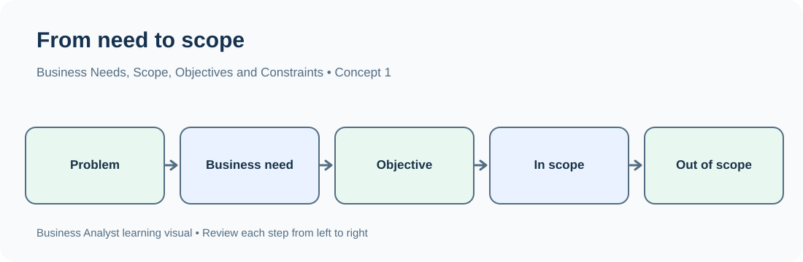
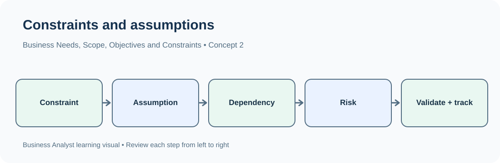

# TechPhile.ai --- Business Analyst Career Pathway

# Day 5: Business Needs, Scope, Objectives, Constraints and Assumptions

**Phase:** 1 --- Business Analysis Foundations\
**Approved syllabus topic:** Business needs, scope, objectives,
constraints and assumptions\
**Learning level:** Beginner to Intermediate\
**Estimated learning time:** 2--3 hours\
**Prerequisites:** Day 1 --- Business analysis, BA responsibilities,
SDLC and project lifecycle; Day 2 --- Business problems, business
objectives, stakeholders and value creation; Day 3 --- Business domains,
processes, products, services and organizational structures; Day 4 ---
Stakeholder identification, stakeholder mapping, influence and interest.

------------------------------------------------------------------------

# 1. Learning Objectives

By the end of Day 5, you should be able to:

-   Explain the difference between a business problem, business need,
    business objective and solution.
-   Identify and document business needs using stakeholder and business
    context.
-   Explain project scope and distinguish what is included from what is
    excluded.
-   Identify project boundaries, deliverables and affected areas.
-   Write clear, measurable business objectives.
-   Recognize constraints that limit a project or solution.
-   Identify assumptions that are treated as true for planning but still
    need validation.
-   Distinguish constraints, assumptions, risks, dependencies and
    requirements.
-   Explain how a Business Analyst helps stakeholders agree on scope and
    avoid uncontrolled scope changes.

# 2. Why This Topic Matters in a Real Business

Imagine that a retail company tells its project team:

> "We want a new customer portal. Customers should be able to manage
> everything online."

This sounds like a clear request, but it is not yet a usable project
definition.

The team still needs to understand:

-   What business need is driving the request?
-   Which customer problems should the portal solve?
-   Which customers will use it?
-   What does "manage everything" mean?
-   Will the portal support order tracking, returns, payments, profile
    updates or all of these?
-   Will it be available on mobile, desktop or both?
-   Which systems must it connect to?
-   What is the budget?
-   When must it be delivered?
-   What is not part of the first release?
-   Are there assumptions about customer access, data availability or
    existing systems?

If the team starts development without answering these questions, it may
build the wrong solution, exceed the budget or miss the delivery date.

A Business Analyst helps convert a broad request into an agreed business
need, measurable objectives and a clearly defined scope. The BA also
records constraints and assumptions so that the team understands the
conditions under which the work is being planned.

**Main idea:** Before a team builds a solution, it must understand why
the change is needed, what success means and what work is inside or
outside the agreed boundaries.

# 3. Words You Need

  -----------------------------------------------------------------------
  Term                    Plain-English meaning   Example
  ----------------------- ----------------------- -----------------------
  Business problem        A situation preventing  Customers make repeated
                          the organization from   calls because they
                          achieving a desired     cannot track orders
                          result                  

  Business need           The change or           Customers need a
                          capability the          reliable way to see
                          organization requires   order status

  Business objective      A result the            Reduce order-status
                          organization wants to   calls by 25%
                          achieve                 

  Solution                A product, service,     A customer
                          process or change that  order-tracking portal
                          addresses the need      

  Scope                   The agreed boundaries   Order tracking and
                          of the work             profile updates are
                                                  included; online
                                                  returns are excluded

  In scope                Work that is included   Display order status
                          in the agreed           and estimated delivery
                          initiative              date

  Out of scope            Work that is explicitly Changing the warehouse
                          not included            management system

  Deliverable             A specific output       Approved requirements
                          produced by the project document or working
                                                  portal

  Constraint              A limitation or         The solution must
                          condition the project   launch within four
                          must obey               months

  Assumption              Something treated as    The existing customer
                          true for planning until database will remain
                          it is confirmed         available

  Dependency              Something the project   The portal needs an API
                          relies on               from the
                                                  order-management system

  Risk                    An uncertain event that The API may not be
                          could affect the        ready on time
                          project                 

  Scope creep             Uncontrolled growth in  Adding a returns module
                          project work without    after scope approval
                          proper review           without assessing
                                                  impact

  Baseline                An agreed reference     The approved scope
                          version used to compare statement
                          later changes           

  Acceptance criteria     Conditions that must be A customer can view the
                          met for a deliverable   latest order status
                          or requirement to be    after signing in
                          accepted                
  -----------------------------------------------------------------------

# 4. Understand Business Needs

## 4.1 What is a business need?

A business need is the reason an organization requires a change. It
describes the capability, improvement or outcome the business requires,
rather than prescribing a particular technical solution.

A need may arise because:

-   A process is slow or expensive.
-   Customers are dissatisfied.
-   Employees perform repetitive manual work.
-   The organization wants to increase revenue.
-   A regulation or policy requires a change.
-   Existing systems cannot support a new business activity.
-   The organization sees an opportunity to improve a service.

### Example: Manual invoice processing

A company receives 2,000 supplier invoices every month. Employees enter
invoice details manually into a finance system. This causes delays and
repeated data-entry errors.

  -----------------------------------------------------------------------
  Element                             Example
  ----------------------------------- -----------------------------------
  Business problem                    Invoice processing is slow and
                                      contains frequent data-entry errors

  Evidence                            Average processing time is 6 days;
                                      12% of invoices require correction

  Business need                       A more accurate and efficient
                                      invoice-processing capability

  Possible solution                   Workflow automation with invoice
                                      data extraction

  Expected value                      Faster processing and fewer
                                      corrections
  -----------------------------------------------------------------------

Notice that the business need does not say "buy an automation tool."
Automation is a possible solution. Another solution could involve
process redesign, improved forms, better training or system
configuration.

## 4.2 Need versus solution

A BA should avoid treating a stakeholder's proposed solution as the
confirmed business need.

  -----------------------------------------------------------------------
  Stakeholder says                    What the BA should investigate
  ----------------------------------- -----------------------------------
  "We need a mobile app."             What user or business problem
                                      requires a change?

  "Add another approval screen."      What decision or control is missing
                                      today?

  "We need more employees."           Is the workload high because of
                                      demand, process inefficiency or
                                      rework?

  "Replace the database."             What limitation of the current
                                      database affects the business?

  "Create a dashboard."               Which decisions are difficult
                                      because information is unavailable
                                      or unclear?
  -----------------------------------------------------------------------

### Practical questioning technique

When a stakeholder requests a solution, ask:

1.  What problem are you trying to solve?
2.  Who experiences the problem?
3.  How frequently does it happen?
4.  What is the impact on customers, employees or the organization?
5.  What evidence shows that the problem exists?
6.  What would improve if the problem were addressed?
7.  Are there other ways to achieve the same result?

These questions help the BA discover the underlying need without
dismissing the stakeholder's suggestion.

## 4.3 Business need statement

A useful business need statement is short, specific and focused on the
business situation.

**Example:**

"Customer-support agents spend significant time responding to
order-status enquiries because customers cannot independently access
reliable delivery updates. The business needs a way to make current
order information easily available to customers."

A good statement identifies:

-   The affected group.
-   The current difficulty or opportunity.
-   The business impact.
-   The capability or improvement required.

Avoid writing the need as a technical design unless the solution has
already been selected and justified.

# 5. Business Objectives

## 5.1 What is a business objective?

A business objective describes what the organization intends to achieve
through the change.

Objectives connect the business need to a result that can be evaluated.

For example:

-   Need: Customers need better access to order information.
-   Objective: Reduce order-status calls to customer support by 25%
    within six months of launch.

The need explains why change is required. The objective explains what
result the business wants.

## 5.2 Characteristics of a good objective

A useful objective should be:

-   **Specific:** It identifies exactly what should improve.
-   **Measurable:** Progress can be checked using evidence or a metric.
-   **Achievable:** It is realistic given available resources and
    conditions.
-   **Relevant:** It supports the business need.
-   **Time-bound:** It identifies when the result should be achieved.

These characteristics are commonly remembered as SMART.

  -----------------------------------------------------------------------
  SMART element           Question                Example
  ----------------------- ----------------------- -----------------------
  Specific                What exactly should     Reduce order-status
                          change?                 enquiries

  Measurable              How will it be          Number of order-status
                          measured?               calls

  Achievable              Is the target           A 25% reduction based
                          realistic?              on available capacity
                                                  and evidence

  Relevant                Does it address the     It reduces avoidable
                          business need?          support work

  Time-bound              By when?                Within six months after
                                                  launch
  -----------------------------------------------------------------------

**Weak objective:** "Improve customer experience."

**Stronger objective:** "Increase the percentage of customers who can
find their order status without contacting support from 60% to 85%
within six months of launch."

The stronger version identifies a measure, a starting point, a target
and a time period.

## 5.3 Objective, KPI and target

These terms are related but not identical.

  -----------------------------------------------------------------------
  Term                    Meaning                 Example
  ----------------------- ----------------------- -----------------------
  Objective               The result the business Reduce order-status
                          wants                   support enquiries

  KPI                     The measure used to     Monthly order-status
                          monitor progress        support calls

  Baseline                The current measured    4,000 calls per month
                          position                

  Target                  The desired value       3,000 calls per month

  Time period             When the target should  Within six months
                          be reached              
  -----------------------------------------------------------------------

A target should be based on business evidence and stakeholder agreement.
A BA should not invent a target and present it as an approved
commitment.

## 5.4 Connect needs, objectives and outcomes

Consider a training company whose students frequently miss class
updates.

  -----------------------------------------------------------------------
  Stage                               Example
  ----------------------------------- -----------------------------------
  Problem                             Students miss important schedule
                                      changes

  Business need                       Students need reliable access to
                                      current class information

  Objective                           Reduce missed classes caused by
                                      communication gaps

  KPI                                 Number of missed classes attributed
                                      to missed updates

  Target                              Reduce the measured number by an
                                      agreed percentage

  Possible solution                   A centralized notification and
                                      schedule feature

  Outcome                             Students receive and can access
                                      timely updates
  -----------------------------------------------------------------------

A solution is successful only when it helps achieve the intended
outcome. Delivering a feature does not automatically prove that the
business objective has been achieved.

# 6. Project Scope

## 6.1 What is project scope?

Project scope defines the boundaries of the work. It explains what the
project will deliver and what work is not included.

Scope helps stakeholders and delivery teams share the same understanding
of the initiative.

A project scope may describe:

-   Business areas affected.
-   Users or stakeholder groups covered.
-   Processes included.
-   Features or capabilities included.
-   Systems and integrations involved.
-   Deliverables.
-   Exclusions.
-   Boundaries and limitations.

### Example: Customer self-service portal

A company wants customers to manage basic account information online.

**In scope:** - Customer sign-in. - View and update selected profile
information. - View current orders. - View estimated delivery dates. -
Basic account activity history.

**Out of scope:** - Creating a new warehouse system. - Replacing the
finance platform. - Adding international shipping. - Introducing a
loyalty-points program. - Building a native mobile application in the
first release.

The exclusions are important. If they are not documented, different
stakeholders may assume that these features are included.

## 6.2 Scope components

  -----------------------------------------------------------------------
  Component               What it explains        Example
  ----------------------- ----------------------- -----------------------
  Purpose                 Why the initiative      Improve customer
                          exists                  self-service

  Business objectives     Intended business       Reduce support
                          results                 enquiries

  Scope description       General boundaries of   A web portal for
                          the work                existing customers

  In-scope items          Work included           Sign-in and order
                                                  tracking

  Out-of-scope items      Work excluded           Loyalty program

  Deliverables            Outputs to be produced  Portal, approved
                                                  requirements, user
                                                  guidance

  Stakeholders            People or groups        Customers, support,
                          involved                operations, IT

  Assumptions             Conditions treated as   Existing customer
                          true                    records are usable

  Constraints             Limits that must be     Fixed launch date and
                          followed                budget

  Dependencies            External items required Order-system API
                                                  availability

  Acceptance conditions   How completion will be  Agreed functions pass
                          judged                  validation
  -----------------------------------------------------------------------

## 6.3 Scope boundaries

A scope boundary makes clear where the project begins and ends.

Example:

A project improves the online order-tracking experience.

-   It begins when an existing customer signs in to the portal.
-   It includes retrieving order information and displaying status.
-   It ends when the customer can view the latest available order
    status.
-   It does not include changing how warehouse staff pick, pack or
    dispatch orders.

A clear boundary prevents the project from unintentionally expanding
into unrelated processes.

## 6.4 Scope statement

A scope statement is a concise description of the agreed project
boundaries.

**Example:**

"The initiative will deliver a web-based self-service portal for
existing retail customers. The first release will allow customers to
sign in, view current orders, check delivery status and update selected
profile details. The release will use the existing customer and
order-management systems. A loyalty program, warehouse-system
replacement, international shipping and native mobile applications are
excluded from this release."

A scope statement should be reviewed with relevant stakeholders. It
should not be treated as approved merely because the BA has written it.

## 6.5 Scope creep

Scope creep occurs when work expands beyond the agreed scope without
appropriate assessment, approval or control.

### Example

The approved portal includes sign-in and order tracking. During
development, stakeholders request:

-   A loyalty program.
-   Product recommendations.
-   Online returns.
-   Live chat.
-   International shipping.

These may be useful features, but they can affect time, cost,
complexity, security and testing.

The BA should not automatically reject every new request. Instead, the
request should be documented and evaluated through the agreed change
process.

**Typical effects of uncontrolled scope creep:**

-   Delayed delivery.
-   Increased cost.
-   Conflicting priorities.
-   Incomplete testing.
-   Reduced quality.
-   Team overload.
-   Disagreement about what was originally agreed.

### Scope control in practice

1.  Record the new request.
2.  Clarify the business reason and expected value.
3.  Identify affected requirements and deliverables.
4.  Assess impact on time, cost, resources, risk and dependencies.
5.  Discuss the impact with the appropriate decision-makers.
6.  Obtain the required approval or rejection.
7.  Update scope and related documentation when approved.
8.  Communicate the decision to affected stakeholders.

# 7. Constraints

## 7.1 What is a constraint?

A constraint is a restriction or condition that limits the choices
available to a project or solution.

Constraints may come from the business, technology, law, policy,
resources or external environment.

### Common types of constraints

  -----------------------------------------------------------------------
  Type                    Meaning                 Example
  ----------------------- ----------------------- -----------------------
  Time                    Limits on delivery      The first release must
                          schedule                launch before the new
                                                  financial year

  Budget                  Limits on spending      The project budget
                                                  cannot exceed an
                                                  approved amount

  Resource                Limits on people or     Only two developers are
                          skills                  available

  Technology              Limits imposed by       The solution must use
                          existing systems or     the company's approved
                          standards               cloud platform

  Regulatory/legal        Mandatory legal or      Personal data must be
                          regulatory conditions   handled according to
                                                  applicable privacy
                                                  requirements

  Policy                  Internal organizational Only authorized
                          rules                   employees can approve
                                                  refunds

  Operational             Limits caused by        The system must remain
                          business operations     available during
                                                  business hours

  Scope                   Limits on what can be   Only existing customers
                          delivered               are supported in the
                                                  first release
  -----------------------------------------------------------------------

## 7.2 How a BA documents constraints

A constraint should be clear enough for the team to understand and
assess.

  -----------------------------------------------------------------------
  Constraint ID     Constraint        Source/owner      Impact
  ----------------- ----------------- ----------------- -----------------
  CON-01            First release     Sponsor           Limits delivery
                    must be delivered                   schedule
                    by 30 September                     

  CON-02            Project spending  Finance           Limits solution
                    must remain                         options
                    within the                          
                    approved budget                     

  CON-03            Existing customer IT leadership     Affects
                    database must be                    architecture and
                    retained                            integration

  CON-04            Only existing     Product sponsor   Limits user
                    customers are                       population
                    included in                         
                    release one                         
  -----------------------------------------------------------------------

The BA should distinguish confirmed constraints from informal
preferences. For example, "the manager prefers a blue interface" is not
automatically a project constraint.

## 7.3 Constraint versus requirement

A requirement describes a capability or condition the solution must
satisfy. A constraint limits how the project or solution can be
delivered.

  -----------------------------------------------------------------------
  Requirement                         Constraint
  ----------------------------------- -----------------------------------
  Customers must be able to view      The portal must use the existing
  order status                        order-management platform

  Users must reset their password     The first release must be delivered
                                      within four months

  The system must display delivery    The project must stay within the
  estimates                           approved budget
  -----------------------------------------------------------------------

Some statements can be expressed in different ways depending on context.
The BA should document the underlying meaning, source and reason rather
than relying only on a label.

# 8. Assumptions

## 8.1 What is an assumption?

An assumption is something the team treats as true for planning or
analysis even though it has not yet been fully confirmed.

Assumptions are often necessary because a project cannot wait for every
unknown to be resolved before initial planning begins.

### Examples

-   The existing customer database will remain available.
-   Business users will be available for requirement workshops.
-   The organization will provide access to test data.
-   The current order system can provide order-status information.
-   The customer support team will participate in user acceptance
    testing.

An assumption is not a fact simply because it has been written down.

## 8.2 Why assumptions must be documented

If an assumption is incorrect, it may affect scope, cost, schedule,
solution design or delivery.

Example:

The project team assumes that an existing order-management system
provides an API for retrieving delivery status.

Later, the technical team discovers that no suitable API exists.

Possible impact:

-   Additional integration work may be required.
-   The schedule may need to change.
-   The budget may increase.
-   The proposed solution may need redesign.

Recording the assumption early allows the team to validate it before it
becomes a major issue.

## 8.3 Assumption register

An assumption register records assumptions, their owners, validation
status and potential impact.

  ---------------------------------------------------------------------------
  ID             Assumption     Owner          How to validate Status
  -------------- -------------- -------------- --------------- --------------
  ASM-01         Existing       Data owner     Review          To validate
                 customer data                 data-quality    
                 is accurate                   report          
                 enough for the                                
                 portal                                        

  ASM-02         Order system   Technical lead Review API      To validate
                 exposes                       documentation   
                 required                      and test access 
                 order-status                                  
                 information                                   

  ASM-03         Support agents Support        Confirm         Confirmed /
                 can attend UAT manager        availability    pending
                 sessions                                      

  ASM-04         Customers have Product team   Review customer To validate
                 access to a                   profile data    
                 valid email                                   
                 address                                       
  ---------------------------------------------------------------------------

Use status labels consistently, such as: - To validate. - Confirmed. -
Rejected. - No longer applicable.

## 8.4 Assumption versus constraint

  -----------------------------------------------------------------------
  Assumption                          Constraint
  ----------------------------------- -----------------------------------
  A condition believed to be true for A known restriction that must be
  planning                            followed

  May later prove false               Remains binding unless formally
                                      changed

  Example: Business users will be     Example: Workshops must take place
  available for workshops             during business hours
  -----------------------------------------------------------------------

## 8.5 Assumption versus risk

An assumption is a planning belief. A risk is an uncertain event or
condition that could affect objectives.

Example:

-   Assumption: The existing order system will provide the required
    data.
-   Risk: The order system may not provide the required data, causing
    integration delays.

A useful BA practice is to identify the risk that could arise if an
important assumption is false.

# 9. Dependencies

A dependency is something the project needs from another activity,
person, team, system or organization.

Examples:

-   The portal depends on an order-system API.
-   UAT depends on test data being available.
-   Development depends on approved requirements.
-   Launch depends on security review and deployment approval.

  -----------------------------------------------------------------------
  Dependency              Why it matters          Possible owner
  ----------------------- ----------------------- -----------------------
  API access              Required to retrieve    Integration team
                          order information       

  Test customer accounts  Required for UAT        Test/data team

  Approved screen designs Required before         Product/design team
                          interface               
                          implementation          

  Security approval       Required before         Security team
                          production release      
  -----------------------------------------------------------------------

A dependency is not automatically a risk. It becomes a risk when
uncertainty or failure around that dependency could affect the project.

# 10. How Business Needs, Objectives, Scope, Constraints and Assumptions Fit Together

These concepts are connected but answer different questions.

  -----------------------------------------------------------------------
  Concept                 Main question           Example
  ----------------------- ----------------------- -----------------------
  Business problem        What is wrong or what   Customers cannot easily
                          opportunity exists?     track orders

  Business need           What change or          Customers need reliable
                          capability is required? access to order
                                                  information

  Business objective      What result should be   Reduce order-status
                          achieved?               calls by 25%

  Scope                   What work is included   Build a portal for
                          and excluded?           order tracking; exclude
                                                  loyalty features

  Constraint              What limits must be     Launch within four
                          respected?              months

  Assumption              What are we treating as Existing order data can
                          true for now?           be accessed

  Dependency              What must be available  Order API access
                          or completed?           

  Risk                    What uncertain event    API access may be
                          could affect success?   delayed

  Deliverable             What output will the    A working customer
                          project produce?        portal
  -----------------------------------------------------------------------

## 10.1 Complete example: Online appointment booking

A healthcare service provider receives complaints that patients spend
too long waiting on the phone to book appointments.

**Business problem** - Patients experience long call waiting times. -
Reception staff spend substantial time handling routine booking calls.

**Business need** - Patients need a convenient way to view available
appointment slots and request bookings.

**Business objectives** - Reduce routine appointment-booking calls. -
Increase the proportion of appointments booked through self-service. -
Improve the patient booking experience.

The organization must define numerical targets and time periods using
its own baseline data.

**Scope --- in** - Patient sign-in. - View available appointment
slots. - Request an appointment. - View booking confirmation.

**Scope --- out** - Clinical diagnosis. - Online consultation. -
Insurance claim processing. - Replacing the hospital's clinical records
system.

**Constraints** - The solution must follow applicable privacy and
security requirements. - The project has an approved budget. - The first
release must work with the existing appointment system.

**Assumptions** - Appointment availability data can be accessed. -
Clinic staff will validate booking workflows. - Patients can use the
supported web interface.

**Dependencies** - Appointment-system integration. - Security review. -
Test data and user availability for UAT.

**Risks** - The appointment system may not support the required
integration. - Incorrect availability data could lead to double
bookings. - Users may struggle with the new booking process.

This example shows how a BA creates a connected view of the business
change instead of documenting each item in isolation.

# 11. Practical BA Method: From Request to Agreed Scope

Use this sequence when a stakeholder requests a new system or process
change.

``` text
Stakeholder Request
        |
        v
Understand the Business Problem
        |
        v
Identify the Business Need
        |
        v
Define Desired Business Objectives
        |
        v
Identify Stakeholders and Their Expectations
        |
        v
Explore Possible Solution Options
        |
        v
Define In-Scope and Out-of-Scope Work
        |
        v
Record Constraints, Assumptions and Dependencies
        |
        v
Identify Risks and Open Questions
        |
        v
Review Scope with Stakeholders
        |
        v
Obtain Agreement and Maintain the Baseline
```

## 11.1 Questions a BA should ask

**Business need** - What business problem or opportunity triggered this
request? - Who is affected? - What evidence supports the problem?

**Objectives** - What result does the business want? - How will success
be measured? - What is the baseline and target?

**Scope** - Which users and business processes are included? - Which
capabilities are required in the first release? - What is explicitly
excluded? - What are the start and end boundaries?

**Constraints** - What deadlines or budget limits apply? - Are there
mandatory policies, regulations or technology standards? - Are there
resource limitations?

**Assumptions** - What are we treating as true but have not verified? -
Who can validate each assumption? - What happens if an assumption is
false?

**Dependencies** - Which teams, systems, approvals or data sources are
required? - When must they be available?

# 12. Common Mistakes and How to Avoid Them

  -----------------------------------------------------------------------
  Mistake                 Why it causes problems  Better approach
  ----------------------- ----------------------- -----------------------
  Treating a requested    The actual problem may  Ask why the solution is
  solution as the         remain unsolved         needed
  business need                                   

  Writing vague           Success cannot be       Define a measure,
  objectives              measured clearly        baseline, target and
                                                  time period

  Defining scope only as  Boundaries and          Include users,
  a feature list          exclusions remain       processes, systems,
                          unclear                 deliverables and
                                                  exclusions

  Forgetting out-of-scope Stakeholders may expect Record explicit
  items                   extra work              exclusions

  Treating assumptions as Planning may rely on    Record owner,
  confirmed facts         incorrect information   validation method and
                                                  status

  Confusing a constraint  The team may            Document the
  with a risk             misunderstand what is   restriction and the
                          fixed and what is       uncertainty separately
                          uncertain               

  Ignoring dependencies   Work may be planned     Identify owners and
                          before required inputs  required dates
                          are available           

  Accepting every new     Scope creep may occur   Use change assessment
  request informally                              and approval

  Setting targets without Objectives may be       Establish a baseline
  evidence                unrealistic             and obtain stakeholder
                                                  agreement

  Failing to communicate  Teams may work from     Share the approved
  scope decisions         different expectations  scope and changes
  -----------------------------------------------------------------------

# 13. Interview-Relevant Points

Be prepared to explain these distinctions clearly:

-   **Business need vs business objective:** The need describes the
    required change; the objective describes the result to achieve.
-   **Objective vs KPI:** The objective is the intended result; the KPI
    is a measure used to monitor it.
-   **Scope vs requirement:** Scope defines the boundaries of the
    initiative; requirements describe what stakeholders or the solution
    need.
-   **In scope vs out of scope:** In-scope work is included in the
    agreement; out-of-scope work is excluded.
-   **Constraint vs assumption:** A constraint is a restriction; an
    assumption is a condition treated as true until validated.
-   **Assumption vs risk:** An assumption is a planning belief; a risk
    is an uncertain event or condition that may affect objectives.
-   **Dependency vs risk:** A dependency is something the work relies
    on; a risk is uncertainty that may affect the work.
-   **Scope creep:** Uncontrolled expansion beyond the agreed scope.
-   **Scope baseline:** The agreed scope reference used to assess
    proposed changes.

# 14. Interview Questions and Answers

## Q1. What is the difference between a business need and a business objective?

**Answer:**

A business need describes the change or capability an organization
requires to address a problem or opportunity. A business objective
describes the result the organization wants to achieve through that
change.

**Example:** - Business need: Customers need a convenient way to track
orders. - Business objective: Reduce order-status support calls by an
agreed percentage within six months.

**Why it matters:** A solution should address the need and contribute to
the objective.

**Follow-up:** Can a business need exist before the organization knows
which solution to build?

Yes. The BA should understand and document the need before evaluating
solution options.

## Q2. What is project scope?

**Answer:**

Project scope defines the boundaries of the work. It explains what the
project will deliver, which users or processes are covered, and what is
excluded.

**Example:**

For a customer portal, sign-in and order tracking may be included, while
a loyalty program and warehouse-system replacement may be excluded.

**Why it matters:** A clear scope creates shared expectations and helps
control changes.

**Follow-up:** Who approves project scope?

The appropriate sponsor, product owner or authorized governance group
approves it according to the organization's decision-making process. The
BA facilitates analysis and documentation.

## Q3. What is the difference between in-scope and out-of-scope?

**Answer:**

In-scope items are included in the agreed project boundaries.
Out-of-scope items are explicitly excluded from the current initiative
or release.

**Example:** - In scope: Customers can view their order status. - Out of
scope: Customers can redeem loyalty points.

**Why it matters:** Explicit exclusions reduce misunderstandings and
help prevent scope creep.

**Follow-up:** Can an out-of-scope feature be added later?

Yes. It can be submitted as a change request and assessed for value and
impact before approval.

## Q4. What is a constraint? Give examples.

**Answer:**

A constraint is a restriction or condition that limits how a project or
solution can be delivered.

Examples include: - A fixed delivery deadline. - An approved budget
ceiling. - A required technology platform. - Mandatory security or
regulatory conditions. - Limited team availability.

**Why it matters:** Constraints influence planning, solution choices and
feasibility.

**Follow-up:** Is a fixed deadline a risk?

The deadline itself is a constraint. The possibility that the team may
miss it is a risk.

## Q5. What is an assumption in business analysis?

**Answer:**

An assumption is a condition treated as true for planning or analysis
even though it has not yet been fully confirmed.

**Example:** The team assumes that the existing order system can provide
order-status data.

The BA should document the assumption, owner, validation method and
status.

**Why it matters:** If the assumption is false, the project may need
changes to its design, cost or schedule.

**Follow-up:** What should the BA do when an assumption is disproved?

Assess its impact, inform relevant stakeholders, update affected
documents and plans, and raise risks or change requests where necessary.

## Q6. What is scope creep, and how can a BA help prevent it?

**Answer:**

Scope creep is uncontrolled growth in project work beyond the agreed
scope.

A BA helps prevent it by: 1. Documenting scope and exclusions. 2.
Maintaining clear requirements and traceability. 3. Recording new
requests. 4. Assessing their impact. 5. Following the agreed
change-control process. 6. Communicating approved decisions.

**Example:** Adding online returns to an approved order-tracking portal
without assessing schedule, cost or testing impact is scope creep.

**Follow-up:** Should a BA reject every request that is outside the
original scope?

No. The BA should assess the business value and impact. The authorized
decision-maker determines whether the change should be accepted,
deferred or rejected.

## Q7. How do you write a measurable business objective?

**Answer:**

First identify the outcome, then choose a relevant measure, establish
the current baseline, agree on a realistic target and specify a time
period.

**Example:**

"Reduce average invoice-processing time from six days to three days
within six months of implementing the approved process improvement."

**Follow-up:** What if the baseline data is unavailable?

The BA should identify the data gap and work with the relevant
stakeholders to establish a reliable baseline before committing to a
numerical target.

## Q8. What is the difference between a dependency and a risk?

**Answer:**

A dependency is an external item, activity, person, team or system that
the project relies on. A risk is an uncertain event or condition that
could affect project objectives.

**Example:** - Dependency: The integration team must provide API
access. - Risk: API access may be delayed, affecting development.

**Follow-up:** How would you manage a critical dependency?

Identify its owner, required date, status and impact if delayed. Track
it regularly and agree on an escalation or alternative plan.

## Q9. What would you do if two stakeholders disagree about project scope?

**Answer:**

I would first understand each stakeholder's business need, reason and
expected value. I would document the conflicting expectations, identify
the impact of each option and facilitate a discussion using agreed
business objectives and constraints. If the decision requires authority
beyond my role, I would escalate it to the sponsor or designated
decision-maker. I would then update the scope documentation after an
authorized decision.

**Follow-up:** Should the BA choose the option personally?

Not unless the BA has been given that decision authority. The BA
provides analysis and supports an informed decision.

## Q10. What is the role of a Business Analyst in scope management?

**Answer:**

The BA helps clarify and document the business need, objectives, scope
boundaries, assumptions, constraints and dependencies. The BA
communicates these to stakeholders, analyzes proposed changes, assesses
impacts on requirements and supports the change-control process.

**Follow-up:** Does the BA own every project decision?

No. Decision ownership depends on the organization's governance and role
definitions. The BA supports decisions through analysis and clear
documentation.

# 15. Quick Revision Sheet

  Topic                Remember
  -------------------- --------------------------------------------------------
  Business need        Why the organization requires a change
  Business objective   What result the organization wants
  Solution             How the need may be addressed
  Scope                Boundaries of the project or release
  In scope             Included work
  Out of scope         Excluded work
  Deliverable          A specific output produced
  Constraint           A restriction that must be respected
  Assumption           A condition treated as true until validated
  Dependency           Something the work relies on
  Risk                 Uncertainty that may affect objectives
  Scope creep          Uncontrolled expansion of work
  SMART                Specific, Measurable, Achievable, Relevant, Time-bound

## The most important distinction

``` text
PROBLEM       = What is wrong?
NEED          = What change is required?
OBJECTIVE     = What result should be achieved?
SOLUTION      = How might the need be addressed?
SCOPE         = What work is included or excluded?
CONSTRAINT    = What limits must be respected?
ASSUMPTION    = What are we treating as true for now?
DEPENDENCY    = What does the work rely on?
RISK          = What uncertain event could affect success?
```

# 16. Day 5 Knowledge Check

Try answering these before reviewing the answers.

1.  A stakeholder says, "We need a mobile application." What should the
    BA investigate before accepting this as the business need?
2.  A company wants to reduce invoice-processing time from six days to
    three days within six months. Identify the objective, measure,
    baseline, target and time period.
3.  A project includes order tracking but excludes loyalty points. Which
    item is in scope and which is out of scope?
4.  The project must use an existing database. Is this a constraint or
    an assumption? Explain based on whether it is confirmed.
5.  The team believes that an API will be available, but nobody has
    verified it. How should the BA document this?
6.  What is the difference between a dependency and a risk in an API
    integration?
7.  A stakeholder requests a new feature after scope approval. What
    steps should the BA follow?
8.  Why should a project scope statement explicitly mention exclusions?

## Suggested Answers

1.  Investigate the problem, affected users, business impact, evidence
    and desired outcome. The mobile application is a proposed solution,
    not necessarily the underlying need.
2.  Objective: reduce processing time. Measure: average
    invoice-processing time. Baseline: six days. Target: three days.
    Time period: within six months.
3.  Order tracking is in scope; loyalty points are out of scope.
4.  If the organization has formally required use of the existing
    database, it is a constraint. If the team merely believes the
    database will remain available but has not confirmed it, record it
    as an assumption.
5.  Record it in the assumption register with an owner, validation
    method, status and impact if false.
6.  API availability is a dependency. The possibility that access may be
    delayed or unavailable is a risk.
7.  Record and clarify the request, assess business value and impact,
    obtain the required decision, and update documentation if approved.
8.  Exclusions prevent different stakeholders from assuming that
    additional capabilities are part of the agreed delivery.


## Visual learning aids





# 17. Day 5 Completion Checklist

-   [ ] I can explain a business need without jumping directly to a
    solution.
-   [ ] I can distinguish a business need from a business objective.
-   [ ] I can write a measurable objective with a baseline, target and
    time period.
-   [ ] I can explain project scope and scope boundaries.
-   [ ] I can distinguish in-scope and out-of-scope items.
-   [ ] I can explain deliverables and acceptance conditions.
-   [ ] I can identify common project constraints.
-   [ ] I can document assumptions and explain how to validate them.
-   [ ] I can distinguish assumptions, constraints, dependencies and
    risks.
-   [ ] I can explain scope creep and the change-control approach.
-   [ ] I can describe how a BA helps stakeholders agree on project
    scope.
-   [ ] I can answer the Day 5 interview questions in my own words.

------------------------------------------------------------------------

**End of Day 5 --- Business Needs, Scope, Objectives, Constraints and
Assumptions**

**Next syllabus topic --- Day 6:** Requirement types: business,
stakeholder, functional and non-functional.
