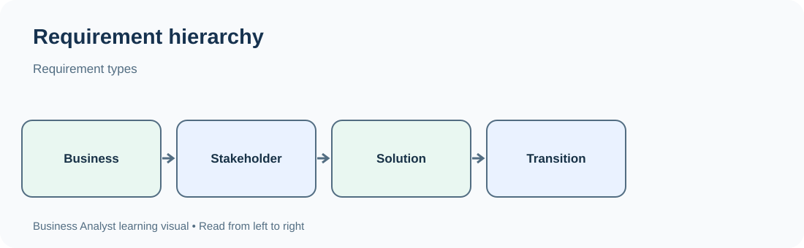
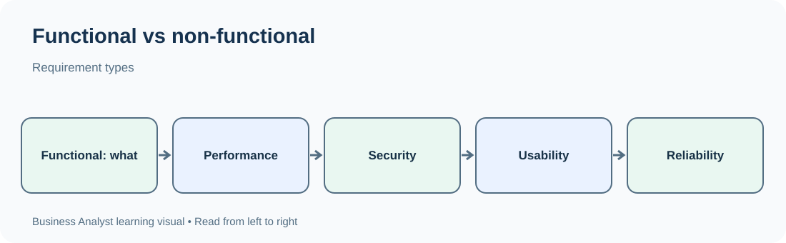

# TechPhile.ai --- Business Analyst Career Pathway

# Day 6: Requirement Types --- Business, Stakeholder, Functional and Non-Functional

**Phase:** 2 --- Requirements Engineering\
**Approved syllabus topic:** Requirement types: business, stakeholder,
functional and non-functional\
**Learning level:** Beginner to Intermediate\
**Estimated learning time:** 2--3 hours\
**Prerequisites:** Days 1--5 --- Business analysis foundations, business
problems and objectives, business domains and processes, stakeholder
identification and mapping, and business needs, scope, objectives,
constraints and assumptions.

------------------------------------------------------------------------

# 1. Learning Objectives

By the end of this lesson, you should be able to:

-   Explain what a requirement is and why requirements are important in
    business analysis.
-   Distinguish business, stakeholder, functional and non-functional
    requirements.
-   Understand how the four requirement types relate to one another.
-   Identify the correct requirement type from a business scenario.
-   Write requirements using clear, specific and testable language.
-   Recognize vague, ambiguous, conflicting, duplicated and incomplete
    requirements.
-   Understand how business rules, constraints and assumptions relate to
    requirements.
-   Explain how a Business Analyst organizes and validates requirements
    with stakeholders.

# 2. Why Requirement Types Matter

Imagine a bank wants to introduce an online loan application service.

Different people describe what they need:

-   The business sponsor says, "We want to reduce the time required to
    process loan applications."
-   A loan officer says, "I need to review the applicant's income and
    submitted documents."
-   A customer says, "I want to apply online and see the application
    status."
-   The technology team says, "The application must respond quickly and
    protect customer information."

All these statements are important, but they do not describe the same
kind of requirement.

A Business Analyst must organize them so that the team understands:

-   **Why** the organization is making the change.
-   **Who** needs something from the solution.
-   **What** the solution must do.
-   **How well** the solution must perform or what quality conditions it
    must satisfy.

If these categories are mixed together, important needs may be missed.
For example, the team might build an online application form but forget
status tracking, access control or performance expectations.

**Main idea:** Requirements describe needs and conditions that guide the
solution. Classifying them makes them easier to analyze, communicate,
prioritize, trace and test.

# 3. Words You Need

  -----------------------------------------------------------------------
  Term                    Plain-English meaning   Example
  ----------------------- ----------------------- -----------------------
  Requirement             A documented need or    Customers must be able
                          condition that must be  to submit a loan
                          satisfied               application online

  Business requirement    A high-level need or    Reduce loan-processing
                          outcome for the         time
                          organization            

  Stakeholder requirement A need expressed by a   Loan officers need to
                          stakeholder or          review submitted
                          stakeholder group       documents

  Functional requirement  A capability or         The system must allow
                          behavior the solution   customers to upload
                          must provide            income documents

  Non-functional          A quality attribute or  The application page
  requirement             operating condition the must load within an
                          solution must satisfy   agreed time

  Requirement source      The person, group,      Loan operations manager
                          policy or document from 
                          which a requirement     
                          originates              

  Requirement attribute   Information recorded    ID, owner, priority,
                          about a requirement     status and source

  Business rule           A policy or rule that   A loan application must
                          guides or restricts     meet the bank's
                          business behavior       eligibility policy

  Acceptance criteria     Conditions used to      An eligible customer
                          decide whether a        can submit the form and
                          requirement or feature  receive a reference
                          is acceptable           number

  Traceability            The ability to follow a A business objective
                          requirement through its links to a feature and
                          source, design,         its test cases
                          implementation and      
                          testing                 

  Verification            Checking whether the    Confirming a page loads
                          solution or requirement within the agreed
                          meets specified         response time
                          conditions              

  Validation              Checking whether the    Confirming the online
                          requirement or solution application solves the
                          meets the real business customer problem
                          need                    
  -----------------------------------------------------------------------

# 4. What Is a Requirement?

A requirement is a documented statement of a need, capability, behavior
or condition that must be satisfied by a solution, process or project.

Requirements help people agree on what needs to be delivered.

A requirement may describe:

-   A business result.
-   A stakeholder need.
-   A system function.
-   A quality or performance condition.
-   A business rule or restriction.
-   An interface or integration need.
-   A condition that must be met for acceptance.

## 4.1 Why requirements are important

Requirements provide a shared understanding between business
stakeholders and the delivery team.

They help:

1.  Define what the business expects.
2.  Prevent misunderstandings.
3.  Guide solution design and development.
4.  Help testers decide what to verify.
5.  Support estimation and planning.
6.  Make changes easier to assess.
7.  Connect delivered features to business value.
8.  Provide evidence for acceptance and sign-off.

### What can happen when requirements are unclear?

Suppose a stakeholder says:

"Make the application secure."

The development team may add a password field and consider the work
complete. The security team may expect multi-factor authentication,
encryption, session controls and audit logging.

The word "secure" means different things to different people. The BA
must clarify the intended security requirements and make them specific
enough to review and test.

# 5. The Four Main Requirement Types in This Syllabus

The approved syllabus identifies four categories:

1.  Business requirements.
2.  Stakeholder requirements.
3.  Functional requirements.
4.  Non-functional requirements.

They answer different questions and work together.

## 5.1 Business requirements --- Why is the change needed?

A business requirement describes a high-level business need, goal or
outcome that the organization wants to achieve.

It focuses on the organization rather than on the detailed behavior of a
particular screen or system feature.

**Example:**

"The bank needs to reduce the average time required to process loan
applications."

This statement explains the business result. It does not yet say exactly
what screens, buttons or system functions must be built.

### Common characteristics

-   Usually high-level.
-   Connected to business goals and value.
-   Often sponsored by business leadership.
-   May apply to an entire project, product or business change.
-   Should be connected to measurable outcomes where possible.

### Examples

  -----------------------------------------------------------------------
  Business area                       Business requirement
  ----------------------------------- -----------------------------------
  Banking                             Reduce the average time required to
                                      process loan applications

  Retail                              Improve the percentage of online
                                      orders delivered on time

  Education                           Reduce delays in student admission
                                      processing

  Healthcare administration           Reduce the time required to
                                      schedule routine appointments

  Human resources                     Reduce manual effort in employee
                                      onboarding
  -----------------------------------------------------------------------

### How to recognize one

Ask: "Does this statement describe what the organization wants to
achieve?"

If yes, it may be a business requirement.

**Not a good business requirement:** "Add a blue Submit button."

That is a detailed interface or solution behavior, not a high-level
business outcome.

# 6. Stakeholder Requirements --- What Do People Need?

A stakeholder requirement describes what a particular stakeholder or
stakeholder group needs from the change or solution.

Stakeholders may include:

-   Customers.
-   Employees.
-   Managers.
-   Business owners.
-   Operations teams.
-   Compliance teams.
-   Support teams.
-   External partners.
-   System administrators.

Different stakeholders may have different needs even when they are
involved in the same project.

## 6.1 Example: Loan application service

  -----------------------------------------------------------------------
  Stakeholder                         Need
  ----------------------------------- -----------------------------------
  Customer                            Apply for a loan without visiting a
                                      branch

  Loan officer                        Review submitted applications and
                                      documents

  Branch manager                      Monitor application status and
                                      workload

  Compliance officer                  Review required information and
                                      maintain appropriate records

  Customer-support agent              Find an application using its
                                      reference number

  System administrator                Manage authorized user access
  -----------------------------------------------------------------------

These are stakeholder requirements because they describe what different
groups need to do their work or achieve their goals.

## 6.2 Stakeholder requirement versus business requirement

  -----------------------------------------------------------------------
  Business requirement                Stakeholder requirement
  ----------------------------------- -----------------------------------
  Describes an organizational goal or Describes a need of a person or
  need                                group

  Usually broader and higher-level    More specific to a stakeholder's
                                      work or interaction

  Example: Reduce loan-processing     Example: Loan officers need a queue
  time                                of applications awaiting review
  -----------------------------------------------------------------------

A stakeholder requirement should be connected to the broader business
need where appropriate.

## 6.3 Stakeholder requirement questions

A BA can ask:

-   Who will use or be affected by the solution?
-   What task are they trying to complete?
-   What information do they need?
-   What decisions must they make?
-   What problems do they experience today?
-   What would make the new process useful?
-   Are there different needs for different user groups?
-   Are there accessibility, language or operational needs?

## 6.4 Important point

A stakeholder's request is not automatically an approved requirement.

The BA should clarify the need, understand its value, check whether it
conflicts with other needs and confirm it with the appropriate
stakeholders.

# 7. Functional Requirements --- What Must the Solution Do?

A functional requirement describes a capability, action, service or
behavior that a solution must provide.

It explains what the system or solution must do in response to a user
action, event, input or condition.

Functional requirements often describe:

-   User actions.
-   System responses.
-   Data entry and validation.
-   Calculations.
-   Searches and filters.
-   Notifications.
-   Reports.
-   Approvals.
-   Data storage and retrieval.
-   Integrations with other systems.

## 7.1 Examples of functional requirements

For an online loan application:

-   The system must allow a customer to create a loan application.
-   The system must allow a customer to upload the required income
    documents.
-   The system must generate a unique application reference number after
    successful submission.
-   The system must allow an authorized loan officer to view assigned
    applications.
-   The system must allow a loan officer to update the application
    status.
-   The system must notify the customer when the application status
    changes.

Each statement describes something the solution must do.

## 7.2 Functional requirement structure

A useful basic structure is:

**The system must \[action\] \[object\] \[condition or context\].**

Examples:

-   The system must allow customers to view their submitted
    applications.
-   The system must validate that required fields are completed before
    submission.
-   The system must generate a reference number after successful
    application submission.

This structure is a writing aid, not a universal rule. Requirements may
need more detail depending on complexity.

## 7.3 Functional requirement example with expected behavior

**Requirement ID:** FR-01\
**Requirement:** The system must allow a customer to submit a loan
application after completing all mandatory fields.

**Expected behavior:**

1.  The customer opens the application form.
2.  The customer enters the required information.
3.  The customer selects Submit.
4.  The system checks mandatory fields.
5.  If the information is valid, the system records the application.
6.  The system displays a confirmation and reference number.

**Alternative behavior:**

If a mandatory field is missing, the system identifies the field and
asks the customer to complete it. The application is not submitted until
the required information is provided.

This makes the expected function easier for developers, testers and
stakeholders to understand.

# 8. Non-Functional Requirements --- How Well Must the Solution Work?

A non-functional requirement describes a quality attribute, operating
condition or restriction that the solution must satisfy.

Functional requirements describe what the system does. Non-functional
requirements describe qualities such as how fast, secure, reliable,
accessible or usable it must be.

## 8.1 Common non-functional requirement categories

  -----------------------------------------------------------------------
  Category                Meaning                 Example
  ----------------------- ----------------------- -----------------------
  Performance             How quickly the system  Search results should
                          responds or processes   be displayed within an
                          work                    agreed response time

  Security                How the system protects Only authorized loan
                          data and access         officers can view
                                                  assigned applications

  Availability            When the system should  The service should meet
                          be accessible           an agreed monthly
                                                  availability target

  Reliability             How consistently the    A submitted application
                          system operates         should not be lost
                          correctly               during a recoverable
                                                  service interruption

  Usability               How easily users can    Customers should be
                          learn and use the       able to complete the
                          solution                application using clear
                                                  instructions

  Accessibility           Whether people with     Forms should support
                          different abilities can keyboard navigation and
                          use the solution        accessible labels

  Scalability             Ability to handle       The service should
                          growth in usage or      support an agreed
                          workload                increase in concurrent
                                                  users

  Compatibility           Ability to work with    The portal must support
                          required devices,       the organization's
                          browsers or systems     approved browser
                                                  versions

  Maintainability         How easily the solution Application errors
                          can be corrected or     should be logged in a
                          changed                 format support teams
                                                  can investigate

  Auditability            Ability to record and   Changes to application
                          review important        status should be
                          actions                 recorded with user and
                                                  timestamp details

  Backup and recovery     Ability to protect and  Backups and recovery
                          restore information     procedures must meet
                                                  agreed business
                                                  requirements
  -----------------------------------------------------------------------

## 8.2 Why vague non-functional requirements are dangerous

Consider:

"The portal must be fast."

This is not precise enough to test. Different users may have different
expectations of "fast."

A more useful requirement might be:

"Under the agreed normal operating load, 95% of application-status
searches must return results within two seconds."

This statement identifies:

-   The activity being measured.
-   The operating condition.
-   The percentage of requests.
-   The response-time target.

The actual value must be agreed with stakeholders and technical
specialists. A BA should not invent a performance target without
evidence or approval.

## 8.3 Non-functional requirements should be measurable

  -----------------------------------------------------------------------
  Vague statement                     More testable form
  ----------------------------------- -----------------------------------
  The system must be fast             95% of searches must complete
                                      within the agreed response-time
                                      target under the specified load

  The system must be secure           Access to application records must
                                      be restricted to authorized roles

  The system must be easy to use      Representative users must complete
                                      the agreed key task without
                                      assistance during usability
                                      validation

  The system must always be available The service must meet an agreed
                                      availability target during the
                                      defined measurement period

  The system must support many users  The solution must support the
                                      agreed number of concurrent users
                                      under specified conditions
  -----------------------------------------------------------------------

A requirement may need several details before it is testable:
measurement method, operating conditions, scope, threshold and exception
handling.

# 9. Functional vs Non-Functional Requirements

This is one of the most important distinctions in requirements
engineering.

  -----------------------------------------------------------------------
  Functional requirement              Non-functional requirement
  ----------------------------------- -----------------------------------
  Describes what the solution does    Describes how well or under what
                                      quality conditions it operates

  Focuses on behavior and             Focuses on quality attributes and
  capabilities                        operating conditions

  Often expressed as actions or       Often expressed as measurable
  system responses                    thresholds or standards

  Example: User can reset a password  Example: Password-reset requests
                                      must be processed within an agreed
                                      time

  Example: System sends an email      Example: Confirmation emails must
  confirmation                        be delivered within an agreed
                                      service target
  -----------------------------------------------------------------------

### Easy memory trick

-   Functional = **What does it do?**
-   Non-functional = **How well must it do it?**

### Important nuance

Some requirements involve both function and quality.

Example:

"The system must allow users to download account statements, and the
download must complete within five seconds for files up to the agreed
size."

This contains: - Functional part: users can download statements. -
Performance part: the download completes within the specified time and
conditions.

A BA can separate these into linked requirements to make them easier to
manage and test.

# 10. How the Four Requirement Types Connect

Use one business scenario to understand the hierarchy.

**Scenario:** A retail company wants to improve online order tracking.

  -----------------------------------------------------------------------
  Type                                Requirement
  ----------------------------------- -----------------------------------
  Business requirement                Reduce customer-support effort
                                      caused by order-status enquiries

  Stakeholder requirement ---         Customers need to see the current
  customer                            status of their orders

  Stakeholder requirement --- support Support agents need to search for
  agent                               an order using its reference number

  Functional requirement              The system must display the current
                                      order status for an authenticated
                                      customer

  Functional requirement              The system must allow an authorized
                                      support agent to search for an
                                      order by reference number

  Non-functional requirement          Order-status information must be
                                      displayed within the agreed
                                      response-time target

  Non-functional requirement          Order information must only be
                                      visible to authorized users
  -----------------------------------------------------------------------

The connection can be represented as:

``` text
BUSINESS NEED / BUSINESS REQUIREMENT
                |
                v
       BUSINESS OBJECTIVE
                |
                v
      STAKEHOLDER REQUIREMENTS
          /             \
         v               v
 FUNCTIONAL          NON-FUNCTIONAL
 REQUIREMENTS        REQUIREMENTS
         \               /
          v             v
          SOLUTION DESIGN
                |
                v
       DEVELOPMENT AND TESTING
                |
                v
        BUSINESS VALIDATION
```

This is a useful way to think about how high-level business needs are
translated into detailed solution expectations. Real projects may use
different documentation structures, and requirements may be refined
iteratively.

# 11. Requirements, Business Rules, Constraints and Assumptions

These concepts are related, but they should not be confused.

  -----------------------------------------------------------------------
  Item                    Meaning                 Example
  ----------------------- ----------------------- -----------------------
  Requirement             A need or condition the Customers must be able
                          solution must satisfy   to submit loan
                                                  applications online

  Business rule           A policy or decision    An applicant must meet
                          rule that guides        the bank's approved
                          business behavior       eligibility criteria

  Constraint              A restriction on the    The solution must use
                          project or solution     the existing identity
                                                  platform

  Assumption              Something treated as    The identity platform
                          true until confirmed    will be available for
                                                  integration

  Risk                    An uncertain event that The identity platform
                          could affect objectives may not support the
                                                  required integration
  -----------------------------------------------------------------------

### Example

Business rule:

"Applicants below the bank's minimum eligibility threshold cannot
proceed to final approval."

Functional requirement:

"The system must check the applicant's recorded eligibility information
before allowing the application to move to the final approval stage."

Non-functional requirement:

"Eligibility checks must complete within the agreed response-time
target."

Constraint:

"The solution must integrate with the bank's existing identity
platform."

Assumption:

"The identity platform will provide the required applicant identifier."

These statements are connected, but each has a different purpose.

# 12. How to Write Clear Requirements

A requirement should be understandable to the people who need to review,
build, test or approve it.

## 12.1 Characteristics of a good requirement

A useful requirement is:

-   **Clear:** It has one understandable meaning.
-   **Specific:** It describes the expected need or behavior.
-   **Complete:** It includes enough information to understand the
    expectation.
-   **Consistent:** It does not contradict another approved requirement.
-   **Feasible:** It can reasonably be delivered within the relevant
    constraints.
-   **Necessary:** It supports a real business or stakeholder need.
-   **Traceable:** It can be linked to its source and related work.
-   **Verifiable:** It can be checked through inspection, demonstration,
    analysis or testing.
-   **Prioritizable:** Stakeholders can assess its relative importance.

## 12.2 Improve vague requirements

  -----------------------------------------------------------------------
  Weak requirement        What is unclear?        Improved example
  ----------------------- ----------------------- -----------------------
  The system should be    No defined user task or A first-time customer
  user-friendly           measure                 must be able to locate
                                                  the application-status
                                                  page using the agreed
                                                  navigation

  The system must be      No security behavior is Only users with the
  secure                  specified               authorized loan-officer
                                                  role may view assigned
                                                  applications

  The report should be    No response target or   The report must be
  quick                   conditions              generated within the
                                                  agreed time for the
                                                  defined data volume

  Users can manage        "Manage" is too broad   Authorized loan
  applications                                    officers can view,
                                                  assign and update the
                                                  status of applications

  The system should send  Alert event and         The system must send a
  alerts                  recipient are unclear   status-change
                                                  notification to the
                                                  customer's registered
                                                  contact channel
  -----------------------------------------------------------------------

These are examples of clearer wording. In a real project, the exact
roles, thresholds, events and channels must be confirmed.

## 12.3 Avoid ambiguous words

Be careful with words such as:

-   Fast.
-   Easy.
-   User-friendly.
-   Flexible.
-   Secure.
-   Efficient.
-   Appropriate.
-   Sufficient.
-   Normally.
-   As soon as possible.
-   All.
-   Some.

These words are not always wrong, but they often need clarification.

Ask: - What does "fast" mean? - Which user? - Under what conditions? -
How will the result be measured? - Who decides whether it is acceptable?

# 13. Requirement Attributes and Documentation

A requirement is easier to manage when it has supporting information,
not just a sentence.

Common attributes include:

  -----------------------------------------------------------------------
  Attribute               Purpose                 Example
  ----------------------- ----------------------- -----------------------
  Requirement ID          Unique identification   FR-001

  Requirement statement   What is required        System allows customers
                                                  to view order status

  Requirement type        Classification          Functional

  Source                  Where the need came     Customer interview
                          from                    

  Owner                   Person responsible for  Product owner
                          clarification or        
                          approval                

  Rationale               Why it is needed        Reduce support
                                                  enquiries

  Priority                Relative importance     Must have

  Status                  Current state           Draft, reviewed,
                                                  approved

  Acceptance criteria     How it will be judged   Status is visible for a
                                                  valid order

  Related requirement     Link to another         BR-001
                          requirement             

  Notes                   Additional context      Applies to
                                                  authenticated customers
  -----------------------------------------------------------------------

A requirement register or requirements catalogue may be maintained in a
spreadsheet, requirements-management tool or project platform.

## 13.1 Example requirement register

  ---------------------------------------------------------------------------------
  ID          Type             Requirement     Source       Priority    Status
  ----------- ---------------- --------------- ------------ ----------- -----------
  BR-001      Business         Reduce          Support      High        Approved
                               order-status    leadership               
                               enquiries                                

  SR-001      Stakeholder      Customers need  Customer     High        Reviewed
                               to view current research                 
                               order status                             

  FR-001      Functional       System must     SR-001       High        Draft
                               display order                            
                               status to an                             
                               authenticated                            
                               customer                                 

  NFR-001     Non-functional   Order-status    Operations / High        Draft
                               search must     IT                       
                               meet the agreed                          
                               response-time                            
                               target                                   
  ---------------------------------------------------------------------------------

The IDs are illustrative. Teams should adopt a consistent naming
convention.

# 14. Requirement Relationships and Traceability

Traceability means being able to follow a requirement from its origin
through analysis, design, implementation and validation.

Why is this useful?

-   It shows why a requirement exists.
-   It helps identify requirements that have no clear business value.
-   It helps determine which features are affected by a change.
-   It supports test coverage.
-   It helps demonstrate that important business needs have been
    addressed.

### Example relationship

  -----------------------------------------------------------------------
  Business need     Stakeholder need  Requirement       Validation
  ----------------- ----------------- ----------------- -----------------
  Reduce            Customer needs    FR-001: Display   Test customer can
  order-status      order visibility  order status      view status
  enquiries                                             

  Reduce support    Agent needs to    FR-002: Search by Test agent can
  search time       find an order     order reference   find a valid
                    quickly                             order

  Protect customer  Customer expects  NFR-001: Restrict Unauthorized user
  data              private           order access      cannot view the
                    information                         order
  -----------------------------------------------------------------------

A requirement that cannot be linked to a valid need should be reviewed.
It may still be necessary for compliance, technical operation or another
legitimate reason, but its rationale should be understood.

# 15. Common Requirement Problems

  -------------------------------------------------------------------------
  Problem             Meaning           Example           BA response
  ------------------- ----------------- ----------------- -----------------
  Ambiguous           More than one     "Show recent      Define "recent"
                      interpretation is transactions"     and relevant
                      possible                            transaction types

  Incomplete          Important         "Send a           Clarify event,
                      information is    notification"     recipient,
                      missing                             channel and
                                                          timing

  Conflicting         Two requirements  One says all      Identify the
                      disagree          users can edit;   conflict and get
                                        another says only a decision
                                        managers can edit 

  Duplicated          Same requirement  Two entries       Consolidate or
                      appears more than describe the same link the entries
                      once              password-reset    
                                        behavior          

  Infeasible          Cannot be         A feature         Investigate
                      delivered under   requires          alternatives and
                      current           unavailable data  constraints
                      conditions                          

  Untestable          No way to         "The system must  Define observable
                      determine whether be excellent"     and measurable
                      it is satisfied                     conditions

  Unnecessary         No valid need or  A report nobody   Confirm value and
                      justification is  uses              ownership
                      identified                          

  Overly              It prescribes a   "Use a particular Clarify whether
  solution-specific   design before the vendor's product" it is a genuine
                      need is                             constraint or
                      understood                          only a suggestion
  -------------------------------------------------------------------------

# 16. Practical Scenario: Student Admission Portal

A college wants to improve its admission process. Today, students submit
paper forms and visit the campus to check their application status.

## 16.1 Business requirement

"Reduce manual effort and improve the transparency of the student
admission process."

This describes the organization's high-level need.

## 16.2 Stakeholder requirements

  -----------------------------------------------------------------------
  Stakeholder                         Requirement
  ----------------------------------- -----------------------------------
  Applicant                           Needs to submit admission
                                      information online

  Applicant                           Needs to know whether the
                                      application has been received

  Admission officer                   Needs to review submitted
                                      applications

  Admission manager                   Needs to monitor application
                                      progress

  Finance team                        Needs to confirm whether required
                                      fees have been recorded

  System administrator                Needs to manage authorized staff
                                      access
  -----------------------------------------------------------------------

## 16.3 Functional requirements

-   The system must allow applicants to create an admission application.
-   The system must allow applicants to enter personal and academic
    information.
-   The system must allow applicants to upload required documents.
-   The system must generate an application reference number after
    successful submission.
-   The system must allow authorized admission officers to review
    applications.
-   The system must allow authorized staff to update application status.
-   The system must display the current application status to the
    applicant.

## 16.4 Non-functional requirements

-   The portal must protect applicant information through approved
    access controls.
-   The portal must meet the agreed response-time target under defined
    operating conditions.
-   The portal must support the agreed number of concurrent applicants
    during admission periods.
-   The portal must support the institution's approved browsers and
    devices.
-   The portal must meet applicable accessibility and privacy
    expectations.

## 16.5 Questions still requiring clarification

A BA should not assume that every detail is already known.

-   Which applicant categories are supported?
-   Which documents are mandatory for each category?
-   Can applicants edit an application after submission?
-   Which staff roles can approve or reject applications?
-   What are the exact application status values?
-   What is the expected peak number of concurrent users?
-   What response-time target is acceptable?
-   Which payment system, if any, is involved?
-   Which privacy and retention policies apply?

This is how a BA moves from broad needs to clear, reviewable
requirements.

# 17. Interview Preparation --- Key Explanations

Be able to explain these without memorizing only definitions:

-   A business requirement explains the organization's high-level need
    or desired outcome.
-   A stakeholder requirement describes what a particular person or
    group needs.
-   A functional requirement describes what the solution must do.
-   A non-functional requirement describes a quality attribute or
    operating condition.
-   Business rules express policies or decision logic.
-   Requirements should be clear, complete, consistent, feasible,
    traceable and verifiable.
-   A requirement register stores requirements and their attributes.
-   Traceability links requirements to their sources and downstream
    design, delivery and testing.
-   A stakeholder request must be clarified and validated; it is not
    automatically an approved requirement.

# 18. Interview Questions and Answers

## Q1. What is a requirement in business analysis?

**Answer:**

A requirement is a documented need or condition that a solution, process
or project must satisfy. It explains what stakeholders or the business
need and provides a basis for design, development, testing and
acceptance.

**Example:** Customers must be able to view the status of their orders
after signing in.

**Why it matters:** Clear requirements reduce misunderstandings and help
ensure the delivered solution addresses the intended need.

**Follow-up:** Is every stakeholder request automatically a requirement?

No. The BA must clarify the request, understand its rationale, assess it
and confirm it with the appropriate stakeholders.

## Q2. What are the four requirement types covered in this syllabus?

**Answer:**

The four types are business requirements, stakeholder requirements,
functional requirements and non-functional requirements.

-   Business: what the organization needs to achieve.
-   Stakeholder: what a person or group needs.
-   Functional: what the solution must do.
-   Non-functional: how well or under what quality conditions the
    solution must operate.

**Example:** For a loan portal, reducing processing time is a business
requirement; allowing customers to submit applications is a functional
requirement; protecting applicant data is a non-functional requirement.

**Follow-up:** Can one business need lead to multiple functional and
non-functional requirements?

Yes. A high-level business need often leads to several stakeholder,
functional and non-functional requirements.

## Q3. What is the difference between functional and non-functional requirements?

**Answer:**

A functional requirement describes a capability or behavior the solution
must provide. A non-functional requirement describes a quality attribute
or operating condition, such as performance, security, availability or
usability.

**Example:** - Functional: The system must allow a user to download an
account statement. - Non-functional: The download must complete within
the agreed time for the specified file size and operating conditions.

**Follow-up:** Can a requirement contain both types?

Yes. It is often clearer to split the functional behavior and quality
condition into separate linked requirements.

## Q4. What is a stakeholder requirement?

**Answer:**

A stakeholder requirement describes what a person or group needs from a
solution or business change.

For example, a customer may need to track an order, while a support
agent may need to search for an order using its reference number.

**Why it matters:** Different stakeholders interact with the same
solution in different ways, so their needs must be understood.

**Follow-up:** How do you identify stakeholder requirements?

Through elicitation methods such as interviews, workshops, observation,
questionnaires and document analysis.

## Q5. What makes a requirement good?

**Answer:**

A good requirement is clear, specific, complete, consistent, feasible,
necessary, traceable and verifiable. It should communicate one
understandable expectation and contain enough information for review and
testing.

**Example:** Instead of "The system should be fast," define the relevant
operation, expected response time and operating conditions.

**Follow-up:** What would you do if a requirement is difficult to test?

Clarify the expected outcome and define observable or measurable
acceptance conditions with stakeholders and technical specialists.

## Q6. What is the difference between a business requirement and a functional requirement?

**Answer:**

A business requirement describes a high-level organizational need or
result. A functional requirement describes a specific behavior or
capability the solution must provide to help address that need.

**Example:** - Business: Reduce manual effort in student admissions. -
Functional: The system must allow applicants to submit admission forms
online.

**Follow-up:** Can one business requirement map to several functional
requirements?

Yes. A broad business need may require several system capabilities and
supporting quality requirements.

## Q7. What is a non-functional requirement? Give examples.

**Answer:**

A non-functional requirement describes a quality attribute or operating
condition of a solution.

Examples include: - Performance. - Security. - Availability. -
Reliability. - Usability. - Accessibility. - Scalability. -
Compatibility.

For example, "Only authorized admission officers may access applicant
review records" describes an access-control condition.

**Follow-up:** Why should non-functional requirements be measurable?

So that the team can determine whether the solution satisfies the agreed
quality expectation.

## Q8. How would you handle conflicting requirements?

**Answer:**

I would identify the exact conflict, trace each requirement to its
source, understand the business reason and impact, and discuss the
alternatives with the relevant stakeholders. I would document the
decision and update the requirements after the authorized decision-maker
approves it.

**Example:** One stakeholder wants all employees to edit customer
records, while another says only supervisors should edit them.

**Follow-up:** Should the BA decide which stakeholder is correct?

The BA facilitates analysis and supports a decision. Final authority
depends on the organization's governance and role definitions.

## Q9. What is requirement traceability?

**Answer:**

Requirement traceability is the ability to follow a requirement from its
source through related requirements, design, implementation and testing.

It helps the team understand why a requirement exists, identify the
impact of changes and confirm that requirements have been validated.

**Example:** A business objective to reduce support enquiries links to a
customer order-status requirement and the test cases that verify order
visibility.

**Follow-up:** What happens if a requirement has no clear source?

Investigate its rationale and ownership. It may be valid, but the reason
and authority for it should be established.

## Q10. What is the difference between verification and validation?

**Answer:**

Verification checks whether the solution or work product meets specified
requirements. Validation checks whether the solution meets the real
business need and is useful for its intended purpose.

**Example:** - Verification: Check that the portal displays order status
within the agreed response time. - Validation: Confirm with customers
and business stakeholders that the portal makes it easier to find order
information.

**Follow-up:** Can a solution pass verification but fail validation?

Yes. It may meet the written requirements but still fail to solve the
actual business problem if the requirements were incomplete or
misunderstood.

# 19. Day 6 Knowledge Check

Try answering before reading the suggested answers.

1.  "Reduce average loan-processing time." Which requirement type is
    this?
2.  "Loan officers need to review applications assigned to them." Which
    requirement type is this?
3.  "The system must allow customers to upload income documents." Which
    requirement type is this?
4.  "The application must meet the agreed availability target." Which
    requirement type is this?
5.  What is the difference between a stakeholder requirement and a
    functional requirement?
6.  Why is "The system must be user-friendly" difficult to test?
7.  A requirement says users can "manage their accounts." What
    clarification is needed?
8.  What information might be stored in a requirement register?
9.  Why is traceability useful when a stakeholder requests a change?
10. Can a requirement be functional and have a related non-functional
    requirement? Give an example.

## Suggested Answers

1.  Business requirement.
2.  Stakeholder requirement.
3.  Functional requirement.
4.  Non-functional requirement.
5.  A stakeholder requirement describes what a stakeholder needs; a
    functional requirement describes a capability or behavior the
    solution must provide.
6.  "User-friendly" is vague. The BA needs to identify the user, task,
    conditions and observable acceptance measure.
7.  Clarify which account actions are intended, which users can perform
    them, what data is involved and what rules apply.
8.  ID, statement, type, source, owner, rationale, priority, status,
    acceptance criteria and related requirements.
9.  Traceability helps identify affected requirements, design,
    development work, tests, costs and business outcomes.
10. Yes. For example, users can download statements (functional), and
    the download must complete within an agreed response time
    (non-functional).

# 20. Quick Revision Sheet

  -----------------------------------------------------------------------
  Requirement type        Key question            Example
  ----------------------- ----------------------- -----------------------
  Business                What does the           Reduce
                          organization need to    admission-processing
                          achieve?                delays

  Stakeholder             What does this person   Applicants need to
                          or group need?          check admission status

  Functional              What must the solution  System displays
                          do?                     application status

  Non-functional          How well or under what  Status must load within
                          conditions must it      the agreed response
                          work?                   time
  -----------------------------------------------------------------------

**Remember:**

``` text
BUSINESS       = ORGANIZATIONAL NEED OR OUTCOME
STAKEHOLDER    = PERSON OR GROUP NEED
FUNCTIONAL     = SOLUTION BEHAVIOR
NON-FUNCTIONAL = SOLUTION QUALITY OR OPERATING CONDITION
```


## Visual learning aids





# 21. Day 6 Completion Checklist

-   [ ] I can explain what a requirement is.
-   [ ] I can distinguish the four requirement types.
-   [ ] I can classify requirements from a business scenario.
-   [ ] I can explain functional versus non-functional requirements.
-   [ ] I can identify vague and ambiguous requirement wording.
-   [ ] I can improve a vague requirement into a clearer statement.
-   [ ] I can explain the purpose of requirement attributes and a
    requirement register.
-   [ ] I can explain how requirements connect to business needs.
-   [ ] I can explain requirement traceability.
-   [ ] I can distinguish requirements, business rules, constraints,
    assumptions and risks.
-   [ ] I can answer the interview questions in my own words.

------------------------------------------------------------------------

**End of Day 6 --- Requirement Types: Business, Stakeholder, Functional
and Non-Functional**

**Next syllabus topic --- Day 7:** Requirement elicitation, interviews
and questionnaires.
