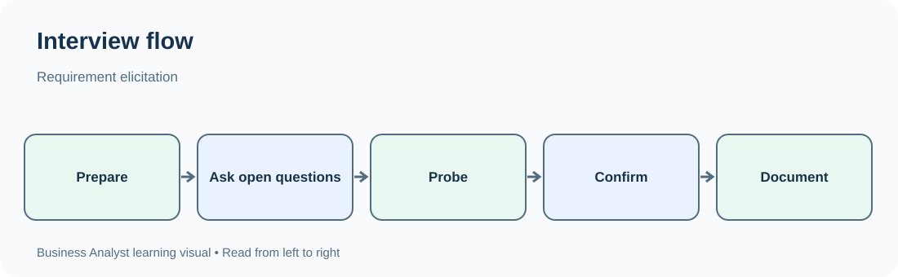
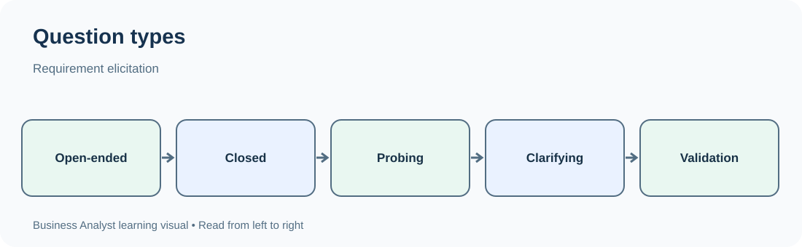

# TechPhile.ai --- Business Analyst Career Pathway

# Day 7: Requirement Elicitation, Interviews and Questionnaires

**Phase:** 2 --- Requirements Engineering\
**Approved syllabus topic:** Requirement elicitation, interviews and
questionnaires\
**Learning level:** Beginner to Intermediate\
**Estimated learning time:** 2--3 hours\
**Prerequisites:** Days 1--6 --- Business analysis foundations, business
problems and objectives, business domains and processes, stakeholder
identification and mapping, business needs and scope, and requirement
types.

------------------------------------------------------------------------

# 1. Learning Objectives

By the end of this lesson, you should be able to:

-   Explain requirement elicitation and distinguish it from simply
    collecting or documenting requirements.
-   Identify suitable stakeholders and prepare for an elicitation
    conversation.
-   Plan and conduct a structured or semi-structured stakeholder
    interview.
-   Write open-ended, closed-ended, probing, clarifying and follow-up
    questions.
-   Design a questionnaire that gathers useful and unbiased information.
-   Choose between interviews and questionnaires based on the situation.
-   Record responses accurately, identify gaps and confirm your
    understanding with stakeholders.
-   Recognize common elicitation mistakes and explain how to avoid them.

# 2. Why Requirement Elicitation Matters

Imagine a college wants to replace its manual student admission process
with an online admission portal.

The college management says:

> "We need an online admission system."

That statement is not enough to build a useful solution. The Business
Analyst needs to understand:

-   How students currently apply.
-   Which documents students submit.
-   Who checks the documents.
-   How application fees are paid.
-   How admission decisions are made.
-   How students learn whether they have been accepted.
-   What happens when a document is missing or a payment fails.
-   Which reports management needs.

A BA cannot discover all of this by guessing. The BA interacts with
people who understand the current process and the people who will use or
be affected by the new solution.

This activity is called **requirement elicitation**.

**Main idea:** Elicitation is the deliberate process of drawing out
information from stakeholders and other sources so that the BA can
understand needs, expectations, problems, rules and requirements.

A stakeholder may not describe a need in formal requirement language.
They may explain a frustration, tell a story about a recent incident, or
request a particular feature. The BA's job is to listen, investigate and
clarify the underlying need.

# 3. Words You Need

  -----------------------------------------------------------------------
  Term                    Plain-English meaning   Example
  ----------------------- ----------------------- -----------------------
  Elicitation             Drawing out information Asking admission staff
                          to understand needs and how they verify student
                          requirements            documents

  Elicitation technique   A method used to obtain Interview,
                          information             questionnaire, workshop
                                                  or observation

  Interview               A planned conversation  Speaking with the
                          used to explore a topic admissions manager

  Interviewee             The person being        An admissions officer
                          interviewed             

  Interviewer             The person asking       The Business Analyst
                          questions and guiding   
                          the conversation        

  Questionnaire           A prepared set of       Asking 200 students
                          questions sent to a     about problems with the
                          group of people         current application
                                                  process

  Open-ended question     A question that allows  "What problems do you
                          a detailed answer       face during admission?"

  Closed-ended question   A question with a       "Do you currently
                          limited set of possible submit documents
                          answers                 online? Yes/No"

  Probing question        A follow-up question    "Can you explain why
                          that explores an answer that happens?"
                          more deeply             

  Clarifying question     A question that checks  "When you say 'slow',
                          the exact meaning of a  do you mean the page
                          statement               takes a long time to
                                                  load or staff take a
                                                  long time to approve
                                                  it?"

  Follow-up question      A question asked to     "Who approves the final
                          obtain missing detail   application?"
                          or confirm an earlier   
                          answer                  

  Bias                    A factor that unfairly  Asking, "You agree the
                          influences a response   old system is bad,
                                                  right?"

  Response rate           The proportion of       60 responses from 100
                          people who return a     people invited = 60%
                          questionnaire           

  Interview guide         A prepared list of      Questions about
                          topics and questions    application submission,
                          for an interview        verification and
                                                  approval

  Notes / elicitation     A record of what was    A dated record of an
  record                  said, observed or       officer's explanation
                          discovered              of document checks

  Confirmation            Checking with a         Sending a short summary
                          stakeholder that the BA for the officer to
                          understood the          verify
                          information correctly   
  -----------------------------------------------------------------------

# 4. Understanding Requirement Elicitation

## 4.1 Elicitation is more than asking questions

A BA does not simply ask, "What features do you want?" and write down
the answers.

A useful elicitation process involves:

1.  Understanding the business context.
2.  Identifying the people and information sources that can explain the
    situation.
3.  Selecting suitable elicitation techniques.
4.  Preparing questions and materials.
5.  Conducting the elicitation activity.
6.  Recording information and evidence.
7.  Identifying unclear, missing or conflicting information.
8.  Following up with stakeholders.
9.  Confirming the BA's understanding.
10. Organizing the findings for further analysis.

**Example**

An admissions officer says:

> "We need the system to reject incomplete applications."

The BA should not immediately write a requirement that every incomplete
application must be rejected. The BA should explore the statement:

-   What makes an application incomplete?
-   Should the student be allowed to save a draft?
-   Can the student submit first and provide a missing document later?
-   Should the system show which document is missing?
-   Is there a deadline after which an incomplete application is
    rejected?
-   Who can override the rule?

The original statement may represent a business rule, a workflow need or
a proposed solution. Elicitation helps discover the actual requirement.

## 4.2 Elicitation versus related BA activities

  -----------------------------------------------------------------------
  Activity                Main purpose            Example
  ----------------------- ----------------------- -----------------------
  Elicitation             Discover information    Interviewing admissions
                          and needs               staff

  Analysis                Examine information,    Finding that two
                          relationships,          departments use
                          conflicts and gaps      different document
                                                  rules

  Specification /         Record requirements in  Writing a functional
  documentation           a clear structure       requirement for
                                                  document upload

  Validation              Check that requirements Asking the admissions
                          represent stakeholder   manager to confirm the
                          needs                   requirement

  Verification            Check that documented   Checking whether a
                          requirements meet       requirement is clear
                          quality standards       and testable
  -----------------------------------------------------------------------

These activities are connected, but they are not identical. Elicitation
provides information that the BA later analyzes, documents and
validates.

## 4.3 Sources of elicitation information

Information can come from more than interviews.

  -----------------------------------------------------------------------
  Source                  What the BA can learn   Example
  ----------------------- ----------------------- -----------------------
  Stakeholders            Needs, expectations,    Students, admission
                          frustrations and        officers and managers
                          decisions               

  Existing documents      Current rules and       Admission policy and
                          recorded procedures     application forms

  Existing systems        Current fields,         The college's existing
                          workflows and           admission portal
                          limitations             

  Reports and data        Patterns, volumes and   Number of applications
                          performance             rejected each month

  Policies and            Mandatory conditions    Required identity or
  regulations                                     education documents

  Operational records     Real examples of        Support tickets and
                          problems                complaint logs
  -----------------------------------------------------------------------

Day 8 covers workshops, brainstorming, observation and document analysis
in more detail. Today, the focus is on interviews and questionnaires.

# 5. Interviews

## 5.1 What is a stakeholder interview?

A stakeholder interview is a planned conversation between the BA and one
or more stakeholders to understand a business situation, process, need
or requirement.

Interviews are useful when the BA needs detailed explanations, examples,
clarification or an opportunity to ask follow-up questions.

**Example:** The BA interviews an admissions officer to understand how
applications are checked and approved.

## 5.2 When should you use interviews?

Use interviews when:

-   The topic is complex and needs detailed explanation.
-   The stakeholder has specialist knowledge.
-   The BA needs to understand why a problem occurs.
-   Answers may lead to additional questions.
-   The stakeholder's statements need clarification.
-   The BA needs to understand exceptions and unusual situations.
-   The topic is sensitive and a private conversation is more
    appropriate than a group questionnaire.

Interviews may be less suitable when hundreds of people need to be
consulted and the questions are mostly simple and standardized.

## 5.3 Types of interviews

### A. Structured interview

The interviewer follows a fixed list of questions in a planned order.

**Example questions:**

1.  How many admission applications do you process per day?
2.  Which documents do you verify?
3.  How many staff members perform verification?
4.  How are rejected applications communicated to students?

**Advantages** - Consistent questions across interviewees. - Easier to
compare answers. - Useful when information must be collected in a
standard format.

**Limitations** - Less flexibility to explore unexpected information. -
May miss important details that were not anticipated.

### B. Unstructured interview

The interviewer uses broad topics and allows the conversation to develop
naturally.

**Example opening:**

> "Please walk me through how you handle a student's application from
> the moment it arrives."

**Advantages** - Encourages detailed explanations. - Can reveal
unexpected problems. - Useful during early discovery when the BA knows
little about the process.

**Limitations** - Conversations may move away from the topic. -
Different stakeholders may provide very different levels of detail. -
Comparing answers can be difficult.

### C. Semi-structured interview

The interviewer prepares important questions but can ask additional
questions based on the answers.

**Example:** - Prepared question: "How do you verify submitted
documents?" - Follow-up: "What happens when the document is unclear?" -
Clarification: "Does the application remain pending until the student
uploads a replacement?"

**Advantages** - Balances consistency and flexibility. - Supports deeper
investigation. - Often useful for business analysis interviews.

**Remember:** A structured interview follows a fixed script; an
unstructured interview is flexible; a semi-structured interview combines
prepared questions with follow-ups.

## 5.4 Who should be interviewed?

Choose interviewees based on the information needed, not only their job
titles.

For an admission portal, possible interviewees include:

  -----------------------------------------------------------------------
  Stakeholder                         What to explore
  ----------------------------------- -----------------------------------
  Admissions manager                  Business goals, approval rules and
                                      performance expectations

  Admissions officer                  Daily processing steps, exceptions
                                      and workload

  Student                             Application experience, confusion
                                      and communication needs

  Finance officer                     Fee calculation, payment
                                      confirmation and refunds

  IT support staff                    Current system issues, access and
                                      integration limitations

  Management                          Reports, targets and decisions
  -----------------------------------------------------------------------

One person may not know the complete process. For example, an admissions
officer may understand document verification but may not know how the
finance team handles refunds.

## 5.5 Preparing for an interview

A good interview begins before the meeting.

### Step 1: Define the interview objective

Write down what you need to learn.

Weak objective:

> "Understand the admission process."

Better objective:

> "Understand how admissions officers receive applications, verify
> documents, identify incomplete submissions and decide whether an
> application can move to approval."

### Step 2: Select the interviewee

Choose someone who performs, manages, uses or is affected by the
process.

### Step 3: Review existing information

Read available process documents, forms, policies or previous notes.
This prevents the BA from asking questions that have already been
answered.

### Step 4: Prepare an interview guide

Group questions by topic, for example:

-   Current process.
-   Roles and responsibilities.
-   Problems and delays.
-   Business rules.
-   Exceptions.
-   Desired outcomes.
-   Reports and information needs.

### Step 5: Arrange the meeting

Confirm: - Purpose of the interview. - Date and time. - Expected
duration. - Participants. - Meeting location or online meeting link. -
Whether any documents should be available.

### Step 6: Prepare how information will be recorded

Use a notebook or a structured document. Record important statements
accurately. If recording audio is considered, obtain permission first
and follow organizational privacy rules.

## 5.6 Conducting an interview: step by step

  -----------------------------------------------------------------------
  Stage                   What the BA does        Example
  ----------------------- ----------------------- -----------------------
  1\. Opening             Introduces the purpose  "I want to understand
                          and confirms the time   the current document
                          available               verification process."

  2\. Context             Asks the stakeholder to "What are your
                          explain their role      responsibilities during
                                                  admission?"

  3\. Exploration         Asks questions about    "What happens after an
                          the current process     application is
                                                  submitted?"

  4\. Probing             Investigates important  "What causes most
                          answers                 applications to be
                                                  delayed?"

  5\. Exceptions          Explores unusual        "What happens if a
                          situations              student uploads the
                                                  wrong document?"

  6\. Confirmation        Summarizes the          "So the application
                          understanding           stays pending until the
                                                  missing document is
                                                  received. Is that
                                                  correct?"

  7\. Closing             Asks whether anything   "Is there another issue
                          important was missed    we should discuss?"

  8\. After the meeting   Organizes notes and     Sends a summary for
                          follows up              confirmation
  -----------------------------------------------------------------------

### Opening example

> "Thank you for your time. I am studying the current admission process
> so that we can understand the problems and identify what the improved
> process needs to support. I will ask about your current activities,
> common delays and exceptions. I may summarize some answers to confirm
> that I have understood them correctly."

### Closing example

> "Let me summarize what I understood. Applications are first checked
> for completeness. If a document is missing, the application remains
> pending and the student is contacted. Once all documents are verified,
> it moves to the approval stage. Is that accurate? Is there anything
> important I have missed?"

## 5.7 Interview question types

A strong BA uses different question types for different purposes.

  -----------------------------------------------------------------------
  Question type           Purpose                 Example
  ----------------------- ----------------------- -----------------------
  Open-ended              Encourage detailed      "How do you currently
                          answers                 process an
                                                  application?"

  Closed-ended            Obtain a specific       "Do you verify
                          answer                  documents before
                                                  payment? Yes or no?"

  Probing                 Explore a response more "Why does that delay
                          deeply                  happen?"

  Clarifying              Remove ambiguity        "When you say
                                                  'approval', which
                                                  manager approves it?"

  Follow-up               Obtain missing details  "What happens after the
                                                  manager rejects it?"

  Hypothetical            Explore a possible      "What should happen if
                          situation               the payment gateway is
                                                  unavailable?"

  Reflective /            Check understanding     "So the student
  confirmation                                    receives an email after
                                                  approval, correct?"

  Ranking /               Understand relative     "Which of these three
  prioritization          importance              delays causes the
                                                  greatest impact?"
  -----------------------------------------------------------------------

### Open-ended questions

Open-ended questions usually begin with words such as: - What? - How? -
Why? - Describe... - Explain... - Walk me through...

Examples: - "What problems do students face while submitting
applications?" - "How do you decide whether a document is acceptable?" -
"Describe what happens when a payment fails."

They are useful for discovering information that the BA may not already
know.

### Closed-ended questions

Closed-ended questions usually have a limited answer.

Examples: - "Is the application currently processed through a web
portal?" - "Does the student receive an email after submission?" - "How
many staff members verify applications?"

They are useful for confirming facts and collecting comparable answers.
However, relying only on yes/no questions may hide the reason behind an
answer.

### Probing questions

A probing question explores an answer.

Stakeholder:

> "The verification process takes too long."

BA: - "How long does it normally take?" - "At which step does the delay
occur?" - "What usually causes the delay?" - "Does the delay happen for
every application or only some applications?"

A useful probe turns a general complaint into information that can be
investigated.

## 5.8 Asking neutral, unbiased questions

The wording of a question can influence the answer.

  -----------------------------------------------------------------------
  Leading or biased question          Neutral alternative
  ----------------------------------- -----------------------------------
  "You agree that the current portal  "How would you describe your
  is terrible, right?"                experience with the current
                                      portal?"

  "Wouldn't automatic approval save   "What changes, if any, would
  time?"                              improve the approval process?"

  "Why do staff keep making           "What factors contribute to errors
  mistakes?"                          during application processing?"

  "Don't you think students need SMS  "How should students be informed
  alerts?"                            about application updates?"
  -----------------------------------------------------------------------

**Rule:** Ask questions that allow the stakeholder to express their
actual view. Do not push them toward the answer you expect.

## 5.9 Interview note-taking

Record information in a structured way.

  -----------------------------------------------------------------------
  Field                               Example
  ----------------------------------- -----------------------------------
  Interview ID                        INT-01

  Date                                7 November 2026

  Interviewee                         Admissions Officer

  Role / department                   Admissions

  Interview objective                 Understand document verification

  Current activity                    Checks documents after application
                                      submission

  Problem stated                      Missing documents create repeated
                                      follow-ups

  Frequency / evidence                Stakeholder reports that this
                                      happens regularly; exact count not
                                      yet confirmed

  Business rule                       Application cannot proceed to final
                                      approval until mandatory documents
                                      are verified

  Open question                       Can students replace a document
                                      after the deadline?

  Follow-up owner                     BA

  Confirmation status                 Awaiting stakeholder confirmation
  -----------------------------------------------------------------------

Do not turn an unverified statement into a confirmed fact. If the
stakeholder estimates a number, record it as an estimate until evidence
is available.

## 5.10 After the interview

The BA should:

1.  Review notes soon after the conversation.
2.  Separate facts, opinions, assumptions and proposed solutions.
3.  Highlight unclear statements.
4.  Identify contradictions with other stakeholder responses.
5.  List unanswered questions.
6.  Write a short summary in clear language.
7.  Send the summary to the stakeholder when confirmation is needed.
8.  Update the requirement records only after the information is
    sufficiently understood.

**Example of a useful confirmation message:**

> "Thank you for explaining the document verification process. My
> understanding is that an application cannot move to final approval
> until all mandatory documents are verified. If a document is missing,
> the application remains pending and the student is contacted. Please
> confirm whether this summary is accurate and let me know if any
> exception applies."

# 6. Questionnaires

## 6.1 What is a questionnaire?

A questionnaire is a prepared set of questions distributed to a group of
people to collect information in a consistent format.

It may be delivered through: - Online forms. - Email. - Paper forms. - A
survey platform.

**Example:** A college sends a questionnaire to 500 students to
understand their experience with the existing admission process.

## 6.2 When should you use a questionnaire?

Use a questionnaire when:

-   You need information from many people.
-   Questions are relatively clear and standardized.
-   Respondents may be in different locations.
-   You need to compare responses.
-   You want to identify common patterns or preferences.
-   Stakeholders can answer independently without a long conversation.

A questionnaire is less suitable when the topic is highly complex,
respondents may misunderstand the questions, or the BA needs to explore
detailed explanations immediately.

## 6.3 Types of questionnaire questions

### A. Multiple-choice

Respondents select one or more options.

**Example:**

Which method do you currently use to submit admission documents?

-   In person.
-   Email.
-   Online portal.
-   Other.

State whether respondents may select one answer or multiple answers.

### B. Yes/No

**Example:**

Did you receive an application confirmation after submission?

-   Yes.
-   No.

This is quick to answer but provides limited detail.

### C. Rating scale

Respondents rate an experience.

**Example:**

How easy was it to submit your documents?

1 --- Very difficult\
2 --- Difficult\
3 --- Neither easy nor difficult\
4 --- Easy\
5 --- Very easy

Keep the scale balanced and explain what each end means.

### D. Likert-style agreement scale

Respondents indicate their level of agreement with a statement.

**Statement:** "The application status information is easy to
understand."

-   Strongly disagree.
-   Disagree.
-   Neither agree nor disagree.
-   Agree.
-   Strongly agree.

A rating scale may measure satisfaction or difficulty, while an
agreement scale measures agreement with a statement. Make sure the scale
matches what you want to measure.

### E. Ranking

Respondents order options by importance.

**Example:** Rank these improvements from most important to least
important: - Faster document verification. - Clear application status. -
SMS notifications. - Easier document upload.

Ranking is useful when you need relative preferences, but it can be
difficult for respondents when there are too many options.

### F. Open-text question

Respondents provide their own answer.

**Example:**

"What was the most difficult part of the admission process?"

Open-text answers can reveal unexpected issues, but they take more
effort to analyze.

## 6.4 Designing a good questionnaire

### Step 1: Define the objective

Weak objective:

> "Ask students about admission."

Better objective:

> "Identify the most common difficulties students experience while
> submitting documents and checking application status."

### Step 2: Identify the target respondents

Decide who should answer: - All students? - Only students who applied
this year? - Students whose applications were rejected? - Students who
completed the process?

The target group affects the meaning of the responses.

### Step 3: Choose the questions

Each question should help answer the questionnaire objective. Remove
questions that do not contribute useful information.

### Step 4: Use simple language

Avoid technical terms and internal organizational language.

Weak:

> "Did the document-validation workflow provide sufficient procedural
> transparency?"

Better:

> "Was it clear which documents you needed to submit and whether each
> document had been accepted?"

### Step 5: Avoid double-barrelled questions

A double-barrelled question asks about two things at once.

Weak:

> "Was the application form easy to complete and was the payment process
> fast?"

A respondent may find the form easy but payment slow.

Better: 1. "Was the application form easy to complete?" 2. "Was the
payment process fast?"

### Step 6: Avoid leading questions

Weak:

> "How much did you like our improved application portal?"

This assumes the respondent liked it.

Better:

> "How would you rate your experience with the application portal?"

### Step 7: Provide appropriate answer options

For a question about contact method, include an "Other" option if the
listed options may not cover every response. Include "Not applicable" or
"I don't know" when appropriate.

### Step 8: Arrange questions logically

A useful order is: 1. Introductory and eligibility questions. 2. General
experience questions. 3. Specific process questions. 4. Problems and
improvement suggestions. 5. Optional demographic or classification
questions, only when relevant and justified.

### Step 9: Keep it manageable

Long questionnaires can cause incomplete responses. Ask only what is
needed for the stated objective.

### Step 10: Test before distribution

Ask a small number of people to complete the questionnaire. Check
whether: - They understand each question. - Answer options are
complete. - Questions are neutral. - The form works on common devices. -
The time required is reasonable. - Responses can be analyzed as
intended.

This small test is often called a pilot or pilot test.

## 6.5 Example: Student admission questionnaire

**Purpose:** Understand student difficulties in the current admission
process.

**Introductory text:**

"We are collecting feedback to understand how students experience the
admission process. Your responses will be used to identify areas for
improvement. Please answer based on your most recent application
experience."

  ------------------------------------------------------------------------
                           No. Question              Question type
  ---------------------------- --------------------- ---------------------
                             1 Did you apply for     Yes/No
                               admission during the  
                               current academic      
                               year?                 

                             2 Which method did you  Multiple choice
                               use to submit your    
                               application?          

                             3 How easy was it to    1--5 rating
                               understand the        
                               required document     
                               list?                 

                             4 Did you experience    Yes/No
                               any difficulty        
                               uploading documents?  

                             5 If yes, please        Open text
                               describe the          
                               difficulty.           

                             6 Was your application  1--5 rating
                               status easy to        
                               understand?           

                             7 How did you prefer to Multiple choice
                               receive application   
                               updates?              

                             8 Which improvement     Multiple choice
                               would be most useful  
                               to you?               

                             9 What is one change    Open text
                               you would recommend?  
  ------------------------------------------------------------------------

**Important:** Question 5 should be shown conditionally only to
respondents who answered "Yes" to Question 4, if the form tool supports
conditional logic. If it does not, make the instruction clear.

## 6.6 Questionnaire response rate

Response rate indicates how many invited people submitted a response.

Example: - 100 students are invited. - 60 students submit responses.

Response rate = (Number of completed responses / Number invited) × 100

Response rate = (60 / 100) × 100 = 60%

A 60% response rate does not automatically mean the results represent
every student. The people who responded may differ from those who did
not. The BA should consider who responded and whether important groups
are missing.

## 6.7 Analyzing questionnaire responses

For closed-ended questions: - Count each answer. - Calculate percentages
where useful. - Compare responses across relevant groups. - Look for
common patterns.

For open-text questions: - Read responses carefully. - Group similar
comments into themes. - Count recurring themes where appropriate. - Keep
important unusual comments visible. - Avoid treating a few comments as
proof of a universal problem.

**Example:**

Out of 60 responses to "Did you experience difficulty uploading
documents?":

  Response     Number   Percentage
  ---------- -------- ------------
  Yes              36          60%
  No               24          40%
  Total            60         100%

Interpretation:

"Among the 60 respondents, 36 (60%) reported difficulty uploading
documents."

Do not claim that 60% of all students experienced the issue unless the
sample and collection method support that conclusion.

# 7. Interviews vs Questionnaires

  -----------------------------------------------------------------------
  Comparison              Interview               Questionnaire
  ----------------------- ----------------------- -----------------------
  Interaction             Direct conversation     Usually completed
                                                  independently

  Typical audience        One person or a small   Often many respondents
                          group                   

  Depth                   Can explore answers in  Depends on question
                          detail                  design; usually less
                                                  immediate depth

  Follow-up               Immediate follow-up     Follow-up may require
                          questions are possible  another message or
                                                  survey

  Consistency             Can vary between        Same questions can be
                          conversations           given to everyone

  Time per respondent     Usually higher          Usually lower

  Analysis                Notes may require       Closed responses can be
                          qualitative analysis    summarized; open
                                                  responses need coding
                                                  or grouping

  Best suited for         Complex topics and      Broad feedback and
                          detailed discovery      standardized
                                                  information

  Main risk               Interviewer influence   Low response rate,
                          or inconsistent         unclear questions or
                          coverage                biased sample
  -----------------------------------------------------------------------

**Practical rule:** - Use interviews to understand depth and reasons. -
Use questionnaires to collect standardized information from a wider
group. - Use both when the topic needs detailed discovery and broad
confirmation.

## 7.1 Combining interviews and questionnaires

A BA can use a questionnaire first to identify broad patterns, then
interview selected respondents to understand the reasons.

Alternatively, the BA can interview a few stakeholders first to discover
the right questions, then send a questionnaire to a larger group.

**Example:** 1. Interview five admissions officers to understand the
current verification process. 2. Use the interviews to identify common
problems. 3. Send a questionnaire to students to understand their
experience. 4. Compare the findings. 5. Follow up where the findings
conflict or important details remain unclear.

# 8. Worked Example --- Eliciting Requirements for an Admission Portal

## 8.1 Business context

A college wants to improve its admission process. Students report
confusion about required documents and application status. Admissions
staff spend time answering repeated questions.

## 8.2 Elicitation objective

Understand: - How students submit applications. - How staff verify
documents. - How missing documents are handled. - How application status
is communicated. - What information management needs.

## 8.3 Interview with an admissions officer

**BA:** "Please walk me through what happens after a student submits an
application."

**Officer:** "We check the application and verify the documents."

**BA:** "What happens if a document is missing?"

**Officer:** "We contact the student and wait for the document."

**BA:** "How does the student know which document is missing?"

**Officer:** "Usually, we send an email explaining it."

**BA:** "Can the student see the application status without contacting
the office?"

**Officer:** "Not consistently in the current process."

**BA:** "What happens after all documents are verified?"

**Officer:** "The application moves to the approval stage."

## 8.4 Record the findings

  -----------------------------------------------------------------------
  Finding                 Type of information     Confirmation needed?
  ----------------------- ----------------------- -----------------------
  Staff verify documents  Current process         Confirm with another
  after submission                                officer or process
                                                  evidence

  Missing documents lead  Current process /       Confirm permitted
  to student contact      business rule candidate contact methods and
                                                  exceptions

  Email is usually used   Current communication   Confirm whether other
  to explain missing      practice                channels are used
  documents                                       

  Students cannot         Reported process        Check with students and
  consistently view       problem                 current system
  status                                          

  Verified applications   Process rule candidate  Confirm approval roles
  move to approval                                and conditions
  -----------------------------------------------------------------------

## 8.5 Example questionnaire findings

Suppose 60 students respond: - 36 report difficulty uploading
documents. - 42 say application status is not clear. - 48 prefer email
notifications. - 30 request a page that lists missing documents.

These results suggest areas for further investigation. They do not by
themselves prove the cause of the problems or define the complete
solution.

## 8.6 From elicitation information to candidate requirements

The BA may identify candidate requirements such as:

-   Students need to know which documents are required.
-   Students need to understand whether their application is pending,
    under review or approved.
-   Staff need to identify missing or invalid documents.
-   Students should receive an update when the application status
    changes.

These are initial findings. The BA must clarify details, classify the
requirements, check rules and exceptions, and validate the wording with
stakeholders before treating them as agreed requirements.

# 9. Common Mistakes and How to Avoid Them

  -----------------------------------------------------------------------
  Mistake                 Why it causes problems  Better approach
  ----------------------- ----------------------- -----------------------
  Asking only "What do    Stakeholders may jump   Ask about current work,
  you want?"              to a solution without   problems, outcomes and
                          explaining the need     exceptions

  Asking leading          Influences the answer   Use neutral wording
  questions                                       

  Interrupting the        Important context may   Listen fully and take
  stakeholder             be missed               notes

  Asking multiple         The stakeholder may     Ask one clear question
  questions at once       answer only part of the at a time
                          question                

  Using technical         Stakeholders may        Use everyday language
  language unnecessarily  misunderstand           

  Interviewing only       Daily operational       Include people who
  managers                problems may be missed  perform the work

  Assuming one            Other groups may have   Identify relevant
  stakeholder represents  different needs         stakeholder groups
  everyone                                        

  Recording opinions as   Findings may be         Label opinions and
  facts                   misleading              verify evidence

  Writing requirements    The BA may document an  Record the statement,
  during the conversation incorrect               investigate and confirm
  without clarification   interpretation          

  Making a questionnaire  Respondents may abandon Keep only relevant
  too long                it                      questions

  Using double-barrelled  Answers become          Split questions
  questions               difficult to interpret  

  Ignoring                Results may not         Examine response
  non-respondents         represent the target    coverage and
                          group                   limitations

  Failing to confirm      Misunderstandings       Summarize and request
  findings                remain hidden           confirmation
  -----------------------------------------------------------------------

# 10. Interview Preparation Checklist

Before an interview:

-   [ ] Define the objective.
-   [ ] Identify the stakeholder and why their input matters.
-   [ ] Review available background documents.
-   [ ] Prepare an interview guide.
-   [ ] Include open-ended and follow-up questions.
-   [ ] Avoid leading and double-barrelled questions.
-   [ ] Confirm meeting details.
-   [ ] Prepare a note-taking format.

During an interview:

-   [ ] Explain the purpose.
-   [ ] Listen without interrupting unnecessarily.
-   [ ] Ask one clear question at a time.
-   [ ] Probe vague statements.
-   [ ] Explore exceptions and business rules.
-   [ ] Separate facts from opinions.
-   [ ] Summarize key points for confirmation.

After an interview:

-   [ ] Organize the notes.
-   [ ] Identify gaps and contradictions.
-   [ ] Record follow-up questions.
-   [ ] Share a summary where confirmation is required.
-   [ ] Update requirement records carefully.

# 11. Interview Questions and Answers

## Q1. What is requirement elicitation?

**Answer:**

Requirement elicitation is the process of discovering and understanding
stakeholder needs, expectations, business rules, problems and
requirements. A BA uses techniques such as interviews and questionnaires
to obtain information and then analyzes and confirms the findings.

## Q2. What is the difference between requirement elicitation and requirement gathering?

**Answer:**

The terms are often used similarly in everyday project conversations.
Elicitation emphasizes actively drawing out information through
interaction and investigation, rather than simply collecting statements
that stakeholders provide. The BA asks questions, probes, clarifies and
checks understanding.

## Q3. What is a stakeholder interview?

**Answer:**

A stakeholder interview is a planned conversation with a person who has
relevant knowledge, needs or responsibilities. It helps the BA
understand processes, problems, expectations, rules and exceptions.

## Q4. What are the three common interview structures?

**Answer:**

-   Structured: follows a fixed set of questions.
-   Unstructured: flexible conversation guided by broad topics.
-   Semi-structured: uses prepared questions but allows follow-up
    questions.

A semi-structured interview is useful when the BA needs both consistency
and flexibility.

## Q5. What is the difference between open-ended and closed-ended questions?

**Answer:**

An open-ended question allows a detailed answer, such as "What problems
do you face during document verification?" A closed-ended question
limits the answer, such as "Do you verify documents before approval?"
Both are useful for different purposes.

## Q6. What is a probing question?

**Answer:**

A probing question explores an answer more deeply. If a stakeholder says
the process is slow, the BA may ask, "Which step takes the most time?"
or "What usually causes the delay?"

## Q7. What is a leading question? Give an example.

**Answer:**

A leading question is worded in a way that suggests or encourages a
particular answer. For example, "You agree that the old portal is
difficult to use, right?" A neutral alternative is, "How would you
describe your experience with the current portal?"

## Q8. What is a questionnaire?

**Answer:**

A questionnaire is a prepared set of questions distributed to
respondents to collect information in a consistent format. It is useful
when the BA needs standardized feedback from a relatively large group.

## Q9. When would you choose an interview instead of a questionnaire?

**Answer:**

I would choose an interview when the topic is complex, I need detailed
explanations, or I expect to ask follow-up questions. I would choose a
questionnaire when I need standardized information from many people and
the questions are clear enough to be answered independently.

## Q10. How do you ensure that interview findings are accurate?

**Answer:**

I prepare the interview, ask clear and neutral questions, take
structured notes, distinguish facts from opinions, investigate unclear
statements and summarize the findings for stakeholder confirmation. I
also compare information from relevant sources where necessary.

## Q11. What is a double-barrelled question?

**Answer:**

It is a question that asks about two separate matters at once. For
example, "Was the form easy to use and was the payment process fast?"
The respondent may have different opinions about each part. The BA
should split it into two questions.

## Q12. What is response rate?

**Answer:**

Response rate is the percentage of invited respondents who submit a
response. If 60 people respond out of 100 invited, the response rate is
60%. A high response rate does not automatically guarantee that the
results represent the entire target population.

## Q13. Why should a BA confirm interview findings with stakeholders?

**Answer:**

Confirmation helps identify misunderstandings and missing details before
the information is used in requirements. It gives stakeholders an
opportunity to correct the BA's interpretation.

## Q14. How would you handle two stakeholders giving conflicting answers?

**Answer:**

I would record both statements without choosing one prematurely. I would
clarify the context and ask for examples or supporting policies. I would
identify whether the difference is caused by role, location, process
variation or a genuine conflict in business rules, then arrange the
appropriate discussion to resolve it.

## Q15. What would you do if a stakeholder gives only vague answers?

**Answer:**

I would use probing and clarifying questions, ask for a recent real
example, and request the stakeholder to explain the process step by
step. For example, instead of accepting "approval takes too long," I
would ask how long it takes, where the delay occurs and what usually
causes it.

# 12. Knowledge Check

Try answering these questions before checking the answers.

1.  What is requirement elicitation?
2.  Which interview type uses prepared questions but allows follow-ups?
3.  Is "What problems do you face during admission?" open-ended or
    closed-ended?
4.  What is wrong with the question, "You like the new portal, don't
    you?"
5.  When is a questionnaire more suitable than an interview?
6.  What should a BA do after an interview?
7.  What is a double-barrelled question?
8.  If 40 people respond out of 80 invited, what is the response rate?
9.  Why should the BA include operational staff in stakeholder
    interviews?
10. Does a questionnaire response automatically represent the opinion of
    every person in the target group?

## Answers

1.  A process of actively discovering stakeholder needs, expectations,
    problems and requirements.
2.  Semi-structured interview.
3.  Open-ended.
4.  It is leading and encourages a particular answer.
5.  When standardized information is needed from a larger group and the
    questions are suitable for independent responses.
6.  Organize notes, identify gaps and contradictions, record follow-ups
    and confirm findings with stakeholders where needed.
7.  A question that asks about two different matters at once.
8.  (40 / 80) × 100 = 50%.
9.  They understand daily activities, exceptions and operational
    problems that managers may not see directly.
10. No. The BA must consider the respondents, response coverage and
    possible bias.

# 13. Day 7 Revision Sheet

  -----------------------------------------------------------------------
  Topic                               Remember
  ----------------------------------- -----------------------------------
  Requirement elicitation             Actively discover needs and
                                      information

  Interview                           Planned conversation with a
                                      stakeholder

  Structured interview                Fixed questions and order

  Unstructured interview              Flexible conversation

  Semi-structured interview           Prepared questions plus follow-ups

  Open-ended question                 Encourages explanation

  Closed-ended question               Limited answer options

  Probing question                    Explores an answer

  Clarifying question                 Checks exact meaning

  Leading question                    Pushes toward a particular answer

  Questionnaire                       Standardized questions for
                                      respondents

  Double-barrelled question           Two questions combined into one

  Response rate                       Completed responses divided by
                                      invitations, multiplied by 100

  Confirmation                        Checks that the BA understood
                                      correctly
  -----------------------------------------------------------------------

**A useful BA habit:** Never assume that the first statement you hear is
the complete requirement. Ask, listen, probe, record and confirm.

## Visual learning aids

# 14. Day 7 Completion Checklist

-   [ ] I can explain requirement elicitation in simple language.
-   [ ] I can distinguish elicitation from analysis, documentation and
    validation.
-   [ ] I can explain structured, unstructured and semi-structured
    interviews.
-   [ ] I can prepare an interview objective and question guide.
-   [ ] I can write open-ended, closed-ended, probing and clarifying
    questions.
-   [ ] I can recognize leading and double-barrelled questions.
-   [ ] I can explain when to use interviews and questionnaires.
-   [ ] I can design clear and neutral questionnaire questions.
-   [ ] I can calculate response rate and explain its limitations.
-   [ ] I can organize interview findings and confirm them with
    stakeholders.
-   [ ] I can answer the interview questions without relying on the
    notes.

------------------------------------------------------------------------

**Day 7 complete --- Requirement Elicitation, Interviews and
Questionnaires.**

**Next syllabus topic --- Day 8: Workshops, brainstorming, observation
and document analysis.**
